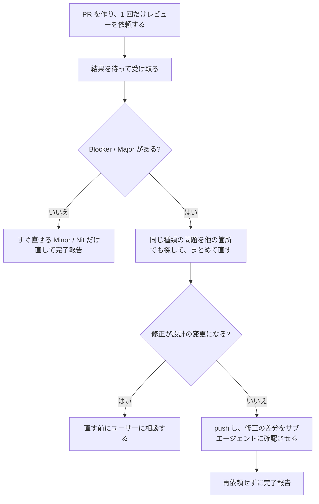

# レビュー依頼は 1 PR につき 1 回

Codex / CodeRabbit へのレビュー依頼は、PR を作った直後の 1 回だけにする。指摘を直したあとに再依頼はしない。
[[feedback-codex-auto-loop]] と [[feedback-coderabbit-fallback]] の待ち受けは、この 1 回の結果を受け取るために使う。

## ルール

| # | ルール | 中身 |
|---|---|---|
| 1 | **依頼は 1 回** | `@codex review` は PR 作成直後に 1 回だけ投稿する。修正 push 後に再依頼しない。Codex が利用上限で返さず CodeRabbit に切り替えた場合は、`@coderabbitai review` の 1 回をその 1 回とみなす。 |
| 2 | **直す範囲** | Blocker / Major はすべて直す。Minor / Nit は、すぐ直せるものだけ直す。`[Future]` は計画書の「未決事項」に 1 行追記する。 |
| 3 | **まとめて直す** | 指摘を 1 件直したら、同じ種類の問題がほかにないかを `grep` で探して同じコミットで直す。同じ内容を複数の文書に書いている場合は、要約を消してリンクにする。 |
| 4 | **修正の確認** | 再レビューの代わりに、修正の差分をサブエージェントに読み取り専用で確認させる（[[feedback-subagent-review]]）。コード変更ならビルドと `ctest` も通す。 |
| 5 | **PR を太らせない** | レビュー後の PR に、指摘と関係ない作業を足さない。別ブランチ・別 PR にする。 |
| 6 | **重要度を自分で確かめる** | `[Major]` と付いていても、[review-guidelines.md](../../Docs/agents/review-guidelines.md) の Major の条件に当たらなければ Minor として扱ってよい。理由を 1 行で返信する。ただし、重点観点や `.claude/rules/` の規約への違反は格下げしない。 |

## 重要度の読み替え

Codex は独自に P0〜P3 を付けることがある。次のように読み替える。

| Codex | このルールでの扱い |
|---|---|
| P0 / P1 | Blocker |
| P2 | Major（ルール 6 で Minor に下げてよい） |
| P3 | Minor |

## 補足

- 方針そのものを差し戻す指摘（タスク分割のやり直しなど）や、設計の変更になる修正は、直す前にユーザーに相談する。
- 完了報告には「直した指摘」と「残した Minor / Nit」を書く。
- ユーザーが再レビューを頼んだときは、その指示に従う。

## Why

2026-11-05 にユーザーから「レビューが数十回に及ぶことがあり、開発が進まない」と指摘された。原因は次の 2 つだった。

- **PR #181**（ドキュメントのみ）：依頼 17 回・inline 指摘 58 件。未実装の hook 設計について、Codex がすり抜けの穴を 1 つずつ指摘した。直すたびに設計が細かくなり、その細部にまた穴が見つかった。同じ要約を CLAUDE.md・workflow.md・memory-index に書いていたので「別の文書と食い違っている」という指摘も繰り返し出た。
- **PR #182**：レビュー中に、別件の Stop hook を同じ PR に追加した。その hook だけで 6 往復増えた。

無制限に繰り返すと、文書が厚くなるだけで品質は上がらない。当初は「依頼は 3 回まで」としたが、同日にユーザーが「1 PR あたり依頼 1 回でいい」と決めた。

関連：[[feedback-codex-auto-loop]] / [[feedback-coderabbit-fallback]] / [[feedback-plan-docs-consistency]] / [Docs/agents/review-guidelines.md](../../Docs/agents/review-guidelines.md)
