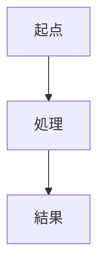

# 理解度_<対象名>

- 日付 / Date: <YYYY-MM-DD>
- 対象 / Target: <PR #NNNN / コミット <hash> / ファイル群>
- 目的 / Goal: この変更（コード）を、何も見ずに再現できる状態にする

## 全体図 / Overview

なぜこの変更が必要だったか（1文）: <一文で>

## 理解度表 / Comprehension Table

<!-- このブロックを、進捗のたびに丸ごと最新版へ差し替える -->
<!-- 初期化時: 「説明」は短く埋めてよい。「詳細（なぜ）」は空で始め、フェーズBでユーザーがリコールして埋める。 -->

| ファイル名 | 説明 | 詳細（工夫・意図） | 理解度 | 分かっていない部分 |
| --- | --- | --- | --- | --- |
| <file1> | <何が変わった/何をする> | <初期は空。ユーザーが「なぜそう書いたか」を再生して埋める> | 未着手 |  |
| <file2> |  |  | 未着手 |  |

**サマリー / Summary**
- 平均理解度: <NN>%
- 100%まで残り: <N> 項目
- 次に読むと効率が良いファイル: <file>

## 学習ログ / Session Log

<!-- セッションごとに1行追記。差分が分かる形で残す -->

- <YYYY-MM-DD>: <このセッションで進めたこと。例: file1 を 0→100%、file2 の「なぜQList?」が残課題>

## 未確認事項 / Open Questions

- <まだ解けていない疑問。解けたら理解度表の該当行へ移して消す>
