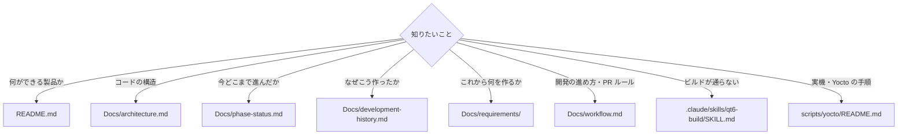

# ドキュメント地図

このリポジトリの文書は **人間が読むもの** と **AI エージェント（Claude Code / Codex）への指示** が混在しています。
本ファイルは「どれを読めばよくて、どれを読まなくていいか」の一覧です。

**人間が最初に読むのはこの 3 つだけで足ります。**

| # | ファイル | 何が分かるか |
|---|---|---|
| 1 | [README.md](README.md) | Atlas とは何か、何ができるか、どうビルドして動かすか |
| 2 | [Docs/architecture.md](Docs/architecture.md) | 3 つのアプリ（Editor / Simulator / Runtime）とモジュール構成 |
| 3 | [Docs/phase-status.md](Docs/phase-status.md) | 今どこまで実装済みか（**進捗の正本**） |

---

## 目的別の入口



---

## 全体ツリー

凡例 — 読者：**[人]** 人間向け / **[AI]** エージェント設定（人間は読まなくてよい） / **[人+AI]** 両方
　　　鮮度：**現行** 今も正しい / **記録** 過去の記録（現在の仕様ではない） / **⚠️** 内容が古い

> **計画書のパス規約**：**進行中** のフェーズ計画は `Docs/` 直下（`Docs/phase*-plan.md`）、
> **完了済み** は `Docs/archive/` 配下（`Docs/archive/phase*-plan.md`）。新規の計画書は必ず `Docs/` 直下に作り、
> フェーズ完了時に `Docs/archive/` へ移して本ファイルと [Docs/archive/README.md](Docs/archive/README.md) を更新する。

```
hmi-platform/
├─ README.md                    [人]    現行  入口。製品概要・ビルド・実行
├─ DOCS-MAP.md                  [人]    現行  このファイル
├─ CLAUDE.md                    [AI]    現行  Claude Code への作業指針
├─ AGENTS.md                    [AI]    現行  ChatGPT Codex への作業指針
│
├─ Docs/                        ── 人間向けが中心
│   ├─ architecture.md          [人]    現行  モジュール構成・アプリの役割
│   ├─ phase-status.md          [人]    現行  進捗の正本
│   ├─ development-history.md   [人]    記録  タスク単位の開発経緯・PR・学び
│   ├─ requirements/            [人+AI] 現行  関心別の要求仕様書 11 本（REQ/ACC 管理表）。索引は README.md
│   ├─ requirements.md          [人]    現行  上記への案内（旧版は archive/requirements-legacy.md）
│   ├─ workflow.md              [人+AI] 現行  開発ルール・PR ワークフロー
│   ├─ refactoring-plan.md      [人+AI] 現行  進行中フェーズの計画・進捗表
│   ├─ phase7-modbus-plan.md    [人+AI] 現行  Modbus（実機作業 MB-5/6 が未完のため現行）
│   ├─ claude-web-dev.md        [人+AI] 現行  Claude on the Web での開発環境手順
│   │
│   ├─ agents/                  [AI]    現行  エージェント専用の設定・ガイド
│   │   ├─ review-guidelines.md         Codex のレビュー作法（日本語・指摘の粒度）
│   │   ├─ domain.md                    着手前に読むべき資料の指定
│   │   └─ issue-tracker.md             GitHub Issues を使わない旨と代替
│   │
│   ├─ archive/                 [AI/記録] 完了フェーズの実装指示書 17 本 + 旧要求仕様 1 本（現在の仕様ではない）
│   │   └─ README.md            [人]    現行  archive の中身一覧
│   │
│   ├─ samples/                 [人+AI] 現行  デモ用プロジェクト JSON（9 件）
│   └─ screenshots/             [人]    現行  README 掲載画像・動作証跡（47 件）
│
├─ .claude/                     [AI]    ── ほぼ全部が Claude Code の動作設定。人間は読まなくてよい
│   ├─ rules/*.md  (20)                 常時読み込まれる規約・環境メモ・ユーザーの好み
│   ├─ skills/*/SKILL.md (10)           手順書（ビルド / PR / E2E / スクショ 等）
│   ├─ agents/*.md (2)                  サブエージェント定義
│   ├─ commands/*.md (1)                スラッシュコマンド定義
│   └─ settings.json                    プラグイン・hooks 設定
│
├─ scripts/
│   ├─ yocto/README.md          [人]    現行  Yocto クロスビルド・i.MX8MP 実機展開の手順
│   └─ opcua/README.md          [人]    現行  OPC-UA 手動テストサーバの起動手順
│
└─ .github/workflows/ci.yml     [人+AI] 現行  CI 構成（linux=self-hosted / desktop=ラベル時のみ）
```

---

## 人間向け（現行）

| ファイル | 行 | 内容 |
|---|---|---|
| [README.md](README.md) | 172 | 製品概要・対応 Widget・クイックスタート・現在地 |
| [Docs/architecture.md](Docs/architecture.md) | 43 | Editor / Simulator / Runtime とモジュール構成 |
| [Docs/phase-status.md](Docs/phase-status.md) | 49 | フェーズ進捗の正本 |
| [Docs/workflow.md](Docs/workflow.md) | 54 | ブランチ規約・PR・レビュー・完了基準 |
| [Docs/refactoring-plan.md](Docs/refactoring-plan.md) | 76 | 進行中のリファクタリング計画と進捗表 |
| [Docs/claude-web-dev.md](Docs/claude-web-dev.md) | 102 | Claude on the Web での開発セットアップ |
| [Docs/phase7-modbus-plan.md](Docs/phase7-modbus-plan.md) | 153 | Modbus TCP。MB-5/6（実機）が未完 |
| [scripts/yocto/README.md](scripts/yocto/README.md) | 144 | Yocto SDK クロスビルド・実機転送・VNC キャプチャ |
| [scripts/opcua/README.md](scripts/opcua/README.md) | 45 | OPC-UA テストサーバの起動 |

## 人間向け（記録・要注意）

| ファイル | 行 | 注意点 |
|---|---|---|
| [Docs/development-history.md](Docs/development-history.md) | 463 | 時系列の開発経緯。「今どうなっているか」ではなく「どう作ってきたか」 |
| [Docs/requirements/](Docs/requirements/README.md) | 11 本 | 関心別の要求仕様書。各書に REQ/ACC 表。旧版は [archive/requirements-legacy.md](Docs/archive/requirements-legacy.md)（実装状況が古い） |
| [Docs/archive/](Docs/archive/) | 18 本 | 完了フェーズの実装指示書。仕様書ではない |
| [Docs/archive/qml-canvas-structure.md](Docs/archive/qml-canvas-structure.md) | 46 | **⚠️ 内容が実装と乖離**（Canvas.qml は現在 1,244 行） |

## AI エージェント向け（人間は読まなくてよい）

| 場所 | 件数 | 役割 |
|---|---|---|
| [CLAUDE.md](CLAUDE.md) | 1 | Claude Code への作業指針。冒頭に「Claude Code への指針です」と明記 |
| [AGENTS.md](AGENTS.md) | 1 | ChatGPT Codex への作業指針 |
| [Docs/agents/](Docs/agents/) | 3 | レビュー作法・ドメイン資料の指定・課題管理の代替 |
| `.claude/rules/*.md` | 20 | 常時読み込まれる規約。環境固有の罠、ユーザーの応答スタイルの好みなど |
| `.claude/skills/*/SKILL.md` | 10 | エージェントが実行する手順書 |
| `.claude/agents/*.md` | 2 | サブエージェント定義 |
| `.claude/commands/*.md` | 1 | スラッシュコマンド定義 |

> `.claude/skills/qt6-build/SKILL.md`（ビルド手順の罠）と `.claude/rules/dev-environment.md`（開発ホスト・実機・Yocto の現状）は
> AI 向けですが、環境構築で行き詰まったときは人間が読む価値があります。

---

## 既知の穴

このリポジトリには **「今の Atlas の機能仕様書」に相当する文書がありません**。
`Docs/requirements/` は「何を満たすべきか」（要求と受入条件）を関心別に書いた文書で、動作の詳細仕様ではない。`architecture.md` はモジュール構成のみ、
`phase-status.md` は進捗のみを扱うため、「Meter のバインディングはどう解決されるか」といった問いに答える文書が存在しません。
現状は README の概要か `Docs/archive/` の各計画書を読み解く必要があります。**`Docs/specification.md` の新規執筆が未着手の課題**です。
