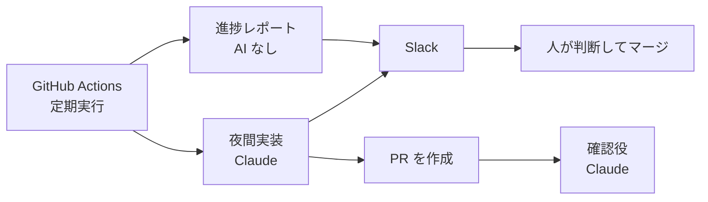

# AI 自動開発の仕組み

GitHub Actions が決まった時刻に動き、結果を Slack へ ボット名義で投稿する。マージは人が行う。

## 2 つの workflow

| 名前 | 時刻（日本時間） | 内容 | ファイル |
|---|---|---|---|
| 進捗レポート | 平日（月〜金）8:47 | 直近のマージ・CI 失敗・開いている PR を集めて投稿する。月曜は週末を含む 72 時間。AI は使わない | `.github/workflows/atlas-daily-report.yml` |
| 夜間実装 | 平日（月〜金）の早朝 3:17 | 指定したタスクを 1 つ実装して PR を作り、確認役が PR にコメントし、結果を投稿する | `.github/workflows/atlas-nightly-implement.yml` |

どちらも、手動実行（Actions 画面の「Run workflow」）で試せる。

## 夜間実装の対象を決める

夜間実装は、リポジトリ変数 `ATLAS_NIGHTLY_TASK` に書かれたタスクだけを実装する。着手するかどうかは、人が決める。

次の場合は、実装せずに Slack へ理由だけを投稿して終わる。Qt も入れない。

- 変数が空のとき。
- `task/` で始まるブランチの PR が、すでに 2 件以上開いているとき。
- そのタスクのブランチ（`task/<ID>-*`）が、すでにあるとき。

## 最初に必要な設定

定期実行は、**デフォルトブランチ（main）にある workflow だけ**が動く。workflow を main にマージしてから設定する。

| 場所 | 項目 | 値 |
|---|---|---|
| Settings → Secrets and variables → Actions → Secrets | `SLACK_BOT_TOKEN` | Slack アプリの Bot トークン（`xoxb-` で始まる）。権限は `chat:write` |
| 同 → Variables | `SLACK_CHANNEL_ID` | 投稿先の Slack チャンネル ID |
| 同 → Variables | `ATLAS_NIGHTLY_TASK` | 夜間実装の対象タスクの番号（計画書の進捗表にあるもの）。空なら実装しない |
| 同 → Secrets | `CLAUDE_CODE_OAUTH_TOKEN` | `claude setup-token` で発行したトークン。夜間実装だけが使う |
| Settings → Actions → General | Workflow permissions | 「Read and write permissions」と「Allow GitHub Actions to create and approve pull requests」を有効にする |
| Settings → Rules → Rulesets | main の保護 | PR を必須にし、直接 push と force push を禁止する |

- Slack ボットは、投稿先のチャンネルへ招待しておく。
- API キーを使うときは、`CLAUDE_CODE_OAUTH_TOKEN` の代わりに `ANTHROPIC_API_KEY` を登録する。workflow の `claude_code_oauth_token:` は `anthropic_api_key:` に変える。
- main の保護は必須である。夜間実装の権限は、Claude が main へ直接 push できる広さになっている。protect しておかないと、プロンプトの禁止だけが頼りになる。

## 確認役

夜間実装が PR を作ったあと、別のジョブで、別の Claude がその PR の本文と差分だけを読み、コメントを 1 件だけ残す。往復は 1 回で終わる。

- 権限は、ファイルの読み取りと、PR へのコメントだけにしている。ファイルの書き換え、マージ、承認の道具は許可していない。
- 受け取るのは、実装が作った PR の番号 1 つだけ。自分のリポジトリのブランチの PR だけを対象にするので、他の人の PR は読まない。
- 対象のタスクが決まっていない日や、PR ができなかった日は動かない。
- 失敗したときは、Slack に知らせる。実装の結果の投稿は、確認役の成否に関わらず出る。
- 効果が薄ければ、workflow の `review` ジョブを消すだけで戻せる。

## 夜間実装の権限

Claude に許す操作は、ブランチの作成と commit、`task/` ブランチへの push、PR の作成とコメント、ビルドとテストに絞っている。マージ、PR のクローズ、承認、force push は禁止している。

実行中の Claude は、他の人が書いた PR やコメントを読まない。公開リポジトリでは、誰でも文章を書き込めるためである。

## 注意

- 公開リポジトリなので、Secrets を使う workflow は `schedule` と `workflow_dispatch` だけで起動する。外部の人の PR やコメントでは動かない。
- この workflow の `GITHUB_TOKEN` で作った PR は、他の workflow（CI）を自動で起動しない（GitHub の仕様）。夜間実装は、PR を作る前に自分でビルドと `ctest` を回す。CI も回したいときは、ci.yml を手動実行する。
- Codex のレビュー依頼は、PR を作った直後の 1 回だけ。夜間実装は、結果を待たずに終わる。指摘への対応は、次の作業で人が行う。
- 定期実行は、リポジトリが 60 日間動かないと GitHub が自動で止める。止まったら Actions 画面で有効に戻す。
- `claude-code-action` の許可リストは、初回に拒否されるコマンドが出るかもしれない。初回の手動実行のログを見て調整する。
- Claude の認証方法（購読のトークンか API キーか）は、公式の資料の記載に沿っている。実際の動作は、初回の手動実行で確かめる。
- 外部の action（`anthropics/claude-code-action`、`jurplel/install-qt-action`）は、版のタグで指定している。さらに固めるなら、commit の SHA で固定する。

## 関連

[workflow.md](workflow.md)（開発ルールと PR ワークフロー）/ [ci.yml](../.github/workflows/ci.yml)（CI 構成）
