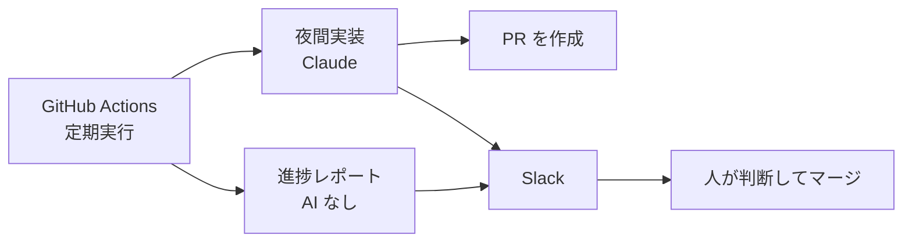

# AI 自動開発の仕組み

GitHub Actions が決まった時刻に動き、結果を Slack の `#ai自律化` へ ボット名義で投稿する。マージは人が行う。

## 2 つの workflow

| 名前 | 時刻（日本時間） | 内容 | ファイル |
|---|---|---|---|
| 進捗レポート | 平日 8:47 | 直近 24 時間のマージ・CI 失敗・開いている PR を集めて投稿する。AI は使わない | `.github/workflows/atlas-daily-report.yml` |
| 夜間実装 | 平日 3:17 | 次の 1 タスクを実装して PR を作り、結果を投稿する。未マージの PR が 3 件以上なら実装しない | `.github/workflows/atlas-nightly-implement.yml` |

どちらも、手動実行（Actions 画面の「Run workflow」）で試せる。

## 最初に必要な設定

定期実行は、**デフォルトブランチ（main）にある workflow だけ**が動く。この PR をマージしてから設定する。

| 場所 | 項目 | 値 |
|---|---|---|
| Settings → Secrets and variables → Actions → Secrets | `SLACK_BOT_TOKEN` | Slack アプリの Bot トークン（`xoxb-` で始まる）。権限は `chat:write` |
| 同 → Variables | `SLACK_CHANNEL_ID` | 投稿先のチャンネル ID（`#ai自律化` は `C0CKUADSVLZ`） |
| 同 → Secrets | `CLAUDE_CODE_OAUTH_TOKEN` | `claude setup-token` で発行したトークン（夜間実装だけが使う） |
| Settings → Actions → General | Workflow permissions | 「Read and write permissions」と「Allow GitHub Actions to create and approve pull requests」を有効にする |

- Slack ボットを投稿先のチャンネルへ招待しておく（`/invite @ボット名`）。
- API キーを使う場合は、`CLAUDE_CODE_OAUTH_TOKEN` の代わりに `ANTHROPIC_API_KEY` を登録し、workflow の `claude_code_oauth_token:` を `anthropic_api_key:` に変える。

## 注意

- 公開リポジトリなので、Secrets を使う workflow は `schedule` と `workflow_dispatch` だけで起動する。外部の人の PR やコメントでは動かない。
- `GITHUB_TOKEN` で作った PR は、他の workflow（CI）を自動で起動しない（GitHub の仕様）。夜間実装は、PR を作る前に自分でビルドと `ctest` を回す。CI も回したいときは、PR を開き直すか、ci.yml を手動実行する。
- 夜間実装のブランチ名は `task/<N>-<名>`。PR の Codex レビュー依頼は、ship-task の手順どおり 1 回だけ。
- 定期実行は、リポジトリが 60 日間動かないと GitHub が自動で止める。止まったら Actions 画面で有効に戻す。
- 夜間実装の Claude の認証方法（購読のトークンか API キーか）は、公式の資料の記載に沿っているが、実際の動作は初回の手動実行で確かめる。

## 関連

[workflow.md](workflow.md)（開発ルールと PR ワークフロー）/ [ci.yml](../.github/workflows/ci.yml)（CI 構成）
