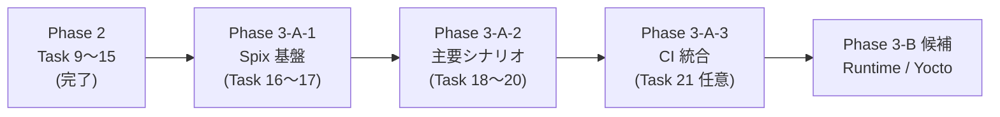

# Phase 3-A: E2E テスト導入

Phase 2 / テスト基盤導入（Task 9〜15）完了を受け、Phase 3-A では Editor / Simulator の操作を end-to-end で自動検証する仕組みを **Spix（OSS / MIT）** で導入する。MVP / Phase 2 と同じく **1 タスク = 1 ブランチ = 1 PR**、完了基準は `cmake --build` 緑 ＋ 新規 `ctest` 緑。



---

## 採用フレームワーク：Spix

[github.com/faaxm/spix](https://github.com/faaxm/spix)

| 項目 | 内容 |
|---|---|
| ライセンス | MIT |
| Qt サポート | Qt 5 / Qt 6 |
| 統合方法 | 本体に `spix::AnchorManager` を C++ で生やす（数行） |
| 操作方法 | 外部プロセスから Spix が提供する RPC 経由で `mouseClick` / `setProperty` / `drag` / `inputText` を発火（具体的なエンコーディングは Task 16 で Spix 最新版の README / examples を確認して確定する） |
| Item 指定 | `mainQuickItem/objectName` 形式のパス |
| Yocto / クロスビルド | 可能（CMake / FetchContent or submodule で取り込み） |

選定理由：

- **本体侵蝕が最小**：Editor / Simulator は `--e2e` CLI フラグ付き起動時のみ Spix エンドポイントを listen させる構成にできる。通常起動への影響ゼロ。
- **OSS で永続利用可**：Squish のようなライセンス更新リスクなし。
- **CI 親和性**：`-platform offscreen` で起動でき、Phase 2 で確立した GitHub Actions ジョブにそのまま追加できる。
- **objectName ベース**：QML 側に `objectName` を 1 行付けるだけで指定可能。Task 14 で Repeater delegate に `widgetId` を持たせた発想と同列。
- **Phase 3-B との両立**：Yocto / i.MX8MP に持っていく際もクロスビルドできる。

参考代替案（不採用）：

- **Squish for Qt**：商用ライセンス費用、CI 取り回し負荷大。
- **PyAutoGUI / pywinauto**：座標ベースで脆い。レイアウト変更で全壊。CI 不可。
- **CLI 引数 + dump-screen フック自作**：E2E と呼べる範囲が狭く、操作系シナリオ（ドラッグ）が再現不能。Task 8 で確立した CLI 引数ロード機能の応用としては有用だが、E2E の正面手段にはしない。

> **Note**：Spix の最新 README / API は Task 16 着手時に再確認する。本ドキュメントの操作 API 例は 2026-05 時点での想定値であり、最新版で関数名や CMake 統合方法が変わる可能性がある。

---

## タスク一覧

### Phase 3-A-1: Spix 基盤構築

| # | タスク | スコープ | 完了基準 |
|---|---|---|---|
| 16 | Spix 取り込み + Editor / Simulator 統合 | `third_party/spix/`（submodule or FetchContent）で Spix を取り込む。Editor `main.cpp` と Simulator `main.cpp` の **両方** に **真偽フラグ `--e2e`** と **値オプション `--e2e-port <port>`（既定は Editor=9876 / Simulator=9877 等の別ポート）** の 2 つの CLI 引数を追加し、`--e2e` が立っているときだけ `spix::AnchorManager` を起動。通常起動には影響なし。CLI 引数の追加コードは Editor と Simulator で重複するが、CLAUDE.md「Editor / Simulator で同等の C++ ヘルパーが必要になる場合、Shared に移さず両方に独立して持つ」原則に従い Shared に移さない | `hmi_editor --e2e` / `hmi_simulator --e2e` で Spix エンドポイントが各既定ポートを listen している（`nc localhost <port>` 等で接続確認）。`--e2e --e2e-port <port>` で任意ポートに切り替わる。`cmake --build` 緑 |
| 17 | E2E ハーネス雛形 + smoke 1 件 | `tests/e2e/` ディレクトリを作成。テストランナー（Python or C++）を整備して Editor を subprocess で起動 → Spix 経由で接続 → 既存ボタンの存在確認 → 終了。ctest 統合 | `ctest` 上に E2E smoke 1 件登録、緑 |

### Phase 3-A-2: 主要シナリオ E2E

| # | タスク | スコープ | 完了基準 |
|---|---|---|---|
| 18 | Editor 配置 + 座標反映 E2E | E2E から「Button 追加」→ 既定位置に EditableWidget が出る → `setStringProperty` で別座標へ移動 → x/y が反映される | E2E ctest 緑 |
| 19 | JSON 保存 → 読込ループ E2E | E2E から `Main.qml.saveTo(path)` を `invokeMethod` で呼び出して JSON を書き出し → 別プロセス（同 Editor）を `--open <path>` で起動 → 同じ画面が再現。FileDialog は Spix から自動操作不能のため Window 直下の QML ラッパー関数を経由する。Editor の CLI 引数名は Simulator と揃えて `--open <path>` を採用（計画当初の `--load` から改名） | E2E ctest 緑 |
| 20 | Simulator 表示 E2E | Task 19 で作った JSON を Simulator `--load <path>` で起動 → 期待 Widget が描画 | E2E ctest 緑 |

### Phase 3-A-3: CI 統合（任意）

| # | タスク | スコープ | 完了基準 |
|---|---|---|---|
| 21 | E2E ジョブを GitHub Actions に追加 | 既存 `.github/workflows/ci.yml` に E2E ジョブを matrix で追加。Editor / Simulator を `-platform offscreen` + `--e2e` で起動 | macOS / Windows 両 OS で E2E ctest 緑 |

> **Note**：Task 21 は CI 上での subprocess 制御と Spix 接続の安定性次第。Task 16〜20 が安定してから着手するか判断する（Phase 2 Task 15 と同じ「任意」扱い）。

> **Task 18 で確立：Spix の drag は `setStringProperty` で代替する**
>
> 元の計画は「任意座標へドラッグ → 座標が反映される」だったが、Task 18 着手時に Spix v0.14 の制約が判明：
> - `mouseBeginDrag(path)` / `mouseEndDrag(path)` は **source / dest item の中央** のみを対象にした drag&drop モデルで、自由座標を指定する API は存在しない（`int x, int y` のオーバーロードは無し）。
> - `Qt 6.11 + -platform offscreen` 環境では `QGuiApplication::postEvent` を経由した中間 `mouseMove` が drag 閾値に到達せず、Editor 側の `MouseArea.drag.target` が動かなかった（PR #30 の検証で確認）。
>
> Task 18 / 19 / 20 のスコープでは E2E は **`setStringProperty` で QML プロパティを直接更新 → 反映を確認する**形に統一する。テスト本来の責務（「Editor の状態を E2E から変更でき、反映パスが通る」）は十分担保できる。実マウスドラッグの動作確認は Phase 3-B（実機 / Yocto）の手動テスト、または Spix の Qt 6 サポートが改善したら追加テストで補う。

### Phase 3-B 候補（Phase 3-A 完了後に別途承認）

- **Runtime（i.MX8MP / Yocto）対応**：クロスビルド・QtWayland・実機デプロイ手順整備。Spix もクロスビルドして実機 E2E に再利用できる構成を検討。

---

## 設計指針

### Spix 統合パターン

- Editor / Simulator は **真偽フラグ `--e2e` と値オプション `--e2e-port <port>` の 2 つに分けた CLI 引数** を持ち、`--e2e` が立っているときだけ Spix エンドポイントを有効化する。`QCommandLineParser` は optional value（`--e2e [<port>]` のような任意値）をサポートしないため、フラグと値オプションを明示的に分割する。
- **既定ポートは Editor=9876 / Simulator=9877 のようにアプリごとに別値を取る**。Editor / Simulator を同一マシンで同時起動する E2E シナリオ（Task 20）でポート競合を起こさないため。`QCommandLineOption` のデフォルト引数自体を main.cpp 側でアプリ別に書き分ける：

  ```cpp
  // Editor/src/main.cpp（疑似コード）
  QCommandLineOption e2eOpt("e2e", "E2E テスト用エンドポイントを有効化する");
  QCommandLineOption e2ePortOpt("e2e-port",
      "E2E エンドポイントの listen ポート（既定 9876）", "port", "9876");
  parser.addOption(e2eOpt);
  parser.addOption(e2ePortOpt);
  // ... parser.process(app);

  if (parser.isSet(e2eOpt)) {
      const quint16 port = parser.value(e2ePortOpt).toUShort();
      static spix::AnchorManager anchor;
      anchor.startServer(port);
  }
  ```

  `Simulator/src/main.cpp` 側は `QCommandLineOption e2ePortOpt(..., "port", "9877")` のように既定値だけ 9877 に差し替える。重複コードを Shared に移さない原則（CLAUDE.md）に従い、アプリごとに main.cpp に書く。

- これにより **通常起動時は Spix の依存関係がランタイムにロードされない**（厳密にはリンクされているだけだが、ネットワークは開かない）。本番影響ゼロ。
- **CLI 命名は `--e2e` / `--e2e-port` で統一**（Task 16 で確立予定）。`--listen` 等は紛らわしいので避ける。**`--e2e [<port>]` のような optional value 表記は使わない**（Codex P1 指摘で確立、QCommandLineParser 制約）。

### QML 側の準備

- 操作対象の Item に `objectName` を付与する。例：
  ```qml
  HmiButton { objectName: "btn_add_widget"; text: qsTr("追加"); }
  ```
- `objectName` の付与は CLAUDE.md「テストのために本体を変えない」原則の **例外として許容**する。理由：
  - Phase 2 Task 14 でも Repeater delegate に `widgetId` プロパティを生やしており、テスト識別用の属性追加は前例がある
  - `objectName` は QML 標準プロパティで、本体の挙動を変えない（純粋にメタデータ）
  - レイアウト変更や API 変更とは性質が異なる

### テストランナー

- **Python ベースを推奨**。`subprocess.Popen` で Editor / Simulator を起動 → Spix エンドポイントへ接続 → Spix コマンド送信 → 結果検証 → プロセス終了の流れを Python で書ける。
- **Spix の RPC プロトコルは Task 16 着手時に最新 README / examples を確認して確定する**。エンコーディングは独自に推測せず（XML-RPC / HTTP / JSON-RPC など Spix のバージョンで変わる可能性がある）、**Spix が公式に提供する Python クライアントまたは examples のクライアント実装をそのまま採用**する。素のソケット + 自前エンコーディングは使わない（Codex P1 指摘で確立、誤実装で接続失敗するリスクを避ける）。
- 起動時は **必ず `-platform offscreen`** を付ける（Phase 2 Task 12 で確立した CI 互換原則と同じ）。

### ファイル配置

```
hmi-platform/
├─ third_party/
│   └─ spix/                 # submodule または FetchContent
├─ Editor/
│   └─ src/main.cpp          # --e2e フラグと spix::AnchorManager セットアップ
├─ Simulator/
│   └─ src/main.cpp          # 同上
└─ tests/
    └─ e2e/                  # 横断 E2E（Editor 単体 / Simulator 単体 / 連携シナリオ）
        ├─ CMakeLists.txt
        ├─ conftest.py 等
        └─ test_*.py
```

Editor / Simulator 内の `tests/` には **モジュール単体の Qt Quick Test**（Phase 2 で導入済み）を残し、E2E はリポジトリ直下 `tests/e2e/` に集約する。Phase 2 の `Editor/tests/`、`Shared/Widgets/tests/` は手を入れない。

### CMake 統合方針

- ルート `CMakeLists.txt` に `if(BUILD_TESTING) add_subdirectory(tests/e2e) endif()` を 1 行追加。
- Spix の取り込みは Task 16 で **FetchContent を第一候補**として評価する（submodule より CI 再現性が高い）。フォールバックとして submodule。
- E2E は本体ビルドプロダクト（`hmi_editor` / `hmi_simulator`）に依存するため、**`ctest` 実行前に `cmake --build` を完了させておく前提**で運用する。Phase 2 で確立した運用（README / CLAUDE.md の「ビルドと実行」節）と同じく、`cmake --build build && ctest --test-dir build` の順序を README に明示する。CMake の `add_test` ＋ `set_tests_properties(... DEPENDS ...)` は **他テストの run-after 順序のみを制御** しビルドターゲット依存は保証しないため、ここでは使わない。**Python テストランナー側の起動時にバイナリパスを直接渡し、存在しなければ即 fail させる**（Phase 2 Task 11 の方式 B / `target_include_directories` 経由のソース共有と同じく「テスト実行体に必要なリソースは明示的に渡す」原則）。

### スクリーンショット運用

E2E は GUI 変化を伴うが、対象画面は Phase 1 / Phase 2 で確立済みのため、新規スクショは原則不要。**新規 Widget や新規メニューが増えるタスク**（Phase 3-A スコープ外）でのみ動作証跡スクショを撮る。

---

## ルール（Phase 3-A 限定 / 既存ルールの上に追加）

### Must Always

- Spix エンドポイントは **`--e2e` CLI フラグ付き起動時のみ** 有効化する（通常起動への影響ゼロ）。
- E2E テストは **`-platform offscreen` で動く** ように書く（CI 互換）。
- 各タスク完了時に **新規 E2E が `ctest` で緑** であることを完了基準に含める（`cmake --build` 緑だけでは不十分）。
- 操作対象には `objectName` を付与する。直接の座標指定は避ける（レイアウト変更で壊れるため）。

### Must Never

- Spix を `Shared/Schema` / `Shared/Widgets` に依存させる（E2E は **利用側アプリ完結**）。
- Editor / Simulator の通常起動パスに E2E 用コードを混ぜる。Spix の `AnchorManager` 生成は `--e2e` 分岐の中だけ。
- `objectName` 以外のテスト用ハック（テスト用クラス継承、`#ifdef E2E_TEST` のような debug-only コードなど）を本体に入れる。
- Spix 以外の E2E フレームワーク（Squish / pywinauto 等）を独断で追加する。

---

## 進捗

| # | タスク | 状態 |
|---|---|---|
| 16 | Spix 取り込み + Editor 統合 | ✅ 完了 |
| 17 | E2E ハーネス雛形 + smoke 1 件 | ✅ 完了 |
| 18 | Editor 配置 + 座標反映 E2E | ✅ 完了 |
| 19 | JSON 保存 → 読込ループ E2E | ✅ 完了 |
| 20 | Simulator 表示 E2E | ✅ 完了 |
| 21 | E2E ジョブを GitHub Actions に追加 | ✅ 完了 |
