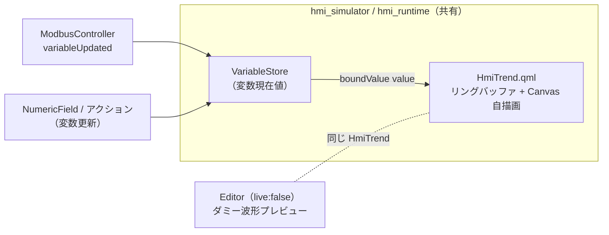

# Phase 8 計画 — トレンドグラフ（Trend / ライブ折れ線）

新 Widget 種別「Trend」を追加する。Phase 5（Label）/ Phase 6（NumericField）で確立した
**横展開テンプレ**（型分岐の足場 + Schema 4 メソッド + インスペクタ型対応 + cross-app E2E）に乗せ、
Trend が初めて必要にする差分（① Canvas 自描画、② 周期/変更時サンプリングという新トリガ、
③ Canvas 不可視性に対するテスト用プロパティ公開）だけを上積みする。

> **進捗の正本は本ファイル「進捗」表**。承認・着手でステータスが動いたら常駐文書
> （CLAUDE.md / AGENTS.md / README / mvp-task-runner / development-history）を同期する
> （[feedback-phase-status-sync](../../.claude/rules/feedback-phase-status-sync.md)）。

## 承認状態

**着手承認（2026-06-16）** — ユーザー要望「トレンドグラフ欲しい」+ スコープ 2 問確定
（データ範囲＝**ライブ（直近 N 点）**、描画方式＝**QML Canvas 自作**）。

## 確定スコープ（ユーザー合意）

| 項目 | 決定 |
|---|---|
| データ範囲 | **ライブのみ**。bound 変数を変更時/周期でサンプリングし、メモリ上のリングバッファに直近 N 点保持して横スクロール表示。**履歴のファイル/DB 永続化は対象外**（後続フェーズ候補） |
| 描画 | **QML `Canvas` 自描画**（折れ線）。**QtCharts 等の新規 Qt モジュール依存は入れない** |
| 動機 | `Canvas` は `import QtQuick` のみで使え **新モジュール依存ゼロ**＝i.MX8MP rootfs にそのまま載る（Phase 7 で QtSerialBus が kit/rootfs 未同梱だった轍を踏まない） |
| サンプル源 | 既存 `bindings`（`{property:"value", variable:X}`）の「読み」を再利用（Schema/C++ ブリッジ無改変）。Modbus の `variableUpdated→setValue` でも追従 |
| 系列数 | MVP は **単系列**。複数系列・軸目盛り・凡例は非スコープ（後続候補） |

## 各アプリの役割・ソース共有

| アプリ | 動作環境 | Trend の振る舞い |
|---|---|---|
| Editor | PC 専用 | 設計面。ライブデータ無し → **ダミー波形プレビュー**（`live:false`）。追加 UI・インスペクタ編集 |
| Simulator | PC | `boundValue("value")` 変化でサンプル取り込み（`live:true`） |
| Runtime | 実機 i.MX8MP | **Simulator とソース完全共有で自動継承**（`Runtime/` 無改変） |

## アーキテクチャ



## タスク分割（1 タスク = 1 PR、`cmake --build` + Web `ctest` 緑が完了基準）

| Task | スコープ | 完了基準 |
|---|---|---|
| **T-A: Schema 拡張** | `WidgetData` に Trend 固有フィールドを追加（§Schema）。`toJson`/`fromJson`/`toVariantMap`/`fromVariantMap` の **4 メソッド**を揃える（C++ ブリッジ無改変）。`isValidJson` 必須集合は不変（全 optional ＝後方互換）。`tst_widget_data.cpp` に round-trip（presence true/false 両方）を追加。**QML/描画はまだ無し** | build + `ctest` 緑。`type:"Trend"` の JSON が値欠落なく round-trip。`git diff` で C++ ブリッジ無改変を確認 |
| **T-B: 型分岐の足場 + HmiTrend 描画** | `Shared/Widgets/qml/HmiTrend.qml` 新設（§HmiTrend）。`Shared/Widgets/CMakeLists.txt` の `QML_FILES` 登録。Editor `Canvas.qml` / Simulator `SimulatorCanvas.qml` の delegate に **4 分岐目** `trendComponent`（objectName `hmiTrend`）。Simulator は `boundValue("value")` 変化で 1 点 push。HmiTrend 単体 + delegate 生成の unit 追加。**追加 UI はまだ無し**（手書き JSON で検証） | build + `ctest` 緑。`type:"Trend"` でも選択枠・リサイズ正常。変数変化で `sampleCount` 増加（unit）。完了基準は `ctest` 緑まで（実機 Canvas 性能の VNC 確認は **T-B PR 本文に作業 TODO として追記**し、完了条件には含めない＝ローカル実機が要るため Web で満たせない） |
| **T-C: Editor 追加 UI + インスペクタ型対応** | `addWidget` ホワイトリストに `"Trend"`（既定サイズ大きめ・`text:""`）。ツールバー「トレンド追加」ボタン `addTrendButton`。`selectedIsTrend` 追加・`selectedSupportsClickAction` に `&& !selectedIsTrend`（Button/NumericField 共有プロパティへの変更＝**Label の既存クリックアクション抑制と競合しないか T-C 着手時に確認**）。Trend 詳細セクション（点数 N / Y 軸 min・max〔presence チェック〕/ 線色 / 周期）を `visible: selectedIsTrend` で表示。objectName・編集ロジック・Schema 不変 | build + `ctest` 緑。Editor で Trend を追加・選択・属性設定できる。**`editor.png` 同期** |
| **T-D: cross-app E2E + スクショ** | `tests/e2e/test_trend_live.py` 新設。Editor `--open`→`saveTo`→保存 JSON 直接 assert（`type:"Trend"` / value binding / `pointCount`）→ Simulator で操作用 NumericField から変数を複数回更新 → Trend の公開 `sampleCount`/`lastValue` 追従を観測。`CMakeLists.txt` に `e2e_trend_live` 登録。`editor.png`/`simulator.png` 最終同期 | build + `ctest` 緑（`e2e_trend_live` 含む）。E2E が「変数変化→サンプル取り込み」を公開プロパティで観測。スクショ同期 |

> T-C が重ければ T-C1（追加ボタン+ホワイトリスト）/ T-C2（インスペクタ詳細）に分割可（5 本構成）。

## Schema 拡張（§Task A）

`type` 値は既存（`"Button"`/`"Label"`/`"NumericField"`）に合わせ **PascalCase `"Trend"`**。

### 既存属性の再利用

`id`/`type`/`x`/`y`/`width`/`height`、`backgroundColor`/`borderColor`/`borderWidth`/`radius`、
`opacity`/`enabled`、`bindings`（**＝サンプル源**）を再利用。`text`/フォント/`checkable`/`checked`/
`actions` は Trend では未使用（流さない）。

### 新規フィールド（Trend 固有）

| フィールド | 型 | 未指定表現 | 根拠 |
|---|---|---|---|
| `pointCount`（N） | `int` | `0`＝未指定（HmiTrend が既定 N=60 へ解決） | `0` は「0 点」という正当値を持たない → `0` センチネル可（`fontSize` 同型） |
| `yMin` / `hasYMin` | `double` / `bool` | **presence フラグ方式** | Y 軸下限の負値が正当 → センチネル不可。`minValue`/`maxValue` の前例踏襲 |
| `yMax` / `hasYMax` | `double` / `bool` | 同上（未指定時はデータ自動スケール） | 同上 |
| `lineColor` | `QString` | `""`＝未指定（既定線色へ解決） | 色は `"#RRGGBB"`/空（`backgroundColor` 同型） |
| `sampleMs` | `int` | `0`＝周期サンプリングなし（変更時サンプルのみ） | 周期 0ms は無意味 → `0` センチネル可。`>0` で周期 |

`isValidJson` 必須集合（id/type/width/height）は**不変**＝全 optional で後方互換。

```json
{
  "id": "trend001", "type": "Trend",
  "x": 40, "y": 40, "width": 320, "height": 160,
  "backgroundColor": "#0b1d2a", "borderColor": "#9aa5b1", "borderWidth": 1, "radius": 4,
  "pointCount": 120, "yMin": 0, "yMax": 100, "lineColor": "#4cc9f0", "sampleMs": 0,
  "bindings": [ { "property": "value", "variable": "sensorTemp" } ]
}
```

> **`hasYMin`/`hasYMax` は JSON キーではない**（メモリ上の presence フラグ）。JSON では
> **`yMin`/`yMax` キーの有無自体が presence を表す**（`fromJson`: `hasYMin = obj.contains("yMin")`、
> `toJson`: `hasYMin` のときだけ `yMin` を書く）。上例は両指定（固定 Y 軸）。両キーを省略すれば
> 自動スケール。`sampleMs:0` は変更時サンプルのみ。旧 JSON は新キーを持たない＝後方互換で全て既定解決。

## HmiTrend.qml（§Task B）

HmiButton/HmiLabel/HmiNumericField と同じ **resolved\* フォールバック方式**。root は背景・枠を持つ
`Rectangle`、中に描画 `Canvas`、上に選択用 `MouseArea`。ファイル名 `HmiTrend` は QtQuick 標準型と
非衝突（中で `Canvas{}` 型を使うのは可）。

| 持つ | 持たない |
|---|---|
| 公開入力：`value`（サンプル源）/ `pointCount` / `yMin`+`hasYMin` / `yMax`+`hasYMax` / `lineColor` / `sampleMs` / `live` | `text`/フォント / `checkable`/`checked` / クリックアクション |
| スタイル：`backgroundColor`/`borderColor`/`borderWidth`/`cornerRadius`/`widgetOpacity`/`widgetEnabled`（resolved\*） | 軸目盛り・凡例・複数系列（MVP 非スコープ） |
| リングバッファ：`property var _buffer: []` + `_push(v)`（N 超過で先頭破棄）+ `requestPaint()` | 履歴の永続化 |
| **テスト用公開**：`sampleCount`（取り込み総数）/ `lastValue`（直近値）/ `bufferSize`（= resolved N） | ピクセル assert（Canvas は E2E 不可視） |
| 選択用 `signal clicked(int modifiers)` + MouseArea | — |
| `live`（Simulator=true 実サンプル / Editor=false プレビュー） | — |

**resolved 既定**（実装時に確定、乖離したら同コミットで本計画更新）：`resolvedPointCount: pointCount>0 ? pointCount : 60` /
`resolvedLineColor: "#4cc9f0"` / `resolvedBackgroundColor: "#0b1d2a"`（グラフらしい濃紺）。枠/角丸/opacity/enabled は NumericField の resolved\* 流用。

**サンプル取り込みトリガ**：
- 方式 A（既定）：`onValueChanged: if (live) _push(value)`。delegate が `boundValue("value")` を `value` へバインド。
- 方式 B（`sampleMs>0`）：`Timer { running: live && sampleMs>0; interval: sampleMs; repeat: true; onTriggered: _push(value) }`。

**描画**：`Canvas.onPaint` で折れ線を strokePath。X はバッファ index を幅へ等間隔、Y は
`[effectiveYMin, effectiveYMax]`（presence 未指定ならバッファ min/max 自動スケール）を高さへマップ。
横スクロール＝満杯時に最古を捨てて全点再描画。**Editor プレビュー**（`live:false`）は `Component.onCompleted` で
`_buffer` をダミー波形で埋め 1 度描画（サンプリング・Timer は動かさない）。

## Editor 統合 / インスペクタ（§Task C）

delegate は Loader 三項 + inline Component に **4 分岐目** `trendComponent` を足すだけ
（NumericField の Component が手本、`editable:false`→`live:false`）。Simulator は `value: boundValue("value")` 結線。
`snapshotModel` と EditableWidget メタ流し込みに新フィールド（`widgetPointCount` 等）を追加
（「Schema 4 メソッド + delegate + メタ + HmiXxx の入力/resolved を揃える」確立手順の機械適用）。

インスペクタ型出し分け（`visible` のみ・objectName/Schema 不変）：

| セクション | Trend |
|---|---|
| 基本（座標・サイズ） | ✅（Text 不要＝隠す） |
| 文字（フォント） | ❌ |
| 背景・枠 | ✅（グラフ枠） |
| 状態 | **有効のみ**（`widgetEnabled` を持つ） |
| クリックアクション | ❌（`!selectedIsTrend`） |
| バインディング | ✅ **「サンプル対象変数」として value binding** |
| Trend 詳細（N / Y 軸 / 線色 / 周期） | ✅ `visible: selectedIsTrend` |

## テスト方針（§Task D）

1. **Schema round-trip（T-A）**：`tst_widget_data.cpp` に Trend フィールドの JSON⇄struct⇄QVariantMap 往復。presence の true/false 両方を `variantMapRoundTripFullFields`/`fromVariantMapFillsSentinelDefaults` 相当で固定。
2. **QML 単体（T-B）**：`tst_hmi_trend.qml`。resolved 既定・リングバッファ巻き取り（N+5 push 後 `bufferSize===N`）・`sampleCount`/`lastValue` 追従・`clicked`・`live:false` プレビュー。**ピクセルは見ず公開プロパティのみ assert**。delegate unit に「`type:"Trend"` で `hmiTrend` 生成」を追加。
3. **cross-app E2E（T-D）**：Canvas はピクセル不可 → 公開 `sampleCount`/`lastValue` を `getStringProperty` で観測。Spix は実入力不可なので操作用 NumericField を fixture 同居させ `setStringProperty`+`commitValue()` invoke で同変数を更新 → Trend のサンプル取り込みを観測。Editor 段は保存 JSON 直接 assert で round-trip 担保。

## リスク / 未確定事項

1. **実機 Canvas 性能**：頻繁な `requestPaint()` が i.MX8MP で重い恐れ。緩和＝描画間引き（Timer 駆動 or 変化スロットリング）の余地を HmiTrend に残し、T-B に VNC 実描画確認 TODO。
2. **サンプリング周期既定**：`sampleMs` の推奨値は実機更新レート・描画コスト依存 → 初期は方式 A（`sampleMs:0`）で確定し、周期既定は実測で決める（断定形で書かない）。
3. **Editor プレビュー波形**：ダミー波形の見た目（サイン波等）は実装時決定、乖離したら同コミット更新。
4. **Spix int プロパティ取得可否**：既存 E2E は `getStringProperty` 中心。`sampleCount`（int）取得可否を T-D 着手時に確認し、不可なら文字列公開へ寄せる。
5. **自動 Y スケールの揺れ**：presence 未指定の自動スケールは軸が暴れうる。MVP は素朴な min/max 自動スケール + 固定 Y 軸（`hasYMin`/`hasYMax`）を推奨運用とする。

## 進捗

| Task | 状態 | PR |
|---|---|---|
| T-A Schema 拡張（trend フィールド round-trip） | 完了 | #127 |
| T-B 型分岐の足場 + HmiTrend 描画（Canvas） | 完了 | #128 |
| T-C Editor 追加 UI + インスペクタ型対応 | 完了 | #130 |
| T-D cross-app E2E（ライブサンプリング）+ スクショ | 実装済み（レビュー中・再ランド） | — |

**Phase 8 完了**（T-A〜T-D）。`tests/e2e/test_trend_live.py`（`e2e_trend_live`）で Editor round-trip
（`type:"Trend"` / value binding / `pointCount`）→ Simulator で操作用 NumericField の `commitValue()`
を複数回叩いて変数を変化させ、Trend の公開 `sampleCount` 増加・`lastValue` 追従を `getStringProperty`
で観測。Web `ctest` 23/23 緑。`simulator.png` を Trend ライブ折れ線描画状態へ更新。
次フェーズ候補（下記「非スコープ」）は未承認＝先にスコープ確定する。

## 非スコープ（別承認）

> **複数系列・軸目盛り/凡例は 2026-06-17 に承認され [Phase 8-B](phase8b-trend-extend-plan.md) へ移動**（本フェーズ＝単系列のまま）。

履歴永続化（historian）・トレンドの拡縮ズーム・後続入力 Widget（Gauge / Toggle）・
NumericField の step/decimals/unit・OPC-UA。
