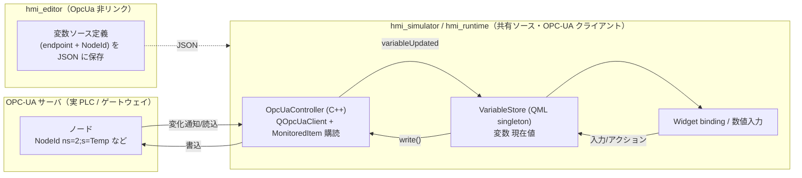
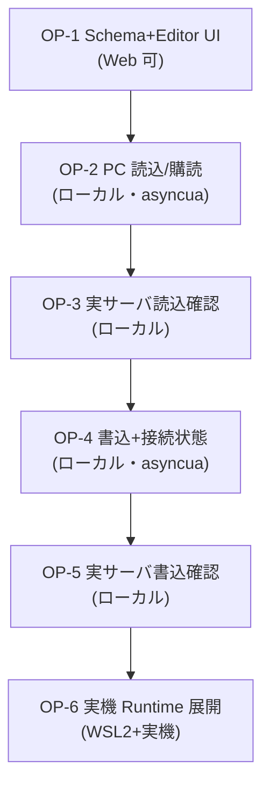

# Phase 9 計画 — OPC-UA クライアント対応（産業標準プロトコルで実機器と連動）

> **位置づけ**：Modbus TCP（Phase 7）に続く 2 本目の実機器連携。`hmi_runtime`（実機）/ `hmi_simulator`（PC）が **OPC-UA クライアント**として OPC-UA サーバ（PLC / ゲートウェイ / SCADA）のノードを購読・読み書きし、既存の **変数ストア + バインディング**経路に流し込む。Modbus と同じ「変数ソース」抽象に **2 つ目の proto** を足す形にする。
>
> **本書は計画のみ**（実装は別 PR でタスク 1 つずつ）。要求の倉庫は [requirements/](../requirements/README.md)（旧版は [requirements-legacy.md](requirements-legacy.md)）、結線規約は [.claude/rules/qml-module-conventions.md](../../.claude/rules/qml-module-conventions.md)、Schema 規約は [.claude/rules/schema-conventions.md](../../.claude/rules/schema-conventions.md)、実機/SDK 事情は [.claude/rules/dev-environment.md](../../.claude/rules/dev-environment.md)。Modbus 実装の前例は [phase7-modbus-plan.md](../phase7-modbus-plan.md)。
> **進捗の正本は本ファイル「進捗」表**。
>
> **承認状態**：**完了（2026-06-27 OP-6 クローズ）。OP-1〔Schema + Editor UI〕#140 ／OP-2〔PC 読込/購読〕／OP-3〔実サーバ読込確認〕／OP-4〔書込 + 接続状態 + 自動再接続〕／OP-5〔実サーバ書込確認〕／OP-6〔実機 Runtime 展開〕すべて完了。** 直近完了は Phase 8-B（Trend 拡張・PR #138 でクローズ）。
> **🔴 最重要ゲート（Web 不可）→ macOS / Windows / 実機すべて解消済み**：**Qt OPC-UA（`qtopcua`）は aqtinstall のバイナリ addon に含まれない**（2026-06-20 実証）ので Web/CI ではビルド不可（この点は不変）。macOS は OP-2 着手時に qtopcua を Homebrew Qt にマージして解消（2026-06-22）。**Windows 母艦は `scripts/windows/build-opcua.ps1` で解消済み（OP-5・2026-06-27）**。**実機 rootfs は `meta-toolchain-qt6` SDK に既包含（OP-6・2026-06-27）**。手順・罠の正本は [dev-environment.md](../../.claude/rules/dev-environment.md)。

---

## 確定した前提（2026-06-20 合意 + 既定方針）

| 項目 | 決定 |
|---|---|
| プロトコル | **OPC-UA（OPC Unified Architecture）クライアント**。サーバ実装は本フェーズ対象外（HMI はクライアント） |
| 通信ライブラリ | **Qt 標準 Qt OPC-UA（`QOpcUaClient`）+ open62541 バックエンド**。Modbus と同じ「Qt 純正で外部依存を増やさない」方針を踏襲（**ただし qtopcua は aqt 非同梱＝§依存で要調査**） |
| 通信相手 | OPC-UA サーバ（実 PLC / ゲートウェイ）。**自動検証は Python ソフトサーバ**（`asyncua` / opcua-asyncio）相手に E2E（Modbus の pymodbus に相当） |
| 初手の実行アプリ | **PC の `hmi_simulator`** → 固まったら **実機 `hmi_runtime`**（ソース共有で自動継承） |
| データ取得方式 | **MonitoredItem 購読（subscription）を主**とし、購読不可ノードは周期読込（poll）にフォールバック。Modbus の `QTimer` ポーリングと違い OPC-UA は変化通知が標準 |
| セキュリティ | **MVP は `None`（無暗号・匿名）**。証明書/暗号化（Basic256Sha256）・ユーザ認証は後続（別タスク P2） |
| 非スコープ | OPC-UA サーバ機能・メソッド呼び出し（Call）・履歴アクセス（HA）・イベント/アラーム購読・証明書管理 UI・複雑型（構造体）。MVP は **スカラ値ノードの読み/書き/購読**のみ |

---

## アーキテクチャ（Modbus と同型・proto 2 本目）



**設計原則（既存ルール・Modbus 実装との整合）**

- **通信は Simulator 共有ソースに置く**（→ Runtime が自動継承。[qml-module-conventions](../../.claude/rules/qml-module-conventions.md)「Simulator/Runtime はソース完全共通」）。実機固有差分は `#ifdef HMI_RUNTIME_BUILD`。
- **Editor は `Qt6::OpcUa` をリンクしない**。Editor は「変数ソース定義（endpoint・NodeId）を JSON に書く」だけで実通信しない（Modbus の Editor 非リンク方針と同じ。変更時 `git diff` / `ldd` で確認）。
- **`hmi_schema` は QML も通信も知らない**。OPC-UA を喋る C++（`OpcUaController`）は利用側アプリ（Simulator）に置く。
- **`find_package(Qt6 ... OpcUa)` は root `CMakeLists.txt` に置く**（Simulator の共有 function が両ターゲットで解決できるように。MB-2 で確立した IMPORTED target スコープの罠回避。[qml-module-conventions](../../.claude/rules/qml-module-conventions.md)）。
- **変数ストア + binding 経路を再利用**：購読/読込値は `VariableStore.setValue(name, val)` に流すだけで既存 `boundValue()` が UI を追従（Task 41 経路）。書込は数値入力/アクションが `VariableStore` を更新 → `OpcUaController.writeVariable()`（MB-4 の `writeBoundValue`→`writeToPlc` 二経路分離をそのまま流用し、読込由来の setValue では書き返さない）。

---

## スキーマ拡張（変数ソースに proto 2 本目）

Modbus（Phase 7）で導入済みの **`connections[]` + `VariableData.source`** をそのまま拡張する（既存 `ConnectionData` / `source` の 4 メソッドに OPC-UA 用フィールドを足す。後方互換＝Modbus 既存 JSON は無改変で動く）。

```jsonc
// ProjectData（案・Modbus と共存）
"connections": [
  { "id": "plc1",  "proto": "modbusTcp", "host": "192.168.0.10", "port": 502, "unitId": 1 },
  { "id": "opc1",  "proto": "opcua",     "endpoint": "opc.tcp://192.168.0.20:4840" }
],
"variables": [
  { "name": "tankLevel", "type": "int",
    "source": { "connection": "plc1", "reg": "holding", "address": 0, "poll": 1000 } },
  { "name": "spindleTemp", "type": "real",
    "source": { "connection": "opc1", "nodeId": "ns=2;s=Spindle.Temp", "poll": 0 } }
]
```

- **`proto`** で接続種別を分岐（`modbusTcp` / `opcua`）。OPC-UA 接続は **`endpoint`（`opc.tcp://host:port`）** を持つ（`host`/`port`/`unitId` は Modbus 用＝空でよい）。
- **変数 `source`**：OPC-UA は **`nodeId`（文字列・例 `ns=2;s=Tag` / `ns=2;i=1001`）** で対象ノードを指す（Modbus の `reg`/`address` に相当）。`poll` は購読不可時のフォールバック周期 ms（`0` = 購読のみ＝既定）。
- **書込可否**：OPC-UA はノードの AccessLevel で決まる（Modbus の coil/holding 限定と違う）。MVP は「書けるノードに書く・失敗はログ」とし、Editor は読/書を区別表示しない（着手時に再検討）。
- Schema 実装は [schema-conventions](../../.claude/rules/schema-conventions.md) の **4 メソッド**（`toJson`/`fromJson`/`toVariantMap`/`fromVariantMap`）を揃える。`ConnectionData` への `endpoint`、`source` への `nodeId` を **optional**（空時省略）で足す。**`proto` 既定は `modbusTcp`**（既存 JSON 互換）か **必須化**かを OP-1 着手時に確定（既存 Modbus JSON に `proto` がある前提なら必須化可。なければ既定 modbusTcp）。
- **🔴 `SourceData::isValidJson` を proto 種別を見た検証へ変える（Codex PR #139 [Major]）**：現行 `SourceData::isValidJson`（`Shared/Schema/src/SourceData.cpp:49-67`）は `connection` に加え **`reg` が `coil/discrete/input/holding` のいずれかであることを必須**にしている。このまま `nodeId` を optional 追加しても、OPC-UA の `{connection, nodeId}`（`reg` 無し）は **不正扱いで弾かれ、`ProjectIo`/`ProjectLoader` の `parseValidated` が source を落とす**（＝「`isValidJson` 必須集合は不変」は誤り）。OP-1 で **検証を「`connection` 必須 + （`reg` が有効値〔Modbus〕 **または** `nodeId` が非空〔OPC-UA〕）」へ変更**する（`reg` も `nodeId` も無いものは従来どおり不正）。**SourceData 単体は接続の `proto` を知らない**ため、proto で分岐せず **source が持つフィールド（reg/nodeId）の有無**で判定する自己完結ルールにする（型に `kind` 弁別子を足す案もあるが、フィールド有無判定で足りるので MVP は型を増やさない）。`toJson`/`fromJson`/`toVariantMap`/`fromVariantMap` の 4 メソッドにも `nodeId` を通す（現状 reg/address/poll のみ＝nodeId 追加が要る）。OP-1 完了基準に **「opcua source〔reg 無し・nodeId 有り〕が `isValidJson` を通る + round-trip で `nodeId` 保持 + Modbus source〔reg 有り〕も従来どおり有効 + reg/nodeId 双方欠落は不正」の unit テスト**を含める。

> **確定**：接続は Phase 7 と同じ **プロジェクト共通 `connections[]` 参照**を踏襲（`source.connection` → `ConnectionData.id`）。proto 別フィールドは同一 `ConnectionData` に同居させ、`proto` で解釈を分ける（型を分けない＝Schema をシンプルに保つ）。OP-1 完了基準に「opcua 接続 + nodeId source の round-trip unit + Modbus 既存 JSON 無改変回帰」を含める。

---

## Qt OPC-UA API スケッチ（実装時に Qt6 公式で再確認）

```cpp
// CMake: find_package(Qt6 REQUIRED COMPONENTS OpcUa); target_link_libraries(... Qt6::OpcUa)
QOpcUaProvider provider;
// バックエンド名は環境依存（"open62541" 等）。provider.availableBackends() で確認してから生成する
QOpcUaClient *client = provider.createClient(provider.availableBackends().value(0));
client->connectToEndpoint(QUrl("opc.tcp://192.168.0.20:4840"));  // 非同期。stateChanged で監視

// 購読（MonitoredItem）
QOpcUaNode *node = client->node("ns=2;s=Spindle.Temp");
node->enableMonitoring(QOpcUa::NodeAttribute::Value, QOpcUaMonitoringParameters(/*interval ms*/100));
QObject::connect(node, &QOpcUaNode::attributeUpdated, [](QOpcUa::NodeAttribute, const QVariant &v){
    // → emit variableUpdated(name, v) → QML が VariableStore.setValue
});
// 読込（フォールバック）: node->readAttributes(QOpcUa::NodeAttribute::Value)
// 書込: node->writeAttribute(QOpcUa::NodeAttribute::Value, value)
// 接続状態: client->stateChanged(QOpcUaClient::ClientState) / errorChanged
```

- **非同期 API（シグナル）なので UI を塞がない**。購読が基本で `QTimer` ポーリングは購読不可ノードのフォールバックのみ（**未確認情報を断定しない**：[feedback-plan-docs-consistency](../../.claude/rules/feedback-plan-docs-consistency.md) 項目 1/2。正確な enum 名・ctor・バックエンド名は着手時に Qt6 ドキュメント/examples で確認）。
- **バックエンド**：Qt OPC-UA は backend plugin（open62541 が標準同梱の想定）が要る。**実行時に `availableBackends()` が空でないこと**を起動時チェックし、空ならエラー表示（実機 rootfs に plugin が無いと購読が黙って動かない＝Modbus の plugin 同梱罠と同型）。
- **`OpcUaController` の責務（Simulator 側 C++）**：`signal variableUpdated(const QString &name, const QVariant &value)` を宣言し QML で `VariableStore.setValue` へ接続。書込は QML→`OpcUaController.writeVariable(name, value)`。接続状態は MB-4 と同じ `Q_PROPERTY QVariantMap connectionStates` + NOTIFY で公開（id→connected/connecting/disconnected/error）。**世代カウンタで configure/stop 後の旧接続・旧購読を弾く**（MB-2/MB-4 と同型）。スレッド境界（コールバックのスレッド）は実装時に確認し、跨ぐなら queued connection で UI スレッドへ。

---

## タスク分割（1 タスク = 1 PR、`cmake --build` 成功が完了基準。Web 可否に注意）

> **🔴 着手前ゲート（OP-2 着手前・最優先）**：§依存の **Qt OpcUa 入手性**（aqt ソースビルド or 別配布 / ローカル kit / 実機 rootfs）を解決し結果を本書に記録する。**未解決のうちは OP-2 以降に進めない**（ビルド不能）。OP-1（Schema + Editor UI）は OpcUa 非依存なので Web で先行可。

| Task | スコープ | 実行環境 | 完了基準 |
|---|---|---|---|
| **OP-1** | **変数ソース Schema 拡張（proto 2 本目）+ Editor 編集 UI**。`ConnectionData.endpoint` + `VariableData.source.nodeId` + `proto:"opcua"` を追加（round-trip・Modbus 無改変回帰）。Editor 変数定義パネルに「接続 proto 選択 → opcua なら endpoint / nodeId 入力」を追加。**実通信なし・OpcUa 非リンク**。 | **Web 可** | build + `ctest` 緑（Schema round-trip unit + Editor 編集 unit）。Editor は OpcUa 非リンクのまま。Modbus 既存 JSON 無改変 |
| **OP-2** | **PC 読込/購読**。Simulator 共有ソースに `OpcUaController`（`QOpcUaClient` + MonitoredItem 購読）を追加し、接続→ノード値購読→`VariableStore.setValue` で UI 追従。root `CMakeLists.txt` に `find_package(... OpcUa)`、Simulator function 内で `Qt6::OpcUa` リンク（Editor 非）。E2E 用に **`asyncua` ソフトサーバ起動 fixture** + ctest 連携。 | **ローカル**（Qt OpcUa kit 要・**Web 不可**。E2E は asyncua ソフトサーバ相手） | build + `ctest` 緑。Simulator に `Qt6::OpcUa` 依存追加で build 成功。新規 E2E：asyncua のノード値変更が Simulator の binding に追従。Signal/Slot unit |
| **OP-3** | **実 OPC-UA サーバ読込確認**。PC `hmi_simulator` を手元の実サーバ/ゲートウェイ（または PLC の OPC-UA エンドポイント）に向け表示追従を確認。証跡スクショ。 | ローカル（PC + 実サーバ） | 実サーバの値変化が Simulator に反映される証跡 |
| **OP-4** | **書込 + 接続状態 + 再接続**。数値入力/アクションの変数書込を `writeAttribute` で。接続状態（接続/切断/エラー）公開 + 自動再接続。書込 E2E（asyncua）。 | **ローカル**（Web 不可・asyncua 相手） | build + `ctest` 緑。E2E：HMI 操作で asyncua のノードが変わる。状態表示 unit |
| **OP-5** | **実サーバ書込確認**。PC Simulator から実サーバのノードを書き換える確認 + 証跡。 | ローカル（PC + 実サーバ） | 実ノードが HMI 操作で変わる証跡 |
| **OP-6** | **実機 Runtime 展開**。Yocto に `qtopcua`（+ open62541 backend）を追加（IMAGE_INSTALL + SDK）→ image/SDK 再ビルド → `hmi_runtime` を aarch64 クロスビルド → 実機 i.MX8MP から実サーバと通信 → VNC キャプチャ。 | ローカル（WSL2 + 実機・**Web 不可**） | 実機 Runtime が実サーバと読み書きする証跡（VNC）。手順を dev-environment.md に追記 |



> Modbus（Phase 7）は MB-1/2/4 が Web 可だった（aqt に qtserialbus 同梱のため）。**OPC-UA は qtopcua が aqt 非同梱なので OP-2 以降が軒並みローカル**になる点が最大の差。OP-1 だけ Web で先行できる。

---

## 依存・要調査（着手前に潰す）

| 項目 | 内容 |
|---|---|
| **Qt OpcUa 入手性（OP-2 着手前ゲート）→ macOS / Windows / 実機すべて解消済み** | **2026-06-20 実証：aqtinstall の Qt 6.10.0 linux desktop に `qtopcua` モジュールは無い**（`qtserialbus`/`qtserialport` はある）→ Web/CI 不可。**macOS は option ②（自前ビルド）で解消（2026-06-22）**：`brew install open62541 ninja` → qtopcua v6.11.1 を `qt-cmake`（`-DQT_NO_XCODE_MIN_VERSION_CHECK=ON`）でビルド → `/opt/homebrew/opt/qt` にマージ。`QOpcUaProvider::availableBackends()`=`("open62541")` 確認済み。**Windows 母艦 kit は `scripts/windows/build-opcua.ps1` で解消（2026-06-27）**（Stage A で 7z 取得・Stage B でソースビルドフォールバック）。**実機 rootfs は `meta-toolchain-qt6` SDK に既包含（OP-6 で確認・2026-06-27）**。3 環境すべて導入済み（手順・罠は [dev-environment.md](../../.claude/rules/dev-environment.md)）。Web/CI（aqt 非同梱）は依然不可。 |
| **自動検証サーバ** | 実サーバは CI/Web から不達 → E2E は **`asyncua`（opcua-asyncio）ソフトサーバ**で固定（Modbus の pymodbus に相当）。dev 依存に閉じ製品コードに持ち込まない。**ただし OpcUa が Web で入らない以上、この E2E もローカルでしか緑にできない**（OP-2 以降）。 |
| **バックエンド plugin** | Qt OPC-UA は backend（open62541 等）plugin が無いと購読が動かない。kit / rootfs 双方で plugin の同梱を確認（起動時 `availableBackends()` チェックを実装）。 |
| **NodeId の人間表現** | `ns=2;s=Tag` 形式を JSON/内部の正準にする（Editor は素の文字列入力で開始。ブラウズ UI は P2）。off-by-one 系の罠は Modbus の address より少ない（文字列指定のため）。 |
| **real / 型変換** | OPC-UA は型付きノード（Double/Int32/Boolean…）。`VariableStore.coerce` の既存（int/real/bool）で受ける。複雑型（構造体・配列）は非スコープ。 |
| **Editor 非リンク維持** | Editor が誤って `Qt6::OpcUa` をリンクしないこと（`git diff` / `ldd` で確認）。通信は Simulator/Runtime のみ。 |

---

## 進捗

| Task | 状態 | PR |
|---|---|---|
| OP-1 変数ソース Schema 拡張（proto 2 本目）+ Editor UI | 完了（Web ctest 25/25 緑） | #140 |
| OP-2 PC 読込/購読（asyncua E2E） | 完了（macOS local：unit 13/13 緑 + asyncua E2E `e2e_opcua_read` round-trip 緑） | — |
| OP-3 実 OPC-UA サーバ読込確認 | 完了（macOS local：`scripts/opcua/test_server.py` 起動→Counter/Temperature/Running/Setpoint の購読追従を証跡スクショ 2 枚で確認。Windows でも 2026-06-27 に同手順で追従確認） | — |
| OP-4 書込 + 接続状態 + 再接続 | 完了（macOS local：unit 13/13 緑 + asyncua 書込 E2E `e2e_opcua_write` round-trip 緑 + read `e2e_opcua_read` 緑維持） | — |
| OP-5 実サーバ書込確認 | 完了（Windows local：`test_server.py` + `opcua-demo.json` の NumericField で Setpoint 書込 → asyncua クライアント読み返し確認。2026-06-27） | — |
| OP-6 実機 Runtime 展開（WSL2+実機） | 完了（2026-06-27：i.MX8MP 実機で OPC-UA 読込購読を VNC キャプチャで確認。証跡：`Docs/screenshots/op6-runtime.png`） | — |

> **OP-1（#140）〜OP-6 すべて完了。Phase 9 OPC-UA クライアント対応クローズ。** OP-6：`meta-toolchain-qt6` SDK に qtopcua が既包含（SDK 再ビルド不要）→ WSL2 クロスビルド → 実機 i.MX8MP への deb 転送（libsocketcan2 / libqt6serialport6 / libqt6serialbus6）→ `QT_QPA_PLATFORM=vnc:size=1280x720` で起動 → test_server.py（`--host` で全 IF バインド）に OPC-UA 接続 → Counter/Temperature/Running/Setpoint の購読追従を VNC キャプチャで実証。手順・罠は [dev-environment.md](../../.claude/rules/dev-environment.md)「OPC-UA 実機展開」に追記済み。
