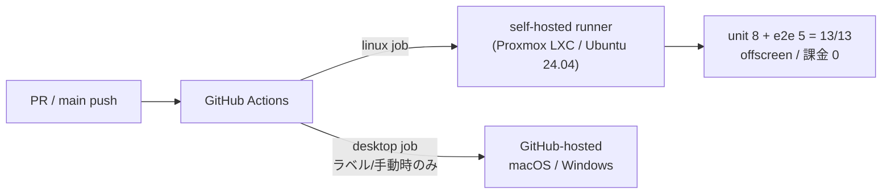

# CI 復活計画 — self-hosted runner（Proxmox）で課金ゼロの自動 CI

> **位置づけ**：2026-06-10 に GitHub Actions の課金回避で自動 CI（`pull_request` / `push` トリガ）を停止し、`workflow_dispatch`（手動）のみにした（[ci.yml](../.github/workflows/ci.yml) 冒頭コメント / [dev-environment.md](../.claude/rules/dev-environment.md)「リポジトリ運用の注意」）。これを **Proxmox 上の self-hosted runner で課金ゼロのまま自動 CI に戻す**ための計画。
>
> **本書は計画のみ**。**CI はまだ off のまま**（`ci.yml` は変更しない）。**Proxmox に runner が立って動作確認が取れてから** `ci.yml` を改修して自動トリガを復活させる。
> **進捗の正本は本ファイル「進捗」表**。

---

## 現状と課題

| 項目 | 現状 |
|---|---|
| CI トリガ | `workflow_dispatch`（手動）のみ。PR / main push では一切走らない＝**自動の緑ゲートが無い** |
| 止めた理由 | GitHub Actions の課金（main push 毎に **macOS=10x / Windows=2x** ジョブが走り無料枠を消費） |
| 当面のテスト担保 | Web セッション内 `ctest`（unit + e2e）。CI 緑ではない（手動・属人的） |
| 既存 `ci.yml` の構造 | **Linux=主ゲート（1x）**＋ **desktop（mac/win）= `ci-desktop` ラベル + main push + 手動限定**。設計は良好で流用できる |

**狙い**：日常 PR の緑ゲートを**自前マシン（Proxmox）で無料・自動**に戻す。課金の主因 mac(10x) は自動化しない。

---

## 方針 — 二段構え（Linux=self-hosted / desktop=GitHub-hosted）

| ジョブ | 実行場所 | トリガ | 課金 |
|---|---|---|---|
| **linux**（主ゲート） | **Proxmox の self-hosted runner** | 毎 PR / main push（自動） | **0 円** |
| **desktop**（mac / win） | GitHub-hosted（据え置き） | **`ci-desktop` ラベル + 手動のみ**（main push を除外） | 必要時のみ |

- 日常 PR は self-hosted Linux で unit + e2e（offscreen）を毎回自動チェック＝**緑ゲート復活**。
- 実機 2 OS（mac/win）の確認は従来どおり必要時だけ GitHub-hosted で（10x の自動消費を避ける）。
- **⚠️ desktop ジョブの `if` も直す必要がある**（Codex PR #133 P2 指摘）。現行 `ci.yml:106-108` の `if: github.event_name != 'pull_request' || ...ci-desktop...` は **main push でも desktop（mac 10x / win 2x）が走る**。自動トリガで `push: main` を復活させると、main merge 毎に mac/win が自動起動して「課金ゼロ・mac 自動化しない」目的に反する。よって **desktop の `if` を「workflow_dispatch（手動）+ `ci-desktop` ラベル」限定に変える**（main push を除外）。
- `ci.yml` の変更は **①linux ジョブの `runs-on`** ＋ **②自動トリガのコメント解除** ＋ **③desktop ジョブの `if` を main push 除外**の 3 点。



---

## 構築手順（Proxmox 側 — 君の手元で実施）

> runner 登録には **registration token**（リポジトリ Settings で都度発行・短命）が要るため、この部分は Web からは実施できない。

### 1. LXC コンテナ作成（Ubuntu 24.04）
- **OS**：Ubuntu 24.04（CI の `ubuntu-latest` = 24.04 と揃える。`scripts/web/setup.sh` と同じ前提）。
- **スペック目安**：2〜4 vCPU / 4GB+ RAM / 30GB+ disk。
- **Docker は当面不要**＝LXC で十分（将来 runner 内で Docker を回すなら `features: nesting=1` を付けるか VM に切替）。

### 2. CI 依存を入れる（[ci.yml](../.github/workflows/ci.yml) の Linux deps と同一）
```sh
sudo apt-get update
sudo apt-get install -y --no-install-recommends \
  libgl1 libegl1 libegl-mesa0 libxkbcommon0 libfontconfig1 libfreetype6 libdbus-1-3 \
  libglib2.0-0t64 libx11-6 libxcb1 \
  libgl-dev libglx-dev libopengl-dev libegl-dev mesa-common-dev \
  ninja-build fonts-dejavu-core fonts-noto-cjk \
  curl git python3 python3-pip
```
- Qt 本体は **`ci.yml` 内の `jurplel/install-qt-action` が self-hosted でも動く**（初回 DL、persistent runner なのでキャッシュで2回目以降速い）。事前手動導入は不要。
- 外向きネットワークで **`download.qt.io` に到達できること**（Qt 取得）。Proxmox の LAN がそのまま出られるなら OK。

### 3. GitHub Actions runner を登録
- リポジトリ → **Settings → Actions → Runners → New self-hosted runner（Linux x64）** に出るコマンドを LXC で実行（`./config.sh ...`（token 込み）→ `./run.sh`）。
- **ラベル**：既定の `self-hosted` `Linux` `X64` に加え、必要なら `qt` 等を付与（`ci.yml` 側の `runs-on` と一致させる）。
- **常駐化**：`./svc.sh install && ./svc.sh start` で systemd サービス化（LXC 起動で自動復帰）。

### 4. 動作確認
- 適当なブランチで `ci.yml` を手動実行（`workflow_dispatch`）し、linux ジョブを **self-hosted で完走** → 13/13 緑を確認。

---

## `ci.yml` 改修案（runner 動作確認後に別 PR で適用）

**まだ適用しない**。runner が緑で回ったらこの差分を入れて CI on にする。

```yaml
# on: のコメントアウトを解除（自動トリガ復活）
on:
  workflow_dispatch:
  pull_request:
    branches: [main]
    types: [opened, synchronize, reopened, labeled]
  push:
    branches: [main]

jobs:
  linux:
    name: Linux / Qt 6.10
    runs-on: [self-hosted, linux]   # ← ① ubuntu-latest から変更
    ...

  desktop:
    name: ${{ matrix.name }}
    # ③ main push を除外し、手動 + ci-desktop ラベルのときだけ走らせる
    # （変更前は `github.event_name != 'pull_request'` で main push でも mac/win が走った）
    if: >-
      github.event_name == 'workflow_dispatch'
      || contains(github.event.pull_request.labels.*.name, 'ci-desktop')
    ...
```

- **①linux ジョブの `runs-on`** `ubuntu-latest` → `[self-hosted, linux]`。
- **②自動トリガ**（`pull_request` / `push`）のコメント解除。
- **③desktop ジョブの `if`** を `workflow_dispatch` + `ci-desktop` ラベル限定に変更し **main push を除外**（main merge 毎の mac 10x / win 2x 自動課金を防ぐ。Codex PR #133 P2）。desktop の steps 自体は無改変。
- apt の Linux deps ステップは **self-hosted でも冪等に通る**（既導入なら skip 扱い）。passwordless sudo を runner ユーザーに付けておく。
- 復活したら [dev-environment.md](../.claude/rules/dev-environment.md)「リポジトリ運用の注意」の「CI は手動のみ」記述も更新する。

---

## セキュリティ注意

- **self-hosted runner は public リポだと fork PR が任意コード実行できて危険**。本リポが **private なら問題なし**。public 化する場合は fork PR を GitHub-hosted に振り分ける設定が必須（self-hosted には流さない）。
- runner は専用 LXC に隔離し、不要な権限（host の Proxmox 操作等）を持たせない。

---

## 非スコープ（別途承認）

CI を回す箱（self-hosted）ができた後の **上積み候補**。今回はやらない。

| 候補 | メモ |
|---|---|
| **cppcheck**（静的解析） | C++ が薄く今は低 ROI。やるなら Modbus（`ModbusController`）保険として最小から |
| **clang-tidy** | moc/autogen 除外など設定コスト高。後回し |
| **カバレッジ**（gcovr → HTML artifact） | テストがあるのは `Shared/Schema` のみ＝「Schema の回帰防止」と割り切れば可 |
| **SonarQube（Proxmox 自前）** | 静的解析 + カバレッジ + 履歴トレンドを Web ダッシュボードに一元化。常駐 Java+DB で運用重 |

---

## 進捗

| ステップ | 状態 | メモ |
|---|---|---|
| 計画書作成 | ✅ 本書 | CI は off のまま。`ci.yml` 未変更 |
| Proxmox LXC 作成 + CI 依存導入 | ⬜ 未 | 君の手元（手順は本書「構築手順」§1〜2） |
| self-hosted runner 登録・常駐化 | ⬜ 未 | registration token は Web 不可（手元で） |
| runner で手動実行 → 13/13 緑確認 | ⬜ 未 | §4 |
| `ci.yml` 改修（①linux=self-hosted ②自動トリガ復活 ③desktop=main push 除外）+ dev-environment.md 更新 | ⬜ 未 | runner 緑確認後に別 PR |
