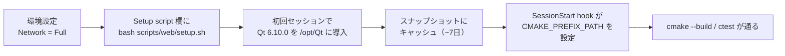
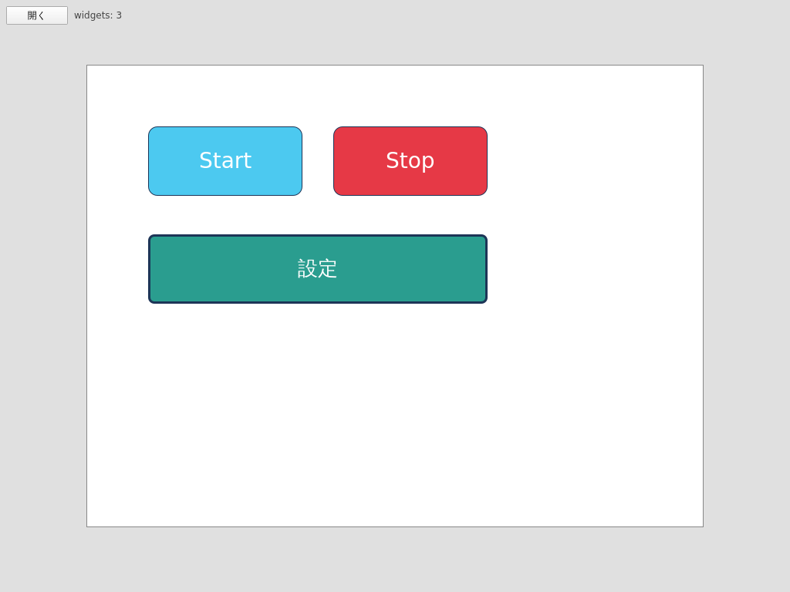

# Claude Code on the web で開発する（Qt6 を導入する）

これまで「Web版は非対応」と言っていたのは、**Qtがインストールできない**からだった。原因を辿ると、
コンテナの**ネットワークアクセスが既定の `Trusted`** になっていて、それが `download.qt.io` を遮断していただけだった。
**ネットワークポリシーを `Full` にすれば、CIと同じ `aqtinstall` がそのまま通り、Web上でもビルド〜テストまでできる。**

GUIのディスプレイは無くても大丈夫：ビルド・ユニットテスト・E2Eは `-platform offscreen` で動くし、**GUIのスクショも
`-platform offscreen` + アプリ内蔵の `--screenshot`（`QQuickWindow::grabWindow()`）を使えば、ウィンドウシステム
無しで撮れる**（Xvfbも不要）。詳しい経緯や代替案はこの文書の一番下にまとめてある。

## セットアップ手順



| 手順 | 操作 | 補足 |
|---|---|---|
| 1 | 環境設定で **Network access = Full** | 既定 `Trusted` は Qt ミラーを 403 で遮断。`Full`（任意ドメイン）が必要。`Custom` + `*.qt.io` 等でも可 |
| 2 | **Setup script** 欄に `bash scripts/web/setup.sh` | 初回のみ実行→**スナップショットにキャッシュ**され 2 回目以降は即起動（約 7 日保持） |
| 3 | （自動）SessionStart hook が `CMAKE_PREFIX_PATH` を設定 | `.claude/settings.json` + `scripts/web/session-env.sh`。ローカルでは `CLAUDE_CODE_REMOTE!=true` で no-op |

## 関与ファイル

| ファイル | 役割 | 実行場所 |
|---|---|---|
| `scripts/web/setup.sh` | apt 依存（Qt ランタイム/開発ライブラリ + 日本語フォント `fonts-noto-cjk`）+ `aqtinstall` で Qt 6.10.0（`linux_gcc_64`）を `/opt/Qt` へ。冪等 | 環境の Setup script（キャッシュ） |
| `scripts/web/session-env.sh` | prefix マーカー（`/opt/hmi-web-qt-prefix`）優先→無ければ `${HMI_QT_OUTDIR:-/opt/Qt}/*/gcc_64` を探索し、`export CMAKE_PREFIX_PATH=...` を `$CLAUDE_ENV_FILE` に書く | SessionStart hook（毎回・即 no-op 判定あり） |
| `.claude/settings.json` | 上記 hook の登録 | — |
| `scripts/capture-app-screenshot-linux.sh` | offscreen + `--screenshot` で GUI スクショを撮るラッパー（後述） | セッション内で手動 |

## ビルド・テスト（Web）

```sh
# SessionStart hook が CMAKE_PREFIX_PATH を入れているので明示不要。手動なら下記を渡す:
#   -DCMAKE_PREFIX_PATH=/opt/Qt/6.10.0/gcc_64
cmake -S . -B build
cmake --build build
ctest --test-dir build --output-on-failure          # ユニット（QML テストは -platform offscreen 済み）
ctest --test-dir build -L e2e --output-on-failure    # E2E（harness.py が QT_QPA_PLATFORM=offscreen を設定）
```

## GUI スクショ（ヘッドレス）

Editor / Simulator / Runtime（PC ビルド）に **アプリ内蔵の `--screenshot <path>` フラグ**を追加した
（`Editor/src/ScreenshotGrabber.h` / `Simulator/src/ScreenshotGrabber.h`）。`-platform offscreen` で起動し、
`QQuickWindow::grabWindow()` でオフスクリーン描画結果を PNG に書き出して自動終了する。**Xvfb も
X11/Wayland も不要**で、phantom_nexus の「アプリ自身が PNG を書き出して終了」方式と同じ思想（Qt 版）。

```sh
# ラッパー（推奨）: ビルド済みバイナリを offscreen 起動して撮る
scripts/capture-app-screenshot-linux.sh -a editor    -o Docs/screenshots/editor.png
scripts/capture-app-screenshot-linux.sh -a simulator -o Docs/screenshots/sim.png -j Docs/samples/web-gui-demo.json

# 直接叩く場合
QT_QPA_PLATFORM=offscreen QT_QUICK_BACKEND=software \
  build/Simulator/hmi_simulator --open Docs/samples/web-gui-demo.json --screenshot out.png --screenshot-delay 1000
```

| オプション | 意味 |
|---|---|
| `-a <app>` | `editor` / `simulator` / `runtime`（既定 `editor`） |
| `-o <path>` | 出力 PNG（既定 `Docs/screenshots/<app>-linux.png`） |
| `-j <json>` | 起動時に `--open` で読み込むプロジェクト JSON（任意。`Docs/samples/web-gui-demo.json` が例） |
| `-d <ms>` | 撮影前待機ミリ秒（既定 700。自動ロードや過渡状態を待つときに増やす） |

撮影例（`Docs/samples/web-gui-demo.json` を Simulator で描画）：



> 日本語ラベルを □（豆腐）にしないため、`setup.sh` が `fonts-noto-cjk` を導入する。
> 実機 i.MX8MP の VNC キャプチャ（`scripts/yocto/vnc-capture.py`）とは別経路（あちらは実機 / weston 用）。

## なぜ GUI が無くても大丈夫なのか

| 用途 | 仕組み | 既存の使用箇所 |
|---|---|---|
| ユニット / QML テスト | `-platform offscreen` | `Editor/tests/`, `Shared/Widgets/tests/` |
| E2E（Spix） | `QT_QPA_PLATFORM=offscreen` | `tests/e2e/harness.py` |
| GUI スクショ証跡（PC ビルド / Web） | `-platform offscreen` + `--screenshot`（`grabWindow`） | `scripts/capture-app-screenshot-linux.sh` |
| スクショ証跡（実機 i.MX8MP） | `QT_QPA_PLATFORM=vnc` | `scripts/yocto/vnc-capture.py` |

ただし offscreen にも限界はある：Spix の本物のマウスドラッグ（`mouseBeginDrag/EndDrag`）は drag の閾値に
届かないので、座標変更は代わりに `setStringProperty` で行っている（`Docs/development-history.md` 参照）。
`--screenshot` は「起動直後の静止画」が前提なので、本当の手動操作の検証は引き続きローカルや実機で行う。

## 代替案（ポリシーを変えられない場合）

`Full` にできない事情があるときは、`Trusted` のまま **Qt 一式を tar に固めて GitHub Release に置く**手もある
（`release-assets.githubusercontent.com` は Trusted の既定許可に含まれる）。Setup script でその tar を取得・展開し、
`CMAKE_PREFIX_PATH` を同様に通す。Qt blob を用意・ホストする手間がかかるため、まずは `Full` + `aqtinstall` を推奨。

## 注意

- ネットワークアクセスと Setup script 欄は **Web UI でのみ設定**でき、コンテナ内からは変更できない（手順 1・2 は人手）。
- Setup script / 環境変数は環境設定に保存され、その環境を編集できる人に見える。秘匿情報は置かない。
- `aqtinstall` の Qt バージョンは CI（`jurplel/install-qt-action@v4`）と合わせ **6.10.0**。`HMI_QT_VERSION` で上書き可。
