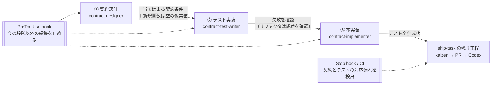

# 契約→テスト→実装 開発手順の導入計画（DbC + テスト先行）

コードの間違いを減らすため、実装を必ず次の 3 段階で進める仕組みを Claude Code の機能（スキル・サブエージェント・hooks・ルール・CI）で整える。

1. **契約を設計する** — 関数・クラスごとに「事前条件 / 事後条件 / 不変条件」のうち**当てはまる条件**を書く（どれを書くかはルールの「どの条件を書くか」）
2. **書いた条件に対応するテストを書く** — 実装より先に書き、失敗することを確認する（振る舞いを変えないリファクタリングは、変更前から成功することを確認する）
3. **テストが通るように本番コードを書く** — テストは触らない

手順の規約（記法・段階の切り替え条件）の正本は [.claude/rules/dbc-tdd.md](../.claude/rules/dbc-tdd.md)。本書は導入計画と進捗を持つ。

> 本計画は機能追加ではなく**開発プロセスの改善**で、フェーズタスク（[phase-status.md](phase-status.md)）とは独立に進める。リファクタリング計画（[refactoring-plan.md](refactoring-plan.md)・一区切り）とも独立。**DT-2 以降は v1.0 公開（2026-11-09）までの機能凍結が明けてから着手する**（[v1-release-plan.md](v1-release-plan.md)）。

---

## 全体の流れ

## 3 条件の意味

| 条件 | 意味 | 誰の責任か | 例（`VariableData`） |
|---|---|---|---|
| 事前条件（`@pre`） | 呼ぶ前に満たしていなければならないこと | 呼び出す側 | （内部関数の例）渡す変数名は登録済みである |
| 事後条件（`@post`） | 呼んだ後に必ず成り立つこと（戻り値・状態の変化） | 呼ばれる側 | `isValidJson` が true の JSON を `fromJson` すると、`name` / `type` が保たれる |
| 不変条件（`@invariant`） | どの公開関数の前後でも常に成り立つこと（既定構築直後も含む） | クラス | `VariableData` は値の入れ物で、既定構築直後は `type` が空なので**書かない**。状態を持つクラスにだけ書く |

> **外部入力（JSON・通信・ユーザー入力）は事前条件にしない。** 外から来る値は壊れていて当然なので、「不正な入力のときは〜を返す」という**事後条件**として扱い、テストで確かめる。事前条件は、アプリ内部の呼び出し同士の約束だけに使う。

## 使う仕組み

| 仕組み | 追加・変更するもの | 役割 |
|---|---|---|
| ルール | `.claude/rules/dbc-tdd.md`（常時読み込み） | 記法・テスト名の付け方・段階の切り替え条件 |
| CLAUDE.md / workflow.md | コア原則に 1 行追加 + リンク | 太らせない（スナップショットとリンクだけ） |
| スキル | `.claude/skills/dbc-tdd/SKILL.md` | 3 段階の手順書。段階を切り替え、サブエージェントを順に呼ぶ |
| サブエージェント | `contract-designer` / `contract-test-writer` / `contract-implementer` | 書き手を分ける。テストを書くエージェントは**本番の実装が入っていない別ディレクトリ**で動かす。git worktree は元リポジトリの履歴を共有して `git show` で実装を読めてしまうため使わず、`.git` を持たないただのコピーにする。このディレクトリには、`scripts/tdd/extract-contracts.py` が作る「宣言と契約コメントだけのヘッダ（インライン関数の中身も除く）」と「QML ごとの契約一覧（コンポーネント名・import・公開プロパティ／シグナル・関数のシグネチャと契約コメント。関数の中身は除く）」、テストディレクトリ・CMake だけを置き、`.cpp` / `.qml` の本体は置かない。普段の読み方（Read / Grep / git）では本実装が見えないので、うっかり本実装に合わせたテストにならない。書いたテストは元の作業ツリーへ戻してから ② の失敗確認をする |
| hooks（PreToolUse） | `scripts/hooks/tdd-phase-guard.sh` + 段階の記録 `.claude/state/tdd-phase`（git 管理外） | 段階ごとに編集できる範囲を制限する（下表） |
| hooks（Stop） | `scripts/hooks/check-contract-coverage.sh` | 本番コードの差分に契約コメントや対応テストが無ければ知らせる |
| 段階切替スクリプト | `scripts/tdd/phase.sh set contract\|test\|impl\|off` | スキルからもユーザーからも使える |
| C++ の契約チェック | `Shared/Schema/include/hmi/schema/Contract.h`（`HMI_REQUIRE` / `HMI_ENSURE` / `HMI_INVARIANT`） | 契約を実行時にも確かめる。違反時の処理（ハンドラ）を差し替えられるようにして、事前条件違反もテストで確認できるようにする |
| Codex レビュー | [Docs/agents/review-guidelines.md](agents/review-guidelines.md) | 「契約とテストの対応」「テストを弱めていないか」を確認観点に追加 |
| CI | `scripts/tdd/check-contract-tags.py` を linux ジョブで実行 | hook をすり抜けた対応漏れを拾う |

### 段階ごとに編集してよい範囲（PreToolUse hook が確認する）

| 段階 | 編集してよい | 止める |
|---|---|---|
| `contract` | `.h` / `.cpp` / `.qml` への**コメントだけの変更**（契約コメントはここ）、新規関数の宣言と空の仮実装（警告つき）、本計画などのドキュメント | テスト本体、既存関数の中身の変更（ヘッダ内のインライン関数・マクロを含む） |
| `test` | テストディレクトリ（`tests/**` と任意階層の `**/tests/**`。例：`Shared/Schema/tests/`・`Shared/Widgets/tests/`・`tests/e2e/`）と、テスト登録に関わる CMake の行（下記） | 本番コード（`.h` / `.cpp` / `.qml` 本体） |
| `impl` | 本番コード | テストディレクトリ（`tests/**` / `**/tests/**`）と、テスト登録に関わる CMake・CI 設定（テストを弱めたり外したりして通すのを防ぐ） |
| `off` | 制限なし（ドキュメントだけの作業など） | — |

`.h` / `.cpp` / `.qml` はどれもファイル単位では「契約コメント」と「本実装」を区別できない（ヘッダにもインライン関数やマクロの実装がある）ため、`contract` 段階の hook は 3 種とも編集前後の文字列を比べて判定する：

- コメント行（`//` / `///`）を取り除いて比べたとき、編集前と編集後が同じ → **コメントだけの変更として許可**
- それ以外（新規関数の宣言・仮実装の追加、ヘッダ内のインライン関数やマクロの変更を含む）→ **警告のみ**（ブロックには上げない例外）。追加が新規関数の宣言・仮実装だけで、既存の実装に手を入れていないかは、Stop hook とレビューで確認する

テストはテストディレクトリの外でも登録されている（例：`Editor/CMakeLists.txt` や `Shared/Schema/CMakeLists.txt` の `add_subdirectory(tests)`、ルート `CMakeLists.txt` の `BUILD_TESTING` 条件、`.github/workflows/ci.yml`）。テスト本体に触れずにこれらを変えると、テストを `ctest` から外して「全件成功」にできてしまうため、二重に防ぐ：

- **PreToolUse hook**：`impl` 段階で、`CMakeLists.txt` の `add_test` / `add_subdirectory(...tests...)` / `BUILD_TESTING` / `ctest` を含む行が変わる編集を止める。CI 設定（`.github/workflows/**`）は、ジョブの `if` やトリガーを変えるだけでもテストを止められるため、**`impl` 段階ではファイルごと編集を止める**
- **Stop hook と CI**：`ctest --show-only=json-v1` で得た**既存テストごとの登録内容（名前・実行コマンド・プロパティ全体。`DISABLED` / `WILL_FAIL` / `SKIP_RETURN_CODE` / 合否判定の正規表現など）**を、作業開始時（Stop hook）や base ブランチ（CI）と比べ（比較の前に、ソースとビルドの置き場所の絶対パスを `<SRC>` / `<BUILD>` に置き換えて、置き場所の違いだけで差が出ないようにする）、**既存のテストが消えた・登録内容が 1 項目でも変わった**ら知らせる（件数や名前だけだと、入れ替えや無効化を見逃すため）。消えたテストがあるときは、その理由（契約の変更など）を PR に書く

PreToolUse hook が中身を比べられるのは Edit / Write だけで、Bash（`sed -i` やスクリプト）で書き換えた場合は実行前に変更後の内容が分からない。そこで Bash については次の 2 つで補う：

- **段階の開始時に、作業ツリーにある全ファイル（追跡済みと、`.gitignore` 対象外の未追跡ファイルの両方）の内容のハッシュを記録**しておく。**PostToolUse hook**（Bash の実行後に動く）で同じ一覧とハッシュを取り直して比べ、追加・変更・削除されたファイルを調べる。コミットの有無に関係なく作業ツリーの中身そのものを比べるので、Bash の中で `git add`・`git commit` まで済ませた場合も見つかり、前の段階で作った未追跡ファイルを誤って検出することもない。段階中に HEAD が動いた（コミットされた）こと自体も警告する。今の段階で触ってはいけないファイルが変わっていたら、ファイル名を示して止める（元に戻すかはユーザーに確認する）
- `contract` / `test` / `impl` の段階では、ルールで「ファイルの書き換えは Edit / Write で行い、Bash では書き換えない」と決める

**守る相手の想定**：この仕組みが防ぐのは、指示に従って作業するエージェント（や人）が**うっかり**段階を飛ばしたり、実装に合わせてテストを書いたり、テストを弱めたりすることである。わざと抜け道を探して回避しようとする相手を完全に防ぐ仕組み（セキュリティ上の隔離）ではない。わざとの回避は、Codex のレビューと人のレビューで見つける。上の hook の仕組みは方針を示したもので、うっかりを防ぐための細かい対策は DT-3 / DT-5 の実装とテストの中で詰める（本書で全パターンを網羅しようとしない）。

最初は**警告のみ**で導入し、実タスクで試して問題が無ければ**ブロック**に上げる。

---

## 導入タスク

| # | 内容 | 主な成果物 |
|---|---|---|
| DT-1 | 計画とルール（ドキュメントのみ） | 本書、`.claude/rules/dbc-tdd.md`、CLAUDE.md / workflow.md / review-guidelines / DOCS-MAP / memory-index |
| DT-2 | スキルとサブエージェント | `.claude/skills/dbc-tdd/`、`.claude/agents/contract-{designer,test-writer,implementer}.md`、`scripts/tdd/extract-contracts.py` |
| DT-3 | hooks と段階切替（警告モード） | `scripts/hooks/tdd-phase-guard.sh`、`check-contract-coverage.sh`、`scripts/tdd/phase.sh`、`.gitignore`、`settings.json` |
| DT-4 | 実行時の契約チェック + 手本 | `Contract.h` とそのテスト、`VariableData` に契約を付けた例 |
| DT-5 | 既存手順への組み込み + CI 照合 | `ship-task` フェーズ 1 / `mvp-next-task` / `mvp-task-runner` の更新、`check-contract-tags.py`、ci.yml |
| DT-6 | 実タスクで試行 → kaizen | v1.0 公開後の最初の実装タスクで 3 段階を通し、詰まった点をルールに反映。hook をブロックに上げるか判断 |

## 適用範囲

- **最初は C++（`Shared/Schema`、Simulator の Controller 類）から適用する。**
- QML は関数のコメント記法とテストだけを適用し、実行時チェックは入れない。
- ドキュメントだけの変更・ビルド設定だけの変更には適用しない（段階 `off`）。

---

## 進捗

| # | 状態 | PR |
|---|---|---|
| DT-1 | ✅ 完了 | #181 |
| DT-2 | 未着手 | — |
| DT-3 | 未着手 | — |
| DT-4 | 未着手 | — |
| DT-5 | 未着手 | — |
| DT-6 | 未着手 | — |
