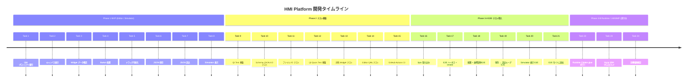

# 開発ヒストリー

本リポジトリの開発を **タスク単位の時系列** で俯瞰するためのドキュメント。第三者（新規参加者・レビュアー・関係部署）が「どんな順序でどこまで作ってきたか」を 1 枚で把握できることを目的とする。

- 各 Task は **目的 / PR / 主な成果物 / 学び** の 4 行を基本とする（簡潔さ優先）。
- 詳細な計画・受け入れ基準は `Docs/phase*-plan.md` を参照。罠と回避策は [CLAUDE.md](../CLAUDE.md) に集約。
- 進捗状態（✅ 完了 / ⏳ 未着手）の一覧は [README.md](../README.md#フェーズ進捗) を参照。

## タイムライン俯瞰

---

## Phase 1: MVP — Editor / Simulator の作画 → 保存 → 読込

**目標**：Editor で Widget を配置し、JSON で保存して Simulator が同じ JSON を描画できる最小ループを成立させる。
**計画書**：[phase1-mvp-plan.md](phase1-mvp-plan.md)（2026-05-30 に他フェーズと体裁を揃えて事後整理。Phase 1 は計画書化前に完了したため、本ヒストリーと各 PR を一次情報として遡って作成）

### Task 1: Qt6 プロジェクト雛形

- **目的**：CMake ルートと Editor / Simulator / Shared/Schema / Shared/Widgets の 4 サブプロジェクト構成を立ち上げる。
- **PR**：`f195a0c`（リポジトリ初期化期のため直接コミット、PR 番号なし）
- **成果物**：ルート `CMakeLists.txt`、各サブディレクトリの最小 `qt_add_executable` / `qt_add_qml_module` / `qt_add_library`。
- **学び**：macOS 14+ では同梱 Qt 6.7.0 が `AGL.framework` 不在でリンク不可。Homebrew Qt 6.8+ を `CMAKE_PREFIX_PATH` で指定する運用を確立。

### Task 2: キャンバス表示 ([PR #4](https://github.com/hang-up33/hmi-platform/pull/4))

- **目的**：Editor の中央に 1024×600 の編集領域（`EditorCanvas`）を描画する。
- **成果物**：`EditorCanvas.qml`、`HmiEditor` モジュールの起動経路（`loadFromModule("HmiEditor", "Main")`）。
- **学び**：QtQuick 標準型と同名の QML ファイルは衝突する（`Canvas.qml` 不可）。プレフィックス命名（`EditorCanvas`）で回避。

### Task 3: Widget データ構造定義 ([PR #6](https://github.com/hang-up33/hmi-platform/pull/6))

- **目的**：Widget / Screen / Project の型と JSON I/O を `Shared/Schema` に集約する。
- **成果物**：`hmi::schema::WidgetData` / `ScreenData` / `ProjectData`（struct + namespace スタイル）、各型に `toJson()` / `fromJson()`。
- **学び**：Schema は唯一の真実とし、Q_GADGET / Q_OBJECT は必要になるまで付けない。利用側で検証ロジックが散らないよう、後の Task 7 で `isValidJson()` も Schema 側に集約する設計を確立。

### Task 4: Button 配置 ([PR #7](https://github.com/hang-up33/hmi-platform/pull/7))

- **目的**：「ボタンを追加」操作で Canvas に Button widget を 1 つ生やす。
- **成果物**：`HmiButton.qml`（共有 Widget）、`EditableWidget.qml`、`widgetModel` の概念を導入。
- **学び**：共有 QML モジュール（`HmiWidgets`）は `STATIC` でビルドし利用側で `hmi_widgetsplugin` を直リンクする構成が Qt 6.11 で唯一安定。

### Task 5: ドラッグ可能化 ([PR #10](https://github.com/hang-up33/hmi-platform/pull/10))

- **目的**：配置済み Widget をマウスドラッグで移動可能にする。
- **成果物**：`EditableWidget.qml` の `MouseArea.drag.target` 設定、座標更新を `widgetModel` へ反映。
- **学び**：`var` 配列の `widgetModel` は in-place push でバインディング通知が出ないため、配列ごと差し替え（`concat`）する運用に。これは後の Task 19 E2E で「Repeater 再生成によるバインディング巻き戻し」の罠を呼ぶ伏線になる。

### Task 6: JSON 保存 ([PR #11](https://github.com/hang-up33/hmi-platform/pull/11))

- **目的**：Editor の状態を `ProjectData` に変換し JSON ファイルに保存する。
- **成果物**：`Editor::ProjectIo`（`setContextProperty("projectIo", ...)` で QML 公開）、FileDialog 経由の保存 UI。
- **学び**：`FileDialog.selectedFile` は `file://` 形式の `QUrl` なので `toLocalFile()` で OS パス化。書き込みは `QSaveFile.commit()` で原子的に。

### Task 7: JSON 読込 ([PR #14](https://github.com/hang-up33/hmi-platform/pull/14))

- **目的**：保存済み JSON を Editor で再オープンし状態を復元する。
- **成果物**：`ProjectIo::load()`、`ProjectData::isValidJson()` を含む階層的バリデーション API。
- **学び**：`fromJson()` はキー欠落を既定値で埋める緩い設計のため、読込側は必ず `isValidJson()` を先に通す規約を確立。AppleScript で Qt QML のボタンを自動クリックする手段は事実上ない（後の E2E で Spix 採用の根拠に）。

### Task 8: Simulator 表示 ([PR #16](https://github.com/hang-up33/hmi-platform/pull/16))

- **目的**：Editor が出した JSON を Simulator（読み取り専用）が同じレイアウトで描画する。
- **成果物**：`Simulator::ProjectLoader`、`--open <path>` CLI、`HmiSimulator` モジュール。
- **学び**：起動時自動ロードは `QCommandLineParser` + `setContextProperty("initialJsonUrl", ...)` で軽量に実装可能。Editor と Simulator で同等の load() ロジックが重複するが、責務が違うので Shared に統合せず両方に独立保持する判断を確立。

---

## Phase 2: テスト基盤導入

**目標**：Qt Test（C++ ユニット）・Qt Quick Test（QML 振る舞い）・CI を整備し、退行を機械的に検出できる土台を作る。
**計画書**：[Docs/phase2-testing-plan.md](phase2-testing-plan.md)

### Task 9: Qt Test 基盤構築 ([PR #18](https://github.com/hang-up33/hmi-platform/pull/18))

- **目的**：`ctest` で C++ ユニットテストを走らせる仕組みを入れる。
- **成果物**：ルート `enable_testing()`、`tests/unit/` ディレクトリ、smoke テスト 1 件。
- **学び**：`find_package(Qt6 ... Test)` は `BUILD_TESTING` で条件化（Codex 指摘）。これでテスト無効ビルド時の不要依存を回避。

### Task 10: Schema JSON I/O テスト ([PR #21](https://github.com/hang-up33/hmi-platform/pull/21))

- **目的**：`hmi_schema` の `toJson()` / `fromJson()` / `isValidJson()` をユニットテストで担保。
- **成果物**：`tests/unit/SchemaTest.cpp`、Widget / Screen / Project 3 層分のラウンドトリップテスト。
- **学び**：JSON I/O テストは Schema が唯一の真実である以上、ここで仕様変更の retro 影響を可視化する。

### Task 11: ファイル I/O テスト（ProjectIo / ProjectLoader） ([PR #22](https://github.com/hang-up33/hmi-platform/pull/22))

- **目的**：Editor の保存と Simulator の読込が実ファイル経由で対称であることを保証。
- **成果物**：`ProjectIoTest` / `ProjectLoaderTest`、一時ディレクトリ経由の保存→読込ラウンドトリップ。
- **学び**：FileDialog を介さない API レベルのテストとして整理。「Editor / Simulator の load() は重複を許容」の決定が、ここで両方独立にテストする方針に整合。

### Task 12: Qt Quick Test 基盤構築 ([PR #23](https://github.com/hang-up33/hmi-platform/pull/23))

- **目的**：QML 側の振る舞いを `tst_*.qml` で書ける土台を入れる。
- **成果物**：`tests/quick/` の `qt_add_test` 経路、smoke QML テスト。
- **学び**：`add_test` には `-platform offscreen` を明示（Codex 指摘）。CI / ローカル両環境で display 依存を排除。

### Task 13: 共有 Widget テスト（HmiButton） ([PR #24](https://github.com/hang-up33/hmi-platform/pull/24))

- **目的**：`HmiWidgets` モジュールの最小コンポーネントを QML テストで担保。
- **成果物**：`tst_HmiButton.qml`、`Shared/Widgets` の plugin リンク経路の検証。
- **学び**：共有モジュールを `STATIC` plugin として使う構成がテスト側でも素直に通る（=実アプリと同じリンクパターン）。

### Task 14: Editor QML テスト（Canvas / EditableWidget） ([PR #25](https://github.com/hang-up33/hmi-platform/pull/25))

- **目的**：Editor の Canvas / EditableWidget の生成・配置ロジックを QML テストで担保。
- **成果物**：`tst_EditorCanvas.qml`、Repeater delegate 生成完了の `tryVerify` 待ち。
- **学び**：Repeater delegate は次の event loop で生成されるため `tryVerify` で待つ（Codex P2 Major 指摘）。Task 19 で踏む「再生成によるバインディング巻き戻し」と同根の問題系。

### Task 15: CI 整備（GitHub Actions） ([PR #26](https://github.com/hang-up33/hmi-platform/pull/26))

- **目的**：macOS / Windows の matrix で `cmake --build` と `ctest` を自動実行する。
- **成果物**：`.github/workflows/ci.yml`、`jurplel/install-qt-action@v4` 経由の Qt 6.10.0 インストール、Tools 階層キャッシュ。
- **学び**：CI 用 Qt はローカル開発バージョン（6.11.x）を追従しない方が安定。aqtinstall は最新リリースに mirror 同期遅延があり 6.11.0 で `Failed to locate XML data` で落ちた → 1〜2 マイナー下げた 6.10.0 で安定取得。

---

## Phase 3-A: E2E テスト導入

**目標**：Editor 配置 → JSON 保存 → Simulator 表示までの cross-app 動作を `ctest -L e2e` で自動検証する。
**計画書**：[Docs/phase3-e2e-plan.md](phase3-e2e-plan.md)

### Task 16: Spix 取り込み + Editor / Simulator 統合 ([PR #28](https://github.com/hang-up33/hmi-platform/pull/28))

- **目的**：E2E フレームワーク Spix（OSS / MIT、`faaxm/spix` v0.14）を導入し、`--e2e` フラグで Spix サーバを起動可能にする。
- **成果物**：FetchContent で Spix + AnyRPC を取得、`Editor/src/main.cpp` / `Simulator/src/main.cpp` に `--e2e` / `--e2e-port` を追加（既定 9876 / 9877）。
- **学び**：AnyRPC は upstream 未メンテで罠の宝庫（`CMAKE_POLICY_VERSION_MINIMUM`、`CMAKE_SOURCE_DIR` 誤動作、`SpixCoreTargets` 同梱、MinGW での `std::recursive_mutex` 衝突）。Windows MinGW では `HMI_ENABLE_E2E` 既定 OFF で opt-out 運用。詳細罠リストは CLAUDE.md「Spix（E2E）統合の罠」節へ集約。

### Task 17: E2E ハーネス雛形 + smoke 1 件 ([PR #29](https://github.com/hang-up33/hmi-platform/pull/29))

- **目的**：Python テストランナー（`tests/e2e/harness.py`）と最初の smoke E2E（アプリ起動 → Spix サーバ応答確認）を入れる。
- **成果物**：`harness.py`（`urllib.request` で XML-RPC を直接 POST する実装）、`subprocess` でアプリ起動／終了する contextmanager、smoke ケース 1 件。
- **学び**：Homebrew Python 3.14 の `_pyexpat` が macOS の libexpat と非互換で `xmlrpc.client` が落ちる → urllib + 文字列マッチで回避し全環境で同じ実装を使う。`QT_QPA_PLATFORM=offscreen` を harness 側で `setdefault` し display 非依存。

### Task 18: Editor 配置 + 座標反映 E2E ([PR #30](https://github.com/hang-up33/hmi-platform/pull/30))

- **目的**：Editor を Spix から操作して widget を配置し、座標変更が JSON に乗ることを検証。
- **成果物**：`tests/e2e/test_editor_place.py`、`widget_<id>` objectName 規約、`setStringProperty(path, "x", "<n>")` による座標変更。
- **学び**：Spix の `mouseBeginDrag` / `mouseEndDrag` は item 中央間の drag&drop モデルしか持たず、offscreen 環境では drag 閾値判定にも届かない → 座標変更は `setStringProperty` で代替。実マウスドラッグの検証は Phase 3-B 以降の手動 / 別タスク扱い。

### Task 19: JSON 保存 → 読込ループ E2E ([PR #31](https://github.com/hang-up33/hmi-platform/pull/31))

- **目的**：Editor 配置 → 保存 → 再起動 → 復元のラウンドトリップを E2E 化。
- **成果物**：`Main.qml` の `saveTo(path)` 関数化（FileDialog を介さない E2E ハンドル）、Editor `--open` CLI（Simulator と命名統一）、`invokeMethod` 配列引数対応。
- **学び**：FileDialog は Spix から自動操作不可 → Window 直下に `Q_INVOKABLE` 相当の関数を生やし `invokeMethod` で呼ぶパターンを確立。Repeater 再生成で座標が巻き戻る事故 → 「Repeater サイズ変更 → 全 widget 座標変更」の順序固定で防御。

### Task 20: Simulator 表示 E2E ([PR #32](https://github.com/hang-up33/hmi-platform/pull/32))

- **目的**：Editor が出した JSON を Simulator が起動して描画するまでを cross-app で検証。
- **成果物**：Editor=`hmiEditorWindow` / Simulator=`hmiSimulatorWindow` の objectName 規約、`spix_app` contextmanager を 2 段重ねで順次起動するパターン。
- **学び**：Editor を terminate してから Simulator を起動する設計で「今どちらが落ちたか」のデバッグが容易に。中間 JSON は `tempfile.mkstemp` → finally で `os.unlink`。

### Task 21: E2E ジョブを GitHub Actions に追加 ([PR #33](https://github.com/hang-up33/hmi-platform/pull/33))

- **目的**：`ctest -L e2e` を CI で常時走らせる。
- **成果物**：`.github/workflows/ci.yml` に E2E ステップ追加、`actions/setup-python@v5` の明示インストール。
- **学び**：Windows MinGW では `HMI_ENABLE_E2E=OFF` のため `add_test` 自体が登録されず `ctest -L e2e` は warning で exit 0 → matrix を OS で分けずに 1 ジョブで「macOS は 4 件走る／Windows はスキップ」を両立。

---

## Phase 3-B: Runtime / i.MX8MP 対応（進行中 — Task 22 完了）

**目標**：Simulator と同じ JSON 描画機能を i.MX8MP 実機（Yocto / Wayland or EGLFS）で動かす Runtime を導入する。
**計画書**：[Docs/phase3b-runtime-plan.md](phase3b-runtime-plan.md)（v2、PR [#37](https://github.com/hang-up33/hmi-platform/pull/37) で策定）
**方針**：Simulator/ のソースを共有して `hmi_runtime` バイナリを生成し、3 バイナリ構成（hmi_editor / hmi_simulator / hmi_runtime）を維持。開発ホストは Windows 母艦 + WSL2 で、Yocto SDK クロスビルドは **WSL2 内**で実施。実機 image が Qt6 非対応（zeus 5.4、2026-05-30 判明）のため、Task 23 は新 BSP（scarthgap）で `imx-image-full` をビルドして実機更新 → 同一 BSP から SDK 生成、に拡張（詳細は計画書 §「実機 image 調査結果と更新方針」）。

### Task 22: Runtime CMake glue ([PR #39](https://github.com/hang-up33/hmi-platform/pull/39))

- **目的**：Simulator の QML module を `STATIC` library 化し、`Runtime/CMakeLists.txt` の glue だけで `hmi_runtime` バイナリをホストビルド可能にする。
- **成果物**：`hmi_simulator_qmlplugin`（STATIC、`Simulator/CMakeLists.txt`）、共通 function `hmi_add_simulator_like_executable`、`Runtime/CMakeLists.txt`（C++ ソースは Simulator/ を `CMAKE_CURRENT_FUNCTION_LIST_DIR` 経由で参照）、ホスト起動スクショ `Docs/screenshots/task-22-runtime-host.png` / `task-22-simulator-host.png`。
- **学び**：Qt の `qt_add_qml_module` を実行ファイル直結にすると別バイナリから共有できない → STATIC plugin + 直リンクが必須（`Shared/Widgets` と同パターン）。C++ ソース共有は CMake 関数 + `CMAKE_CURRENT_FUNCTION_LIST_DIR` でディレクトリを跨いだ参照が成立。Runtime/ には `.cpp` / `.qml` / `.h` を置かない原則を維持。hmi_simulator / hmi_runtime の PC ビルドが同一 JSON で完全一致のレイアウトを描画することを目視確認。

### Task 23: Yocto SDK で hmi_runtime をクロスビルド（⏳ 未着手）

- **目的**：`hmi_runtime` を aarch64 ELF として生成。**前提変更（2026-05-30）**：実機の現行 image が Qt6 非対応（NXP zeus 5.4）と判明したため、**WSL2 内で NXP 新 BSP（scarthgap）の `imx-image-full` をビルドして実機 image を更新し、同一 BSP から生成した SDK** でクロスビルドする（詳細は [phase3b-runtime-plan.md](phase3b-runtime-plan.md) §「実機 image 調査結果と更新方針」）。
- **予定成果物**：`scripts/yocto/cross-build.sh`、`-DHMI_ENABLE_E2E=OFF -DBUILD_TESTING=OFF -DCMAKE_TOOLCHAIN_FILE=...` 固定のラッパー。
- **設計判断**：Spix / AnyRPC はクロスビルド互換性に難があるため E2E は明示 OFF。ビルドは `--target hmi_runtime` のみで PC 専用 Editor / Simulator は build しない（時間と失敗要因を削る）。

### Task 24: i.MX8MP 実機で hmi_runtime を起動し JSON 描画（⏳ 未着手）

- **目的**：実機に `scp` で配布し、Editor が出した既存 JSON を実機画面で描画する。
- **予定成果物**：実機画面の手動撮影写真 `Docs/screenshots/task-24-runtime-imx.jpg` を PR 本文に添付。
- **設計判断**：実機固有の問題（フォント不足 / QPA 不整合 / タッチ座標）が大きい場合は追加タスクに切り出し、Phase 3-B-3 を肥大化させない。PC → i.MX 転送機能は **OS レイヤの責務** として Phase 3-C 候補（Runtime バイナリには入れない）。

---

## 関連ドキュメント

- [README.md](../README.md) — 進捗表（状態のみ）・ビルド手順・スクリーンショット
- [CLAUDE.md](../CLAUDE.md) — Claude Code 向けの作業指針・既知の罠の集約
- [AGENTS.md](../AGENTS.md) — Codex GitHub App 向けのレビュー指針
- [Docs/phase2-testing-plan.md](phase2-testing-plan.md) — Phase 2 計画書
- [Docs/phase3-e2e-plan.md](phase3-e2e-plan.md) — Phase 3-A 計画書
- [Docs/phase3b-runtime-plan.md](phase3b-runtime-plan.md) — Phase 3-B 計画書 v2
- [Docs/qml-canvas-structure.md](qml-canvas-structure.md) — Canvas.qml の構造解説
