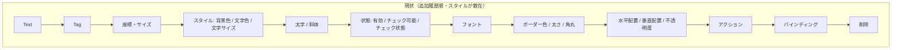
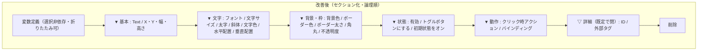

# インスペクタ UX 改善計画（Task 44〜46）

> **位置づけ**：Phase 4（Button 縦スライス Task 25〜43）で項目を積み増した結果、Editor 右側インスペクタが
> **約 20 個のフィールドが平坦に並ぶ**状態になり、スタイル系が散在し・技術的/未配線のプロパティが
> 混ざって「どこを触ればよいか分かりづらい」。**Phase 5（横展開＝新 Widget 種別 Label / Lamp 等）に
> 進む前に、インスペクタの配置を整理し分かりづらいプロパティを片付ける**（横展開すると同じ散らかりが
> 各 Widget 種別へ波及するため、テンプレを綺麗にしてから増やす）。**スキーマ・round-trip・objectName は
> 不変**（表示・配置・ラベルのみ変更）で、既存 unit / E2E を緑のまま保つことを完了基準に含める。

関連：進捗の正本は本ファイル「進捗」表。横展開本体は [phase4-button-slice-plan.md](phase4-button-slice-plan.md)「Phase 5 候補」。
インスペクタ結線規約は [.claude/rules/qml-module-conventions.md](../.claude/rules/qml-module-conventions.md)（2 本立て編集・objectName）。

---

## 現状の問題

`Editor/qml/Main.qml` の単一選択フォームは、ボールド Label を見出し代わりにした**平坦な 1 列**で、追加履歴順（Task 26→43）にフィールドが並ぶ。結果：

- **文字/フォント関連が 3 箇所に分散**：文字サイズ（"スタイル"）/ 太字・斜体（独立）/ フォント family（独立）/ 配置（最後）。
- **色関連が 2 箇所に分散**：背景色・文字色（"スタイル"）と ボーダー色（後方）。
- **グルーピングが無く約 20 項目が一望**で、スクロールしないと削除ボタン等に届かない（T31 で ScrollView 化済みだが平坦さは残る）。
- **技術的/未配線のプロパティが混在**：`ID`（読み取り専用・内部値）、`Tag`（保存のみで機能未配線）。

### 分かりづらいプロパティの棚卸し

| プロパティ | 現ラベル | 実態 | 問題 | 対応方針 |
|---|---|---|---|---|
| `id` | `ID: btnXXX` | 内部一意 ID（読み取り専用） | UI 設計者に無意味・場所を取る | **「詳細」セクション（既定で折りたたみ）へ降格** |
| `tag` (`widgetTag`) | `Tag` | `WidgetData.tag`。保存/round-trip されるが**アクション/バインディングは変数を参照しており tag はどこにも配線されていない**（"PLC.START" 等の外部識別子の想定だが現状は未使用） | 何に使うか分からない・Text と紛らわしい | **ラベルを「外部タグ（PLC アドレス等）」に明確化し「詳細」へ降格**。削除はしない（round-trip 維持・将来の PLC 連携用フィールド） |
| `checkable` | `チェック可能` | トグル動作の有効化 | 「checkable」直訳で意味不明 | **「トグルボタンにする」へリネーム + ツールチップ** |
| `checked` | `チェック状態（初期）` | 初期トグル状態 | 〃・括弧書きが冗長 | **「初期状態をオン」へリネーム**（checkable 連動の enabled は据置） |
| 背景色 / 文字色 / ボーダー色 | hex 手入力 `#RRGGBB` | 色文字列 | 手入力が手間・**現在色が見えない** | **入力欄の隣に色スウォッチ（プレビュー）を表示**（Task 46。任意で ColorDialog） |

---

## 改善後のレイアウト

選択中フォームを**折りたたみ可能なセクション**に再編し、関連プロパティを集約・論理順に並べ替える。

| セクション | 含めるフィールド（既存 objectName 維持） | 既定 |
|---|---|---|
| 変数定義 | variablePanel（addVariableButton / variableName_* …） | 開（折りたたみ可に） |
| 基本 | inspectorTextField / inspectorGeometryGrid（X・Y・幅・高さ） | 開 |
| 文字 | inspectorFontFamilyCombo / inspectorFontSizeSpin / inspectorFontBoldCheck / inspectorFontItalicCheck / inspectorTextColorField / inspectorHAlignCombo / inspectorVAlignCombo | 開 |
| 背景・枠 | inspectorBgColorField / inspectorBorderColorField / inspectorBorderWidthSpin / inspectorRadiusSpin / inspectorOpacitySpin | 開 |
| 状態 | inspectorEnabledCheck / inspectorCheckableCheck / inspectorCheckedCheck | 開 |
| 動作 | inspectorActionOpCombo / …Target / …Value / inspectorBindingPropCombo / …Var | 開 |
| 詳細 | inspectorIdLabel / inspectorTagField | **閉** |

> **折りたたみセクションの実装**：QtQuick.Controls の `GroupBox` には開閉が無いため、
> 「ヘッダ Label（クリックで `expanded` をトグル、▼/▽ 表示）+ `Column { visible: expanded }`」の
> 小さな inline コンポーネント（`InspectorSection`）を 1 つ作って各グループに使う。**既存の
> 2 本立て編集結線（onTextEdited / Connections.onSelectedItemChanged）・objectName は一切変えない**
> （[qml-module-conventions](../.claude/rules/qml-module-conventions.md)）。

---

## タスク分割（1 タスク = 1 PR、ビルド + 緑が完了基準）

| Task | スコープ | 完了基準 |
|---|---|---|
| **44** | **セクション化 + 論理的再配置**。`InspectorSection`（ヘッダ + 折りたたみ Column）を導入し、単一選択フォームを上表の 6 セクション（基本/文字/背景・枠/状態/動作/詳細）へ再編。変数定義パネルも折りたたみ可に。**フィールドの移動・並べ替えのみ**でロジック・objectName・スキーマは不変。詳細セクションは既定で閉。 | `cmake --build` 成功。Web で `ctest`（unit + e2e）緑。`editor.png` 撮り直し + キャプション更新。 |
| **45** | **分かりづらいプロパティの整理**。ID/Tag を詳細セクションへ（Task 44 で枠は用意）し、Tag ラベルを「外部タグ（PLC アドレス等）」へ。`チェック可能`→「トグルボタンにする」、`チェック状態（初期）`→「初期状態をオン」。主要フィールドへ `ToolTip`（QtQuick.Controls）で 1 行説明を付与。**スキーマ・objectName・round-trip 不変**（表示ラベル + ツールチップのみ）。 | 同上（unit + e2e 緑・スクショ同期）。 |
| **46（任意）** | **色入力の改善**。背景色 / 文字色 / ボーダー色の hex TextField の隣に**色スウォッチ**（現在色の小矩形）を表示し、クリックで `ColorDialog`（QtQuick.Dialogs・既存 import）を開いて選択 → hex を書き戻す。手入力欄も残す（E2E は inspectorBgColorField の hex 入力に依存）。 | 同上。任意のため未着手でも Phase 5 着手可。 |

### 制約・非スコープ（Codex 向け補足）

- **スキーマ変更なし**：`WidgetData` のフィールド・JSON キー・round-trip は完全に不変。本計画は Editor の表示層のみ。
- **objectName 不変**：E2E（Spix）は `inspectorBgColorField` と canvas 上の widget プロパティ（`widgetBackgroundColor` 等）を参照する。**ラベル（visible text）だけ変え objectName は据置**。折りたたみで `visible:false` になる項目は **詳細セクション（ID/Tag）のみ**で、E2E はこれらに依存しないため緑を維持できる（既定で開くセクションに E2E 依存項目を残す）。
- **Simulator / Runtime は対象外**：インスペクタは Editor のみ（読み取り専用アプリは編集 UI を持たない）。
- **動作（アクション/バインディング）の仕様は変えない**：UI の置き場所のみ整理。
- **README スクショ同期**：見た目が変わるため Task 44/45 で `Docs/screenshots/editor.png` とキャプションを同コミットで更新（[readme-screenshot-sync](../.claude/rules/readme-screenshot-sync.md)）。

---

## 進捗

| Task | 状態 | PR |
|---|---|---|
| 44 セクション化 + 再配置 | 未着手 | — |
| 45 分かりづらいプロパティ整理 | 未着手 | — |
| 46 色スウォッチ（任意） | 未着手 | — |

> **本計画完了後に Phase 5（横展開＝新 Widget 種別）へ進む**。Phase 5 のスコープは別途ユーザー承認する
> （[phase4-button-slice-plan.md](phase4-button-slice-plan.md)「Phase 5 候補」）。
