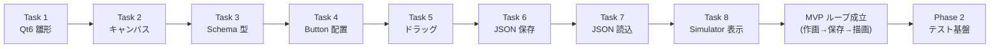

# Phase 1: MVP — Editor / Simulator の作画 → 保存 → 読込

Editor で Widget を配置し、JSON で保存して Simulator が同じ JSON を描画できる **最小ループ（MVP）** を成立させるフェーズ。Task 1〜8 で構成する。運用は、以降のフェーズで定着する **1 タスク = 1 ブランチ = 1 PR** を概ね踏襲する（ただし **Task 1 はリポジトリ初期化期のため直接コミット・PR なし**。Task 2 以降が PR 経由）。完了基準は `cmake --build` 緑 ＋ 該当動作の確認。

> **本書の位置づけ（2026-05-30 事後作成）**：Phase 1 / MVP は「フェーズごとに計画書を書く」運用が定着する **前**（Phase 2 以降で定着）に完了したため、当時は計画書が存在しなかった。本書は他フェーズ（[phase2-testing-plan.md](phase2-testing-plan.md) / [phase3-e2e-plan.md](phase3-e2e-plan.md) / [phase3b-runtime-plan.md](phase3b-runtime-plan.md)）と体裁を揃えるため、**[development-history.md](development-history.md) と各 PR を一次情報として遡って整理**したもの。計画段階の予測ではなく「何をやり、何を完了基準としたか」の確定記録（事後まとめ）である。罠と回避策の集約は [CLAUDE.md](../CLAUDE.md) を参照。

---

## タスク一覧

完了基準はすべて共通の前提として **`cmake --build` 緑（macOS / Windows）＋ GUI 起動での該当動作確認** を含む。下表の「完了基準」はそれに加えるタスク固有の達成条件を記す。

| # | タスク | スコープ | 完了基準（固有分） |
|---|---|---|---|
| 1 | Qt6 プロジェクト雛形 | CMake ルートと **Editor / Simulator / Shared/Schema / Shared/Widgets の 4 サブプロジェクト構成**を立ち上げる。各サブディレクトリに最小の `qt_add_executable` / `qt_add_qml_module` / `qt_add_library`。PR：`f195a0c`（初期化期のため直接コミット、PR 番号なし） | 4 ターゲットが生成され、Editor / Simulator が空ウィンドウで起動する |
| 2 | キャンバス表示 ([PR #4](https://github.com/hang-up33/hmi-platform/pull/4)) | Editor 中央に **1024×600 の編集領域 `EditorCanvas`** を描画。`loadFromModule("HmiEditor", "Main")` の起動経路を確立 | Editor 起動でキャンバスが表示される |
| 3 | Widget データ構造定義 ([PR #6](https://github.com/hang-up33/hmi-platform/pull/6)) | Widget / Screen / Project の型と JSON I/O を **`Shared/Schema` に集約**（struct + `namespace hmi::schema`、各型に `toJson()` / `fromJson()`） | 型のラウンドトリップ（生成 → JSON → 復元）が成立 |
| 4 | Button 配置 ([PR #7](https://github.com/hang-up33/hmi-platform/pull/7)) | 「ボタンを追加」操作で Canvas に Button widget を 1 つ生やす。`HmiButton.qml`（共有 Widget）/ `EditableWidget.qml` / `widgetModel` の概念を導入 | 追加操作でボタンがキャンバスに出る |
| 5 | ドラッグ可能化 ([PR #10](https://github.com/hang-up33/hmi-platform/pull/10)) | 配置済み Widget を **マウスドラッグで移動**可能にし、座標更新を `widgetModel` に反映 | ドラッグで Widget が動き、座標がモデルに反映される |
| 6 | JSON 保存 ([PR #11](https://github.com/hang-up33/hmi-platform/pull/11)) | Editor の状態を `ProjectData` に変換し **JSON ファイルへ保存**。`Editor::ProjectIo`（`setContextProperty` で QML 公開）+ FileDialog 保存 UI | 保存した JSON が妥当な内容で書き出される |
| 7 | JSON 読込 ([PR #14](https://github.com/hang-up33/hmi-platform/pull/14)) | 保存済み JSON を Editor で再オープンし状態を復元。`ProjectIo::load()` と **`ProjectData::isValidJson()` を含む階層的バリデーション API** | 読込で配置状態が復元される。不正 JSON は弾く |
| 8 | Simulator 表示 ([PR #16](https://github.com/hang-up33/hmi-platform/pull/16)) | Editor が出した JSON を **Simulator（読み取り専用）が同じレイアウトで描画**。`Simulator::ProjectLoader` / `--open <path>` CLI / `HmiSimulator` モジュール | Editor と Simulator が同一 JSON を同一レイアウトで描画（**MVP ループ成立**） |

---

## このフェーズで確立した規約（以降も有効）

Phase 1 は本リポジトリの基本ルールが生まれたフェーズでもある。詳細・罠は [CLAUDE.md](../CLAUDE.md) に集約済み。要点：

- **Shared/Schema が唯一の真実**（Task 3）：Widget / Screen / Project の型と JSON I/O はここにのみ定義。`Q_GADGET` / `Q_OBJECT` は必要になるまで付けない（struct + namespace スタイル）。
- **検証は Schema 側に集約**（Task 7）：`fromJson()` はキー欠落を既定値で埋める緩い設計のため、読込側は必ず `isValidJson()` を先に通す。`ProjectData → ScreenData → WidgetData` と階層的に検証。
- **QtQuick 標準型と同名の QML を作らない**（Task 2）：`Canvas.qml` 等は衝突する。プレフィックス命名（`EditorCanvas` / `HmiButton`）で回避。
- **共有 QML モジュールは `STATIC` + 利用側で plugin 直リンク**（Task 4）：`HmiWidgets` を STATIC でビルドし `hmi_widgetsplugin` をリンクする構成が Qt 6.11 で唯一安定（後の Task 22 の `hmi_simulator_qml` STATIC 化の原型）。
- **`var` 配列モデルは配列ごと差し替え**（Task 5）：in-place push ではバインディング通知が出ないため `concat` で差し替える。← 後の Task 19 E2E で「Repeater 再生成によるバインディング巻き戻し」の罠を呼ぶ伏線。
- **`FileDialog.selectedFile` は `file://` の `QUrl`**（Task 6）：`toLocalFile()` で OS パス化し、`QSaveFile.commit()` で原子的に保存。
- **C++ ヘルパーは利用側アプリに置き `setContextProperty` で公開**（Task 6/8）：`hmi_schema` は QML を一切知らないことを保つ。Editor `ProjectIo` と Simulator `ProjectLoader` は load() がほぼ同一でも責務（編集 vs 読み取り専用）が違うため Shared に統合せず両方に独立保持。
- **AppleScript で Qt QML のボタンは自動クリックできない**（Task 7）：動作証跡は初期状態スクショ＋手動補完で対応。← 後の Phase 3-A で E2E フレームワーク **Spix** を採用する根拠。

---

## Phase 2 への接続

MVP ループ（作画 → 保存 → 読込 → Simulator 描画）が成立したことで、回帰を守る土台として **テスト基盤の導入（Phase 2 / Task 9〜15）** へ進んだ。Phase 1 で確立した「Schema 集約」「ProjectIo / ProjectLoader の責務分離」は、Phase 2 の Qt Test（C++ ロジック）/ Qt Quick Test（QML）の対象がそのまま定まる形で引き継がれている。詳細は [phase2-testing-plan.md](phase2-testing-plan.md)。

---

## 進捗

| # | タスク | 状態 |
|---|---|---|
| 1 | Qt6 プロジェクト雛形 | ✅ 完了 |
| 2 | キャンバス表示 | ✅ 完了 |
| 3 | Widget データ構造定義 | ✅ 完了 |
| 4 | Button 配置 | ✅ 完了 |
| 5 | ドラッグ可能化 | ✅ 完了 |
| 6 | JSON 保存 | ✅ 完了 |
| 7 | JSON 読込 | ✅ 完了 |
| 8 | Simulator 表示 | ✅ 完了 |
