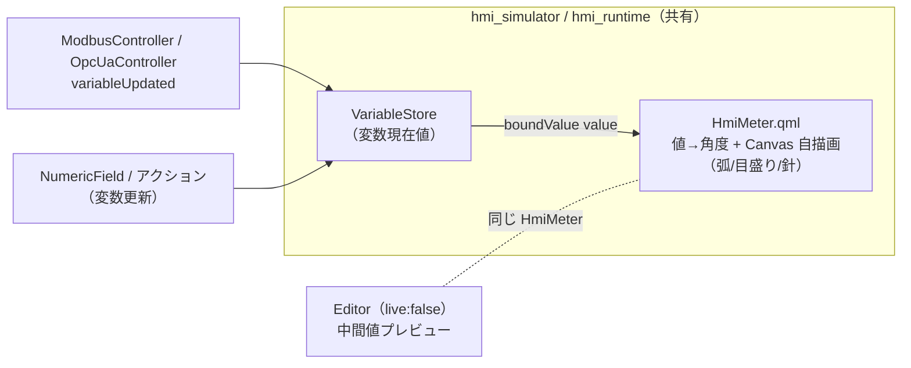

# Phase 10 計画 — メーター（Meter / 車のスピードメーター風）

新 Widget 種別「Meter」を追加する。Phase 5（Label）/ Phase 6（NumericField）/ Phase 8（Trend）で
確立した**横展開テンプレ**（resolved\* フォールバック方式 + Schema 4 メソッド + delegate 型分岐 +
インスペクタ型対応 + cross-app E2E）に乗せ、Meter が初めて必要にする差分（① 円弧＋針の Canvas 自描画、
② 値→角度マッピング、③ Canvas 不可視性に対するテスト用プロパティ公開）だけを上積みする。

> **進捗の正本は本ファイル「進捗」表**。承認・着手でステータスが動いたら常駐文書
> （CLAUDE.md / AGENTS.md / README / mvp-task-runner / development-history）を同期する
> （[feedback-phase-status-sync](../.claude/rules/feedback-phase-status-sync.md)）。

## 承認状態

**着手承認（2026-06-27）** — ユーザー要望「メーター欲しいね」+ 形状確定
（**車のスピードメーター風＝円弧（アーク）＋針**、読み取り専用表示、MVP 単一スタイル）。

## 確定スコープ（ユーザー合意）

| 項目 | 決定 |
|---|---|
| 名称 | **「Meter」**（"Gauge" ではなくユーザー指定の「メーター」。`type:"Meter"` / `HmiMeter.qml` / objectName `hmiMeter`） |
| 形状 | **車のスピードメーター風＝円弧（アーク）＋針**。`[meterMin, meterMax]` を一定の角度範囲（弧）にマッピングし、針が現在値を指す。中央に数値（+ 単位）を表示 |
| 描画 | **QML `Canvas` 自描画**（弧・目盛り・針を自描画）。**QtCharts / QtQuick.Controls 等の新規 Qt モジュール依存は入れない**（Trend と同じく `import QtQuick` のみ） |
| 動機 | `Canvas` は新モジュール依存ゼロ＝i.MX8MP rootfs にそのまま載る（Phase 7 で QtSerialBus が kit/rootfs 未同梱だった轍を踏まない。Trend で実証済み） |
| 役割 | **読み取り専用表示**（Label/Trend と同様）。bound 変数の「読み」のみ。書きはしない |
| 値源 | 既存 `bindings`（`{property:"value", variable:X}`）の「読み」を再利用（Schema / C++ ブリッジ無改変） |
| スタイル | MVP は**単一スタイル**（弧の角度範囲・針形状は HmiMeter に既定として持つ）。複数スタイル（半円のみ・360°リング等）・色帯（緑/黄/赤ゾーン）は非スコープ（後続候補） |

## 各アプリの役割・ソース共有

| アプリ | 動作環境 | Meter の振る舞い |
|---|---|---|
| Editor | PC 専用 | 設計面。ライブ値無し → 中間値（例 `meterMin`/`meterMax` の中点）でプレビュー（`live:false`）。追加 UI・インスペクタ編集 |
| Simulator | PC | `boundValue("value")` 変化で針が追従（`live:true`） |
| Runtime | 実機 i.MX8MP | **Simulator とソース完全共有で自動継承**（`Runtime/` 無改変） |

## アーキテクチャ



## タスク分割（1 タスク = 1 PR、`cmake --build` + Web `ctest` 緑が完了基準）

| Task | スコープ | 完了基準 |
|---|---|---|
| **M-A: Schema 拡張** | `WidgetData` に Meter 固有フィールドを追加（§Schema）。`toJson`/`fromJson`/`toVariantMap`/`fromVariantMap` の **4 メソッド**を揃える（C++ ブリッジ無改変）。`isValidJson` 必須集合（id/type/width/height）は**不変**＝全 optional ＝後方互換。`tst_widget_data.cpp` に round-trip（presence true/false 両方）を追加。**QML/描画はまだ無し** | build + `ctest` 緑。`type:"Meter"` の JSON が値欠落なく round-trip。`git diff` で C++ ブリッジ無改変を確認 |
| **M-B: 型分岐の足場 + HmiMeter 描画** | `Shared/Widgets/qml/HmiMeter.qml` 新設（§HmiMeter）。`Shared/Widgets/CMakeLists.txt` の `QML_FILES` 登録。Editor `Canvas.qml` / Simulator `SimulatorCanvas.qml` の delegate に **5 分岐目** `meterComponent`（objectName `hmiMeter`）。Simulator は `boundValue("value")` を `value` へバインド。HmiMeter 単体（resolved 既定・値→角度・テスト用公開プロパティ）+ delegate 生成の unit 追加。**追加 UI はまだ無し**（手書き JSON で検証） | build + `ctest` 緑。`type:"Meter"` でも選択枠・リサイズ正常。`value` 変化で公開 `needleAngle`/`displayValue` 追従（unit）。完了基準は `ctest` 緑まで（実機 Canvas 描画の VNC 確認は **M-B PR 本文に作業 TODO として追記**し、完了条件には含めない＝ローカル実機が要るため Web で満たせない） |
| **M-C: Editor 追加 UI + インスペクタ型対応** | `addWidget` ホワイトリストに `"Meter"`（既定サイズ・`text:""`）。ツールバー「メーター追加」ボタン `addMeterButton`。`selectedIsMeter` 追加・`selectedSupportsClickAction` に `&& !selectedIsMeter`。Meter 詳細セクション（範囲 min/max〔presence チェック〕/ 弧色 / 針色 / 目盛り数 / 単位）を `visible: selectedIsMeter` で表示。objectName・編集ロジック・Schema 不変 | build + `ctest` 緑。Editor で Meter を追加・選択・属性設定できる。**`editor.png` 同期** |
| **M-D: cross-app E2E + スクショ** | `tests/e2e/test_meter_live.py` 新設。Editor `--open`→`saveTo`→保存 JSON 直接 assert（`type:"Meter"` / value binding / range）→ Simulator で操作用 NumericField から変数を更新 → Meter の公開 `displayValue`/`needleAngle` 追従を観測。`CMakeLists.txt` に `e2e_meter_live` 登録。`editor.png`/`simulator.png` 最終同期 | build + `ctest` 緑（`e2e_meter_live` 含む）。E2E が「変数変化→針追従」を公開プロパティで観測。スクショ同期 |

## Schema 拡張（§Task M-A）

`type` 値は既存（`"Button"`/`"Label"`/`"NumericField"`/`"Trend"`）に合わせ **PascalCase `"Meter"`**。

### 既存属性の再利用

`id`/`type`/`x`/`y`/`width`/`height`、`backgroundColor`/`borderColor`/`borderWidth`/`radius`、
`opacity`/`enabled`、`bindings`（**＝値源**）を再利用。`text`/フォント/`checkable`/`checked`/
`actions` は Meter では未使用（流さない）。

> **`minValue`/`maxValue`（NumericField の入力 clamp 用）は再利用しない**。意味が異なるフィールドを
> 2 Widget で共有すると混乱するため、Trend が `yMin`/`yMax` を独立に持ったのと同じく Meter は
> **独立した `meterMin`/`meterMax`** を持つ（スケール範囲＝値→角度マッピングの定義域）。

### 新規フィールド（Meter 固有）

| フィールド | 型 | 未指定表現 | 根拠 |
|---|---|---|---|
| `meterMin` / `hasMeterMin` | `double` / `bool` | **presence フラグ方式** | スケール下限。**負値が正当**（例 −20℃）→ センチネル不可。`minValue`/`yMin` の前例踏襲。未指定時 HmiMeter が既定 `0` へ解決 |
| `meterMax` / `hasMeterMax` | `double` / `bool` | 同上 | スケール上限。未指定時 HmiMeter が既定 `100` へ解決 |
| `arcColor` | `QString` | `""`＝未指定（既定弧色へ解決） | 色は `"#RRGGBB"`/空（`backgroundColor` 同型） |
| `needleColor` | `QString` | `""`＝未指定（既定針色へ解決） | 同上 |
| `tickCount` | `int` | `0`＝未指定（HmiMeter が既定 N へ解決） | `0` は「目盛り 0 本」の正当値を持たない → `0` センチネル可（`pointCount`/`fontSize`/`yTickCount` 同型）。`> 0` のときだけ書く |
| `unit` | `QString` | `""`＝未指定（単位表示なし） | 中央数値の単位（例 `"km/h"`）。非空のときだけ書く（`lineColor` 同型） |

`isValidJson` 必須集合（id/type/width/height）は**不変**＝全 optional で後方互換。

> **`hasMeterMin`/`hasMeterMax` は JSON キーではない**（メモリ上の presence フラグ）。JSON では
> **`meterMin`/`meterMax` キーの有無自体が presence を表す**（`fromJson`: `hasMeterMin = obj.contains("meterMin")`、
> `toJson`: `hasMeterMin` のときだけ `meterMin` を書く）。**C++↔QML ブリッジの QVariantMap は既存 min/max・yMin/yMax に倣い明示 bool キー `hasMeterMin`/`hasMeterMax` を持つ**。

```json
{
  "id": "meter001", "type": "Meter",
  "x": 40, "y": 40, "width": 200, "height": 200,
  "backgroundColor": "#0b1d2a", "borderColor": "#9aa5b1", "borderWidth": 1, "radius": 8,
  "meterMin": 0, "meterMax": 180, "arcColor": "#4cc9f0", "needleColor": "#ff595e",
  "tickCount": 10, "unit": "km/h",
  "bindings": [ { "property": "value", "variable": "vehicleSpeed" } ]
}
```

## HmiMeter.qml（§Task M-B）

HmiButton/HmiLabel/HmiNumericField/HmiTrend と同じ **resolved\* フォールバック方式**。root は背景・枠を持つ
`Rectangle`、中に描画 `Canvas`、上に選択用 `MouseArea`。ファイル名 `HmiMeter` は QtQuick 標準型と
非衝突（中で `Canvas{}` 型を使うのは可）。

| 持つ | 持たない |
|---|---|
| 公開入力：`value`（値源）/ `meterMin`+`hasMeterMin` / `meterMax`+`hasMeterMax` / `arcColor` / `needleColor` / `tickCount` / `unit` / `live` | `text`/フォント / `checkable`/`checked` / クリックアクション |
| スタイル：`backgroundColor`/`borderColor`/`borderWidth`/`cornerRadius`/`widgetOpacity`/`widgetEnabled`（resolved\*） | 複数スタイル・色帯（緑/黄/赤ゾーン）（MVP 非スコープ） |
| 値→角度：`needleAngle`（resolved 範囲で value を弧の角度域へ線形マッピング + clamp） | 角度範囲のユーザー編集（既定固定） |
| **テスト用公開**：`displayValue`（clamp 後の表示値）/ `needleAngle`（針角度 deg） | ピクセル assert（Canvas は E2E 不可視） |
| 選択用 `signal clicked(int modifiers)` + MouseArea | — |
| `live`（Simulator=true 実値 / Editor=false 中間値プレビュー） | — |

**resolved 既定**（実装時に確定、乖離したら同コミットで本計画更新）：
`resolvedMeterMin: hasMeterMin ? meterMin : 0` / `resolvedMeterMax: hasMeterMax ? meterMax : 100`
（max<=min の退避は実装時に決定）/ `resolvedArcColor: "#4cc9f0"` / `resolvedNeedleColor: "#ff595e"` /
`resolvedTickCount: tickCount>0 ? tickCount : 10` / `resolvedBackgroundColor: "#0b1d2a"`。
枠/角丸/opacity/enabled は Trend の resolved\* 流用。

**弧の角度域（スピードメーター既定・実装時確定）**：開始角・スパンを HmiMeter に定数で持つ
（例：左下から右下へ 270° スパン。針は `meterMin`→開始角、`meterMax`→終了角に対応）。
具体値は実装時に決め、乖離したら同コミットで本計画を更新する（断定形で確定しない）。

**値→針角度**：`displayValue = clamp(value, resolvedMeterMin, resolvedMeterMax)`、
`needleAngle = startAngle + (displayValue - resolvedMeterMin)/(resolvedMeterMax - resolvedMeterMin) * spanAngle`。

**描画**：`Canvas.onPaint` で ① スケール弧（`resolvedArcColor`）② 目盛り（`resolvedTickCount` 本）
③ 針（`resolvedNeedleColor`、`needleAngle` 方向）④ 中央数値（`displayValue` + `unit`）を描く。
`onValueChanged` / resolved 変化で `requestPaint()`。**Editor プレビュー**（`live:false`）は
中間値（`(min+max)/2` 等）を `value` に持たせて 1 度描画。

## Editor 統合 / インスペクタ（§Task M-C）

delegate は Loader 三項 + inline Component に **5 分岐目** `meterComponent` を足すだけ
（Trend の Component が手本、`live:false`）。Simulator は `value: boundValue("value")` 結線。
`snapshotModel` と EditableWidget メタ流し込みへの新フィールド（`widgetMeterMin` 等）追加は
**M-A に前倒し済み**（Meter JSON の Editor 開閉保存でのデータ落ちを防ぐため。Codex PR #152 [P2]）。
M-C は delegate の HmiMeter 結線（M-B の描画コンポーネントへ `widgetMeterMin` 等を渡す）+ 追加 UI +
インスペクタ型対応が残る（「Schema 4 メソッド + delegate + メタ + HmiXxx の入力/resolved を揃える」確立手順の機械適用）。

インスペクタ型出し分け（`visible` のみ・objectName/Schema 不変）：

| セクション | Meter |
|---|---|
| 基本（座標・サイズ） | ✅（Text 不要＝隠す） |
| 文字（フォント） | ❌ |
| 背景・枠 | ✅（メーター枠） |
| 状態 | **有効のみ**（`widgetEnabled` を持つ） |
| クリックアクション | ❌（`!selectedIsMeter`） |
| バインディング | ✅ **「表示対象変数」として value binding** |
| Meter 詳細（範囲 min/max / 弧色 / 針色 / 目盛り数 / 単位） | ✅ `visible: selectedIsMeter` |

## テスト方針（§Task M-D）

1. **Schema round-trip（M-A）**：`tst_widget_data.cpp` に Meter フィールドの JSON⇄struct⇄QVariantMap 往復。presence の true/false 両方を `variantMapRoundTripFullFields`/`fromVariantMapFillsSentinelDefaults` 相当で固定。
2. **QML 単体（M-B）**：`tst_hmi_meter.qml`。resolved 既定・値→角度マッピング（min/中点/max で `needleAngle` が startAngle/中央/endAngle）・clamp（範囲外で端に張り付く）・`displayValue` 追従・`clicked`・`live:false` プレビュー。**ピクセルは見ず公開プロパティのみ assert**。delegate unit に「`type:"Meter"` で `hmiMeter` 生成」を追加。
3. **cross-app E2E（M-D）**：Canvas はピクセル不可 → 公開 `displayValue`/`needleAngle` を `getStringProperty` で観測。Spix は実入力不可なので操作用 NumericField を fixture 同居させ `setStringProperty`+`commitValue()` invoke で同変数を更新 → Meter の針追従を観測。Editor 段は保存 JSON 直接 assert で round-trip 担保。

## リスク / 未確定事項

1. **実機 Canvas 描画**：針の頻繁な `requestPaint()` が i.MX8MP で重い恐れ。Trend で Canvas 自描画は実証済みだが、M-B PR 本文に VNC 実描画確認 TODO を残す（完了条件には含めない）。
2. **弧の角度域の既定値**：スピードメーターらしい開始角・スパンは見た目依存 → 実装時に決め、乖離したら同コミット更新（断定形で書かない）。
3. **max<=min の退避**：不正範囲（max<=min）時の挙動（0 除算回避・針を min 位置へ）は実装時に確定。
4. **Spix int/real プロパティ取得可否**：既存 E2E は `getStringProperty` 中心。`needleAngle`（real）取得可否を M-D 着手時に確認し、不可なら文字列公開へ寄せる。
5. **中央数値の桁/単位**：MVP は素朴に `displayValue`（既定桁）+ `unit`。decimals 指定は非スコープ（後続候補）。

## 進捗

| Task | 状態 | PR |
|---|---|---|
| M-A Schema 拡張（meter フィールド round-trip） | ✅ 完了 | #152 |
| M-B 型分岐の足場 + HmiMeter 描画（Canvas） | ✅ 完了 | — |
| M-C Editor 追加 UI + インスペクタ型対応 | ✅ 完了 | — |
| M-D cross-app E2E（針追従）+ スクショ | 未着手 | — |

**M-B 完了**：`Shared/Widgets/qml/HmiMeter.qml` を新設（背景・枠を持つ `Rectangle` + 弧/目盛り/針/
中央数値を自描画する `Canvas` + 選択用 `MouseArea`。`import QtQuick` のみ＝新 Qt 依存ゼロ）。
resolved\* フォールバック（`meterMin`→0 / `meterMax`→100 / 弧色 #4cc9f0 / 針色 #ff595e / 目盛り 10 /
背景 #0b1d2a）を HmiMeter 1 箇所へ集約。**値→針角度**は `startAngle=135`・`spanAngle=270`（下側 90°
開き＝スピードメーター既定・実装時確定）で線形マッピング + clamp（min→startAngle / 中点→+span/2 /
max→endAngle）。不正範囲（max<=min）は 0 除算せず下限へ退避。テスト用に `displayValue`/`needleAngle`
を公開（Canvas 不可視のため）。`Shared/Widgets/CMakeLists.txt` の `QML_FILES` に登録。Editor `Canvas.qml` /
Simulator `SimulatorCanvas.qml` の delegate に **5 分岐目** `meterComponent`（objectName `hmiMeter`）を追加
（Editor=live:false 中間値プレビュー / Simulator=live:true で `boundValue("value")` 追従）。単体
（`tst_hmi_meter.qml`）+ 両 delegate 生成 unit を追加。Web `ctest` 25/25 緑（HmiMeter 11 / Editor delegate /
Simulator delegate すべて PASS）。**実機 Canvas 描画の VNC 確認は作業 TODO**（ローカル実機が要るため Web で
満たせない＝完了条件外。plan リスク 1）。**追加 UI（ツールバー / インスペクタ）はまだ無し＝手書き JSON で検証**。

**M-C 完了**：Editor に Meter の追加 UI とインスペクタ型対応を足した（Schema・C++ ブリッジ・
描画は不変。M-B の delegate/メタ/snapshot 素通しへ「編集 UI」だけを上積み）。①`Canvas.qml` の
`addWidget` ホワイトリストに `"Meter"` を追加（既定サイズ 200×200・`text:""`）。②ツールバーに
「メーター追加」ボタン（objectName `addMeterButton`）。③`Main.qml` に `selectedIsMeter` を追加し
`selectedSupportsClickAction` に `&& !selectedIsMeter` を連結（Meter はクリックアクション非対応）。
④基本セクションの Text 欄・文字セクションを Meter でも隠す（`&& !selectedIsMeter`）。⑤新設
「Meter 詳細」セクション（`visible: selectedIsMeter`）に 範囲 min/max〔presence チェック方式・
Trend の Y 軸 min/max を手本〕/ 弧色・針色〔hex TextField + 色スウォッチ + ColorDialog〕/
目盛り数〔SpinBox・0=既定 10〕/ 単位〔TextField〕を配置（すべて 2 本立て編集＋undo 境界へ登録）。
⑥背景色・ボーダー色スウォッチの fallback に Meter の resolved 既定（背景 #0b1d2a / 枠 #9aa5b1）を追加。
unit（`tst_canvas.qml`）に `addWidget("Meter")` の型・既定サイズ・undo 回帰を追加。`editor.png` を
Meter 追加ボタン + インスペクタ反映で撮り直し同期。**次＝M-D**（cross-app E2E `e2e_meter_live` +
スクショ）。各 Task 完了時に本表と常駐文書を同期する。

## 非スコープ（別承認）

複数メータースタイル（半円のみ・360°リング・縦横バー）・色帯（緑/黄/赤ゾーン）・
中央数値の decimals 指定・後続入力 Widget（Toggle）・履歴永続化（historian）・
NumericField の step/decimals/unit。いずれも未承認＝先にユーザーとスコープ確定する。
