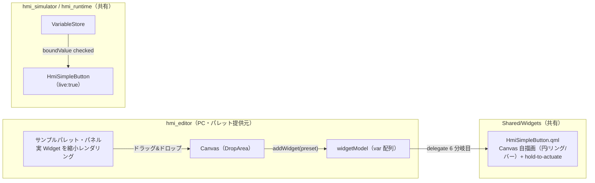

# Phase 11 計画 — Widget サンプルパレット（ドラッグ&ドロップ追加）＋ 初号「シンプルボタン」

issue #155 の「シンプル・イズ・ベスト版 HMI ボタン（ベゼル無し）」デザインを **QML の実 Widget として忠実再現**し、
さらにそれを **Editor のサンプルパレットから見た目そのままレンダリングしてキャンバスへドラッグ&ドロップで追加できる** UX を新設する。
パレットは汎用（プリセット = 「見た目 + 生成する widgetModel エントリ」）で、初号がシンプルボタン。**いずれ他 Widget もパレット化**していく土台にする。

> **進捗の正本は本ファイル「進捗」表**。承認・着手でステータスが動いたら常駐文書
> （CLAUDE.md / AGENTS.md / README / mvp-task-runner / development-history）を同期する
> （[feedback-phase-status-sync](../.claude/rules/feedback-phase-status-sync.md)）。

## 承認状態

**着手承認（2026-07-12）** — ユーザー要望「issue #155 のボタンデザインを QML で実装したい。見た目は確実に再現したい。
button のサンプルとしてユーザーが使えるように、インスペクタのサンプルから直接ドラッグ&ドロップで追加できるようにしたい。
インスペクタ上に widget の見た目もそのまま見せたい。いずれ他 Widget もパレットから追加できるようにしたい」。
**見た目プロトタイプ（`HmiSimpleButton.qml`）をユーザー確認 → 承認済み**（ランプ右上・TEST 主／ON・OFF 従・
面短辺比の文字サイズ）。以後は本計画のタスク分割（W-A〜W-E）に沿って 1 タスク＝1 PR で進める。

> **プロトタイプ先行の扱い**：見た目確定のため `HmiSimpleButton.qml` を W-A/W-B に先行して作成し、
> QML モジュール（`Shared/Widgets/CMakeLists.txt` の `QML_FILES`）に登録済み（ビルド検証のため）。
> **まだ Schema 型・delegate・パレットには未接続**＝単体で存在するプレビュー用コンポーネント。
> W-A（Schema）→ W-B（delegate 結線）で正式に横展開テンプレへ載せる。

## 確定スコープ（ユーザー合意事項）

| 項目 | 決定 |
|---|---|
| 見た目 | issue #155 の「シンプル・イズ・ベスト」ボタンを **忠実再現**（ベゼル無し・フラット面＋やわらかい影・差し色ひとつ・状態ひとつ）。ランプ / TEST ラベル / ON・OFF / 長押し確定の進捗リング（円）・進捗バー（四角） |
| 形状 | **円形プッシュ / スクエア**（issue の `s1`〜`s3`。`shape: "circle" \| "square"`） |
| テーマ | **ライト / ダーク**（issue の `SIMPLE_THEMES`。`theme: "light" \| "dark"`） |
| 実 Widget 化 | 上記はランプ・進捗リング・円形など既存 HmiButton（Rectangle+Text）では描けない → **新 Widget 種別 `SimpleButton`（`HmiSimpleButton.qml`）** として追加（横展開テンプレに乗せる） |
| 描画 | **QML `Canvas` 自描画**（円 / 進捗リング / 進捗バー）。**新規 Qt モジュール依存を入れない**（`import QtQuick` のみ。QtQuick.Shapes / Controls 非依存＝Meter・Trend と同方針で i.MX8MP rootfs にそのまま載る） |
| 長押し確定 | issue の `useHold`（hold-to-actuate）相当を QML で再現。押し続けで進捗が満ちると ON/OFF トグル。**Simulator/Runtime = 実挙動（`live:true`）／ Editor = 静的プレビュー（`live:false`）** |
| パレット UX | Editor のインスペクタ領域に **サンプルパレット・パネル**を新設。各サンプルを**実 Widget で縮小レンダリング**して並べ、キャンバスへ **ドラッグ&ドロップ**で追加。パネルは**汎用**（プリセット追加で他 Widget も並べられる） |
| 色表現 | issue の `oklch()` / `color-mix()` は Qt Quick 非対応 → **hex / rgb へ換算**して HmiSimpleButton の resolved 既定に持つ（具体値は実装時確定。乖離したら同コミットで本計画更新） |
| 音 | issue の効果音（audio）は**非スコープ**（実機 HMI で音源を持たない方針。挙動＝トグルのみ移植） |

## 各アプリの役割・ソース共有

| アプリ | 動作環境 | SimpleButton の振る舞い | パレット |
|---|---|---|---|
| Editor | PC 専用 | 設計面。長押しは動かさず**静的プレビュー**（`live:false`）。追加 UI・インスペクタ編集・**パレット提供元** | ✅ サンプルパレットを持つ |
| Simulator | PC | 長押し確定で ON/OFF トグル（`live:true`）。`checked` は `boundValue` で変数追従も可 | ❌（実行専用アプリ＝編集/パレット無し） |
| Runtime | 実機 i.MX8MP | **Simulator とソース完全共有で自動継承**（`Runtime/` 無改変） | ❌ |

パレットは **Editor 専用**（`Editor/qml/`）。`HmiSimpleButton.qml` は **Shared/Widgets**（Editor/Simulator/Runtime 共有）。

## アーキテクチャ



## タスク分割（1 タスク = 1 PR、`cmake --build` + Web `ctest` 緑が完了基準）

| Task | スコープ | 完了基準 |
|---|---|---|
| **W-A: Schema 拡張** | `WidgetData` に SimpleButton 固有フィールド（§Schema）を追加。`toJson`/`fromJson`/`toVariantMap`/`fromVariantMap` の **4 メソッド**を揃える（C++ ブリッジ無改変）。`isValidJson` 必須集合（id/type/width/height）は**不変**＝全 optional ＝後方互換。`tst_widget_data.cpp` に round-trip 追加。**QML/描画/パレットはまだ無し** | build + `ctest` 緑。`type:"SimpleButton"` JSON が値欠落なく round-trip。C++ ブリッジ無改変を `git diff` で確認 |
| **W-B: HmiSimpleButton 描画 + delegate 6 分岐目** | `Shared/Widgets/qml/HmiSimpleButton.qml` 新設（§HmiSimpleButton。円/四角・ランプ・ON/OFF・ライト/ダーク・**長押し確定リング/バー**）。`Shared/Widgets/CMakeLists.txt` の `QML_FILES` 登録。Editor `Canvas.qml` / Simulator `SimulatorCanvas.qml` の delegate に **6 分岐目** `simpleButtonComponent`（objectName `hmiSimpleButton`）。Simulator は `boundValue("checked")` 結線＋長押しトグル（`live:true`）、Editor は静的（`live:false`）。単体 `tst_hmi_simple_button.qml` + delegate 生成 unit。**追加 UI / パレットはまだ無し（手書き JSON で検証）** | build + `ctest` 緑。`type:"SimpleButton"` で選択枠・リサイズ正常。長押しで公開 `holdProgress` が満ち `checked` がトグル（unit）。実機 Canvas 描画の VNC 確認は PR 本文 TODO（完了条件外） |
| **W-C: サンプルパレット・パネル（見た目そのまま）** | Editor インスペクタ領域に `Editor/qml/SamplePalette.qml`（仮）を新設。**プリセット定義**（`{ id, label, type, defaults }` の配列。初号＝SimpleButton の circle/light）を、各セル内で**実 `HmiSimpleButton` を縮小レンダリング**して一覧表示。セルの**クリックでもキャンバス中央に追加**できるようにして早期に手触り確認（ドラッグ&ドロップは W-D）。パネルは選択有無に依らず表示（インスペクタと同居 or タブ切替は実装時確定） | build + `ctest` 緑。パレットに SimpleButton サンプルが**実 Widget の見た目で**並ぶ。クリックで追加できる。`editor.png` 同期 |
| **W-D: パレット → キャンバス ドラッグ&ドロップ追加** | パレットのセルを `Drag` 可能にし、`Canvas.qml` の背景に `DropArea` を敷く。ドロップ位置（`drop.x/y` を widgetLayer 基準へ変換）に **プリセットから widgetModel エントリを生成して追加**（`addWidget` をプリセット対応へ一般化）。追加は `pushUndo()` 経由（既存の構造変更則）。ドラッグ中はゴースト表示 | build + `ctest` 緑。パレットからキャンバスへドロップして所望位置に SimpleButton が追加される。undo で戻せる。`editor.png` 同期 |
| **W-E: インスペクタ型対応 + cross-app E2E + スクショ** | SimpleButton のインスペクタ型対応（§インスペクタ。形状 / テーマ / 差し色 / 長押し時間 / `checked`）。`selectedSupportsClickAction` へ `&& !selectedIsSimpleButton`。cross-app E2E `test_simple_button_live.py`（Editor `--open`→保存 JSON 直接 assert / Simulator で長押しトグル or `checked` 変数追従を公開プロパティで観測）。`e2e_simple_button_live` 登録。`editor.png`/`simulator.png` 最終同期 | build + `ctest` 緑（E2E 含む）。SimpleButton を選択して属性編集できる。E2E がトグル/追従を公開プロパティで観測。スクショ同期。**Phase 11 クローズ** |

## Schema 拡張（§Task W-A）

`type` 値は既存（`"Button"`/`"Label"`/`"NumericField"`/`"Trend"`/`"Meter"`）に合わせ **PascalCase `"SimpleButton"`**。

### 既存属性の再利用

`id`/`type`/`x`/`y`/`width`/`height`、`text`（TEST 相当のラベル）、`opacity`/`enabled`、
`checked`（**＝ON/OFF 状態**。既存フィールドを再利用）、`bindings`（`checked` の値源）、`actions`（トグル）を再利用。
`backgroundColor`/`border*`/`radius`/フォント詳細は SimpleButton では**テーマが外観を決める**ため基本未使用（流さない。詳細は実装時確定）。

### 新規フィールド（SimpleButton 固有）

| フィールド | 型 | 未指定表現 | 根拠 |
|---|---|---|---|
| `shape` | `QString` | `""`＝未指定（既定 `"circle"` へ解決） | `"circle"` / `"square"`。人間可読文字列（hAlign 同型）。不正値は既定へフォールバック |
| `theme` | `QString` | `""`＝未指定（既定 `"light"` へ解決） | `"light"` / `"dark"` |
| `accentColor` | `QString` | `""`＝未指定（既定 緑へ解決） | 差し色。`"#RRGGBB"`/空（`backgroundColor` 同型）。ブランド差し替え用 |
| `holdMs` | `int` | `0`＝未指定（既定 N ミリ秒へ解決） | 長押し確定に要する時間。`0` は「長押し時間 0」の正当値を持たない → `0` センチネル可（`fontSize`/`tickCount` 同型）。`> 0` のときだけ書く |

`isValidJson` 必須集合（id/type/width/height）は**不変**＝全 optional で後方互換。
`checked` は既存の bool 保存規則（既定 false ＝ true のとき書く）に従う（Task 42 既出）。

```json
{
  "id": "sb001", "type": "SimpleButton",
  "x": 40, "y": 40, "width": 184, "height": 184,
  "text": "TEST", "shape": "circle", "theme": "light",
  "accentColor": "#3aa564", "holdMs": 800, "checked": false,
  "bindings": [ { "property": "checked", "variable": "pumpRunning" } ],
  "actions": [ ]
}
```

## HmiSimpleButton.qml（§Task W-B）

HmiButton/HmiMeter と同じ **resolved\* フォールバック方式**。root は `Item`（テーマが面色を決めるので Rectangle 背景に頼らない）、
中に面 + ランプ + ラベル + 進捗を描く `Canvas`（or Rectangle 合成。円形は Canvas 自描画）、上に選択用 `MouseArea`。
`import QtQuick` のみ（新 Qt 依存ゼロ）。

| 持つ | 持たない |
|---|---|
| 公開入力：`text` / `shape` / `theme` / `accentColor` / `holdMs` / `checked`（ON/OFF）/ `live` | `backgroundColor`/`border*`（テーマが担う）/ フォント詳細 |
| resolved\*：`resolvedShape`(既定 circle) / `resolvedTheme`(既定 light) / `resolvedAccent`(既定 緑) / `resolvedHoldMs`(既定 実装時確定) / テーマ配色（面/影/ランプ/文字/トラック等を `SIMPLE_THEMES` 相当の hex で保持） | 音（audio・非スコープ） |
| 長押し確定：`holdProgress`(0〜1・**テスト用公開**) / 満了で `checked` トグル + `signal toggled(bool)` | 複数アクセントテーマの動的追加（MVP は緑固定・差し替えは accentColor） |
| 選択用 `signal clicked(int modifiers)` + MouseArea（Editor 選択中継用。表示専用 Widget でも必須＝横展開テンプレ則） | ピクセル assert（Canvas 不可視） |
| `live`（Simulator=true 長押し実挙動 / Editor=false 静的プレビュー・進捗 0 固定） | — |

**hold-to-actuate（QML 再現）**：押下（`onPressed`）で `Timer`（`holdMs` を刻む）を開始し `holdProgress` を 0→1 へ進める。
満了で `checked = !checked` + `toggled(checked)` emit + 進捗リセット。指を離す / キャンバス外（`onReleased`/`onCanceled`）で進捗を 0 へ戻す。
**`live:false`（Editor）は Timer を回さず `holdProgress:0` 固定**（設計面で誤作動させない）。
実挙動は Simulator delegate の `onToggled` で `writeBoundValue("checked", …)` へ結線する（Task 51 の入力 Widget 経路と**完全同型**。Schema/ブリッジ無改変）。**`runClickActions` は呼ばない**：`checked` と同じ変数を指す `toggleVariable` アクションがあると、書き戻した次値を直後に再反転して打ち消す二重トグルになるため（Codex PR #164 [P2]）。SimpleButton の状態遷移は `checked` binding 経路へ一本化する（トグル以外の副作用アクションが要る用途は将来別途）。

**描画**：`Canvas.onPaint` で ① 面（`resolvedTheme` の face 色 + 影）② ランプ（ON で accent 発光）③ TEST ラベル + ON/OFF ④ 進捗（circle=外周リング / square=下端バー、`resolvedAccent`、長さ∝`holdProgress`）。`onCheckedChanged`/`onHoldProgressChanged`/resolved 変化で `requestPaint()`。

> **色換算**：issue の `oklch()`/`color-mix()` を hex へ換算して resolved に持つ（Qt Quick は oklch 非対応）。具体値は実装時に確定し、乖離したら同コミットで本計画を更新（断定形で確定しない）。

## サンプルパレット（§Task W-C / W-D）

**プリセット定義**（Editor が持つ配列。初号＝SimpleButton）：

```js
// 例（実装時に確定）
[ { id: "simple-circle-light", label: "シンプル（円・ライト）", type: "SimpleButton",
    defaults: { width: 160, height: 160, text: "TEST", shape: "circle", theme: "light" } },
  { id: "simple-square-dark",  label: "シンプル（四角・ダーク）", type: "SimpleButton",
    defaults: { width: 160, height: 160, text: "TEST", shape: "square", theme: "dark" } } ]
```

- **見た目そのまま表示**：各セルで実 `HmiSimpleButton`（`live:false`）を `scale` 等で縮小レンダリングしてサムネイル化（画像でなく生 Widget＝仕様変更に自動追従）。
- **W-C**：クリックで `addWidget(preset)`（キャンバス中央）。手触りを早期確認。
- **W-D**：セルを `Drag.active` 可能にし、`Canvas.qml` 背景に `DropArea`。ドロップ座標を widgetLayer 基準へ変換して `addWidget(preset, x, y)`。`pushUndo()` 経由（構造変更則）。
- **一般化**：`addWidget(type)` を **`addWidget(preset)`（`{type, defaults, x?, y?}`）** へ拡張し、既存ツールバー各ボタンは `addWidget({type:"Button"})` 等へ薄く移行（挙動・objectName 据え置き＝既存 E2E 互換）。将来 preset 配列に他 Widget を足せばパレットに並ぶ。

## Editor 統合 / インスペクタ（§Task W-E）

delegate は Loader 多項 + inline Component に **6 分岐目** `simpleButtonComponent`（objectName `hmiSimpleButton`）を足すだけ（Meter の Component が手本）。
Editor=`live:false`、Simulator=`live:true` + `checked: boundValue("checked")` + `onToggled` 書き戻し。

インスペクタ型出し分け（`visible` のみ・objectName/Schema 不変）：

| セクション | SimpleButton |
|---|---|
| 基本（座標・サイズ） | ✅ |
| 文字（フォント） | ❌（テーマが決める。ラベル文字列だけ「基本」に残すかは実装時確定） |
| 背景・枠 | ❌（テーマが担う） |
| 状態 | ✅（有効 + ON/OFF＝`checked`） |
| クリックアクション | ✅（トグル用途。`selectedSupportsClickAction` は真のまま） |
| バインディング | ✅ **`checked` の値源** |
| シンプルボタン詳細（形状 / テーマ / 差し色 / 長押し時間 `holdMs`） | ✅ `visible: selectedIsSimpleButton` |

## テスト方針（§Task W-E）

1. **Schema round-trip（W-A）**：`tst_widget_data.cpp` に SimpleButton フィールドの JSON⇄struct⇄QVariantMap 往復（`shape`/`theme`/`accentColor`/`holdMs` + `checked`）。
2. **QML 単体（W-B）**：`tst_hmi_simple_button.qml`。resolved 既定（circle/light/緑/holdMs）・`shape`/`theme` 反映・**長押しで `holdProgress` 0→1→トグル**（Timer 駆動を `wait` or 手動 `holdProgress` セットで検証）・`live:false` で進捗 0 固定・`clicked`/`toggled`。**ピクセルは見ず公開プロパティのみ assert**。delegate unit に「`type:"SimpleButton"` で `hmiSimpleButton` 生成」を追加。
3. **パレット unit（W-C/W-D）**：`tst_canvas.qml` に「preset で addWidget → 型 `SimpleButton`・既定サイズ」「ドロップ座標→追加位置」「undo で戻る」を追加。
4. **cross-app E2E（W-E）**：Canvas ピクセル不可 → 公開 `holdProgress`/`checked` を観測。Spix は実長押し不可なので、公開メソッド（例 `commitHold()` or `holdProgress` 直セット）で確定を模す（Task 51 の `commitValue()` 前例）。Editor 段は保存 JSON 直接 assert で round-trip 担保。

## リスク / 未確定事項

1. **色換算の忠実度**：oklch→hex 換算で微妙に色味がズレうる。目標は「見た目が好き」を満たすことなので、実装後スクショで確認しユーザーレビューに回す（乖離あれば accentColor/テーマ hex を調整）。
2. **長押しの E2E**：Spix は実 press-hold を発火できない → 公開メソッドで確定を模す（前例あり）。実 hold の手触りは VNC / 手動確認（完了条件外の TODO）。
3. **ドラッグ&ドロップの座標系**：`DropArea` の drop 座標を widgetLayer 基準へ正しく変換する必要（既存ドラッグ移動の `mapToItem` 前例を流用）。offscreen E2E ではドラッグ発火不可 → D&D 自体は unit（座標→追加）＋手動で確認。
4. **パレットの置き場所**：インスペクタと同居（上部セクション）か別タブかは実装時に手触りで決定（ユーザーは「インスペクタから」と要望）。
5. **実機 Canvas 描画負荷**：長押し中の頻繁な `requestPaint()`。Meter/Trend で Canvas 実証済みだが VNC で確認（完了条件外 TODO）。
6. **新 Widget 種別の横展開漏れ**：種別追加時の定番（`addWidget` ホワイトリスト / `renameVariableReferences` / delegate / メタ / hero-demo）を W-B〜W-E で機械適用（[qml-module-conventions] 既出チェック）。

## 進捗

| Task | 状態 | PR |
|---|---|---|
| W-A Schema 拡張（SimpleButton フィールド round-trip） | ⬜ 未着手 | — |
| W-B HmiSimpleButton 描画 + delegate 6 分岐目 | ⬜ 未着手 | — |
| W-C サンプルパレット・パネル（見た目そのまま） | ⬜ 未着手 | — |
| W-D パレット → キャンバス ドラッグ&ドロップ追加 | ⬜ 未着手 | — |
| W-E インスペクタ型対応 + cross-app E2E + スクショ | ⬜ 未着手 | — |

## 非スコープ（別承認）

効果音（audio）・複数アクセントテーマの動的追加・WARN/ERR/LOCK 相当の状態モード・
他 Widget 種別のプリセット拡充（土台は W-C/W-D で用意するが、実際のプリセット追加は別承認）・
リッチ版ボタン（`hmi-retro`/`hmi-juicy`/`hmi-temperate` 相当）の移植。いずれも未承認＝先にユーザーとスコープ確定する。
