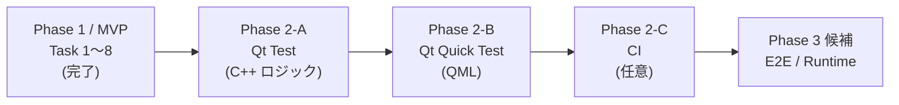

# Phase 2: テスト基盤導入

Phase 1（MVP / Task 1〜8）完了を受け、Phase 2 では Qt Test → Qt Quick Test の順でテスト基盤を整備する。MVP と同じく **1 タスク = 1 ブランチ = 1 PR**、完了基準は `cmake --build` 緑 ＋ 新規 `ctest` 緑。



---

## タスク一覧

### Phase 2-A: Qt Test 導入（C++ ロジック層）

| # | タスク | スコープ | 完了基準 |
|---|---|---|---|
| 9 | Qt Test 基盤構築 | ルート CMake に `enable_testing()` + `include(CTest)`、`tests/` 配置決定、`Qt6::Test` find、smoke 1 件（`tst_smoke`） | `ctest` で 1 件緑 |
| 10 | Schema JSON I/O テスト | `WidgetData` / `ScreenData` / `ProjectData` の `toJson` / `fromJson` ラウンドトリップ、`isValidJson` の正常／異常系 | `ctest` で全件緑 |
| 11 | ファイル I/O テスト | Editor `ProjectIo`（save + load）、Simulator `ProjectLoader`（load）。`QTemporaryDir` で実ファイル経由、不正 JSON 拒否を含む。`ProjectIo` / `ProjectLoader` は現状アプリ実行体（`hmi_editor` / `hmi_simulator`）に直接コンパイルされているため、**テスト実行体に `ProjectIo.cpp` / `ProjectLoader.cpp` を直接 `qt_add_executable` の SOURCES に追加** する方式を採る。ライブラリ分離（`hmi_editor_core` 等の STATIC 化）は本タスクではやらない（必要になれば後続タスクで切り出す） | `ctest` で全件緑 |

### Phase 2-B: Qt Quick Test 導入（QML 層）

| # | タスク | スコープ | 完了基準 |
|---|---|---|---|
| 12 | Qt Quick Test 基盤構築 | `Qt6::QuickTest` 統合、`tst_*.qml` 実行ハーネス、ctest 連携、smoke 1 件 | `ctest` で 1 件緑 |
| 13 | 共有 Widget テスト | `HmiButton` のプロパティ反映・クリックシグナル。今後追加される共有 Widget の雛形を兼ねる | `ctest` で全件緑 |
| 14 | Editor QML テスト | `Canvas` / `EditableWidget` のドラッグ動作、子要素レイアウト | `ctest` で全件緑 |

### Phase 2-C: CI（任意）

| # | タスク | スコープ | 完了基準 |
|---|---|---|---|
| 15 | GitHub Actions 整備 | macOS / Windows runner で `cmake --build` + `ctest` を回す。Qt は公式 install action か aqtinstall | PR 上で全 job 緑 |

> **Note**: Task 15 は CI ランナーの Qt バージョン差や `aqtinstall` の罠が多いため、Phase 2-A/B が安定してから着手する。先に手動で macOS / Windows 両方で `ctest` を回せることを確認しておく。

### Phase 3 候補（Phase 2 完了後に別途承認）

- **E2E テスト**：Squish / 内製の Python 自動操作等。Task 7 で確認した通り AppleScript からの QML 自動操作は不可なので、別アプローチが必要。
- **Runtime（i.MX8MP / Yocto）対応**：クロスビルド・デプロイ。

---

## 設計指針

### テストフォルダ配置

```
hmi-platform/
├─ Shared/Schema/
│   └─ tests/                 # Schema 単体（Task 10）
├─ Editor/
│   └─ tests/                 # ProjectIo + QML（Task 11, 14）
├─ Simulator/
│   └─ tests/                 # ProjectLoader（Task 11）
└─ Shared/Widgets/
    └─ tests/                 # 共有 Widget QML（Task 13）
```

各モジュール直下に `tests/` を置く。Task 9 でこの配置を決定し、smoke テストで動線を確認する。

### CMake 統合方針

- ルート `CMakeLists.txt` に `enable_testing()` + `include(CTest)` を 1 回だけ宣言。
- 各サブプロジェクトの `tests/CMakeLists.txt` で `qt_add_executable` ベースのテスト実行体を定義し、`add_test(NAME ... COMMAND ...)` で ctest に登録。
- テスト対象とアプリ実行体の関係は 2 パターンを許容する：
  - **A. ライブラリリンク方式**：対象が既に STATIC ライブラリ化されている場合（`hmi_schema` / `hmi_widgets`）はテスト実行体から `target_link_libraries` でリンクするだけ。**Task 10 / 13 はこの方式**。
  - **B. ソース直接 include 方式**：対象がアプリ実行体（`hmi_editor` / `hmi_simulator`）に直接コンパイルされていて再利用可能なライブラリが無い場合（`ProjectIo` / `ProjectLoader`）は、テスト実行体の `qt_add_executable` SOURCES に対象 `.cpp` / `.h` を直接含める。**Task 11 はこの方式**。ライブラリ分離は本フェーズではやらず、後続タスクで必要になれば切り出す。
- `BUILD_TESTING=ON`（CTest 標準）が ON のときのみ tests/ を `add_subdirectory` する。Yocto デプロイ時に OFF で外せるよう備える。
- **`find_package(Qt6 ... COMPONENTS Test)` も BUILD_TESTING で条件化** する（ルート `CMakeLists.txt`）。Qt Test が同梱されていないクロス環境（Yocto 等）で `-DBUILD_TESTING=OFF` 構成にしたとき configure が落ちないようにするため。`Qt6::QuickTest` を Task 12 で追加する時も同じ条件下に置く。

### テスト命名規約

- 実行体名：`tst_<対象>`（例：`tst_widget_data`, `tst_project_io`, `tst_hmi_button`）
- ファイル名：実行体名と同名（`tst_widget_data.cpp`）
- QML テスト：`tst_<対象>.qml`

### Task 9 で確立した C++ テスト実装パターン

Task 10 / 11 で踏襲する。Qt Quick Test（Task 12〜14）は別パターンになる予定。

- **テスト実行体は `add_executable`**（`qt_add_executable` ではない）。`qt_add_executable` は macOS で `.app` バンドルを作るため、CLI で実行する ctest には不向き。
- **AUTOMOC はルートの `qt_standard_project_setup` で全プロジェクトに有効**になっているので、各 tests/CMakeLists.txt で `set(CMAKE_AUTOMOC ON)` を書く必要はない。
- **Qt Core のみのテストは `QTEST_APPLESS_MAIN(<TestClass>)`** を使う（`QCoreApplication` を要求しない）。`QApplication` が必要なテスト（QML / Widgets）は将来 `QTEST_MAIN` / `QTEST_GUILESS_MAIN` を使い分ける。
- **`Q_OBJECT` を持つテストクラスを単一 cpp に書く場合、末尾に `#include "tst_<name>.moc"` を必ず書く**（AUTOMOC が同一ファイル内 Q_OBJECT の moc を期待する）。
- `tests/CMakeLists.txt` の最小形：

  ```cmake
  add_executable(tst_<name> tst_<name>.cpp)
  target_link_libraries(tst_<name> PRIVATE Qt6::Test <被テストライブラリ>)
  add_test(NAME tst_<name> COMMAND tst_<name>)
  ```

- 各モジュールの `CMakeLists.txt` には `if(BUILD_TESTING) add_subdirectory(tests) endif()` を 1 行加える（`include(CTest)` で BUILD_TESTING は既定 ON）。

### Task 10 で確立したパターン（データ駆動テスト）

似た形のパターンを大量に並べる検証（必須キー欠落 4 件・型誤り 4 件等）は **`QTest::addColumn` + `QFETCH` のデータ駆動テスト** を使う。テスト関数を 1 つ書いて `_data()` 側でケースを列挙する形になり、PASS/FAIL も `caseName(rowName)` の単位で見えるので失敗時の特定が早い。`tst_widget_data.cpp` の `isValidJsonRejectsMissingRequired_data` / `isValidJsonRejectsWrongTypes_data` が前例。`QJsonValue` 等をカラムに渡すときは `Q_DECLARE_METATYPE` 不要（Qt 側で登録済み）。

### Task 11 で確立したパターン（方式 B / Q_OBJECT を含むソースの直接 SOURCES 共有）

`ProjectIo` / `ProjectLoader` のように **アプリ実行体（`hmi_editor` / `hmi_simulator`）と同じ Q_OBJECT 派生クラスをテストから呼ぶ** 場合、ライブラリ分離せず方式 B（ソース直接）でテスト実行体に取り込める：

```cmake
add_executable(tst_project_io
    tst_project_io.cpp
    ../src/ProjectIo.cpp
    ../src/ProjectIo.h
)
target_include_directories(tst_project_io PRIVATE ../src)
target_link_libraries(tst_project_io PRIVATE Qt6::Test Qt6::Core hmi_schema)
add_test(NAME tst_project_io COMMAND tst_project_io)
```

押さえどころ：

- **SOURCES に `.cpp` と `.h` の両方** を入れる。`.h` が無いと AUTOMOC が moc 対象を見落とす場合がある（被テストクラスが `.cpp` 内に Q_OBJECT を持たない通常パターン）。
- **`target_include_directories` でテストから `../src` を public/private 区別なく見えるようにする**。テストソース側は `#include "ProjectIo.h"` の素のインクルードで済む。
- **同じ `.cpp` をアプリと複数テスト実行体で共有して衝突しない**。AUTOMOC はターゲットごとに独立して走るため、`hmi_editor` 側と `tst_project_io` 側でそれぞれ moc が生成される。
- **実ファイル経由のテストは `QTemporaryDir` を使う**。`dir.filePath("name.json")` でテスト終了時に自動クリーンアップされるパスが得られる。FileDialog 由来の `QUrl` を再現するには `QUrl::fromLocalFile(path)` で包む。

### 重複と原則の整合

CLAUDE.md「**Editor / Simulator で同等の C++ ヘルパーが必要になる場合、Shared に移さず両方に独立して持つ**」原則はテストにも適用する。`ProjectIo` と `ProjectLoader` は別タスクではなく **Task 11 でまとめて** テストするが、テストコード自体は各モジュールの `tests/` に分離する（重複を許容、利用側完結）。

### スクリーンショット運用

Phase 2 は GUI 変化を伴わないため、原則スクリーンショット不要。**Task 14**（Editor QML テスト）でテスト失敗時のデバッグ画面を撮るケースのみ任意で添付する。

---

## ルール（Phase 2 限定 / 既存ルールの上に追加）

### Must Always

- 各タスク完了時に **新規テストが `ctest` で緑** であることを完了基準に含める（`cmake --build` 緑だけでは不十分）。
- 新規テストは **既存の Schema / アプリのコードを変更せずに書ける** ことを優先する。テストのために本体コードを変える必要が出たら、別タスクとして切り出してユーザーに相談する。
- Codex レビュー前提のため、追加した依存（Qt6::Test / Qt6::QuickTest 等）は PR 本文で明示する。

### Must Never

- テスト基盤導入のために MVP で確立した型・API（`hmi::schema` の `toJson` / `fromJson` / `isValidJson` シグネチャ）を変更しない。
- Qt Test / Qt Quick Test 以外のテストフレームワーク（GoogleTest, Catch2 等）を独断で追加しない。Qt 公式の枠内に閉じる。
- ctest が落ちる状態で `gh pr create` しない。

---

## 進捗

| # | タスク | 状態 |
|---|---|---|
| 9 | Qt Test 基盤構築 | ✅ 完了 |
| 10 | Schema JSON I/O テスト | ✅ 完了 |
| 11 | ファイル I/O テスト（ProjectIo / ProjectLoader） | ✅ 完了 |
| 12 | Qt Quick Test 基盤構築 | 未着手 |
| 13 | 共有 Widget テスト | 未着手 |
| 14 | Editor QML テスト | 未着手 |
| 15 | CI 整備（GitHub Actions） | 未着手（任意） |
