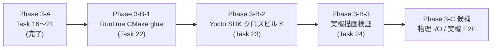
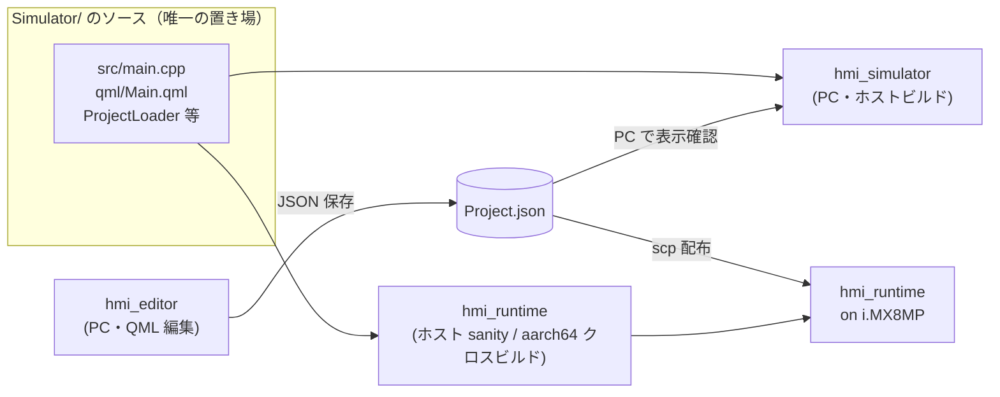

# Phase 3-B: Runtime / i.MX8MP 対応

Phase 3-A / E2E テスト導入（Task 16〜21）完了を受け、Phase 3-B では **Simulator と同じ JSON 描画機能を i.MX8MP 実機で動かす Runtime** を導入する。

**重要な設計意図**：Runtime は Simulator の i.MX8MP ターゲット版であり、**ソースコードを Simulator と共通化** する。実機がない環境でも Simulator（=Runtime のホストビルド版）で開発を継続できることを最優先する。Editor は引き続き PC 上の作画ツールで、実機には載せない。

Phase 1 / 2 / 3-A と同じく **1 タスク = 1 ブランチ = 1 PR**、完了基準は `cmake --build` 緑 ＋ 該当環境での動作確認。

---

## 3 アプリの役割整理（再確認）

| アプリ | 動作環境 | バイナリ名 | ソース置き場 | 役割 |
|---|---|---|---|---|
| Editor | PC のみ | `hmi_editor` | `Editor/` | HMI 作画ツール。Widget を配置し JSON を出力 |
| Simulator | PC のみ | `hmi_simulator` | `Simulator/` | JSON を PC 上で描画する PC 試験環境 |
| Runtime | i.MX8MP のみ（PC でも sanity check 可） | `hmi_runtime` | **Simulator/ を再利用**（Runtime/ は CMake glue のみ） | JSON を実機で描画する実機ランタイム |

**Simulator と Runtime はソース完全共通**、違いはビルドツールチェイン（ホスト / Yocto SDK）と起動時の環境変数のみ。

---

## スコープ確定事項（2026-05-28）

| 項目 | 確定値 |
|---|---|
| Runtime 範囲 | **A: 読み取り専用 JSON 描画のみ**（Simulator と同等機能）。物理 I/O / ネットワーク経由更新は Phase 3-C 以降 |
| ソース共有方式 | **Simulator/ にソースを集中、Runtime/ は CMake glue のみ**。同一ソースから `hmi_simulator`（ホスト用）と `hmi_runtime`（ホスト sanity + クロスビルド用）の 2 ターゲットを生成 |
| 開発ホスト OS | **Windows**（既存 VM + Yocto + i.MX8MP 書き込みワークフローを再利用） |
| クロスビルド方式 | **Yocto SDK**（`meta-toolchain-qt6` から生成、WSL2 / VM で `source environment-setup-*` → CMake クロスビルド）。Runtime 専用ターゲット `hmi_runtime` だけクロスビルド対象、Editor / Simulator はクロスビルドしない |
| CI 組込み | **当面なし**（手動検証）。Phase 3-C 以降に必要になった時点で self-hosted runner を検討 |
| Yocto image | 既存ベンダ提供 image を再利用（レシピ新規作成・image 再ビルドは Phase 3-B スコープ外） |

> **Note**：上記前提のうち「Yocto SDK が `meta-toolchain-qt6` で生成されている」「既存 image の Qt6 バージョンが本リポジトリのホストビルド（6.8 以上）と minor 互換」は Task 23 着手時に確認する。差異があった場合は Task 23 を「SDK 生成 + バージョン整合」に拡張する。

---

## アーキテクチャ整理

- **Simulator/ がソースの唯一の置き場**。`hmi_simulator` と `hmi_runtime` の 2 ターゲットは同じソースから build される（CMake glue は `Runtime/CMakeLists.txt` に置く）。
- **ホストビルド**で 3 バイナリ（`hmi_editor` + `hmi_simulator` + `hmi_runtime` PC 版）が同時に生成される。`hmi_simulator` と `hmi_runtime` PC 版は機能的に等しい（PC で動くか確認する sanity check として有用）。
- **クロスビルド**は `hmi_runtime` のみを Yocto SDK で aarch64 build → `scp` で実機へ配布。Editor / Simulator はクロスビルド対象外。
- **実機が手元になくても** `hmi_simulator` か `hmi_runtime` PC 版で開発・デバッグできるため、デバッグサイクルが速い。

---

## タスク一覧

### Phase 3-B-1: Runtime CMake glue

| # | タスク | スコープ | 完了基準 |
|---|---|---|---|
| 22 | Simulator の QML module を STATIC library 化 + Runtime/ で hmi_runtime バイナリを追加 | **Simulator/CMakeLists.txt を再構成**し、QML module を STATIC library として切り出す（`qt_add_qml_module(hmi_simulator_qml STATIC URI HmiSimulator ...)`）。これは CLAUDE.md「共有 QML モジュールは `STATIC` でビルドし、利用側アプリで plugin ターゲットをリンクする」原則に従う既存パターン（`Shared/Widgets` と同じ構造）。Qt の `qt_add_qml_module` を実行ファイルに直接付けた場合、その QML resource は別の実行ファイルから再利用できないため、**実行ファイル 2 個（hmi_simulator / hmi_runtime）から共有するには STATIC library 化が必須**。Simulator 側 `qt_add_executable(hmi_simulator ...)` は STATIC plugin（`hmi_simulator_qmlplugin`）を `target_link_libraries` で取り込む構成に変更。C++ ソース（`Simulator/src/main.cpp` 等）は **共通ソースとして Simulator/ に残し**、`Runtime/CMakeLists.txt` でも同じソースを参照して `hmi_runtime` ターゲットを add_executable + 同じ STATIC plugin をリンクする。ルート `CMakeLists.txt` に `add_subdirectory(Runtime)` を追加。Simulator と Runtime で振る舞いを切り替える必要が出た場合（例：QPA platform の既定値）は CMake define `HMI_RUNTIME_BUILD` を立てて Simulator/src/main.cpp 内で `#ifdef HMI_RUNTIME_BUILD` で分岐する（Task 24 で実機差異が見えてから具体化、Task 22 段階では分岐ゼロのまま）。バイナリ名は `hmi_simulator` / `hmi_runtime` で別、QML モジュール URI は **`HmiSimulator` を共有**（モジュール名を変えるとソース共有が崩れる）。**C++ ソース共有の具体的な CMake 技法**（`target_sources` で参照 / OBJECT ライブラリ抽出 / 共通 CMake function 化 等）は Task 22 着手時に判断する（QML module の STATIC 化は確定）。`Runtime/` 配下に `.cpp` / `.qml` / `.h` は置かない方針 | `cmake --build` 緑、既存の Simulator 単体テスト（Phase 2 で導入）が引き続き緑、ホストで `hmi_simulator --open <path>` と `hmi_runtime --open <path>` の両方が同じレイアウトで JSON 描画する。動作証跡スクショ `Docs/screenshots/task-22-runtime-host.png`（hmi_runtime PC 版の起動画面）を保存 |

### Phase 3-B-2: Yocto SDK クロスビルド

| # | タスク | スコープ | 完了基準 |
|---|---|---|---|
| 23 | Yocto SDK で hmi_runtime をクロスビルド | 既存 Yocto image から `bitbake meta-toolchain-qt6` で SDK を生成（**未生成の場合のみ**。既に存在する場合は手順だけ記録）。WSL2 / VM に install。`source environment-setup-aarch64-poky-linux` 後にルート `CMakeLists.txt` を **`cmake -DCMAKE_TOOLCHAIN_FILE="$OECORE_NATIVE_SYSROOT/usr/share/cmake/OEToolchainConfig.cmake" -DHMI_ENABLE_E2E=OFF -DBUILD_TESTING=OFF`** で configure（`environment-setup-*` の alias は非対話スクリプトで効かないため、toolchain file を明示的に渡す。詳細は「Yocto SDK 連携」節）。**E2E / BUILD_TESTING を明示 OFF にする理由**：Phase 3-A 経緯で MinGW 以外は E2E が既定 ON のため Yocto 環境では明示 OFF が必要（Spix / AnyRPC のクロスビルド問題を回避）。**ビルドは `cmake --build build-yocto --target hmi_runtime` のように `hmi_runtime` ターゲットのみ**（PC 専用の Editor / Simulator はクロスビルドしない、不要なビルドコストと潜在的な失敗要因を避ける）。`hmi_simulator` ターゲットも `hmi_simulator_qmlplugin`（STATIC plugin、Task 22 で導入）に依存するため、`hmi_runtime` ターゲットを build すれば必要な依存だけが build される。SDK パス・toolchain file・configure オプション・`--target hmi_runtime` の指定を `scripts/yocto/` 配下に**最小限の Bash スクリプト + README**として整備（PowerShell 版は不要、WSL2 / VM 内で実行する想定）。Windows / macOS 側のホストビルドには影響を与えない | WSL2 / VM 内で `scripts/yocto/cross-build.sh` 相当を実行 → `build-yocto/Runtime/hmi_runtime` が aarch64 ELF として生成される（**`file hmi_runtime` の出力に `ELF 64-bit LSB ... ARM aarch64` が含まれることを確認**。ホスト ELF や x86_64 になっていたら toolchain file が正しく渡せていない）。`build-yocto/Editor/hmi_editor` `build-yocto/Simulator/hmi_simulator` は build されないこと（PC 専用ターゲットのクロスビルドコストを払わない）。ホストビルド（`build/` / `build-mingw/`）は引き続き緑 |

### Phase 3-B-3: 実機描画検証

| # | タスク | スコープ | 完了基準 |
|---|---|---|---|
| 24 | i.MX8MP 実機で hmi_runtime を起動し JSON 描画 | Task 23 でビルドした `hmi_runtime` を `scp` で実機 `/usr/local/bin/` 等に配布。実機側で `hmi_runtime --open /path/to/project.json` を起動 → Editor が出力した既存 JSON を実機画面で描画。QPA platform（Wayland / EGLFS）・フォント・画面サイズなど環境差異を当該タスクの中で吸収する（Simulator/src/main.cpp に `#ifdef HMI_RUNTIME_BUILD` で実機向け初期化を追加するか、起動スクリプト側で環境変数を設定するかは実機で動かして判断） | 実機画面で JSON が描画される写真（手動撮影、`Docs/screenshots/task-24-runtime-imx.jpg` 等）を PR 本文に添付。再起動・JSON 差し替え時の挙動も確認 |

> **Note**：Task 24 で発見された実機固有の問題（フォント不足・QPA 不整合・タッチ座標ずれ等）が大きい場合は、追加タスクとして切り出してユーザーに相談する。Phase 3-B-3 を肥大化させない。

---

## Phase 3-C 候補（Phase 3-B 完了後に別途承認）

- **物理 I/O 連携**：GPIO / CAN / シリアルを Widget から扱える Action 拡張。
- **ネットワーク経由 JSON 配信**：実機が起動中に新しい JSON を受信して描画を切り替える。
- **PC → 実機の JSON 転送パス整備（USB ケーブル + 暗号化通信）**：Phase 3-B では Runtime はファイルとして JSON を読むだけで、転送経路は scp / 手動コピー / 他何でも良いとしている。Phase 3-C で「USB ケーブル接続 + 暗号化通信」によるワークフローを整備する想定。具体的には USB Ethernet（CDC-ECM / RNDIS）のドライバを Yocto image に含める + SSH デーモンの有効化 + scp / sftp / 独自プロトコルの選定。**転送機能は Runtime バイナリではなく OS / Yocto image レイヤの責務**（Runtime 自体は読み取り専用 JSON 描画のまま）。既存ベンダ image に必要なドライバ・デーモンが入っているかを Phase 3-C 着手時に確認し、不足分はレシピ追加で対応する。
- **実機 E2E（Spix のクロスビルド再利用）**：Phase 3-A の Spix を Yocto SDK でクロスビルドし、実機上で E2E を回す。**AnyRPC の libstdc++ 衝突問題**（Phase 3-A で Windows MinGW を opt-out にした原因）がクロスツールチェインで再発するか要検証。
- **Yocto レシピ化**：`hmi_runtime` を image に組み込む `.bb` レシピを `meta-hmi-platform` レイヤに整備（現在の scp 運用を image 焼込に移行）。
- **CI への組込み**：self-hosted runner を立てて Yocto SDK クロスビルドを GitHub Actions に統合。
- **Simulator / Runtime のソース統合の更なる最適化**：Phase 3-B-1 の方式（CMake glue で再利用）で運用してみて、もしソース重複や CMake の取り回しが煩雑になるようなら、`Shared/SimulatorCore` への共通ライブラリ抽出を検討する。
- **Windows 向け画面キャプチャスクリプト**：`scripts/windows/capture-app-window.ps1` を追加し、Windows 母艦単独でも自動スクショが撮れるようにする（PowerShell + `System.Windows.Forms` か `Win32 API` で実装）。現状は macOS 環境か手動撮影で代替。

---

## 設計指針

### Runtime の責務分離

- Runtime は **読み取り専用**。Simulator と同じく `Shared/Schema` の保存系 API は呼ばない（そもそも Simulator/ のソースに保存系コードが無い）。
- 編集 UI（ツールバー・FileDialog・配置プレビュー）は持たない（Simulator と同じ）。Editor の編集機能（`ProjectIo` / `EditableWidget` / `Canvas.qml`）は Runtime に一切含まれない（Simulator のソースに含まれていないため、共有しても混入しない）。
- 起動時自動ロードは Simulator と同じ `--open <path>` 命名（共有ソースなのでそのまま継承）。
- **転送機能は持たない**。Runtime バイナリは「ローカルファイルとして配置された JSON を読んで描画する」だけ。PC → 実機への JSON 転送は OS / Yocto image レイヤの責務（scp / 手動コピー / USB マスストレージ / 将来的に USB Ethernet + SSH 等、Phase 3-C 候補）。Runtime にネットワークリスナや暗号化通信処理を入れない。

### ソース共有の原則

- **Simulator/ がソースの唯一の置き場**（`.cpp` / `.qml` / `.h` はここに集中）。Runtime/ には CMakeLists.txt のみ。これにより「Simulator を直すと Runtime にも自動反映」「Runtime に手を入れる場合も Simulator/ で編集する」がルール化される。
- ただし**Simulator/CMakeLists.txt は Task 22 で再構成される**（QML module を実行ファイル直結から STATIC library 化に変更、`Shared/Widgets` と同じパターン）。これは Qt の `qt_add_qml_module` を実行ファイルに直接付けると別の実行ファイルから共有できないという Qt CMake API の制約による必須変更。既存ファイル削除や C++ ソース変更は伴わない。
- Simulator 側の変更が Runtime 動作を壊さないか確認するため、**ホストビルドで `hmi_runtime` PC 版を起動する sanity check** を CI（既存 macOS / Windows ジョブ）の動作確認に含める方針を検討（具体化は Task 22 着手時）。
- CLAUDE.md「Editor / Simulator で同等の C++ ヘルパーが必要になる場合、Shared に移さず両方に独立して持つ」原則は **Simulator と Runtime には適用しない**（両者は本質的に同じアプリで、独立して持つ意味が無いため）。Editor との関係では引き続き適用。

### QML モジュール命名

- `hmi_runtime` バイナリも **`HmiSimulator` モジュール URI を再利用**（共有ソースのため）、`loadFromModule("HmiSimulator", "Main")` で起動する（Simulator と完全同じ）。
- 共有方法は **STATIC plugin リンク**（Task 22 のスコープ参照）。`Simulator/CMakeLists.txt` で `qt_add_qml_module(hmi_simulator_qml STATIC URI HmiSimulator ...)` のように STATIC で宣言し、`Simulator/CMakeLists.txt` の `hmi_simulator` ターゲットと `Runtime/CMakeLists.txt` の `hmi_runtime` ターゲットの両方が `target_link_libraries(<target> PRIVATE hmi_simulator_qmlplugin)` で取り込む。これは既存 `Shared/Widgets` で確立済みのパターン（CLAUDE.md「共有 QML モジュールは `STATIC` でビルドし、利用側アプリで plugin ターゲットをリンクする」原則）。
- Window objectName は **`hmiSimulatorWindow` をそのまま使う**（CLAUDE.md「Window / Widget delegate の objectName はアプリごとに `<app>Window` / `widget_<id>` で命名統一」の例外として、Simulator と Runtime は同一視する）。実機 E2E を Phase 3-C で追加する時もこの命名で済む。

### Yocto SDK 連携

- SDK インストール先・toolchain ファイルパスは **WSL2 / VM 内の絶対パス** をスクリプトに含める。Windows 側の PowerShell から呼ばない（クロスビルドは Linux 環境完結）。
- CMake toolchain は Yocto SDK 同梱の `$OECORE_NATIVE_SYSROOT/usr/share/cmake/OEToolchainConfig.cmake` を使う（本リポジトリ側で独自 toolchain ファイルは導入しない、`-DHMI_TARGET_YOCTO=ON` のような独自オプションも追加しない）。**注意：`environment-setup-*` を `source` すると対話シェル上では `cmake` が alias で wrap されて `CMAKE_TOOLCHAIN_FILE` を自動付与してくれるが、非対話スクリプトでは alias が展開されない**（[Yocto ML 2018-01 報告](https://docs.yoctoproject.org/pipermail/yocto/2018-January/039667.html)）。`scripts/yocto/cross-build.sh` は alias に頼らず、明示的に `cmake -DCMAKE_TOOLCHAIN_FILE="$OECORE_NATIVE_SYSROOT/usr/share/cmake/OEToolchainConfig.cmake"`（もしくは CMake 3.21+ なら `cmake --toolchain "$OECORE_NATIVE_SYSROOT/usr/share/cmake/OEToolchainConfig.cmake"`）で渡す。これを忘れるとホストの Qt / コンパイラを拾うか `find_package(Qt6)` が失敗して、生成バイナリがホスト ELF になる、または build 自体が失敗する。
- ただし**ルート `CMakeLists.txt` は MinGW 以外で `HMI_ENABLE_E2E` を既定 ON にしている**（Phase 3-A 経緯）。Yocto SDK は MinGW ではないため、何も指定しないと Spix / AnyRPC を FetchContent で取得・クロスビルドしようとして AnyRPC のクロスツールチェイン互換問題で失敗する可能性が高い（Phase 3-A の Windows MinGW で踏んだ libstdc++ 衝突と同種のリスク）。**Task 23 のクロスビルド手順では `-DHMI_ENABLE_E2E=OFF -DBUILD_TESTING=OFF` を明示する**。これを `scripts/yocto/cross-build.sh` 相当のラッパーに固定値として埋め、ユーザーが option を意識せずクロスビルドできるようにする。実機 E2E の検討は Phase 3-C 候補に切り出し済み。
- **ビルドターゲットは `hmi_runtime` のみ**（`cmake --build build-yocto --target hmi_runtime`）。PC 専用の `hmi_editor` / `hmi_simulator` は実機に不要で、クロスビルドすると所要時間と失敗要因が増える。`hmi_runtime` は `hmi_simulator_qmlplugin`（Task 22 で導入する STATIC plugin）に依存するので、`hmi_runtime` を build すれば必要な依存ライブラリだけが build される。`scripts/yocto/cross-build.sh` には `--target hmi_runtime` を固定で埋める。
- ビルドツリーは `build-yocto/`（macOS の `build/`、Windows の `build-mingw/` に倣う）に分ける。`.gitignore` への追加も Task 23 内で実施。

### スクリーンショット運用

- Task 22（ホストビルド）：`hmi_runtime` PC 版を起動してキャプチャ。`Docs/screenshots/task-22-runtime-host.png`。
  - **macOS** 環境がある場合：既存スクリプト `scripts/capture-app-window.sh hmi_runtime Docs/screenshots/task-22-runtime-host.png` を使う（Swift + `screencapture` の macOS 専用実装）。
  - **Windows のみ** で開発する場合：スクリプトが macOS 専用のため、PowerShell の `Add-Type` で `System.Windows.Forms` を使ったキャプチャか、`Snipping Tool` / `PrintScreen` 等で手動撮影し PNG として保存。`scripts/windows/` 配下に PowerShell 版キャプチャスクリプトを追加するのは Phase 3-B のスコープ外（Phase 3-C 候補に切り出す）。
- Task 24（実機）：実機画面の **手動撮影写真**（スマホ等）を `Docs/screenshots/task-24-runtime-imx.jpg` 等で保存。`.png` でなく `.jpg` を許容する（写真なので）。README 用の固定ファイル `Docs/screenshots/runtime.jpg`（実機写真）も同コミットで更新。

### README 同期

- Phase 3-B 完了時に README の以下を更新：
  - 進捗表に Task 22〜24 を追加
  - 「ビルドと実行」節に **Yocto クロスビルド** の小節を追加（WSL2 / VM 前提）
  - 「スクリーンショット」節に Runtime 実機写真の項目を追加
  - 対象プラットフォーム表記を「macOS / Windows / **i.MX8MP（Yocto）**」に拡張
  - アプリ構成表に「Runtime は Simulator のソース共有による i.MX8MP ターゲット版」と明記

---

## ルール（Phase 3-B 限定 / 既存ルールの上に追加）

### Must Always

- Runtime は **Simulator のソースを共有**。`Runtime/` 配下には CMakeLists.txt のみを置く（`.cpp` / `.qml` / `.h` は置かない）。
- Runtime に追加機能が必要な場合も **Simulator/ 側で編集**し、必要なら `#ifdef HMI_RUNTIME_BUILD` で振る舞いを分岐する。
- Yocto SDK クロスビルドは **WSL2 / VM 内で完結**。Windows 母艦の PowerShell からは呼ばない（PATH / 環境変数汚染を避ける）。
- Yocto SDK でクロスビルドする時は **`-DHMI_ENABLE_E2E=OFF -DBUILD_TESTING=OFF` を必ず付ける**（Phase 3-A 経緯で MinGW 以外は E2E 既定 ON のため、明示 OFF にしないと Spix / AnyRPC のクロスビルド失敗を踏む）。これを `scripts/yocto/cross-build.sh` に固定値として埋め、ユーザーが option を意識しないでも済むようにする。
- Yocto SDK でビルドする時は **`--target hmi_runtime` で対象を限定する**（PC 専用の hmi_editor / hmi_simulator をクロスビルドしない、ビルド時間と失敗要因を最小化）。`scripts/yocto/cross-build.sh` には `--target hmi_runtime` を固定で埋める。
- ホストビルド（Windows / macOS）で `hmi_simulator` も `hmi_runtime` PC 版も Phase 3-B 完了後に引き続き緑であること。Runtime 追加のために Simulator を壊さない。
- 各タスク完了時に **当該環境での動作確認** を完了基準に含める：Task 22=ホストで両バイナリ起動、Task 23=クロスビルド成果物の生成、Task 24=実機描画。

### Must Never

- `Runtime/` 配下に `.cpp` / `.qml` / `.h` を直接置く（ソースは Simulator/ に集中、Runtime/ は CMake glue のみ）。
- Runtime のために **Editor のソース** を共有する（Editor は PC のみで動作、Runtime / Simulator とは別系統）。Editor の編集系コード（`ProjectIo` / `EditableWidget` / `Canvas.qml` 等）は Runtime / Simulator に持ち込まない。
- Runtime バイナリに **PC からの転送機能**（ネットワークリスナ・SSH デーモン・USB 通信プロトコル等）を実装する（転送は OS / Yocto image レイヤの責務、Phase 3-C 候補）。
- Runtime 用に Simulator と別の QML モジュール URI（`HmiRuntime` 等）を定義する（共有ソースで `HmiSimulator` を共用）。
- Simulator の QML module を **実行ファイルに直結したまま**（`qt_add_qml_module(hmi_simulator URI HmiSimulator ...)` のままで、STATIC 化せず）Runtime/ を作る。Qt の CMake QML Module API では実行ファイルに付けた QML module は他の実行ファイルから共有できないため、必ず STATIC library 化する。
- Yocto レシピ（`.bb` ファイル）を本リポジトリに追加する（Phase 3-C スコープ）。
- Yocto SDK クロスビルドのために `CMAKE_CXX_FLAGS` をルート `CMakeLists.txt` でハードコードする（SDK 側 `environment-setup-*` の export に任せる）。
- CI に self-hosted runner を追加する（Phase 3-C 以降の判断）。
- Yocto SDK が手元にない状態で Task 23 / 24 を進める（前提なしの試行は禁止、Task 23 着手時に SDK 入手 / 生成を最優先する）。

---

## 進捗

| # | タスク | 状態 |
|---|---|---|
| 22 | Runtime/ で Simulator のソースを再利用して hmi_runtime バイナリを追加 | ✅ 完了 |
| 23 | Yocto SDK で hmi_runtime をクロスビルド | ⏳ 未着手 |
| 24 | i.MX8MP 実機で hmi_runtime を起動し JSON 描画 | ⏳ 未着手 |
