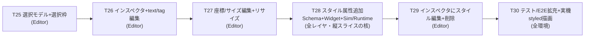

# Phase 4: Button 縦スライス（Widget 追加テンプレの確立）

Phase 3-B / Runtime（Task 22〜24）完了で **Editor→JSON→Simulator/Runtime→実機** のパイプラインが現物で通った。
だが載っているのは **Button だけの MVP** で、しかも Editor から Button の `text` すら変更できない（追加時 "New" 固定 → あとはドラッグで位置のみ）。

Phase 4 では Widget 種別を横に増やす前に、**Button 1 つを全レイヤで深く作り込み、「1 つの Widget を正しく仕上げる型」を確立**する（＝バーティカルスライス）。
ここで作る **選択＋インスペクタ**と **Schema スタイル拡張の手順**が、後続の全 Widget 種別追加の雛形になる。

Phase 1 / 2 / 3-A / 3-B と同じく **1 タスク = 1 ブランチ = 1 PR**、完了基準は `cmake --build` 緑 ＋ 該当環境での動作確認（スクショ / 実機）。

---

## スコープ確定事項

| 項目 | 確定値 |
|---|---|
| 対象 Widget | **Button のみ**（縦スライス）。Label / Lamp / Gauge 等の横展開は Phase 5 候補 |
| 深さ | **スタイル拡張まで**（`backgroundColor` / `textColor` / `fontSize` を Schema に新設し全レイヤ描画）。状態/アクション（pressed/disabled/click action）は Phase 5 候補 |
| 編集 UI 範囲 | 選択・インスペクタ（text/tag/座標/サイズ/スタイル編集）・ハンドルリサイズ・削除 |
| widgetModel 構造 | **`var` 配列を据え置き**（`QAbstractListModel` 化はしない）。下記「設計指針」参照 |
| 改修対象アプリ | **Editor のみが編集 UI を持つ**。Simulator / Runtime は読み取り専用を維持（描画に新スタイルを渡す口だけ追加、ソース共有で Runtime は自動） |
| 実機検証 | T30 で styled Button を含む JSON を `hmi_runtime` で実機描画・撮影 |

---

## 各アプリの役割（再確認）

| アプリ | 動作環境 | Phase 4 での改修 |
|---|---|---|
| Editor | PC のみ | **選択・インスペクタ・リサイズ・削除・スタイル編集 UI を追加**（本フェーズの主戦場） |
| Simulator | PC のみ | delegate に新スタイル（color/font）を HmiButton へ渡す口だけ追加。編集 UI は持たない |
| Runtime | i.MX8MP（PC sanity 可） | **Simulator/ のソース共有のため改修ゼロ**（Simulator の変更が自動反映）。T30 で実機描画確認 |

新スタイルプロパティは **HmiButton（`Shared/Widgets`）＝唯一の真実**に公開し、Editor / Simulator 双方の delegate から渡す（片方取りこぼし防止）。

---

## タスク一覧

### T25: 選択モデル + 選択枠（Editor）

| 項目 | 内容 |
|---|---|
| スコープ | `Canvas.qml`（`root`）に `selectedWidgetId` プロパティを追加。`EditableWidget.qml` には **plain な `selected`（bool）プロパティ**と **`signal selectRequested(string id)`** を持たせ、`selected` 時に選択枠（ハイライト border / 破線）を描画する。**QML の `id` はコンポーネントファイルを跨いで参照できない**ため、`EditableWidget` から `canvas` / `root` を直接触らず、**結線は delegate 側（`root` が可視な `Canvas.qml`）で行う**：delegate で `selected: widgetId === root.selectedWidgetId` をバインドし、`onSelectRequested: root.selectedWidgetId = id`。背景クリックで `root.selectedWidgetId = ""` に解除。`EditableWidget` は `dragArea` の `onClicked` で `selectRequested(widgetId)` を emit する（既存の `drag.filterChildren` との両立は着手時に実機確認。必要なら HmiButton の `clicked` を中継して選択要求に使う） |
| 完了基準 | ビルド緑、既存 QML テスト緑。Editor で Button をクリックすると選択枠が出て、別 Button / 背景クリックで移動・解除。スクショ `Docs/screenshots/task-25-selection.png` |

### T26: インスペクタ + text/tag 編集（Editor）

| 項目 | 内容 |
|---|---|
| スコープ | `Main.qml` 右側にインスペクタ Panel を追加（`QtQuick.Controls` の `TextField` / `Label`、既存 import で完結）。未選択時は「未選択」表示。選択中は `text` / `tag` を編集 → 選択中 `EditableWidget` の `widgetText` / `widgetTag` に two-way 反映（HmiButton が即追従）。**「UI から text を変えられない」致命的ギャップを解消**。インスペクタ各フィールドに Spix 用 `objectName`（例 `inspectorTextField`）を付与 |
| 完了基準 | ビルド緑。Button 選択 → text 編集 → 即キャンバス反映、保存 JSON に反映（手動）。スクショ `Docs/screenshots/task-26-inspector-text.png` |

### T27: 座標/サイズ数値編集 + ハンドルリサイズ（Editor）

| 項目 | 内容 |
|---|---|
| スコープ | インスペクタに `x` / `y` / `width` / `height` の数値入力（`SpinBox` か `TextField`+validator）。選択中 Item に反映。選択枠にリサイズハンドル（右下 1 個から。必要なら四隅）を付け、ドラッグで `width` / `height` を更新（最小サイズ clamp）。EditableWidget 内に別 MouseArea で実装し、既存の移動ドラッグ（`dragArea`）と競合しないようにする（ハンドルの press を親 drag が奪わないこと） |
| 完了基準 | ビルド緑。数値編集とハンドル両方で位置・サイズ変更 → 保存反映。スクショ `Docs/screenshots/task-27-resize.png` |

### T28: スタイル属性追加（Schema + HmiButton + Simulator/Runtime）★縦スライスの核

| 項目 | 内容 |
|---|---|
| スコープ | **全レイヤを貫く**。①`WidgetData`（`Shared/Schema`）に `backgroundColor`（QString hex）/ `textColor`（QString hex）/ `fontSize`（int）を追加。`toJson` は **既定値時は省略書き出し**（既存 text/tag と同じ optional 方針）、`fromJson` は既定値で埋め、`isValidJson` の **必須集合は id/type/width/height のまま据え置き**（後方互換）。②`HmiButton.qml` に `property color backgroundColor` / `textColor` / `property int fontSize` を公開し、現在のハードコード値を既定値に（`backgroundColor: "#4cc9f0"`、`textColor: "white"`、`fontSize: 14`）。press フィードバックは `Qt.darker(backgroundColor, 1.2)` で導出。③Editor の `EditableWidget` メタ（`widgetBackgroundColor` 等）と `Canvas.qml` delegate / `Main.qml` の保存走査（`saveTo` / `onAccepted`）に新フィールドを追加。④**Simulator の `SimulatorCanvas.qml` delegate でも新フィールドを HmiButton へ渡す**（Runtime はソース共有で自動）。⑤`Shared/Schema/tests/tst_widget_data.cpp` に round-trip / 既定値省略 / `isValidJson` のケースを追加 |
| 完了基準 | ビルド緑、`ctest`（Schema 単体）緑。Editor / Simulator で色・フォントが JSON 通り描画される。スクショ `Docs/screenshots/task-28-style-editor.png` / `-simulator.png` |

### T29: インスペクタにスタイル編集 + 削除（Editor）

| 項目 | 内容 |
|---|---|
| スコープ | インスペクタに `backgroundColor` / `textColor`（`#RRGGBB` hex の `TextField`。`ColorDialog` は任意の追加で、必須にしない）と `fontSize`（`SpinBox`）の編集を追加 → 選択中 Item に反映。削除：インスペクタの削除ボタン（と可能なら Delete キー）で選択中 widget を削除（widgetModel を live Items からスナップショット → 該当 id を除去 → 再代入、選択解除） |
| 完了基準 | ビルド緑。色 / フォント編集 → 即反映 → 保存反映、削除動作。スクショ `Docs/screenshots/task-29-style-delete.png` |

### T30: テスト/E2E 拡充 + 実機 styled 描画（全環境）

| 項目 | 内容 |
|---|---|
| スコープ | ①Editor QML テスト（`Editor/tests/tst_canvas.qml` 等）に「選択 → インスペクタ編集 → Item 反映」「削除」を追加。②E2E（`tests/e2e/`）に「Editor で選択 → インスペクタで text / color 変更 → `saveTo` → Simulator で `getStringProperty` 検証」シナリオを追加（既存 `harness.py` 流用、Editor=9876 / Simulator=9877 の既定ポート据え置き）。③styled Button を含む JSON を `hmi_runtime` で **i.MX8MP 実機**描画し撮影 |
| 完了基準 | macOS で `ctest`（unit + e2e）緑。実機 styled 描画写真 `Docs/screenshots/task-30-runtime-styled.jpg`。README スクショ（`editor.png` / `simulator.png`）も更新 |

> **Note**：T25〜T27 / T29 の実装中に「選択や編集が `var` 配列の delegate 再生成で巻き戻る」事象（CLAUDE.md「Spix 罠」最終群と同根）が出たら、**設計指針の "live Item が真実 + 構造変更時のみスナップショット" 方針で吸収**する。それでも破綻するようなら QAbstractListModel 化を別タスク化してユーザーに相談（本スライスには含めない）。

---

## 設計指針

### widgetModel は `var` 配列を据え置き（QAbstractListModel 化しない）

- **編集中の真実は live な `EditableWidget` インスタンス**（保存は既に `canvas.widgetItems` を走査する設計）。インスペクタは選択中 Item に two-way バインドし、編集は Item のプロパティを直接更新する → delegate 再生成を起こさず、フォーカスや選択も保てる。
- **構造変更（追加 / 削除）時のみ** live Items から配列をスナップショット → 変更 → 再代入する（既存 `addWidget()` の「配列丸ごと差し替えで Repeater をリトリガ」を踏襲）。これにより未保存の編集が他 widget で消えない。選択は **id で追跡**し、再生成後に id→Item を解決し直す。
- これは [project-widgetmodel-refactor-deferred.md](../.claude/rules/project-widgetmodel-refactor-deferred.md) の「Phase 3-B スコープ確定後に再評価」を満たした上での判断。Phase 3-B は完了したが、**インスペクタは live Item 直編集で十分綺麗に閉じる**ため、`QAbstractListModel` 化は引き続き不要（過剰な refactor を本スライスに混ぜない＝CLAUDE.md「仮想的な将来要件で設計しない」）。

### 選択状態は Canvas が保持

- `selectedWidgetId` は `Canvas.qml`（`root`）に持たせる。**QML の `id` はコンポーネントファイルを跨いで参照できない**ため、`EditableWidget` から `canvas` / `root` を直接触らない設計にする：`EditableWidget` は plain な `selected`（bool）と `signal selectRequested(string id)` だけを公開し、結線は delegate 側（`root` が可視な `Canvas.qml`）で `selected: widgetId === root.selectedWidgetId` のバインドと `onSelectRequested: root.selectedWidgetId = id` で行う。
- `Main.qml` 側は **自分が定義した子の id（`canvas`）が見える**ので `canvas.selectedWidgetId` をインスペクタ表示・編集対象 Item の解決に使える（インスペクタは `canvas.widgetItems` から `widgetId === canvas.selectedWidgetId` の Item を引いて two-way バインドする）。
- Simulator / Runtime は選択概念を持たない（読み取り専用）ので **無改修**を維持する。

### Schema 拡張の後方互換

- 新フィールドは **optional**（`toJson` で既定値時は省略、`fromJson` は欠落時に既定値）。`isValidJson` の必須集合は **id / type / width / height のまま据え置く**。これにより Phase 1〜3-B で保存した旧 JSON がそのまま読める。
- 値の表現：色は **`#RRGGBB` 文字列**（`HmiButton` の `property color` が解釈）、`fontSize` は **int px**（既定 14、`0`/未設定は既定にフォールバック）。CLAUDE.md「Schema 実装規約」（struct + `toJson`/`fromJson`/`isValidJson` を同時更新）を踏襲。

### スタイルは HmiButton に集約し両アプリから渡す

- 新プロパティは **`HmiButton.qml`（`Shared/Widgets`）に一度だけ公開**。Editor（`Canvas.qml` delegate）と Simulator（`SimulatorCanvas.qml` delegate）の **両方**で HmiButton に渡す口を足す（Runtime は Simulator ソース共有で自動）。片方だけ足すと Editor で編集できても実機/Simulator で反映されない、の取りこぼしを防ぐ。

### E2E / 命名

- インスペクタの入力フィールドには Spix 参照用 `objectName`（`inspectorTextField` 等）を付与。Window / widget delegate の命名（`hmiEditorWindow` / `widget_<id>`）は既存規約を踏襲。
- 既定ポート（Editor=9876 / Simulator=9877）は据え置き。

---

## ルール（Phase 4 限定 / 既存ルールの上に追加）

### Must Always

- 1 タスク = 1 ブランチ = 1 PR、`cmake --build` 緑 ＋ 該当環境での動作確認（スクショ / 実機）を完了基準にする。
- Widget の新プロパティを足す時は **`HmiButton` に公開 → Editor と Simulator 双方の delegate に渡す → Schema 単体テスト（round-trip / `isValidJson`）も同時更新**（このセットを 1 タスク内で揃える）。
- Schema 新フィールドは **optional**（既定値省略書き出し、`isValidJson` 必須集合は据え置き）で後方互換を保つ。
- 編集 UI は **Editor のみ**。Simulator / Runtime は読み取り専用を維持し、描画に新スタイルを渡す口だけ足す。
- widgetModel は **編集中 live Item を真実とし、構造変更時のみ Items→配列スナップショット後に再代入**。選択は id で追跡。

### Must Never

- 本スライスのスコープに **`QAbstractListModel` 化**を含める（据え置き継続。必要が出たら別タスク化してユーザーに相談）。
- Simulator / Runtime に **選択・インスペクタ・編集系コード**を持ち込む（読み取り専用を崩さない）。
- Schema 新フィールドを **`isValidJson` の必須**にする（旧 JSON 後方互換を壊す）。
- **新規ライブラリ / フレームワーク**を追加する（`QtQuick.Controls` / `QtQuick.Dialogs` の既存 import で完結させる）。
- Editor の編集系ソースを **Simulator / Runtime に共有**する（既存原則。Editor は別系統）。
- スタイル属性を `HmiButton` を経由せず Editor / Simulator の delegate に**個別ハードコード**する（唯一の真実は HmiButton）。

---

## Phase 5 候補（Phase 4 完了後に別途承認）

- **Widget 種別の横展開**：Phase 4 で確立した型を使い Label / Lamp（表示灯）/ Gauge / Image 等を追加（`type` 分岐 + 各 HmiXxx.qml + Schema フィールド + インスペクタ）。
- **状態 / アクション**：pressed/disabled 状態、クリック時アクション（→ 方向 B「動く HMI」へ接続）。
- **Phase 3-C 系インフラ**：Yocto レシピ焼込・実機 E2E・CI self-hosted runner・Windows キャプチャ（[phase3b-runtime-plan.md](phase3b-runtime-plan.md) §「Phase 3-C 候補」）。

---

## 進捗

| # | タスク | 状態 |
|---|---|---|
| 25 | 選択モデル + 選択枠（Editor） | ⏳ 未着手 |
| 26 | インスペクタ + text/tag 編集（Editor） | ⏳ 未着手 |
| 27 | 座標/サイズ数値編集 + ハンドルリサイズ（Editor） | ⏳ 未着手 |
| 28 | スタイル属性追加（Schema + HmiButton + Simulator/Runtime）★ | ⏳ 未着手 |
| 29 | インスペクタにスタイル編集 + 削除（Editor） | ⏳ 未着手 |
| 30 | テスト/E2E 拡充 + 実機 styled 描画（全環境） | ⏳ 未着手 |
