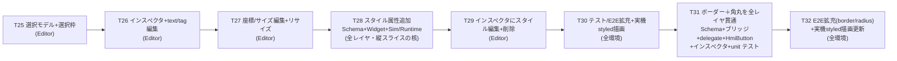

# Phase 4: Button 縦スライス（Widget 追加テンプレの確立 / スタイル + ボーダー・角丸）

> **このフェーズは旧 Phase 4（Task 25〜30）と旧 Phase 5（Task 31〜32）を 1 本に統合したもの**（2026-06-07）。どちらも「Button 1 つを全レイヤで深く作り込む縦スライス」で連続しているため、1 つの Button 縦スライスフェーズ（Task 25〜32）として扱う。旧 `Docs/phase5-button-style-plan.md` は本ファイルへ統合し削除した。以降のフェーズ（横展開 / 状態・アクション）は **Phase 5** に繰り上げ（下記「Phase 5 候補」）。

Phase 3-B / Runtime（Task 22〜24）完了で **Editor→JSON→Simulator/Runtime→実機** のパイプラインが現物で通った。
だが載っているのは **Button だけの MVP** で、しかも Editor から Button の `text` すら変更できない（追加時 "New" 固定 → あとはドラッグで位置のみ）。

Phase 4 では Widget 種別を横に増やす前に、**Button 1 つを全レイヤで深く作り込み、「1 つの Widget を正しく仕上げる型」を確立**する（＝バーティカルスライス）。
ここで作る **選択＋インスペクタ**と **Schema スタイル拡張の手順**が、後続の全 Widget 種別追加の雛形になる。

前半（Task 25〜30）で選択・インスペクタ・リサイズ・削除と **スタイル属性（`backgroundColor` / `textColor` / `fontSize`）の全レイヤ貫通**を確立。
後半（Task 31〜32）は **同じ「プロパティ追加テンプレ」をもう一度回して Button に静的スタイル（ボーダー＋角丸：`borderColor` / `borderWidth` / `radius`）を足す**。狙いは手順の完全定型化と、Task 28 では出なかった **「`0` が正当値の数値プロパティ」（`-1` センチネル設計）** の習得。

Phase 1 / 2 / 3-A / 3-B と同じく **1 タスク = 1 ブランチ = 1 PR**、完了基準は `cmake --build` 緑 ＋ 該当環境での動作確認（スクショ / 実機）。

---

## スコープ確定事項

| 項目 | 確定値 |
|---|---|
| 対象 Widget | **Button のみ**（縦スライス）。Label / Lamp / Gauge 等の横展開は Phase 5 候補 |
| 深さ | **静的スタイル拡張まで**（`backgroundColor` / `textColor` / `fontSize` ＝Task 28、`borderColor` / `borderWidth` / `radius` ＝Task 31 を Schema に新設し全レイヤ描画）。状態/アクション（pressed/disabled/click action）は Phase 5 候補 |
| 編集 UI 範囲 | 選択・インスペクタ（text/tag/座標/サイズ/スタイル〔色・フォント・ボーダー・角丸〕編集）・ハンドルリサイズ・削除 |
| widgetModel 構造 | **`var` 配列を据え置き**（`QAbstractListModel` 化はしない）。下記「設計指針」参照 |
| 改修対象アプリ | **Editor のみが編集 UI を持つ**。Simulator / Runtime は読み取り専用を維持（描画に新スタイルを渡す口だけ追加、ソース共有で Runtime は自動） |
| 実機検証 | T30 で styled Button を含む JSON を `hmi_runtime` で実機描画・撮影 |

---

## 各アプリの役割（再確認）

| アプリ | 動作環境 | Phase 4 での改修 |
|---|---|---|
| Editor | PC のみ | **選択・インスペクタ・リサイズ・削除・スタイル編集 UI を追加**（本フェーズの主戦場） |
| Simulator | PC のみ | delegate に新スタイル（color/font）を HmiButton へ渡す口だけ追加。編集 UI は持たない |
| Runtime | i.MX8MP（PC sanity 可） | **Simulator/ のソース共有のため改修ゼロ**（Simulator の変更が自動反映）。T30 で実機描画確認 |

新スタイルプロパティは **HmiButton（`Shared/Widgets`）＝唯一の真実**に公開し、Editor / Simulator 双方の delegate から渡す（片方取りこぼし防止）。

---

## タスク一覧

### T25: 選択モデル + 選択枠（Editor）

| 項目 | 内容 |
|---|---|
| スコープ | `Canvas.qml`（`root`）に `selectedWidgetId` プロパティを追加。`EditableWidget.qml` には **plain な `selected`（bool）プロパティ**と **`signal selectRequested(string id)`** を持たせ、`selected` 時に選択枠（ハイライト border / 破線）を描画する。**QML の `id` はコンポーネントファイルを跨いで参照できない**ため、`EditableWidget` から `canvas` / `root` を直接触らず、**結線は delegate 側（`root` が可視な `Canvas.qml`）で行う**：delegate で `selected: widgetId === root.selectedWidgetId` をバインドし、`onSelectRequested: root.selectedWidgetId = id`。背景クリックで `root.selectedWidgetId = ""` に解除。`EditableWidget` は `dragArea` の `onClicked` で `selectRequested(widgetId)` を emit する（既存の `drag.filterChildren` との両立は着手時に実機確認。必要なら HmiButton の `clicked` を中継して選択要求に使う） |
| 完了基準 | ビルド緑、既存 QML テスト緑。Editor で Button をクリックすると選択枠が出て、別 Button / 背景クリックで移動・解除。スクショ `Docs/screenshots/task-25-selection.png` |

### T26: インスペクタ + text/tag 編集（Editor）

| 項目 | 内容 |
|---|---|
| スコープ | `Main.qml` 右側にインスペクタ Panel を追加（`QtQuick.Controls` の `TextField` / `Label`、既存 import で完結）。未選択時は「未選択」表示。選択中は `text` / `tag` を編集 → 選択中 `EditableWidget` の `widgetText` / `widgetTag` に two-way 反映（HmiButton が即追従）。**「UI から text を変えられない」致命的ギャップを解消**。インスペクタ各フィールドに Spix 用 `objectName`（例 `inspectorTextField`）を付与 |
| 完了基準 | ビルド緑。Button 選択 → text 編集 → 即キャンバス反映、保存 JSON に反映（手動）。スクショ `Docs/screenshots/task-26-inspector-text.png` |

### T27: 座標/サイズ数値編集 + ハンドルリサイズ（Editor）

| 項目 | 内容 |
|---|---|
| スコープ | インスペクタに `x` / `y` / `width` / `height` の数値入力（`SpinBox` か `TextField`+validator）。選択中 Item に反映。選択枠にリサイズハンドル（右下 1 個から。必要なら四隅）を付け、ドラッグで `width` / `height` を更新（最小サイズ clamp）。EditableWidget 内に別 MouseArea で実装し、既存の移動ドラッグ（`dragArea`）と競合しないようにする（ハンドルの press を親 drag が奪わないこと） |
| 完了基準 | ビルド緑。数値編集とハンドル両方で位置・サイズ変更 → 保存反映。スクショ `Docs/screenshots/task-27-resize.png` |

### T28: スタイル属性追加（Schema + HmiButton + Simulator/Runtime）★縦スライスの核

| 項目 | 内容 |
|---|---|
| スコープ | **全レイヤを貫く**。①`WidgetData`（`Shared/Schema`）に `backgroundColor`（QString hex）/ `textColor`（QString hex）/ `fontSize`（int）を追加。`toJson` は **既定値時は省略書き出し**（既存 text/tag と同じ optional 方針）、`fromJson` は既定値で埋め、`isValidJson` の **必須集合は id/type/width/height のまま据え置き**（後方互換）。②`HmiButton.qml` に `property color backgroundColor` / `textColor` / `property int fontSize` を公開し、現在のハードコード値を既定値に（`backgroundColor: "#4cc9f0"`、`textColor: "white"`、`fontSize: 14`）。press フィードバックは `Qt.darker(backgroundColor, 1.2)` で導出。③Editor の `EditableWidget` メタ（`widgetBackgroundColor` 等）と `Canvas.qml` delegate / `Main.qml` の保存走査（`saveTo` / `onAccepted`）に新フィールドを追加。④**Simulator の `SimulatorCanvas.qml` delegate でも新フィールドを HmiButton へ渡す**（Runtime はソース共有で自動）。⑤**JSON↔QML ブリッジ（C++）**：`Editor/src/ProjectIo.cpp`（save 経路の `QVariantMap`→`WidgetData` 読み取り、load 経路の `WidgetData`→`QVariantMap` の `insert`）と `Simulator/src/ProjectLoader.cpp`（load 経路の `insert`）は現在 `id/type/x/y/width/height/text/tag` を**手動コピー**しているため、**両ファイルの変換に新フィールドを追加**する（忘れると Schema / delegate を直しても styled JSON の色等が QML に届かず「JSON 通り描画」を満たせない）。⑥テスト：`Shared/Schema/tests/tst_widget_data.cpp`（round-trip / 既定値省略 / `isValidJson`）に加え、`Editor/tests/tst_project_io.cpp` と `Simulator/tests/tst_project_loader.cpp` にも新フィールドがブリッジを往復することの検証を追加 |
| 完了基準 | ビルド緑、`ctest`（Schema 単体 + ProjectIo / ProjectLoader）緑。**styled JSON を保存→読込した時に色・フォント込みで再現**（Schema→C++ ブリッジ→delegate を往復）。Editor / Simulator で色・フォントが JSON 通り描画される。スクショ `Docs/screenshots/task-28-style-editor.png` / `-simulator.png` |

### T29: インスペクタにスタイル編集 + 削除（Editor）

| 項目 | 内容 |
|---|---|
| スコープ | インスペクタに `backgroundColor` / `textColor`（`#RRGGBB` hex の `TextField`。`ColorDialog` は任意の追加で、必須にしない）と `fontSize`（`SpinBox`）の編集を追加 → 選択中 Item に反映。削除：インスペクタの削除ボタン（と可能なら Delete キー）で選択中 widget を削除（widgetModel を live Items からスナップショット → 該当 id を除去 → 再代入、選択解除） |
| 完了基準 | ビルド緑。色 / フォント編集 → 即反映 → 保存反映、削除動作。スクショ `Docs/screenshots/task-29-style-delete.png` |

### T30: テスト/E2E 拡充 + 実機 styled 描画（全環境）

| 項目 | 内容 |
|---|---|
| スコープ | ①Editor QML テスト（`Editor/tests/tst_canvas.qml` 等）に「選択 → インスペクタ編集 → Item 反映」「削除」を追加。②E2E（`tests/e2e/`）に「Editor で選択 → インスペクタで text / color 変更 → `saveTo` → Simulator で `getStringProperty` 検証」シナリオを追加（既存 `harness.py` 流用、Editor=9876 / Simulator=9877 の既定ポート据え置き）。③styled Button を含む JSON を `hmi_runtime` で **i.MX8MP 実機**描画し撮影 |
| 完了基準 | macOS で `ctest`（unit + e2e）緑。実機 styled 描画写真 `Docs/screenshots/task-30-runtime-styled.png`（HDMI 未接続のため VNC digital capture。実機なので `.png`）。README スクショ（`editor.png` / `simulator.png`）も更新 |

> **進捗（Windows 母艦セッション）**：①Editor QML テスト追加（`tst_canvas.qml` に `test_delete_preserves_other_widgets_style_edits` ＝削除が他 widget の未保存スタイル編集を保つ保証）・②E2E シナリオ実装（`tests/e2e/test_style_roundtrip.py` ＝選択→**選択中 Widget のスタイルメタ更新**（インスペクタの書き戻し先と同一経路）→`saveTo`→保存 JSON 直接検証→Simulator の `hmiButton` を `getStringProperty` 検証。`SimulatorCanvas.qml` の HmiButton に `objectName: "hmiButton"` 付与・CMake 登録済み。**インスペクタ TextField UI 自体は Spix が onTextEdited を発火できないため駆動せず、検証スコープを直接メタ更新に限定**＝Codex PR #60 指摘対応）・README スクショ更新（`simulator.png` 追加・`editor.png` キャプション刷新）まで **Windows で完了（unit ctest 8/8 緑、E2E は `HMI_ENABLE_E2E=OFF` でスキップ）**。③**実機 styled 描画も完了**：style 対応 `hmi_runtime` を aarch64 クロスビルド → i.MX8MP 実機へ scp → 起動し styled JSON を描画、`Docs/screenshots/task-30-runtime-styled.png` に digital capture（HDMI 未接続のため Qt 内蔵 VNC platform + `scripts/yocto/vnc-capture.py` で撮影。手順と罠は [scripts/yocto/README.md](../scripts/yocto/README.md) / [dev-environment.md](../.claude/rules/dev-environment.md)）。④**macOS E2E 実行も完了**（2026-06-03）：Homebrew Qt で再ビルド後、`ctest -L e2e` で新シナリオ `e2e_style_roundtrip` を含む **E2E 5/5 緑**、別途ラベル無し `ctest`（全件）で **unit 8 + e2e 5 = 13/13 緑**を確認（`-L e2e` は e2e ラベルの 5 件のみを走らせるオプションのため、13 緑はラベル無し `ctest` 側の結果）。これにより **Task 30＝Phase 4 クローズ**。

> **Note**：T25〜T27 / T29 の実装中に「選択や編集が `var` 配列の delegate 再生成で巻き戻る」事象（CLAUDE.md「Spix 罠」最終群と同根）が出たら、**設計指針の "live Item が真実 + 構造変更時のみスナップショット" 方針で吸収**する。それでも破綻するようなら QAbstractListModel 化を別タスク化してユーザーに相談（本スライスには含めない）。

### T31: ボーダー＋角丸を全レイヤ貫通（Schema + HmiButton + Simulator/Runtime + インスペクタ）★スタイルテンプレ反復

Task 28 と同じ **4層 + インスペクタ + テスト** を 1 タスクで揃える（レイヤ貫通順は **Schema → C++ ブリッジ → QML delegate〔Editor + Simulator〕→ HmiButton**）。`borderColor`（QString hex）/ `borderWidth`（int）/ `radius`（int）の 1 バンドル。

| レイヤ | 変更内容 |
|---|---|
| **Schema**（`WidgetData.{h,cpp}`） | `QString borderColor;` / `int borderWidth = -1;` / `int radius = -1;`。`toJson` は空 / `< 0` のとき省略、`fromJson` は `toInt(-1)` でセンチネル維持、`isValidJson` 必須集合は据え置き |
| **C++ ブリッジ**（`ProjectIo.cpp` save/load・`ProjectLoader.cpp` load） | `QVariantMap` 手動コピーに 3 フィールド追加。**save 側は欠落時にセンチネルを失わないよう `m.value("borderWidth", -1).toInt()` で読む**（`.toInt()` だと欠落が `0` になり `toJson` の `>= 0` で誤保存。Codex PR #62 P2）。load 側は `-1` を素通し |
| **HmiButton** | 公開入力 `borderColor: ""` / `borderWidth: -1` / **`cornerRadius: -1`**（`radius` は Rectangle 組込みと衝突するため改名）。`resolvedBorderColor`（""→`#1d3557`）/ `resolvedBorderWidth`（`< 0`→1）/ `resolvedCornerRadius`（`< 0`→4）で既定外観を HmiButton 1 箇所に集約 |
| **EditableWidget / Editor delegate** | メタ `widgetBorderColor` / `widgetBorderWidth` / `widgetRadius` を追加。`snapshotModel()`・Repeater delegate・HmiButton 受け渡し（`cornerRadius: wrapper.widgetRadius` とマップ） |
| **Simulator delegate** | `SimulatorCanvas.qml` で `borderColor` / `borderWidth` / `cornerRadius` を `modelData` から渡す（Runtime はソース共有で自動） |
| **インスペクタ**（`Main.qml`） | `borderColor` = hex TextField（`inspectorBorderColorField`）、`borderWidth` / `radius` = 非 editable SpinBox（`from: 0` で `0` を選べる）。Delete キー Shortcut の `enabled` ガードに新フィールド 3 つの `activeFocus` を追加 |
| **テスト** | `tst_widget_data.cpp`（round-trip・`0` は書き出される・欠落時 `-1`）/ `tst_project_io.cpp` / `tst_project_loader.cpp`（ブリッジ往復、`0` ケース込み）/ `tst_canvas.qml` |

**完了基準**：ビルド緑、`ctest`（Schema 単体 + ProjectIo / ProjectLoader）緑。border/radius 込みの JSON を保存→読込で再現。Editor / Simulator で border 色・太さ・角丸が JSON 通り描画。スクショ `Docs/screenshots/task-31-border-editor.png` / `-simulator.png`。

#### T31 の罠（Task 28 では出なかった新規ポイント）

1. **`0` は正当値**（`borderWidth=0` = ボーダーなし、`radius=0` = 角を丸めない）。`fontSize` の「`0` = 未指定」と違い **`-1` をセンチネル**にする：`toJson` は `>= 0` で書き出し（`0` も書く）、`fromJson` は `toInt(-1)`、C++ ブリッジ save は `m.value(key, -1).toInt()`。
2. **`radius` 名前衝突**：HmiButton の root は `Rectangle` で `radius` は組込み。公開入力を **`cornerRadius`** に改名し `radius: resolvedCornerRadius` で割り当てる。JSON キー / WidgetData / EditableWidget メタは `radius` のまま統一。
3. **既定値の単一ソース**：既定外観（border `#1d3557` / 太さ 1 / 角丸 4）は HmiButton の `resolved*` だけに置く（delegate / Schema に二重定義しない）。

### T32: E2E 拡充（border/radius）+ 実機 styled 描画更新（全環境）

| 項目 | 内容 |
|---|---|
| スコープ | ①E2E（`tests/e2e/test_style_roundtrip.py`）を border/radius まで拡張：選択 → **選択中 Widget の border メタ更新**（インスペクタ書き戻しと同一経路）→ `saveTo` → 保存 JSON 直接検証 → Simulator の `hmiButton` を検証。**数値の `borderWidth` / `radius`（Simulator では `cornerRadius`）は `getStringProperty` を `int(float())` で読む**。border 色は resolved 既定 `#1d3557` と別値にしフォールバック取り違えを防ぐ。②border/radius を含む JSON を `hmi_runtime` で実機描画（再撮影は任意） |
| 完了基準 | **macOS で `ctest`〔unit + e2e〕緑が必須**。実機写真 `Docs/screenshots/task-32-runtime-border.png` は任意（Task 30 で styled 実機描画パスは実証済み）。README スクショ（`editor.png` / `simulator.png`）も border が見える状態に更新 |

> **Spix 制約**：インスペクタ TextField 駆動不可（`onTextEdited` を発火できない）は Task 30 と同様、**検証スコープを「選択中 Widget の直接メタ更新」に限定**して回避する。

---

## 設計指針

### widgetModel は `var` 配列を据え置き（QAbstractListModel 化しない）

- **編集中の真実は live な `EditableWidget` インスタンス**（保存は既に `canvas.widgetItems` を走査する設計）。インスペクタは選択中 Item に two-way バインドし、編集は Item のプロパティを直接更新する → delegate 再生成を起こさず、フォーカスや選択も保てる。
- **構造変更（追加 / 削除）時のみ** live Items から配列をスナップショット → 変更 → 再代入する（既存 `addWidget()` の「配列丸ごと差し替えで Repeater をリトリガ」を踏襲）。これにより未保存の編集が他 widget で消えない。選択は **id で追跡**し、再生成後に id→Item を解決し直す。
- これは [project-widgetmodel-refactor-deferred.md](../.claude/rules/project-widgetmodel-refactor-deferred.md) の「Phase 3-B スコープ確定後に再評価」を満たした上での判断。Phase 3-B は完了したが、**インスペクタは live Item 直編集で十分綺麗に閉じる**ため、`QAbstractListModel` 化は引き続き不要（過剰な refactor を本スライスに混ぜない＝CLAUDE.md「仮想的な将来要件で設計しない」）。

### 選択状態は Canvas が保持

- `selectedWidgetId` は `Canvas.qml`（`root`）に持たせる。**QML の `id` はコンポーネントファイルを跨いで参照できない**ため、`EditableWidget` から `canvas` / `root` を直接触らない設計にする：`EditableWidget` は plain な `selected`（bool）と `signal selectRequested(string id)` だけを公開し、結線は delegate 側（`root` が可視な `Canvas.qml`）で `selected: widgetId === root.selectedWidgetId` のバインドと `onSelectRequested: root.selectedWidgetId = id` で行う。
- `Main.qml` 側は **自分が定義した子の id（`canvas`）が見える**ので `canvas.selectedWidgetId` をインスペクタ表示・編集対象 Item の解決に使える（インスペクタは `canvas.widgetItems` から `widgetId === canvas.selectedWidgetId` の Item を引いて two-way バインドする）。
- Simulator / Runtime は選択概念を持たない（読み取り専用）ので **無改修**を維持する。

### Schema 拡張の後方互換

- 新フィールドは **optional**（`toJson` で既定値時は省略、`fromJson` は欠落時に既定値）。`isValidJson` の必須集合は **id / type / width / height のまま据え置く**。これにより Phase 1〜3-B で保存した旧 JSON がそのまま読める。
- 値の表現：色は **`#RRGGBB` 文字列**（`HmiButton` の `property color` が解釈）、`fontSize` は **int px**（既定 14、`0`/未設定は既定にフォールバック）。Schema 実装規約（[.claude/rules/schema-conventions.md](../.claude/rules/schema-conventions.md)：struct + `toJson`/`fromJson`/`isValidJson` を同時更新）を踏襲。

### `0` が正当値の数値プロパティは `-1` センチネル（Task 31）

- `fontSize`（Task 28）は「`0` = 未指定」で済んだが、`borderWidth` / `radius`（Task 31）は **`0` 自体が意味を持つ**（ボーダーなし / 角丸なし）。このとき optional 化のセンチネルを `0` にすると「未指定」と「明示的に 0」が区別できない。
- そこで **`-1` をセンチネル**にし、**5 箇所で揃える**：Schema `toJson`（`>= 0` で書き出し＝`0` も書く）/ `fromJson`（`toInt(-1)`）/ **C++ ブリッジ save の QVariantMap 読取（`m.value(key, -1).toInt()`）** / HmiButton の `resolved*`（`< 0` で既定）/ インスペクタ SpinBox（`from: 0`）。1 箇所でも `0` 既定に戻すと「キー欠落が明示 0 として誤保存」される（Codex PR #62 P2 で実際に指摘）。詳細は [schema-conventions.md](../.claude/rules/schema-conventions.md)。

### スタイルは HmiButton に集約し両アプリから渡す

- 新プロパティは **`HmiButton.qml`（`Shared/Widgets`）に一度だけ公開**。Editor（`Canvas.qml` delegate）と Simulator（`SimulatorCanvas.qml` delegate）の **両方**で HmiButton に渡す口を足す（Runtime は Simulator ソース共有で自動）。片方だけ足すと Editor で編集できても実機/Simulator で反映されない、の取りこぼしを防ぐ。
- ただし QML delegate だけでは不十分。**JSON↔QML の C++ ブリッジ**（`ProjectIo.cpp` の save/load・`ProjectLoader.cpp` の load）は `QVariantMap` でフィールドを**手動コピー**しているため、新フィールドは **これら C++ 変換にも追加**する。レイヤの貫通順は **Schema → C++ ブリッジ（ProjectIo / ProjectLoader）→ QML delegate → HmiButton**。どこか 1 つ抜けると JSON の値が描画に届かない（これが縦スライスで一番取りこぼしやすい箇所）。

### E2E / 命名

- インスペクタの入力フィールドには Spix 参照用 `objectName`（`inspectorTextField` 等）を付与。Window / widget delegate の命名（`hmiEditorWindow` / `widget_<id>`）は既存規約を踏襲。
- 既定ポート（Editor=9876 / Simulator=9877）は据え置き。

---

## ルール（Phase 4 限定 / 既存ルールの上に追加）

### Must Always

- 1 タスク = 1 ブランチ = 1 PR、`cmake --build` 緑 ＋ 該当環境での動作確認（スクショ / 実機）を完了基準にする。
- Widget の新プロパティを足す時は **`HmiButton` に公開 → JSON↔QML ブリッジ（`ProjectIo.cpp` の save/load・`ProjectLoader.cpp` の load の `QVariantMap` 変換）に追加 → Editor と Simulator 双方の delegate に渡す → Schema / ProjectIo / ProjectLoader のテストも同時更新**（このセットを 1 タスク内で揃える）。
- Schema 新フィールドは **optional**（既定値省略書き出し、`isValidJson` 必須集合は据え置き）で後方互換を保つ。
- **`0` が正当値の数値**は `-1` センチネルで optional 化し、`toJson`（`>= 0`）/ `fromJson`（`toInt(-1)`）/ C++ ブリッジ save（`m.value(key, -1).toInt()`）/ resolved（`< 0`）/ SpinBox（`from: 0`）の 5 箇所を揃える（Task 31）。
- 編集 UI は **Editor のみ**。Simulator / Runtime は読み取り専用を維持し、描画に新スタイルを渡す口だけ足す。
- widgetModel は **編集中 live Item を真実とし、構造変更時のみ Items→配列スナップショット後に再代入**。選択は id で追跡。

### Must Never

- 本スライスのスコープに **`QAbstractListModel` 化**を含める（据え置き継続。必要が出たら別タスク化してユーザーに相談）。
- Simulator / Runtime に **選択・インスペクタ・編集系コード**を持ち込む（読み取り専用を崩さない）。
- Schema 新フィールドを **`isValidJson` の必須**にする（旧 JSON 後方互換を壊す）。
- **新規ライブラリ / フレームワーク**を追加する（`QtQuick.Controls` / `QtQuick.Dialogs` の既存 import で完結させる）。
- Editor の編集系ソースを **Simulator / Runtime に共有**する（既存原則。Editor は別系統）。
- スタイル属性を `HmiButton` を経由せず Editor / Simulator の delegate に**個別ハードコード**する（唯一の真実は HmiButton）。
- `radius` を HmiButton の公開入力名に使う（Rectangle 組込みと衝突。**`cornerRadius`** を使い、JSON キー / WidgetData / メタは `radius` のまま統一）。
- **コア縦スライス（Task 25〜32）**に **状態 / アクション**（pressed/disabled/click action）や **横展開**（新 Widget 種別）を混ぜる。状態 / アクションは下記「Phase 4 拡張」トラック B（Task 39〜43）で **widget 非依存サブシステムとして独立タスク化**して扱い、コア縦スライスの個々のタスクには混ぜない。横展開（新 Widget 種別）は引き続き Phase 5 候補。

---

## Phase 4 拡張（Task 33〜43）

> **2026-06-07 承認**：Phase 4 コア縦スライス（Task 25〜32）完了後、**Button をさらに深く作り込む拡張**としてユーザー承認（①静的スタイルの続き ②編集体験の強化 ③状態 / アクション）。横展開（新 Widget 種別）は引き続き Phase 5 候補に残す。確立済みの「プロパティ追加テンプレ」（**Schema → C++ ブリッジ〔ProjectIo / ProjectLoader〕→ delegate〔Editor + Simulator〕→ HmiButton → インスペクタ → テスト**）を反復しつつ、新しい型（bool / enum 文字列 / real センチネル）と新サブシステム（変数ストア・アクション・undo コマンドスタック）を段階習得する。

順序は **A（静的スタイル T33〜34）→ C（編集体験 T35〜38）→ B（状態 / アクション T39〜43）**。低リスクなテンプレ反復で足場を固め、独立性の高い編集体験を挟み、最後に最も重い横断サブシステムを置く。各タスクは従来どおり **1 タスク = 1 ブランチ = 1 PR、`cmake --build` 緑 + 該当環境での動作確認（スクショ / 実機）** を完了基準にする。既定ポート（Editor=9876 / Simulator=9877）は据え置き。

```mermaid
flowchart LR
    subgraph TA["A: 静的スタイルの続き"]
      T33["T33 フォント詳細<br/>bold/italic/family"] --> T34["T34 配置 hAlign/vAlign<br/>+ opacity"]
    end
    subgraph TC["C: 編集体験の強化（Editor）"]
      T35["T35 グリッドスナップ"] --> T36["T36 複数選択+整列"]
      T36 --> T37["T37 コピー/ペースト/複製"]
      T37 --> T38["T38 undo/redo"]
    end
    subgraph TB["B: 状態/アクション（動く HMI）"]
      T39["T39 変数ストア+Schemaアクション型"] --> T40["T40 アクション編集UI"]
      T40 --> T41["T41 Sim/Runtimeで実行"]
      T41 --> T42["T42 状態別スタイル"]
      T42 --> T43["T43 アクションE2E+実機"]
    end
    T34 --> T35
    T38 --> T39
```

### トラック A：静的スタイルの続き（テンプレ反復）

#### T33: フォント詳細（`fontBold` / `fontItalic` / `fontFamily`）全レイヤ貫通

| 項目 | 内容 |
|---|---|
| スコープ | Task 28 / 31 と同じ **4 層 + インスペクタ + テスト**。`bool fontBold` / `bool fontItalic`（省略時 false）/ `QString fontFamily`（省略時 ""）を Schema → C++ ブリッジ → delegate〔Editor + Simulator〕→ HmiButton（`font.bold` / `font.italic` / `font.family`、空 family はシステム既定にフォールバック）→ インスペクタ。インスペクタは **新 UI 型**：bool = `CheckBox`（`inspectorFontBoldCheck` 等）、family = `ComboBox`（`Qt.fontFamilies()` 由来。`inspectorFontFamilyCombo`） |
| 完了基準 | ビルド緑、`ctest`（Schema 単体 + ProjectIo / ProjectLoader）緑。bold/italic/family 込み JSON を保存→読込で再現。Editor / Simulator で反映。スクショ `Docs/screenshots/task-33-font-editor.png` |
| 新規ポイント | **bool プロパティの optional**（`toJson` は true のときだけ書く／false は省略、`fromJson` は欠落時 false）。**ComboBox という新インスペクタ UI 型**（hex TextField・SpinBox に続く 3 つ目）。Spix 制約は Task 30 同様、E2E は直接メタ更新で検証 |

#### T34: テキスト配置（`hAlign` / `vAlign`）+ 不透明度（`opacity`）全レイヤ貫通

| 項目 | 内容 |
|---|---|
| スコープ | `QString hAlign`（"left"/"center"/"right"、省略時 ""）/ `QString vAlign`（"top"/"middle"/"bottom"）/ `qreal opacity`（0.0–1.0、`-1` センチネルで未指定）を 4 層 + インスペクタ + テスト。HmiButton で **enum 文字列 → `Text.horizontalAlignment` 等へマッピング**（`resolvedHAlign`：""→`Text.AlignHCenter`）、opacity は `resolvedOpacity`（`< 0`→1.0）。インスペクタは hAlign/vAlign = `ComboBox`、opacity = `SpinBox`（0–100% を 0.0–1.0 にスケール）または `Slider` |
| 完了基準 | ビルド緑、`ctest` 緑。配置・opacity 込み JSON round-trip 再現。スクショ `Docs/screenshots/task-34-align-opacity-editor.png` |
| 新規ポイント | **enum 文字列マッピング**（JSON は人間可読な文字列、QML 側で enum へ変換。不正値はフォールバック）。**real〔小数〕センチネル**：`borderWidth`（int `-1`）と違い `opacity` は qreal。`toJson` は `>= 0.0` で書き出し、`fromJson` は `toDouble(-1)`、C++ ブリッジ save は `m.value("opacity", -1.0).toDouble()`、resolved は `< 0`→1.0、の 5 箇所を揃える（Task 31 の `-1` センチネル則の real 版） |

### トラック C：編集体験の強化（Editor 中心 / Simulator・Runtime 無改修）

> **全タスク Editor のみ**。Schema / C++ ブリッジ / Simulator / Runtime は無改修（編集体験は読み取り専用アプリに持ち込まない）。`var` 配列据え置きの方針（live Item が真実・構造変更時のみスナップショット）を踏襲する。

#### T35: グリッドスナップ + スナップ ON/OFF トグル（Editor）

| 項目 | 内容 |
|---|---|
| スコープ | `Canvas.qml` にグリッド間隔プロパティ（既定 8px）と任意のグリッド線描画。移動ドラッグ（`dragArea`）とリサイズハンドル（Task 27）の確定座標を `Math.round(v / grid) * grid` で吸着。ツールバー / インスペクタにスナップ ON/OFF トグル（`snapEnabled`）。**JSON には保存しない**（編集時の補助のみ） |
| 完了基準 | ビルド緑、既存 QML テスト緑。スナップ ON でドラッグ / リサイズが格子に吸着、OFF で従来通り。スクショ `Docs/screenshots/task-35-grid-snap.png` |

#### T36: 複数選択 + 一括移動・整列・削除（Editor）

| 項目 | 内容 |
|---|---|
| スコープ | `selectedWidgetId`（単一）を **選択 ID 集合（`selectedWidgetIds`）へ拡張**（Shift / Ctrl クリックで加除、背景ラバーバンドは任意）。複数選択時：一括ドラッグ移動、一括削除、整列（左 / 水平中央 / 右 / 上 / 垂直中央 / 下）と等間隔分布。インスペクタは複数選択時「N 個選択中」表示 + 共通プロパティのみ編集可（差異は空表示） |
| 完了基準 | ビルド緑、QML テスト緑。複数選択 → 一括移動 / 整列 / 削除。スクショ `Docs/screenshots/task-36-multiselect-align.png` |
| 新規ポイント | **選択を単一 id → 集合へ拡張**（T25 の `selected: widgetId === root.selectedWidgetId` を `selectedWidgetIds.includes(widgetId)` に。delegate 結線の互換に注意）。インスペクタの「複数選択時の共通値編集」 |

#### T37: コピー / ペースト / 複製（Editor）

| 項目 | 内容 |
|---|---|
| スコープ | 選択 widget（複数可）を内部クリップボード（`WidgetData` 相当の配列スナップショット）へコピー。ペーストは **新 id を採番**しオフセット配置、複製（Ctrl+D）はコピー+即ペースト。ペースト後は新規 widget を選択状態にする。Shortcut：Ctrl+C / Ctrl+V / Ctrl+D（macOS は Cmd を `StandardKey` で吸収） |
| 完了基準 | ビルド緑、QML テスト緑。コピペ / 複製で id 重複なく増える。スクショ `Docs/screenshots/task-37-copy-paste.png` |
| 新規ポイント | **id 採番ロジックの再利用**（`addWidget()` の採番と単一ソース化）。構造変更なので「Items→配列スナップショット→追加→再代入」経路を通す |

#### T38: undo / redo（コマンドスタック）（Editor）

| 項目 | 内容 |
|---|---|
| スコープ | Editor の編集（追加 / 削除 / 移動 / リサイズ / プロパティ変更 / コピペ）を**可逆化**。実装は **状態スナップショット方式**（widget 配列全体の前後スナップショットを undo / redo スタックに積む）を基本とし、QML 側で完結（C++ QUndoStack 導入は将来検討）。Shortcut：Ctrl+Z / Ctrl+Shift+Z（or Ctrl+Y）。ツールバーに undo/redo ボタン |
| 完了基準 | ビルド緑、QML テスト（undo→redo で状態一致）緑。代表編集が元に戻る / やり直せる。スクショ `Docs/screenshots/task-38-undo-redo.png` |
| 新規ポイント | **編集の境界（1 操作 = 1 スナップショット）の定義**。連続ドラッグは確定時のみ積む（中間フレームを積まない）。live Item 直編集との整合（編集確定時に配列スナップショットを取る） |

### トラック B：状態 / アクション（動く HMI・横断サブシステム）

> **設計原則（widget 非依存）**：状態 / アクションは Button 専用機能ではなく**全 Widget が使う横断サブシステム**（実行時の変数 / タグストア + アクション + データバインド）。**初手は Button を駆動役にするが、サブシステム自体は Widget 非依存に設計**する（Phase 5 で Label / Lamp 等に横展開した時にそのまま使える形）。編集 UI は Editor のみ、**実行は Simulator / Runtime**（読み取り専用アプリが「動く」のはここが初）。

#### T39: 変数 / タグストア + Schema アクション型

| 項目 | 内容 |
|---|---|
| スコープ | ①`Shared/Schema` に **変数定義**（`name` / 型〔bool / int / string〕/ 初期値）を Project レベルに追加。②`Action` 型（`trigger: "onClick"`、`op: "setVariable" / "toggleVariable"`、`target`〔変数名〕、`value`）を `WidgetData` に optional 配列で追加。③**ランタイム変数ストア**（実行時に変数の現在値を保持する widget 非依存オブジェクト。QML singleton か C++ いずれか着手時に決定）。Schema round-trip テスト |
| 完了基準 | ビルド緑、`ctest`（Schema + ブリッジ）緑。変数定義 + アクション付き JSON が round-trip 再現。**この時点では描画/実行は変えない**（型と保存のみ） |
| 新規ポイント | **配列 / ネストした型の JSON I/O**（これまでのフラットなスカラーと違う）。Project レベル要素の Schema 拡張（widget だけでなく Project に変数定義を持つ）。`isValidJson` 必須集合は据え置き（後方互換） |

#### T40: インスペクタでアクション編集（Editor）

| 項目 | 内容 |
|---|---|
| スコープ | 選択 Button に「クリック時アクション」を設定する UI（変数 ComboBox + 操作 ComboBox + 値入力）。Project の変数定義を管理する簡易パネル（変数の追加 / 削除 / 初期値）。Editor のみ |
| 完了基準 | ビルド緑、QML テスト緑。アクション設定 → 保存 JSON に反映。スクショ `Docs/screenshots/task-40-action-editor.png` |

#### T41: Simulator / Runtime でアクション実行 + 状態反映

| 項目 | 内容 |
|---|---|
| スコープ | Simulator（`SimulatorCanvas.qml`）でロード時に変数ストアを初期化。Button クリックで紐づくアクションを実行 → 変数更新 → **変数にバインドした widget が追従**（最小デモ：変数値を表示する / 変数で `visible`・色を切替）。Runtime はソース共有で自動。**読み取り専用アプリが初めて「動く」** |
| 完了基準 | ビルド緑、`ctest` 緑。Simulator でクリック→変数変化→表示追従。スクショ `Docs/screenshots/task-41-action-runtime.png` |
| 新規ポイント | Simulator / Runtime に「実行」概念を入れる（選択 / 編集は持ち込まない原則は維持）。変数ストアを Simulator/Runtime 共有経路に置く |

#### T42: 状態別スタイル（pressed / disabled / checked）

| 項目 | 内容 |
|---|---|
| スコープ | HmiButton に視覚状態を追加：`enabled`（false で淡色 + クリック無効）、`checkable` / `checked`（トグル外観）。Schema に `bool enabled`（既定 true）/ `bool checkable`（既定 false）。pressed は既存導出（`Qt.darker`）を流用。アクション `op: "toggleVariable"` と `checked` を連動可能に。4 層 + インスペクタ + テスト |
| 完了基準 | ビルド緑、`ctest` 緑。disabled / checked 込み JSON round-trip + 描画。スクショ `Docs/screenshots/task-42-states-editor.png` |

#### T43: アクション round-trip E2E + 実機動作確認

| 項目 | 内容 |
|---|---|
| スコープ | ①E2E（`tests/e2e/`）に「Editor でアクション設定 → `saveTo` → 保存 JSON 直接検証 → Simulator で**クリック → 変数変化 → 追従 widget の property 変化**を `getStringProperty` 検証」シナリオを追加。②変数 / アクション付き JSON を `hmi_runtime` で **i.MX8MP 実機**描画し、クリック→状態変化を撮影（VNC digital capture） |
| 完了基準 | macOS で `ctest`（unit + e2e）緑。実機動作写真 `Docs/screenshots/task-43-runtime-action.png`。README スクショ更新 |
| 新規ポイント | **E2E で「動き」を検証**（これまでは静的 round-trip のみ。Spix の `mouseClick` で実 Button をクリックし状態遷移を観測する） |

### Phase 4 拡張で追加する設計指針

- **新しい型のテンプレ拡張**：bool（true のみ書き出し）/ enum 文字列（JSON は文字列・QML で enum マップ・不正値フォールバック）/ real センチネル（`opacity` は `-1.0` センチネル、`toDouble(-1)`）を、既存の int センチネル（Task 31）と同じ「5 箇所を揃える」則で扱う。
- **編集体験は Editor 専用**（トラック C）。Simulator / Runtime 無改修を維持。`var` 配列据え置き（live Item が真実・構造変更時のみスナップショット・選択は id 追跡）の方針を崩さない。複数選択は id 集合、undo は配列スナップショット方式で QML に閉じる。
- **状態 / アクションは Widget 非依存**（トラック B）。変数ストア・アクション型・データバインドは Button に依存しない形で設計し、Phase 5 の横展開でそのまま再利用する。**実行は Simulator / Runtime**（編集は Editor）で役割分担を維持。

---

## Phase 5 候補（Phase 4 拡張完了後に別途承認）

- **Widget 種別の横展開**：Phase 4（コア + 拡張）で固めたテンプレ（プロパティ追加 + 状態 / アクション）で Label / Lamp（表示灯）/ Gauge / Image 等を追加（`type` 分岐 + 各 HmiXxx.qml + Schema フィールド + インスペクタ）。Phase 4 拡張トラック B の変数 / アクションを各 Widget へ展開する。
- **アクションの拡充**：画面遷移・外部 I/O（タグ通信）・条件分岐など、Phase 4 拡張トラック B の最小サブシステムを実用レベルへ。
- **Phase 3-C 系インフラ**：Yocto レシピ焼込・実機 E2E・CI self-hosted runner・Windows キャプチャ（[phase3b-runtime-plan.md](phase3b-runtime-plan.md) §「Phase 3-C 候補」）。

> 旧「Phase 5 候補」に挙げていた **静的スタイルの続き**（フォント詳細・配置・opacity）と **状態 / アクション** は、2026-06-07 の承認で **Phase 4 拡張（トラック A / B）に繰り上げ**た。

---

## 進捗

### コア縦スライス（Task 25〜32）

| # | タスク | 状態 |
|---|---|---|
| 25 | 選択モデル + 選択枠（Editor） | ✅ 完了 |
| 26 | インスペクタ + text/tag 編集（Editor） | ✅ 完了 |
| 27 | 座標/サイズ数値編集 + ハンドルリサイズ（Editor） | ✅ 完了 |
| 28 | スタイル属性追加（Schema + HmiButton + Simulator/Runtime）★ | ✅ 完了 |
| 29 | インスペクタにスタイル編集 + 削除（Editor） | ✅ 完了 |
| 30 | テスト/E2E 拡充 + 実機 styled 描画（全環境） | ✅ 完了（QML テスト・E2E コード・スクショ・実機 styled 描画 + **macOS `ctest -L e2e` 緑（`e2e_style_roundtrip` 含む 5/5）**） |
| 31 | ボーダー＋角丸を全レイヤ貫通（Schema + HmiButton + Simulator/Runtime + インスペクタ）★ | ✅ 完了（PR #64。`0`=ボーダーなし／`-1`=未指定／キー欠落時省略の境界 unit テスト + インスペクタ ScrollView 化 + Editor/Simulator スクショ） |
| 32 | E2E 拡充（border/radius）+ 実機 styled 描画更新（全環境） | ✅ 完了（PR #66。`e2e_style_roundtrip` を border/radius まで拡張〔数値は `int(float())`、border 色は既定 `#1d3557` と別値〕。**macOS `ctest` で unit 8 + e2e 5 = 13/13 緑**。README スクショを border 入りに更新。実機 border 再撮影は任意のため省略） |

### Phase 4 拡張（Task 33〜43）

| # | タスク | 状態 |
|---|---|---|
| 33 | フォント詳細（bold/italic/family）全レイヤ貫通 + インスペクタ（A） | ⬜ 未着手 |
| 34 | テキスト配置（hAlign/vAlign）+ 不透明度（opacity）全レイヤ貫通（A） | ⬜ 未着手 |
| 35 | グリッドスナップ + スナップ ON/OFF トグル（Editor）（C） | ⬜ 未着手 |
| 36 | 複数選択 + 一括移動・整列・削除（Editor）（C） | ⬜ 未着手 |
| 37 | コピー / ペースト / 複製（Editor）（C） | ⬜ 未着手 |
| 38 | undo / redo（コマンドスタック）（Editor）（C） | ⬜ 未着手 |
| 39 | 変数 / タグストア + Schema アクション型（B） | ⬜ 未着手 |
| 40 | インスペクタでアクション編集（Editor）（B） | ⬜ 未着手 |
| 41 | Simulator / Runtime でアクション実行 + 状態反映（B） | ⬜ 未着手 |
| 42 | 状態別スタイル（pressed / disabled / checked）（B） | ⬜ 未着手 |
| 43 | アクション round-trip E2E + 実機動作確認（全環境）（B） | ⬜ 未着手 |
