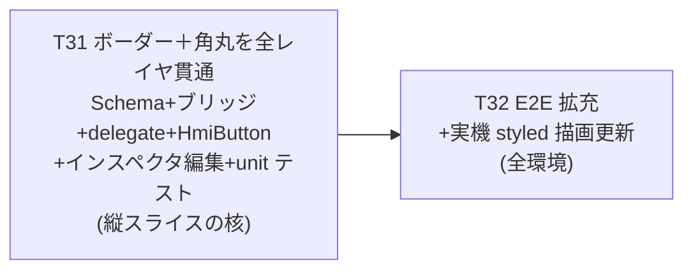

# Phase 5: Button 静的スタイル拡充（ボーダー＋角丸）

Phase 4 / Button 縦スライス（Task 25〜30）で **Editor→JSON→Simulator/Runtime→実機** を貫く
「プロパティ追加テンプレ」（Schema→C++ ブリッジ→delegate→HmiButton→インスペクタ→テスト/E2E）を確立した。

Phase 5 では **Widget 種別の横展開（Label / Lamp / Gauge…）にはまだ進まず**、その前に
**同じ縦スライスをもう一度回して Button に静的スタイルを足す**。狙いは2つ：

1. テンプレを「スタイル属性追加」として **もう一段汎用化** する（手順を完全に定型化）。
2. Task 28（`backgroundColor` / `textColor` / `fontSize`）では出なかった **「`0` が正当値の数値プロパティ」** を初めて扱い、optional 設計の穴（センチネル）を埋める。

対象は **ボーダー＋角丸の1バンドルのみ**（`borderColor` / `borderWidth` / `radius`）。
フォント詳細・テキスト配置・不透明度は **Phase 5 では扱わない**（将来また同じ縦スライスで足せる。下記「Phase 6 候補」）。

Phase 1〜4 と同じく **1 タスク = 1 ブランチ = 1 PR**、完了基準は `cmake --build` 緑 ＋ 該当環境での動作確認（スクショ / 実機）。

---

## スコープ確定事項

| 項目 | 確定値 |
|---|---|
| 対象 Widget | **Button のみ**（縦スライス継続）。Label / Lamp / Gauge 等の横展開は Phase 6 候補 |
| 追加プロパティ | **`borderColor`（QString hex）/ `borderWidth`（int）/ `radius`（int）の1バンドルのみ** |
| 系統 | **静的スタイル拡充**（Task 28 と同型の反復）。状態 / アクション（pressed/disabled/click action）は扱わない |
| 編集 UI 範囲 | インスペクタに border 色（hex TextField）/ ボーダー太さ・角丸（非 editable SpinBox）を追加 |
| widgetModel 構造 | **`var` 配列を据え置き**（Phase 4 と同じ。`QAbstractListModel` 化はしない） |
| 改修対象アプリ | **Editor のみが編集 UI を持つ**。Simulator / Runtime は読み取り専用を維持（描画に新スタイルを渡す口だけ追加、ソース共有で Runtime は自動） |
| 後方互換 | 新フィールドは optional。`isValidJson` の必須集合（id/type/width/height）は据え置き＝旧 JSON を壊さない |

---

## 各アプリの役割（Phase 4 と同一）

| アプリ | 動作環境 | Phase 5 での改修 |
|---|---|---|
| Editor | PC のみ | インスペクタに border/radius 編集 UI を追加。delegate で HmiButton へ渡す口を追加 |
| Simulator | PC のみ | `SimulatorCanvas.qml` delegate に border/radius を HmiButton へ渡す口だけ追加。編集 UI は持たない |
| Runtime | i.MX8MP（PC sanity 可） | **Simulator/ のソース共有のため改修ゼロ**。T32 で実機描画確認 |

新プロパティは **HmiButton（`Shared/Widgets`）＝唯一の真実** に公開し、Editor / Simulator 双方の delegate から渡す（片方取りこぼし防止）。

---

## タスク一覧

### T31: ボーダー＋角丸を全レイヤ貫通 ★縦スライスの核

Task 28 と同じ **4層 + インスペクタ + テスト** を1タスクで揃える。レイヤ貫通順は
**Schema → C++ ブリッジ（ProjectIo / ProjectLoader）→ QML delegate（Editor + Simulator）→ HmiButton**。

| レイヤ | 変更内容 |
|---|---|
| **Schema**（`Shared/Schema/WidgetData.{h,cpp}`） | `QString borderColor;` / `int borderWidth = -1;` / `int radius = -1;` を追加。`toJson` は **空 / `< 0` のとき省略**書き出し。`fromJson` は **`toInt(-1)` でセンチネルを維持**（後述の罠）。`isValidJson` の必須集合は **据え置き**（後方互換） |
| **C++ ブリッジ**（`Editor/src/ProjectIo.cpp` save/load・`Simulator/src/ProjectLoader.cpp` load） | `QVariantMap` 手動コピーに3フィールドを追加。**save 側は欠落時にセンチネルを失わないよう `m.value("borderWidth", -1).toInt()` で読む**（QVariantMap にキーが無い経路〔既存 ProjectIo テスト・非 Canvas 呼び出し〕では `.toInt()` が `0` を返し、`toJson` の `>= 0` ルールで「未指定」でなく明示的なボーダーなしとして誤保存されるため。Codex PR #62 P2）。load 側は `m.insert("borderWidth", w.borderWidth)` 等で `-1` を素通し（QML 側で既定にフォールバック） |
| **HmiButton**（`Shared/Widgets/qml/HmiButton.qml`） | 公開入力 `property string borderColor: ""` / `property int borderWidth: -1` / **`property int cornerRadius: -1`**（`radius` は Rectangle 組込みと衝突するため改名）。`resolvedBorderColor`（""→`#1d3557`）/ `resolvedBorderWidth`（`< 0`→1）/ `resolvedCornerRadius`（`< 0`→4）で既定外観を **HmiButton 1 箇所に集約**。描画は `border.color` / `border.width` / `radius` を `resolved*` 参照に置換（現在のハードコード `#1d3557` / 1 / 4 を既定値へ移す） |
| **EditableWidget**（`Editor/qml/EditableWidget.qml`） | メタ `widgetBorderColor: ""` / `widgetBorderWidth: -1` / `widgetRadius: -1` を追加 |
| **Editor delegate**（`Editor/qml/Canvas.qml`） | ①`snapshotModel()` に `borderColor` / `borderWidth` / `radius` を live Item から追加。②Repeater delegate で `modelData` → wrapper メタへ流す（未指定は `""` / `-1`）。③HmiButton へ `borderColor: wrapper.widgetBorderColor` / `borderWidth: ...` / `cornerRadius: wrapper.widgetRadius` を渡す |
| **Simulator delegate**（`Simulator/qml/SimulatorCanvas.qml`） | HmiButton へ `borderColor` / `borderWidth` / `cornerRadius` を `modelData` から渡す口を追加（Editor delegate と対。Runtime はソース共有で自動反映） |
| **インスペクタ**（`Editor/qml/Main.qml`） | ①`borderColor` = hex TextField（`inspectorBgColorField` と同型：`RegularExpressionValidator /^(#[0-9A-Fa-f]{6})?$/`、`onTextEdited` で `widgetBorderColor` 書き戻し、`Connections.onSelectedItemChanged` で表示同期）。②`borderWidth` / `radius` = **非 editable SpinBox**（`inspectorFontSizeSpin` と同型：`from: 0` で `0` を選べる、`onValueModified` で書き戻し、`Connections` で `value` 同期。表示既定は HmiButton と整合させ border 太さ 1 / 角丸 4）。③Delete キー Shortcut の `enabled` ガードに新フィールド3つの `activeFocus` を追加 |
| **テスト** | `tst_widget_data.cpp`（round-trip・**省略は `< 0` / 空のみ＝`0` は書き出される**ことの検証・`fromJson` 欠落時 `-1`）/ `tst_project_io.cpp` / `tst_project_loader.cpp`（ブリッジ往復、`0` ケース込み）/ `tst_canvas.qml`（選択→インスペクタ編集→Item 反映、`borderWidth=0`＝ボーダーなしの経路） |

**完了基準**：ビルド緑、`ctest`（Schema 単体 + ProjectIo / ProjectLoader）緑。**border/radius 込みの JSON を保存→読込で再現**（Schema→C++ ブリッジ→delegate を往復）。Editor / Simulator で border 色・太さ・角丸が JSON 通り描画。スクショ `Docs/screenshots/task-31-border-editor.png` / `-simulator.png`。

#### T31 の罠（Task 28 では出なかった新規ポイント）

1. **`0` は正当値**（`borderWidth=0` = ボーダーなし、`radius=0` = 角を丸めない）。Task 28 の `fontSize` は「`0` = 未指定」だったが、border/radius は **`-1` をセンチネル**にする：
   - `toJson`：`if (borderWidth >= 0) obj["borderWidth"] = borderWidth;`（`fontSize` の `> 0` と違い **`>= 0`**。`0` は書き出す）
   - `fromJson`：`w.borderWidth = obj.value("borderWidth").toInt(-1);`（**`toInt(-1)`**。`fontSize` の `toInt()`〔欠落時 0〕をコピペすると「欠落＝ボーダーなし」と誤解する）
   - **C++ ブリッジ save**：`w.borderWidth = m.value("borderWidth", -1).toInt();`（QVariantMap 欠落時も `-1` を維持。`.toInt()` だと欠落が `0` になり `toJson` の `>= 0` で誤保存。Codex PR #62 P2）
2. **`radius` 名前衝突**：HmiButton の root は `Rectangle` で `radius` は組込みプロパティ。公開入力を `radius` にすると上書き衝突するため **`cornerRadius`** に改名し、`radius: resolvedCornerRadius` で割り当てる。**JSON キー / WidgetData フィールド / EditableWidget メタは `radius`** のまま統一し、HmiButton 入力名だけ `cornerRadius`（delegate で `cornerRadius: wrapper.widgetRadius` とマップ）。
3. **既定値の単一ソース**：既定外観（border `#1d3557` / 太さ 1 / 角丸 4）は **HmiButton の `resolved*` だけ** に置く。delegate / Schema には既定値を二重定義しない（[qml-module-conventions](../.claude/rules/qml-module-conventions.md) の「未指定 + resolved\* フォールバック」規約）。

### T32: E2E 拡充 + 実機 styled 描画更新（全環境）

| 項目 | 内容 |
|---|---|
| スコープ | ①E2E（`tests/e2e/`）に border roundtrip シナリオを追加（既存 `test_style_roundtrip.py` の拡張 or 新規）：選択 → **選択中 Widget の border メタ更新**（インスペクタ書き戻しと同一経路）→ `saveTo` → 保存 JSON 直接検証 → Simulator の `hmiButton` を `getStringProperty` 検証。②border/radius を含む JSON を `hmi_runtime` で i.MX8MP 実機描画し撮影 |
| 完了基準 | macOS で `ctest`（unit + e2e）緑。**最低限 macOS E2E 緑を必須**とする。実機写真は `Docs/screenshots/task-32-runtime-border.png`（Task 30 で styled 描画パスは実証済みのため、border を含む JSON での **再撮影は任意**：撮るなら HDMI 未接続のため VNC digital capture）。README スクショ（`editor.png` / `simulator.png`）も border が見える状態に更新 |

> **E2E の保留（未確認情報は断定しない）**：Task 30 の E2E は `backgroundColor` を `hmiButton` の `getStringProperty` で検証した。`borderColor` も同一パスで検証できる。**数値の `borderWidth` / `radius`（および `cornerRadius`）は `getStringProperty` が文字列化して返す点に留意** ―― 着手時に Spix の `getStringProperty` 戻り値型を確認してから検証コードを書く（[e2e-spix](../.claude/skills/e2e-spix/SKILL.md) の罠も参照）。Spix のインスペクタ TextField 駆動不可（`onTextEdited` を発火できない）問題は Task 30 と同様、**検証スコープを「選択中 Widget の直接メタ更新」に限定**して回避する。

---

## 設計指針

### Task 28 のスタイル拡張規約をそのまま踏襲する

[qml-module-conventions](../.claude/rules/qml-module-conventions.md) の「Widget のスタイル属性は『未指定 = 空文字 / 0』を許す入力 + `resolved*` フォールバックで HmiButton に既定値集約」を踏襲する。
**唯一の違いは数値センチネルが `0` でなく `-1`**（border/radius は `0` 自体が意味を持つため）。この差分を Schema の `toJson`（`>= 0`）/ `fromJson`（`toInt(-1)`）/ **C++ ブリッジ save の QVariantMap 読取（`m.value(key, -1).toInt()`）** / HmiButton の `resolved*`（`< 0` 判定）/ インスペクタ SpinBox（`from: 0`・同期時 `>= 0` 判定）の **5 箇所で揃える**。

### レイヤ貫通の取りこぼし防止

新プロパティ1つにつき必ず **Schema（toJson/fromJson/isValidJson 据え置き）→ C++ ブリッジ（ProjectIo save+load・ProjectLoader load）→ Editor delegate（snapshotModel + Repeater + HmiButton 受け渡し）→ Simulator delegate → HmiButton 公開＋resolved → インスペクタ編集 → 各テスト** を1セットで揃える。どこか1つ抜けると JSON の値が描画に届かない（縦スライスで最も取りこぼしやすい。Task 28 の教訓）。

### widgetModel / 選択 / 編集パターンは Phase 4 のまま

`var` 配列据え置き、選択は id 追跡、インスペクタは「`onTextEdited`/`onValueModified` で live Item 書き戻し + `Connections.onSelectedItemChanged` で表示同期」の2本立て（[qml-module-conventions](../.claude/rules/qml-module-conventions.md)）。新規の設計判断は持ち込まない。

### E2E / 命名

インスペクタ入力に Spix 用 `objectName`（`inspectorBorderColorField` / `inspectorBorderWidthSpin` / `inspectorRadiusSpin`）を付与。Window / delegate 命名（`hmiEditorWindow` / `widget_<id>` / `hmiButton`）と既定ポート（Editor=9876 / Simulator=9877）は据え置き。

---

## ルール（Phase 5 限定 / 既存ルールの上に追加）

### Must Always

- 1 タスク = 1 ブランチ = 1 PR、`cmake --build` 緑 ＋ 該当環境での動作確認を完了基準にする。
- 新プロパティを足す時は **HmiButton に公開（resolved\* で既定集約）→ C++ ブリッジ（ProjectIo save/load・ProjectLoader load）に追加 → Editor と Simulator 双方の delegate に渡す → Schema / ProjectIo / ProjectLoader / Canvas QML のテストも同時更新** を1タスク内で揃える。
- `0` が正当値の数値は **`-1` センチネル**で optional 化し、`toJson`（`>= 0`）/ `fromJson`（`toInt(-1)`）/ **C++ ブリッジ save の QVariantMap 読取（`m.value(key, -1).toInt()`）** / resolved（`< 0`）/ SpinBox（`from: 0`）の5箇所を揃える。
- 編集 UI は **Editor のみ**。Simulator / Runtime は読み取り専用を維持。

### Must Never

- 本 Phase に **状態 / アクション**（pressed/disabled/click action）や **横展開**（新 Widget 種別）を混ぜる（Phase 6 候補）。
- `radius` を HmiButton の公開入力名に使う（Rectangle 組込みと衝突。`cornerRadius` を使う）。
- Schema 新フィールドを **`isValidJson` の必須**にする（旧 JSON 後方互換を壊す）。
- スタイル既定値を HmiButton 以外（delegate / Schema / インスペクタ）に**二重定義**する。
- **新規ライブラリ / フレームワーク**を追加する（`QtQuick.Controls` の既存 import で完結）。

---

## Phase 6 候補（Phase 5 完了後に別途承認）

- **静的スタイルの続き**：フォント詳細（`fontBold` / `fontItalic` / `fontFamily`）/ テキスト配置（`hAlign` / `vAlign`）/ 不透明度（`opacity`）。同じ縦スライスで追加。
- **Widget 種別の横展開**：Phase 4/5 で固めたテンプレで Label / Lamp / Gauge / Image 等（`type` 分岐 + 各 HmiXxx.qml + Schema フィールド + インスペクタ）。
- **状態 / アクション**：pressed/disabled 状態、クリック時アクション（→「動く HMI」）。
- **Phase 3-C 系インフラ**：Yocto レシピ焼込・実機 E2E・CI self-hosted runner・Windows キャプチャ（[phase3b-runtime-plan.md](phase3b-runtime-plan.md) §「Phase 3-C 候補」）。

---

## 進捗

| # | タスク | 状態 |
|---|---|---|
| 31 | ボーダー＋角丸を全レイヤ貫通（Schema + HmiButton + Simulator/Runtime + インスペクタ）★ | ⬜ 未着手 |
| 32 | E2E 拡充 + 実機 styled 描画更新（全環境） | ⬜ 未着手 |
