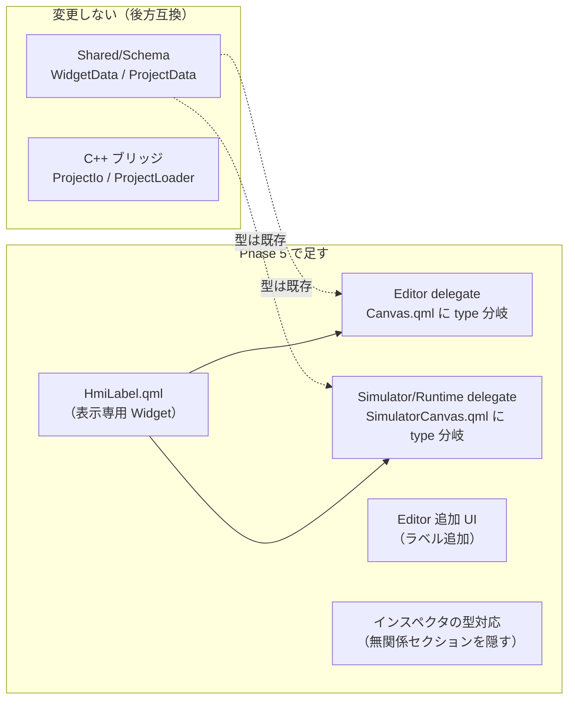
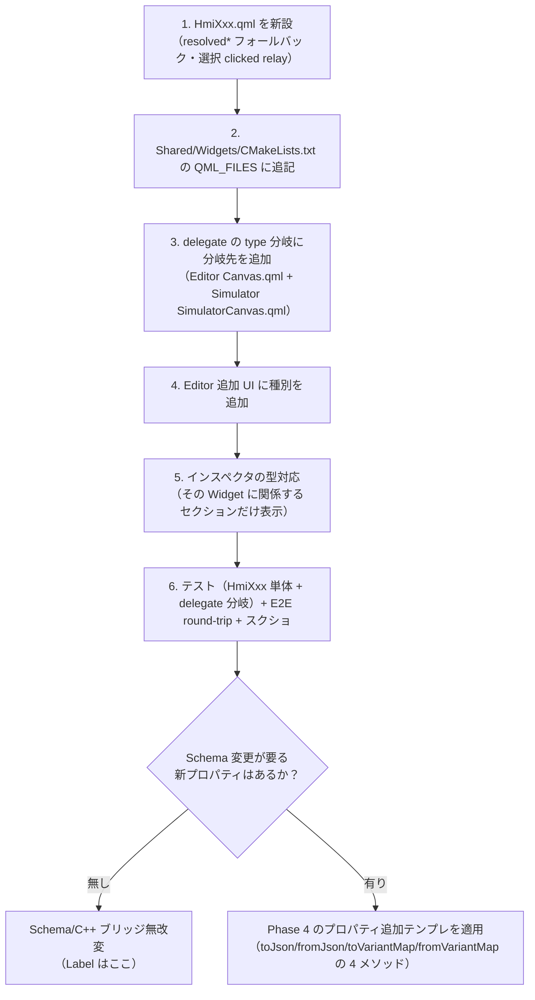

# Phase 5 横展開計画 — 新 Widget 種別（最初の Widget = Label）

> **位置づけ**：Phase 4（Button 縦スライス Task 25〜43）で **1 つの Widget を全レイヤで深く作り込み「プロパティ追加テンプレ」を確立**し、その直後に
> インスペクタ UX 改善（Task 44〜45 / PR #94）で**テンプレ＝インスペクタを綺麗にしてから**横展開する準備を整えた。
> **Phase 5 は Widget 種別を横に増やす**フェーズで、**最初の Widget に「Label（文字表示）」を選ぶ**。Button で固めた
> 縦スライス資産（Schema round-trip・C++ ブリッジ・delegate・インスペクタ・変数/バインディング）を再利用しつつ、
> **横展開で初めて必要になる「型分岐の足場」**（1 つの delegate が `type` で異なる Widget を描き分ける仕組み）を最小コストで導入する。
>
> 関連：縦スライス本体は [phase4-button-slice-plan.md](phase4-button-slice-plan.md)（「Phase 5 候補」を本計画に具体化）。インスペクタ整理は [inspector-ux-plan.md](inspector-ux-plan.md)。
> 結線規約は [.claude/rules/qml-module-conventions.md](../.claude/rules/qml-module-conventions.md)、Schema 規約は [.claude/rules/schema-conventions.md](../.claude/rules/schema-conventions.md)。
> **進捗の正本は本ファイル「進捗」表**。

---

## なぜ Label を最初に選ぶか

| 観点 | Label が横展開の最初に向く理由 |
|---|---|
| **Schema 無改変で済む** | `WidgetData` の必須キーは `id/type/width/height` のみ（`WidgetData::isValidJson`）。Label は全て充足し、文字・色・フォント・配置・不透明度の**全フィールドが Button 用に既存**。`type` も既に round-trip 済み。→ **Schema / C++ ブリッジは一切変更しない**（後方互換）。 |
| **型分岐の足場だけに集中できる** | 新規実装は実質「HmiLabel.qml」＋「delegate の `type` 分岐」だけ。横展開で唯一新しい**型分岐機構**の導入に集中でき、Lamp / Gauge / Image など後続 Widget の**雛形**になる。 |
| **対話なし＝最小サブセット** | Label は表示専用（クリックアクション無し）。Button の機能のうち **binding（変数追従）だけを引き継ぎ、action（実行）は持たない**。横断サブシステム（Phase 4 トラック B）の「読み（binding）は全 Widget・書き（action）は対話 Widget」という分担を実証する最小例。 |

---

## スコープ確定（各レイヤの変更要否）

| レイヤ | 変更 | 内容 |
|---|---|---|
| Shared/Schema（`WidgetData` 等） | **無し** | `type` 文字列・全スタイルフィールドが既存。`isValidJson` も Label を充足。新キー無し。 |
| C++ ブリッジ（ProjectIo / ProjectLoader） | **無し** | `WidgetData::toVariantMap`/`fromVariantMap` が全フィールドを往復済み（[schema-conventions](../.claude/rules/schema-conventions.md)）。type に依らず素通し。 |
| Shared/Widgets | **新規** | `HmiLabel.qml`（表示専用）＋ `CMakeLists.txt` の `QML_FILES` に追記。 |
| Editor（`Canvas.qml`） | **拡張** | delegate に `type` 分岐を導入（`type:"Label"`→HmiLabel、それ以外→HmiButton）。選択結線（clicked relay）は両型で維持。 |
| Simulator/Runtime（`SimulatorCanvas.qml`） | **拡張** | 同じ `type` 分岐。Label は binding 追従のみ（click action は非結線＝表示専用）。Runtime はソース共有で自動。 |
| Editor 追加 UI（`Canvas.qml`/`Main.qml`） | **拡張** | ツールバーに「ラベル追加」。`type:"Label"` の widget を生成。 |
| インスペクタ（`Main.qml`） | **拡張** | 選択 widget の `type` に応じて無関係セクションを隠す（Label は状態/クリックアクションを非表示）。 |

---

## 設計指針

### 型分岐の足場（横展開テンプレの核）

現状の delegate は `type` を無視して常に `HmiButton` を生成する（Editor `Canvas.qml` の `// 現状 MVP は Button のみ。型分岐は将来 Widget 種別が増えた時に拡張。`、Simulator `SimulatorCanvas.qml` の `// MVP は Button のみ。将来 Widget 種別が増えたら type で分岐する。` というコメント直下が該当箇所）。ここに分岐を入れる（**行番号は他 PR の編集でずれるため、上記コメント文字列で箇所を特定する**）。

- **機構**：delegate 内に `Loader { sourceComponent: wrapper.widgetType === "Label" ? labelComp : buttonComp }` を置き、`Component { id: buttonComp; HmiButton{…} }` / `Component { id: labelComp; HmiLabel{…} }` の 2 つの inline Component を用意する。各 Component の中身は従来どおり **`wrapper`（id）経由で `widgetText` 等のメタへバインド**できる（Loader の子は外側スコープの id を参照可）。
  - **clicked relay は Component 内の `onClicked:` ハンドラで結線**する（Connections 不要）。Loader の `item.clicked` を外から繋ぐより、Component 内に `onClicked: wrapper.…` を書くほうが既存パターン（HmiButton をインラインで結線）と同形で素直。
  - **代替案との比較**：`type==="Label" ? labelComp : buttonComp` の 2 分岐は MVP として最小。将来 Widget 種別が 3 つ以上になったら `DelegateChooser`（QtQml.Models）や `type → Component` のマップ table へ昇格する余地を残す（**本タスクでは 2 分岐で十分**＝Don't design for hypothetical future）。
- **未確認事項の保留**：Loader + inline Component で「選択枠・リサイズハンドル（EditableWidget）」が両型で同じく機能するかは Task 47 着手時にビルドで確認する。EditableWidget は子 Widget の `clicked(int modifiers)` を選択に中継する設計なので、**HmiLabel も同じ `signal clicked(int modifiers)` + 選択用 MouseArea を持たせて結線を一様化**する（下記）。

### HmiLabel.qml（表示専用 Widget）

`HmiButton.qml` の **resolved\* フォールバック方式**（未指定値を Widget 側で既定へ解決）を踏襲した、文字表示に絞った Widget。

| 持つ | 持たない |
|---|---|
| `text`（表示文字） | ボーダー（`borderColor`/`borderWidth`/`cornerRadius`）※ Label の既定はフラット。**入力欄も隠す**（インスペクタ側で） |
| 文字スタイル：`textColor` / `fontSize` / `fontBold` / `fontItalic` / `fontFamily` | `checkable` / `checked`（状態トグル＝対話 Button 専用） |
| 配置：`hAlign` / `vAlign` | **クリックアクション実行**（`runClickActions`）＝表示専用 |
| `backgroundColor`（既定 **透明**）/ `widgetOpacity` | — |
| `widgetEnabled`（淡色表示用・既定 true） | — |
| **選択用 `signal clicked(int modifiers)` + MouseArea**（Editor 選択の中継に使う。Simulator では action へ繋がない＝表示専用） | — |

- **既定値は HmiLabel に集約**（Button と同じ思想）。Button と違う既定：**背景 = 透明**（`backgroundColor:""` → `"transparent"`）、ボーダー無し、`textColor` 既定は可読性のため濃色（例 `#1d3557`）、`hAlign` 既定は左寄せ（ラベルらしさ。未指定 `""` → `Text.AlignLeft`）。確定値は Task 47 実装時に HmiButton の resolved 既定と並べて決める。**実装で確定した既定値が本計画と乖離したら、Task 47 の PR で本計画書の当該記述を同コミットで更新する**（計画と実装の乖離を残さない）。
- **binding 対応プロパティ**：`text` / `textColor` / `visible`（＋必要なら `backgroundColor`）。Simulator の `boundValue()` 経路をそのまま再利用（delegate 側で結線）。

### binding ⊂ Label 可・action ⊄ Label（役割分担）

- **binding（変数 → 表示の追従）は全 Widget 共通**。Label は `text`/`textColor`/`visible` を変数にバインドできる（例：変数値をラベルに表示）。Simulator/Runtime で `VariableStore.values` 追従。
- **action（クリック → 変数書き換え）は対話 Widget（Button）のみ**。Label の delegate は `onClicked` を action 実行へ結線しない。
- これは「**Simulator/Runtime は読み取り専用だが実行（binding 追従）は持つ・編集 UI は持たない**」という既存ルール（[phase4 plan](phase4-button-slice-plan.md)「設計原則」）と矛盾しない。Label はそのうち **action を持たない**だけ。

### インスペクタの型対応

#94 で導入した `InspectorSection`（折りたたみセクション：基本/文字/背景・枠/状態/動作/詳細）を**型で出し分け**る。

| セクション | Button | Label |
|---|---|---|
| 基本（Text / 座標・サイズ） | ✅ | ✅ |
| 文字（フォント/サイズ/太字/斜体/文字色/配置） | ✅ | ✅ |
| 背景・枠 | ✅ 全部 | **背景色・不透明度のみ**（ボーダー/角丸は隠す） |
| 状態（有効/トグル/初期オン） | ✅ | ❌ 隠す（表示専用） |
| 動作（クリックアクション） | ✅ | ❌ 隠す。**ただし binding 編集は残す**（Label でも有効） |
| 詳細（ID/外部タグ） | ✅ | ✅ |

- **objectName は不変**（E2E が参照する `inspectorBgColorField` 等は据置）。型で `visible` を切り替えるだけ。Button 選択時は従来どおり全セクション表示で既存 E2E は緑を維持。

---

## タスク分割（1 タスク = 1 PR、`cmake --build` 成功 + Web `ctest` 緑が完了基準）

| Task | スコープ | 完了基準 |
|---|---|---|
| **47** | **型分岐の足場 + HmiLabel 描画**。`HmiLabel.qml`（表示専用・resolved\* フォールバック・選択用 clicked relay）を新設し `Shared/Widgets/CMakeLists.txt` に登録。Editor `Canvas.qml` と Simulator `SimulatorCanvas.qml` の delegate に `type` 分岐（Loader + 2 Component）を導入し、`type:"Label"` の widget を HmiLabel で描く（それ以外＝従来 HmiButton）。Label は binding（text/textColor/visible）追従・click action 非結線。**追加 UI はまだ無し**（手書き JSON / 既存 fixture で検証）。新規 unit：HmiLabel 単体（resolved 既定・clicked シグナル）＋ delegate が `type` で正しい Widget を生成すること（Editor/Simulator）。**Schema/C++ ブリッジは無改変**。 | build 成功。Web `ctest`（unit + e2e）緑。**`type:"Label"` でも EditableWidget の選択枠・リサイズハンドルが正常動作すること**（HmiLabel の clicked 中継で選択でき、ハンドルでサイズ変更できる）。 |
| **48** | **Editor で Label を作成 + インスペクタの型対応**。ツールバーに「ラベル追加」ボタン（or 種別ドロップダウン）を足し、`type:"Label"` の widget を生成（`addWidget(type)` へ一般化、Label の既定文字・透明背景）。インスペクタは選択 widget の `type` に応じて**無関係セクションを隠す**（上表：Label は状態/クリックアクションを非表示、ボーダー/角丸を隠す。binding 編集は残す）。**objectName・スキーマ不変**（`visible` 切替のみ）。 | build + `ctest` 緑。`editor.png` 撮り直し（Label 配置図）+ キャプション更新。 |
| **49** | **Label の round-trip + binding + E2E + スクショ**。Label JSON（`type:"Label"` + 文字スタイル）の保存/読込 round-trip を確認。`text`/`textColor`/`visible` binding を Simulator で追従確認（既存 `boundValue` 経路再利用）。新規 cross-app E2E `e2e_label_roundtrip`（Editor で Label 入り JSON を `--open`→`saveTo`→JSON 直接 assert → Simulator を `--open` で起動し `HmiLabel`〔objectName `hmiLabel`〕の `text` を `getStringProperty` で観測）。README スクショ（`simulator.png` に Label を含める）。**任意**：実機（i.MX8MP）で Label 描画を VNC キャプチャ（ASCII ラベル）。 | build + `ctest` 緑（`e2e_label_roundtrip` 追加で **E2E が 6→7 本**、unit は別途）。スクショ同期。 |

### 制約・非スコープ（Codex 向け補足）

- **Schema / JSON round-trip / C++ ブリッジは無改変**：`WidgetData` のフィールド・キーは一切足さない。`type` の値域（"Button"/"Label"）が増えるだけで、JSON 構造・`isValidJson` の必須集合・`toVariantMap`/`fromVariantMap` は不変。**旧 JSON（Button のみ）との後方互換を保つ**。
- **objectName 不変**：E2E（Spix）が参照する canvas widget プロパティ・インスペクタ `inspectorBgColorField` 等は据置。HmiButton の objectName `hmiButton` も据置、HmiLabel は新規 `hmiLabel`。インスペクタの型出し分けは `visible` のみで objectName を消さない（既定で開く＝Button 選択時のセクションに既存 E2E 依存項目を残す）。
- **役割分担**：binding（読み）⊂ 全 Widget・action（書き）⊂ 対話 Widget。Label は **binding を持ち action を持たない**。Simulator/Runtime は引き続き**実行（binding 追従）は可・編集 UI 不可**。
- **型分岐の機構**は 2 分岐（Button/Label）で最小化。3 種別以上は本フェーズの後続 Widget で必要になってから昇格（hypothetical future の作り込みをしない）。
- **EditableWidget の選択/リサイズ結線**は両型で一様に機能させる（HmiLabel も `clicked(int modifiers)` を中継）。Task 47 着手時にビルドで実機確認する。
- **README スクショ同期**：見た目が変わる Task 48/49 で `Docs/screenshots/editor.png`/`simulator.png` とキャプションを同コミットで更新（[readme-screenshot-sync](../.claude/rules/readme-screenshot-sync.md)）。
- **進捗ステータス同期**：本フェーズ着手＝フェーズ進行のため、実装着手時（Task 47）に常駐文書（CLAUDE.md「現在のフェーズ」/ AGENTS.md / README / `.claude/agents/mvp-task-runner.md`）を本計画へ同期する（[feedback-phase-status-sync](../.claude/rules/feedback-phase-status-sync.md)）。**本 PR は計画書のみ**で、ステータス同期は実装 PR で行う（#94 と同じ運用）。

---

## 横展開テンプレ（Label 以降の後続 Widget へ）

Phase 5 で確立する「**新 Widget 種別の追加手順**」（Lamp / Gauge / Image 等で反復する雛形）：

> **Phase 5 の最初の Widget = Label**。後続 Widget（Lamp / Gauge / Image 等）のスコープ・順序は Label 完了後に別途ユーザー承認する。

---

## 進捗

| Task | 状態 | PR |
|---|---|---|
| 47 型分岐の足場 + HmiLabel 描画 | ✅ 完了 | #97 |
| 48 Editor で Label 作成 + インスペクタ型対応 | ✅ 完了 | #98 |
| 49 Label round-trip + binding + E2E + スクショ | 未着手 | — |

> Task 48 完了（2026-06-11）：Editor `Canvas.qml` の `addWidget()` を `addWidget(type)` へ一般化（省略時は後方互換で Button。Label は既定文字 "Label"・背景未指定＝透明フォールバック）。ツールバーに「ラベル追加」ボタン（objectName `addLabelButton`）を追加し、既存「追加」を「ボタン追加」に明確化（objectName `addWidgetButton`・挙動は据え置き＝E2E 互換）。インスペクタは選択 Widget が Label のとき**無関係セクション / 項目を `visible` で隠す**（状態セクション全体・クリックアクション編集・ボーダー色/太さ/角丸を非表示。背景色・不透明度・**バインディング編集**・基本・文字・詳細は表示）。判定は `rootWindow.selectedIsLabel`（= `selectedItem.widgetType === "Label"`）。**objectName・編集ロジック・Schema は不変＝表示切替のみ**。新規 unit（Canvas）：`addWidget()` 既定 Button / `addWidget("Label")` で Label 型 + HmiLabel 描画 + 既定文字 "Label" / Label 追加の undo。README `editor.png` を Label 配置シーン（`Docs/samples/task-48-label-demo.json`）で撮り直し + キャプション更新。Web `ctest` unit 10 + e2e 6 = 16/16 緑。次は Task 49。

> Task 47 完了（2026-06-11）：`HmiLabel.qml`（表示専用・resolved\* フォールバック・選択用 `clicked(int modifiers)` relay）を新設し `Shared/Widgets/CMakeLists.txt` に登録。Editor `Canvas.qml` と Simulator `SimulatorCanvas.qml` の delegate に `type` 分岐（Loader + inline Component の 2 分岐。`type:"Label"`→HmiLabel、それ以外→HmiButton）を導入。Label は binding（text / textColor / backgroundColor / visible）追従のみで click action は非結線（表示専用）。新規 unit：HmiLabel 単体（resolved 既定〔背景=透明 / 文字色 #1d3557 / hAlign=左〕・clicked シグナル）＋ delegate が `type` で正しい Widget を生成・切替すること（Editor / Simulator）。**Schema / C++ ブリッジは無改変**。Web `ctest` unit 10 + e2e 6 = 16/16 緑。次は Task 48。
