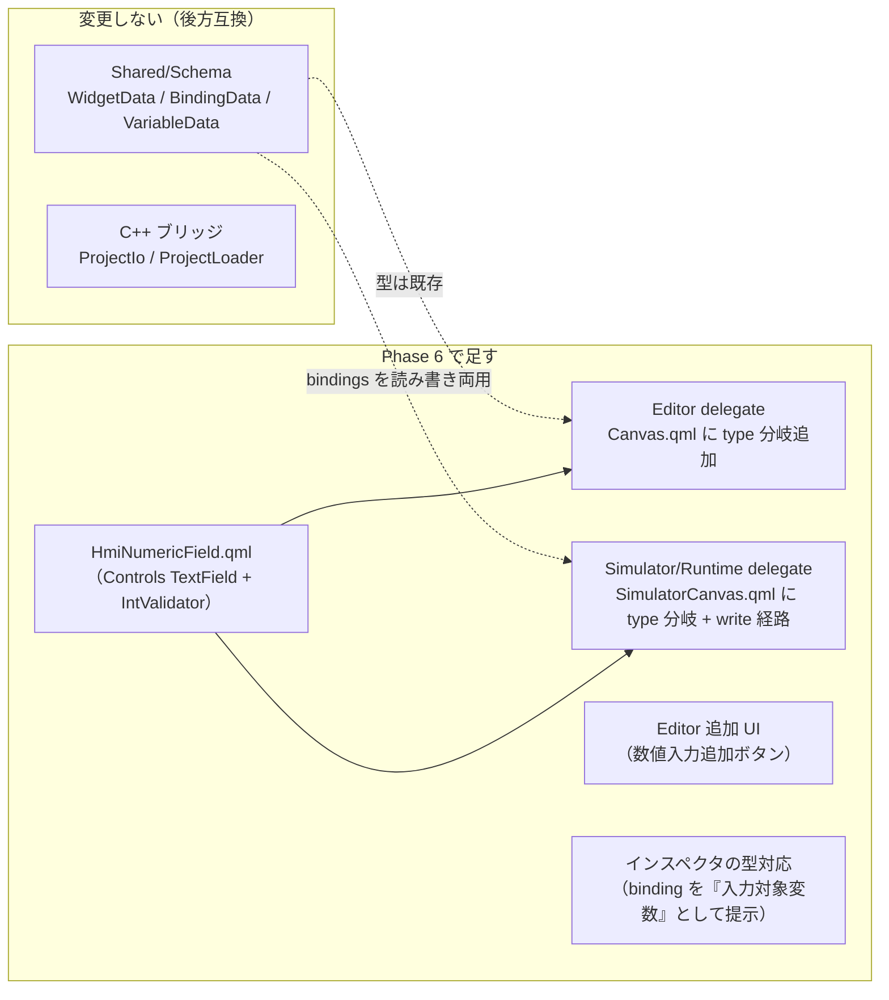
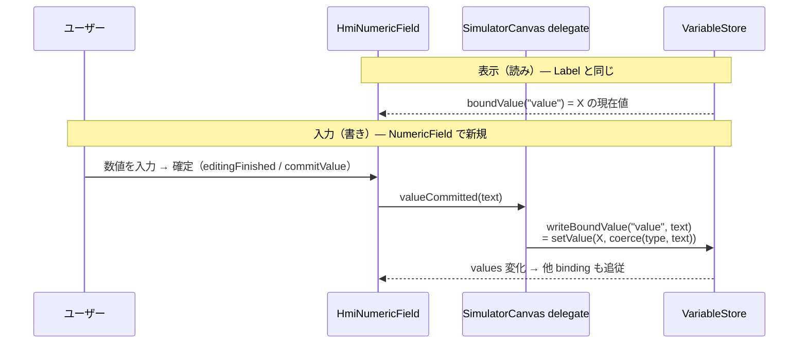

# Phase 6 計画 — 入力 Widget（最初の Widget = NumericField / 数値入力）

> **位置づけ**：Phase 5（横展開）で **最初の Widget = Label（表示専用）** を入れ、「型分岐の足場 + 横展開テンプレ」を確立した。
> Phase 6 は同じ横展開テンプレに乗りつつ、**初めて「ユーザー入力 → 変数へ書き込む（write）」相互作用を持つ入力 Widget** を導入するフェーズで、
> **最初の入力 Widget に「NumericField（数値入力フィールド）」を選ぶ**。
> Label が `binding`（変数 → 表示の**読み**）だけだったのに対し、NumericField は **読み（表示）+ 書き（入力確定で変数更新）の両方**を担う。
>
> **Phase 5（横展開）の後続例は Lamp / Gauge / Image など「表示 Widget」だった**のに対し、NumericField は質的に異なる「入力 Widget」のため、
> 横展開の一種ではなく **新フェーズ（Phase 6 / 入力 Widget）** として立てる（Phase 7 / Modbus は従来どおり将来バックログ）。
>
> 関連：横展開テンプレ・型分岐の足場は [phase5-widget-expansion-plan.md](phase5-widget-expansion-plan.md)。変数 / バインディング / アクションの土台は [phase4-button-slice-plan.md](phase4-button-slice-plan.md)（トラック B）。
> 結線規約は [.claude/rules/qml-module-conventions.md](../.claude/rules/qml-module-conventions.md)、Schema 規約は [.claude/rules/schema-conventions.md](../.claude/rules/schema-conventions.md)。
> **進捗の正本は本ファイル「進捗」表**。

---

## なぜ NumericField を最初の入力 Widget に選ぶか

| 観点 | NumericField が入力 Widget の最初に向く理由 |
|---|---|
| **Schema 無改変で済む（読み書き両用 binding）** | 「入力した数値をどの変数へ書くか」は **既存 `bindings`（`property`/`variable`）を読み書き両用に使う**ことで表現でき、`WidgetData` に新キーを足さない（後方互換）。Label が確立した `boundValue()`（変数 → 表示の読み）経路を、編集確定時に**同じ変数へ書き戻す**（`VariableStore.setValue`）対称経路にするだけ。 |
| **既存の write 部品が揃っている** | `VariableStore.setValue` / `coerce(type, raw)` / Simulator delegate の `variableType(name)` は Phase 4 トラック B（アクション実行）で実装済み。`runClickActions` が既に `setValue` を呼んでいるので、入力確定からの書き込みは新規部品ゼロで成立する。 |
| **横展開テンプレ + 1 つの新概念だけ** | Label で確立した 5 ステップ（HmiXxx 新設 → CMake 登録 → delegate 型分岐 → Editor 追加 UI → インスペクタ型対応）にそのまま乗る。**入力 Widget で初めて要るのは「編集確定 → 変数 write」経路だけ**で、これが Gauge スライダ等の後続入力 Widget の雛形になる。 |
| **数値に絞れば最小** | テキスト一般入力ではなく数値（int）に限定し、`IntValidator` で不正入力を弾く。型 `coerce("int", …)`（`parseInt`）と整合し、最小スコープで「動く入力」を実証できる。 |

---

## スコープ確定（各レイヤの変更要否）

| レイヤ | 変更 | 内容 |
|---|---|---|
| Shared/Schema（`WidgetData` / `BindingData` / `VariableData`） | **無し** | `type` 文字列・`bindings`・`variables` が既存。NumericField は `type:"NumericField"` + binding `{property:"value", variable:X}` で表現。新キー無し・`isValidJson` 充足。 |
| C++ ブリッジ（ProjectIo / ProjectLoader） | **無し** | `WidgetData::toVariantMap`/`fromVariantMap` が全フィールドを往復済み。type に依らず素通し。 |
| Shared/Widgets | **新規** | `HmiNumericField.qml`（QtQuick.Controls TextField + IntValidator + resolved\* + `editable` + `commitValue()`）＋ `CMakeLists.txt` の `QML_FILES` に追記。**Shared/Widgets が初めて QtQuick.Controls に依存**（import のみ、CMake 明示リンク不要）。 |
| Editor（`Canvas.qml`） | **拡張** | delegate の `type` 分岐に NumericField を追加。`addWidget(type)` ホワイトリストに `"NumericField"`。Editor では `editable:false`（読み取り表示＝キャンバスは設計面）。 |
| Simulator/Runtime（`SimulatorCanvas.qml`） | **拡張** | 同じ `type` 分岐 + **write 経路**：`boundValue("value")` で表示し、編集確定 signal を受けて binding が指す変数へ `setValue(coerce(...))`。Runtime はソース共有で自動。 |
| Editor 追加 UI（`Canvas.qml`/`Main.qml`） | **拡張** | ツールバーに「数値入力追加」ボタン（objectName `addNumericButton`）。 |
| インスペクタ（`Main.qml`） | **拡張** | `selectedIsNumericField` を追加し、状態 / クリックアクションを隠す。binding を「入力対象変数」として提示（binding プロパティ ComboBox の model に `"value"` を追加）。 |

---

## 設計指針

### write 経路 — 読み書き両用 binding（Schema 無改変）

現状の binding は「変数 → property を**読む**」一方向（Simulator delegate の `boundValue(prop)`）。NumericField はこれを**対称化**する：

- **読み（表示）**：`boundValue("value")` で binding `{property:"value", variable:X}` が指す変数 X の現在値を表示する。
- **書き（入力確定）**：ユーザーが数値を入れて確定すると、**同じ X** へ `VariableStore.setValue(X, VariableStore.coerce(variableType(X), 入力テキスト))` で書き戻す。delegate に `boundValue` の書き版ヘルパー `writeBoundValue(prop, raw)` を追加する。

- **なぜ (A) 読み書き両用 binding か**（他案を退けた理由）：
  - **(B) 新アクション trigger（onValueChanged 等）を足す案は過剰**。`ActionData.value` は固定文字列で「入力値で置換」する仕組みが無く、trigger 拡張 + value プレースホルダ展開の二重拡張が要る。
  - **(C) 専用フィールド（書き込み先変数名）を Schema 追加する案は整合コスト増**。変数リネーム/削除の参照追従（`renameVariableReferences`/`removeVariableReferences`）も新フィールド対応が要る。binding で表現できるものを別に持たない。
- **保留（実装時に確認）**：binding 表示式は「変数変化で再評価」するため、ユーザー編集中に外部から同変数が変わると表示が上書きされカーソルが飛びうる。インスペクタ two-way 編集で確立した「フォーカス中は表示同期を抑止・確定時のみ書き戻す」（Task 26 パターン）を `HmiNumericField` の `activeFocus` ガードで踏襲する。Simulator 実機での挙動は Task 51 着手時に確認する。

### HmiNumericField.qml（入力 Widget）

`HmiButton.qml` / `HmiLabel.qml` の **resolved\* フォールバック方式**（未指定値を Widget 側で既定へ解決）を踏襲しつつ、**QtQuick.Controls の `TextField` + `IntValidator`** を内部実装に使う。

| 持つ | 持たない（MVP 非スコープ） |
|---|---|
| 数値入力（`TextField` + `IntValidator`）・表示テキスト `text` | `checkable` / `checked`（状態トグル＝Button 専用） |
| 文字スタイル：`textColor` / `fontSize` / `fontBold` / `fontItalic` / `fontFamily` | **クリックアクション**（`runClickActions`）＝書きは入力確定で行う |
| 背景・枠：`backgroundColor`（既定は「入力欄らしい」淡背景）/ `borderColor` / `borderWidth` / `cornerRadius`（TextField の枠に効く） | **min/max（数値範囲）**＝Schema 追加が要るので別タスク |
| 配置：`hAlign` / `vAlign` ・`widgetOpacity` ・`widgetEnabled` | **real（浮動小数）型**＝`VariableData`/`coerce` 拡張が要るので別承認 |
| `editable`（既定 true。Editor=false で読取専用表示 / Simulator=true で live 編集） | — |
| 選択用 `signal clicked(int modifiers)` + 選択用 MouseArea（Editor 選択の中継） | — |
| `commitValue()`（現在 text を確定）/ `signal valueCommitted(string text)`（delegate が write へ結線。E2E でも `invokeMethod` で確定を模す） | — |

- **既定値は HmiNumericField に集約**（Button / Label と同思想）。背景は入力欄らしい淡背景 + 細枠を既定にする。**Task 50 で確定した resolved 既定**：背景 `#ffffff`（白）/ 文字色 `#1d3557`（Label と同じ濃色）/ ボーダー色 `#9aa5b1`・幅 `1` / 角丸 `4` / 配置は数値慣習で **hAlign=右・vAlign=中央**（Button=中央/中央・Label=左/中央 との差分）/ opacity `1.0`。Button の鮮やか塗り・Label の透明とは別の「入力欄らしい」既定。
- **QtQuick.Controls 依存**：import のみで動く（CMake 明示リンク不要、[qml-module-conventions](../.claude/rules/qml-module-conventions.md)）。**SpinBox ではなく TextField + IntValidator** を使う（editable SpinBox の表示更新バグ回避＝Task 27 の教訓）。
- **保留（要検証）**：i.MX8MP の rootfs に QtQuick.Controls plugin（Basic スタイル）が含まれるかは本リポジトリのコードからは判断不能。**Task 50 の完了基準に「windeployqt / Yocto recipe で Controls plugin 同梱を確認」を TODO として明記**し、デプロイ検証は別途行う（MVP の build/ctest 緑とは切り離す）。

### Editor とキャンバスの差（`editable` で出し分け）

- **Editor キャンバス**＝設計面なので **`editable:false`**（`TextField.readOnly:true` + `activeFocusOnPress:false`）。選択用 MouseArea を TextField の**上**に重ね `clicked(int modifiers)` を中継して、EditableWidget の選択/リサイズを Button/Label と一様にする（TextField がフォーカス/入力を奪う罠への対処）。
- **Simulator/Runtime**＝**`editable:true`**（live 編集）。選択 MouseArea を無効化し TextField が入力を受ける（Simulator は clicked を選択に使わない）。`editable` で MouseArea の `enabled` を出し分ける。

### インスペクタの型対応

`selectedIsLabel` と同型の `selectedIsNumericField`（`selectedItem.widgetType === "NumericField"`）を追加。型出し分けは `visible` のみ（objectName / Schema 不変）。

| セクション | Button | Label | NumericField |
|---|---|---|---|
| 基本（Text / 座標・サイズ） | ✅ | ✅ | ✅（Text = 初期表示値） |
| 文字（フォント/サイズ/太字/斜体/文字色/配置） | ✅ | ✅ | ✅ |
| 背景・枠 | ✅ 全部 | 背景色・不透明度のみ | ✅ 全部（入力欄の枠に効く） |
| 状態（有効/トグル/初期オン） | ✅ | ❌ | ❌ 隠す |
| 動作（クリックアクション） | ✅ | ❌ | ❌ 隠す（write は binding で行う） |
| 動作（バインディング編集） | ✅ | ✅ | ✅ **「入力対象変数」として必須提示**（binding プロパティ ComboBox に `"value"` を追加） |
| 詳細（ID/外部タグ） | ✅ | ✅ | ✅ |

- 「クリックアクション非対応 Widget」が Label / NumericField の 2 つになるため、`!selectedIsLabel && !selectedIsNumericField` の連結ではなく **派生 `selectedSupportsClickAction`** を導入してまとめる（今後の Widget 追加で破綻しにくい）。Task 51 着手時に既存 `visible` 条件と突き合わせて確定する。

---

## タスク分割（1 タスク = 1 PR、`cmake --build` 成功 + Web `ctest` 緑が完了基準）

| Task | スコープ | 完了基準 |
|---|---|---|
| **50** | **型分岐の足場 + HmiNumericField 描画**。`HmiNumericField.qml`（Controls TextField + IntValidator + resolved\* + `editable` + 選択用 `clicked(int modifiers)` + `commitValue()`/`valueCommitted`、ただし write 結線は delegate にまだ無い）を新設し `Shared/Widgets/CMakeLists.txt` に登録。Editor `Canvas.qml` / Simulator `SimulatorCanvas.qml` の delegate `type` 分岐に `numericComponent` を追加（objectName `hmiNumericField`）。Editor は `editable:false`、Simulator は `editable:true` で**読み取り表示**（`boundValue("value")` 追従。write は Task 51）。新規 unit：HmiNumericField 単体（resolved 既定・`editable` 切替・clicked）＋ delegate が `type` で正しい Widget を生成すること（Editor/Simulator）。**Schema/C++ ブリッジ無改変**。 | build 成功。Web `ctest`（unit + e2e）緑。`type:"NumericField"` でも EditableWidget の選択枠・リサイズハンドルが正常動作。**PR に「Controls plugin 同梱確認 TODO（windeployqt / Yocto）」を明記**。 |
| **51** | **write 経路（Simulator）+ Editor 追加 UI + インスペクタ型対応**。SimulatorCanvas delegate に `writeBoundValue(prop, raw)` を追加し、NumericField の `valueCommitted` を受けて binding が指す変数へ `setValue(coerce(variableType, text))`。フォーカス中は binding 表示を抑止（カーソル飛び対策）。Editor：`addWidget` ホワイトリストに `"NumericField"`、ツールバーに「数値入力追加」（objectName `addNumericButton`）、`selectedIsNumericField` + `selectedSupportsClickAction` で状態/アクション非表示、binding ComboBox model に `"value"` 追加。新規 unit：SimulatorCanvas の write 追従（`commitValue` 後に変数更新 → 他 binding 追従）。 | build + `ctest` 緑。Editor で NumericField を追加・選択・binding 設定でき、Simulator unit で write が変数に届く。**見た目が変わるので `editor.png`/`simulator.png` 同期**（[readme-screenshot-sync](../.claude/rules/readme-screenshot-sync.md)）。 |
| **52** | **cross-app E2E（typed-write）+ スクショ証跡**。`tests/e2e/test_numeric_input.py` 新設（`test_action_roundtrip.py` テンプレ）：fixture を Editor `--open`→`saveTo`→保存 JSON を直接 assert（`type:"NumericField"` / binding `{property:"value"}`）→ Simulator `--open` で初期表示（変数追従）確認 → `setStringProperty(..., "text", "42")` + `invokeMethod(..., "commitValue")` で確定 → 変数が `42` になり追従することを `getStringProperty` で観測。`tests/e2e/CMakeLists.txt` に `e2e_numeric_input` 登録（TIMEOUT 60 / LABELS e2e）。`scripts/capture-app-screenshot-linux.sh` で task-52 証跡 + `editor.png`/`simulator.png` 最終同期。 | build + `ctest` 緑（`e2e_numeric_input` 含む）。E2E が typed-write の確定 → 変数 → 追従を観測。スクショ同期。 |

> **粒度**：Label が Task 47（足場）/48（Editor UI + インスペクタ）/49（E2E）の 3 本だったのと対応。NumericField は write 経路があるため Task 51 に「write + Editor UI + インスペクタ」を集約。Task 51 が重い場合は 51a（write + Simulator unit）/ 51b（Editor UI + インスペクタ）に分割可（その場合 4 本）。

### 制約・非スコープ（Codex 向け補足）

- **Schema / JSON round-trip / C++ ブリッジは無改変**：`WidgetData` / `BindingData` / `VariableData` にキーを足さない。`type` の値域に `"NumericField"` が増え、binding の `property` 値に `"value"` が増えるだけ。**旧 JSON との後方互換**を保つ。
- **objectName 不変**：E2E（Spix）が参照する既存プロパティ・インスペクタ項目は据置。HmiNumericField は新規 objectName `hmiNumericField`、Editor 追加ボタンは `addNumericButton`。型出し分けは `visible` のみ。
- **役割分担**：binding（読み）⊂ 全 Widget。**NumericField は binding を読み書き両用に使う**（表示=読み・入力確定=書き）。クリックアクション（`runClickActions`）は持たない。Simulator/Runtime は引き続き**実行（binding 追従・入力書き戻し）は可・編集 UI 不可**。
- **MVP は int 変数のみ**：`coerce("int", raw)`（`parseInt`）と `IntValidator` で整合。**real（浮動小数）型・min/max（数値範囲）は Schema 連鎖するため非スコープ＝別タスク/別承認**（`VariableData::isValidJson` は現状 bool/int/string のみ。`WidgetData` に minValue/maxValue 無し）。
- **QtQuick.Controls は import のみで動く**が、**i.MX8MP rootfs への plugin 同梱は未確認＝Task 50 完了基準に確認 TODO を残す**（build/ctest 緑とは切り離す）。
- **Spix は実テキスト入力（editingFinished）を発火できない**：`commitValue()` 公開メソッドを `invokeMethod` で叩いて確定を模す（`saveTo` を invoke するのと同手法）。
- **型分岐の機構**は Label で導入した Loader + inline Component の延長（3 分岐目を追加）。3 種別以上の昇格（DelegateChooser 等）は必要になってから（hypothetical future の作り込みをしない）。

---

## 横展開テンプレ（入力 Widget 版・後続の Gauge スライダ等へ）

Label で確立した 5 ステップに、**入力 Widget 固有の 4 点**を重ねる：

| 横展開 5 ステップ | NumericField での内容 | 入力 Widget 固有の追加 |
|---|---|---|
| 1. `HmiXxx.qml` 新設 | Controls TextField + IntValidator + resolved\* + clicked | **Controls 初依存** / `editable` / `commitValue()` / フォーカス中の binding 表示抑止 |
| 2. CMake `QML_FILES` 追記 | `HmiNumericField.qml` | — |
| 3. delegate 型分岐 | `numericComponent` 追加（両 Canvas） | Simulator に **write 経路**（`writeBoundValue` + 確定結線）。Editor は `editable:false` |
| 4. Editor 追加 UI | ツールバー「数値入力追加」 | 既定初期表示値の決定 |
| 5. インスペクタ型対応 | `selectedIsNumericField` / 状態・アクション非表示 | **binding を「入力対象変数」として提示**（ComboBox に `"value"` 追加） |
| 6. unit + E2E + スクショ | HmiNumericField 単体 + delegate 分岐 + `e2e_numeric_input` | **typed-write の確定を `invokeMethod commitValue` で模す** |

> **Phase 6 の最初の入力 Widget = NumericField**。後続の入力 Widget（Gauge スライダ / Toggle 等）や real 型・数値範囲のスコープ・順序は NumericField 完了後に別途ユーザー承認する。

---

## 進捗

| Task | 状態 | PR |
|---|---|---|
| 50 型分岐の足場 + HmiNumericField 描画 | 🟦 実装済み（PR レビュー待ち） | — |
| 51 write 経路 + Editor 追加 UI + インスペクタ型対応 | ⬜ 未着手 | — |
| 52 cross-app E2E（typed-write）+ スクショ | ⬜ 未着手 | — |

> **本 PR は計画書（+ 進捗ステータス同期）のみ**。Phase 6 の着手＝フェーズ進行のため、常駐文書（README / CLAUDE.md / AGENTS.md / `.claude/agents/mvp-task-runner.md` / development-history）を本 PR で同期する（[feedback-phase-status-sync](../.claude/rules/feedback-phase-status-sync.md)。計画 PR でもステータスが動くなら同コミットで同期する）。実装は Task 50 から 1 タスクずつ。
