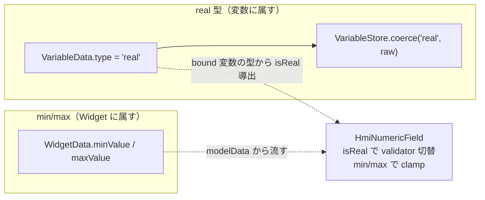

# Phase 6-B 計画 — NumericField 拡張（real 型 + 数値範囲 min/max）

> **位置づけ**：Phase 6（[phase6-input-widget-plan.md](phase6-input-widget-plan.md)）で最初の入力 Widget = NumericField を **int 変数のみ**で確立した（読み書き両用 binding）。
> Phase 6 完了時に「real（浮動小数）型・min/max（数値範囲）は Schema 連鎖するため非スコープ＝別承認」と保留していた 2 点を、本 Phase 6-B で承認スコープとして実装する（2026-06-13 ユーザー承認）。
>
> **承認スコープ**：①**real 変数型**（`VariableData` の型に `"real"` を追加し、NumericField で浮動小数を入出力）／②**数値範囲 min/max**（`WidgetData` に範囲を持たせ、入力を clamp）。
> **非スコープ（別承認）**：`step`（刻み）・`decimals`（小数桁）・`unit`（単位表示）・テンキーポップアップ（requirements FR-NUM の P2 群）、後続入力 Widget（Gauge / Toggle）。
>
> 関連：write 経路・読み書き両用 binding は [phase6-input-widget-plan.md](phase6-input-widget-plan.md)、要求は [requirements.md](requirements.md)（FR-NUM-05/06）、Schema 規約は [.claude/rules/schema-conventions.md](../.claude/rules/schema-conventions.md)、結線規約は [.claude/rules/qml-module-conventions.md](../.claude/rules/qml-module-conventions.md)。
> **進捗の正本は本ファイル「進捗」表**。

---

## スコープの 2 軸（real は変数スコープ・min/max は Widget スコープ）

| 軸 | 何に属すか | 既存資産との対比 |
|---|---|---|
| **real 型** | **変数**（`VariableData.type`）。NumericField は **bound 変数の型** から `isReal` を導出する（Widget 自身は real/int を持たない）。 | `int`/`bool`/`string` の型分岐に 4 値目を足すだけ。`boundValue`/`writeBoundValue` 経路は不変。 |
| **min/max** | **Widget**（`WidgetData.minValue`/`maxValue`）。同じ変数を別 NumericField が別レンジで編集しうるため Widget 固有。 | `borderWidth`/`radius` と同じ「Widget の optional 数値」。**ただしセンチネルは別**（下記）。 |

### ⚠️ min/max のセンチネル設計（borderWidth と違う）

`borderWidth`/`radius` は **負値が不正**なので `-1` を「未指定」センチネルにできた。一方 **min/max は負値が正当**（例 `min=-100`）なので **`-1`/`0` をセンチネルに使えない**。

→ **presence フラグ方式**を採る：`WidgetData` に `double minValue`/`maxValue` ＋ 同伴 `bool hasMinValue`/`hasMaxValue` を持つ。
- `toJson`：`hasMinValue` のときだけ `minValue` を書く（未指定はキー省略＝後方互換）。
- `fromJson`：`hasMinValue = obj.contains("minValue")`、値は `obj.value("minValue").toDouble()`。
- `toVariantMap`/`fromVariantMap`：`minValue`/`hasMinValue` を対で転写（QML 側は `hasMinValue` を見て未指定判定）。
- 型は **`double`**（int レンジは double に内包でき、real レンジ〔例 `0.5`〕も表せる）。int 変数では QML 側で `IntValidator.bottom/top` に丸めて渡す。

---

## 設計指針

### real 型（Task 53）

- **Schema**：`VariableData::isValidJson` の型集合に `"real"` を追加。`initial` は既存の `jsonValueToString`（JSON number → `QString::number(d)`）で float も文字列正規化済み＝**round-trip は追加不要**。
- **coerce**：`VariableStore.coerce` に `type === "real"` 分岐を追加 → `const n = Number(raw); return isNaN(n) ? 0.0 : n;`（`parseFloat` 相当だが全体妥当性を見る `Number`）。`toggle` は bool 専用なので real では呼ばれない（不変）。
- **NumericField の `isReal`**：`property bool isReal: false`。`true` で `validator` を `DoubleValidator` に、`commitValue` の正規化を **整数丸めなし**（`String(Number.fromLocaleString(...))`）にする。`false`（int）は現行どおり `IntValidator` + `Math.trunc`。
- **isReal の導出**：NumericField 自身は real/int を**持たない**。Simulator delegate の wrapper に `boundVariableType(prop)`（binding が指す変数の `variableType` を返す）を足し、`isReal: wrapper.boundVariableType("value") === "real"` で渡す。**Editor キャンバスは設計面＝`editable:false` で validator 非適用なので `isReal:false` 固定でよい**（描画は静的 text）。
- **DoubleValidator の罠（要実装時確認）**：`DoubleValidator` は locale の小数点を使う。`commitValue` は `Number.fromLocaleString(Qt.locale(), ...)` で同一 locale 解釈し ASCII 数値文字列へ正規化する（Phase 6 Task 52 で確立した locale 整合の踏襲）。`notation: DoubleValidator.StandardNotation`、`decimals` は MVP では未制約（指数表記は許容しない方向で実装時確定）。

### 数値範囲 min/max（Task 54）

- **Schema**：上記 presence フラグ方式で `WidgetData` に `minValue`/`maxValue`(double) + `hasMinValue`/`hasMaxValue`(bool)。4 メソッド（`toJson`/`fromJson`/`toVariantMap`/`fromVariantMap`）を揃える（[schema-conventions](../.claude/rules/schema-conventions.md)）。
- **NumericField**：`property real minValue`/`maxValue` + `property bool hasMin`/`hasMax`。
  - **validator**：`hasMin`/`hasMax` のとき `IntValidator`/`DoubleValidator` の `bottom`/`top` に設定（未指定側は付けない）。
  - **clamp**：`commitValue` の正規化後、`hasMin && n < minValue → n = minValue`、`hasMax && n > maxValue → n = maxValue`（**範囲外は拒否でなく clamp**＝requirements FR-NUM-05 の「clamp / 拒否」のうち clamp を採用。確定時に丸める）。clamp 後の値を emit ＝変数へは常に範囲内が書かれる。
- **Editor インスペクタ**：`selectedIsNumericField` のときだけ出す「範囲（min / max）」項目（`TextField` + バリデータの 2 本立て＝`onTextEdited` 書き戻し / `Connections.onSelectedItemChanged` 表示同期。空欄 = 未指定 = `has*=false`）。負値入力可。**NumericField 以外では `visible:false`**。
- **delegate**：Editor `Canvas.qml` / Simulator `SimulatorCanvas.qml` の numericComponent に `minValue`/`maxValue`/`hasMin`/`hasMax` を `modelData` から流す（既存スタイル属性と同形）。

### bool optional 書き出しの注意（feedback-plan-docs-consistency 項目 9）

`hasMinValue`/`hasMaxValue` は **presence の内部表現**で、JSON には書かない（min/max キーの有無で表す）。`enabled`（既定 true）のような「既定と異なる時だけ書く」フラグとは別物。round-trip は「キー有 ⇄ has*=true」で閉じる。

---

## タスク分割（1 タスク = 1 PR、`cmake --build` 成功 + Web `ctest` 緑が完了基準）

| Task | スコープ | 完了基準 |
|---|---|---|
| **53** | **real 変数型 end-to-end**。Schema（`VariableData::isValidJson` に `"real"`）+ `VariableStore.coerce("real")` + Editor 変数定義 ComboBox に `"real"` + `HmiNumericField.isReal`（`DoubleValidator` 切替・`commitValue` real path）+ Simulator delegate の `boundVariableType` 導出。**`WidgetData` 無改変**（real は変数スコープ）。新規 unit：`tst_variable_data` の real round-trip + `isValidJson("real")`、HmiNumericField の isReal validator/commit、SimulatorCanvas の real 変数 write 追従。 | build + `ctest` 緑。real 変数が round-trip し、NumericField で `"36.5"` を real 変数へ書ける（int 変数は現行どおり）。 |
| **54** | **数値範囲 min/max**。`WidgetData` に `minValue`/`maxValue`(double)+`hasMinValue`/`hasMaxValue`(bool) を presence フラグ方式で追加（4 メソッド）+ `HmiNumericField` の validator bottom/top + 確定時 clamp + Editor インスペクタ「範囲」項目（NumericField のみ可視）+ delegate 流し込み。新規 unit：`tst_widget_data` の min/max round-trip + キー欠落時 `has*=false`、HmiNumericField の clamp（範囲外 → 境界値）、`tst_canvas` の min/max 書込。 | build + `ctest` 緑。min/max を持つ NumericField で範囲外入力が境界へ clamp される。**見た目が変わる（インスペクタに範囲項目）ので `editor.png` 同期**。 |
| **55** | **cross-app E2E（real typed-write + 範囲 clamp）+ スクショ + クローズ**。`test_numeric_input.py` を拡張または `test_numeric_extend.py` 新設：real 変数 fixture で `commitValue` → real 変数が `36.5` に更新・追従、min/max 付き NumericField で範囲外確定 → clamp を観測。`tests/e2e/CMakeLists.txt` 登録。`editor.png`/`simulator.png` 最終同期。 | build + `ctest` 緑（新 E2E 含む）。real typed-write と clamp を E2E が観測。Phase 6-B クローズ。 |

> **粒度**：Phase 6 が Task 50（描画）/51（write+UI）/52（E2E）の 3 本だったのに対応。real（変数軸）と min/max（Widget 軸）を別タスクに分け、Schema 連鎖を 1 タスク 1 軸に閉じる。

### 制約・非スコープ（Codex 向け補足）

- **後方互換**：`type:"real"` が増え、`minValue`/`maxValue` キーが optional に増えるだけ。旧 JSON は無改変で読める（min/max キー無し＝`has*=false`、real 不使用なら従来どおり）。
- **min/max は負値が正当 → 数値センチネル禁止**：presence フラグ（`has*`）で未指定を表す。`-1`/`0` を「未指定」に使わない（borderWidth との差）。
- **範囲外は clamp（拒否でなく）**：確定時に境界へ丸める。`IntValidator`/`DoubleValidator` の入力時拒否と、確定時 clamp の二段で担保。
- **real の min/max は double 境界**：`WidgetData.minValue/maxValue` を double にし、int 変数では QML 側で int validator へ丸めて渡す。
- **step / decimals / unit / テンキーは非スコープ**（requirements FR-NUM の P2。別承認）。
- **isReal は変数型から導出**（Widget は real/int を持たない）。Editor キャンバスは `editable:false` で validator 非適用＝`isReal:false` 固定。
- **objectName 不変**：E2E 参照名は据置。インスペクタ範囲項目は新規 objectName（`inspectorMinValueField` 等）。型出し分けは `visible` のみ。

---

## 進捗

> **Phase 6-B 完了（Task 53〜55 すべて完了）。** real 変数型 + 数値範囲 min/max を NumericField に end-to-end で実装し cross-app E2E + スクショまで到達。次フェーズ（step / decimals / unit、Gauge / Toggle、Phase 7 Modbus 等）は未承認＝着手前にユーザーとスコープ確定。

| Task | 状態 | PR |
|---|---|---|
| 53 real 変数型 end-to-end | ✅ 完了 | [#112](https://github.com/hang-up33/hmi-platform/pull/112) |
| 54 数値範囲 min/max | ✅ 完了 | [#113](https://github.com/hang-up33/hmi-platform/pull/113) |
| 55 cross-app E2E（real + clamp）+ スクショ | ✅ 完了 | [#114](https://github.com/hang-up33/hmi-platform/pull/114) |

> **本 PR は計画書（+ 進捗ステータス同期）のみ**。Phase 6-B の承認＝フェーズ進行のため、常駐文書（README / CLAUDE.md / AGENTS.md / `.claude/agents/mvp-task-runner.md` / development-history）を本 PR で同期する（[feedback-phase-status-sync](../.claude/rules/feedback-phase-status-sync.md)）。実装は Task 53 から 1 タスクずつ。
