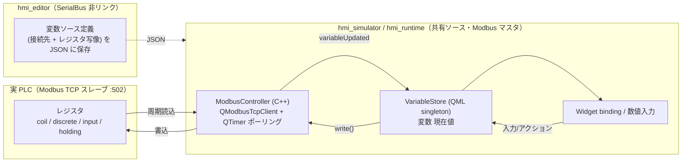
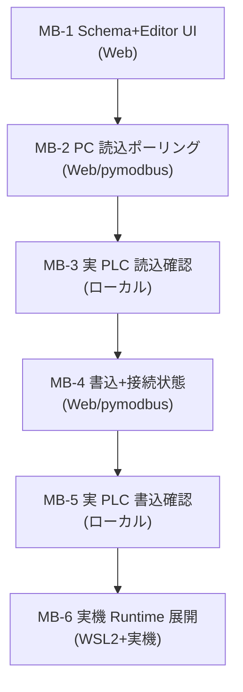

# Phase 7 計画 — Modbus TCP 通信対応（Ethernet で実 PLC と連動）

> **位置づけ**：実務 HMI の核心＝**実デバイス（PLC）と値をやり取りする**機能。`hmi_runtime`（実機）/ `hmi_simulator`（PC）が **Modbus TCP マスタ**として PLC のレジスタを周期ポーリング・書込し、既存の **変数ストア + バインディング**経路に流し込む。
>
> **本書は計画のみ**（実装は別 PR でタスク 1 つずつ）。要求の倉庫は [requirements.md](requirements.md) の §2.3、結線規約は [.claude/rules/qml-module-conventions.md](../.claude/rules/qml-module-conventions.md)、Schema 規約は [.claude/rules/schema-conventions.md](../.claude/rules/schema-conventions.md)、実機/SDK 事情は [.claude/rules/dev-environment.md](../.claude/rules/dev-environment.md)。
> **進捗の正本は本ファイル「進捗」表**。
>
> **承認状態**：**着手済み（2026-06-16 ユーザー承認）。MB-1〔変数ソース Schema + Editor 編集 UI〕実装中（PR 化）。** 直近完了は Phase 6-B（NumericField 拡張・Task 53〜55）。MB-3 / MB-5 / MB-6（実 PLC・実機 Yocto）はローカル専用で Web 環境では実施不可（MB-1 / MB-2 / MB-4 は Web 可）。step / decimals / unit や後続入力 Widget〔Gauge / Toggle〕は引き続き別承認の候補。

---

## 確定した前提（2026-06-12 ユーザー合意）

| 項目 | 決定 |
|---|---|
| プロトコル | **Modbus TCP（Ethernet）一本**。RTU（シリアル）は対象外（将来 P2） |
| 通信ライブラリ | **Qt 標準 QtSerialBus**（`QModbusTcpClient`）。外部依存を増やさない |
| 通信相手 | **実 Modbus TCP PLC が手元にある**（最終的に実 PLC と通信） |
| 初手の実行アプリ | **PC の `hmi_simulator` から PLC へ** → 固まったら **実機 `hmi_runtime`** へ（ソース共有なので自動的に乗る） |
| 自動検証（CI/Web） | 実 PLC へは CI から届かないため、**ソフトスレーブ（pymodbus 等）相手の E2E** で緑を担保。実 PLC 確認は手動（ローカル） |

---

## アーキテクチャ



**設計原則（既存ルールとの整合）**

- **通信は Simulator 共有ソースに置く**（→ Runtime が自動継承。[qml-module-conventions](../.claude/rules/qml-module-conventions.md) の「Simulator/Runtime はソース完全共通」）。実機固有差分が出たら `#ifdef HMI_RUNTIME_BUILD`。
- **Editor は `Qt6::SerialBus` をリンクしない**。Editor は「変数ソース定義（接続先・レジスタ番地）を JSON に書く」だけで実通信しない（[requirements.md](requirements.md) FR-MB-05）。
- **`hmi_schema` は QML も通信も知らない**。Modbus を喋る C++（`ModbusController`）は利用側アプリ（Simulator）に置く（[qml-module-conventions](../.claude/rules/qml-module-conventions.md)「C++ ヘルパーは利用側アプリ」）。
- **変数ストア + binding 経路を再利用**：読込値は `VariableStore.setValue(name, val)` に流すだけで既存 `boundValue()` が UI を追従（Task 41 の経路）。書込は数値入力/アクションが `VariableStore` を更新 → `ModbusController.write()`。

---

## スキーマ拡張（変数ソース定義）

`VariableData` に **optional な接続マッピング**を足す（後方互換＝ソース無し = 内部変数のまま）。接続先は**プロジェクト共通の接続リスト**を参照し、変数側は「どの接続の・どのレジスタか」だけ持つ（接続情報の重複を避ける）。

```jsonc
// ProjectData（案）
"connections": [
  { "id": "plc1", "proto": "modbusTcp", "host": "192.168.0.10", "port": 502, "unitId": 1 }
],
"variables": [
  { "name": "tankLevel", "type": "int",
    "source": { "connection": "plc1", "reg": "holding", "address": 0, "poll": 1000 } }
]
```

- **`reg` 値域**：`coil` / `discrete` / `input` / `holding`（書込可は coil / holding のみ）。
- **`address`** は **0 始まりのプロトコル番地**を JSON / 内部の**正準**とする。Editor が人間表記（1 ベース / `4xxxx`）で見せる場合は **Editor の表示層**が 0 ベース ↔ 表示の変換を担い、JSON には 0 ベースで保存する（schema の `toJson`/`fromJson` は変換を持たず素通し＝正準は 0 ベース）。off-by-one を踏みやすいので、表示変換を入れる場合は **MB-1 完了基準に round-trip unit テスト**（表示入力 → 0 ベース保存 → 再表示で一致）を含める。reg 種別ごとの 0/1 ベース習慣差にも注意。
- **`poll`** はミリ秒（既定 1000）。**`port` 既定 502・`unitId` 既定 1**（plan 内で既定値を揃える）。
- Schema 実装は [schema-conventions](../.claude/rules/schema-conventions.md) の **4 メソッド**（`toJson`/`fromJson`/`toVariantMap`/`fromVariantMap`）を揃える。`ConnectionData` / `source` は子型として `toJson`/`fromJson`/`isValidJson` 三点セット＋空時省略（後方互換）。`isValidJson` の必須集合には**入れない**。

> **確定**：接続は **プロジェクト共通 `connections[]` リスト参照**を採用する（各変数の `source.connection` が接続定義の `id` を参照。複数変数が同一 PLC を指す実態に合い、host/port/unitId の重複を防ぐ）。**上記 JSON 例がこのフェーズの正準スキーマ**で、[requirements.md](requirements.md) §2.3 はこれを参照する。MB-1 完了基準に「`source.connection` → `ConnectionData.id` 参照の round-trip unit テスト」を含める。

---

## QtSerialBus API スケッチ（実装時に Qt6 公式で再確認）

```cpp
// CMake: find_package(Qt6 REQUIRED COMPONENTS SerialBus); target_link_libraries(... Qt6::SerialBus)
QModbusTcpClient client;
client.setConnectionParameter(QModbusDevice::NetworkAddressParameter, "192.168.0.10");
client.setConnectionParameter(QModbusDevice::NetworkPortParameter, 502);
client.connectDevice();                                   // 非同期。state()/stateChanged で接続監視

// 読込（QTimer で poll ごとに発行）
QModbusDataUnit unit(QModbusDataUnit::HoldingRegisters, /*addr*/0, /*count*/1);
if (auto *reply = client.sendReadRequest(unit, /*unitId*/1)) {
    QObject::connect(reply, &QModbusReply::finished, [reply]{
        if (reply->error() == QModbusDevice::NoError) {
            const QModbusDataUnit r = reply->result();    // r.value(i) がレジスタ値
            // → emit variableUpdated(name, r.value(0)) → QML が VariableStore.setValue
        }
        reply->deleteLater();
    });
}
// 書込: 値入り QModbusDataUnit を sendWriteRequest(unit, unitId)
// 接続状態: stateChanged(QModbusDevice::State) / errorOccurred(QModbusDevice::Error)
```

- **非同期 API（`QModbusReply` シグナル）なので UI を塞がない**（NFR-MB-02）。ポーリングは `QTimer`（QtSerialBus に周期ポーリングの組込みは無い＝自前で回す。**未確認情報を断定しない**：[feedback-plan-docs-consistency](../.claude/rules/feedback-plan-docs-consistency.md) 項目 1/2）。
- **正確な ctor 引数順・enum 名は実装着手時に Qt6 ドキュメントで確認**してからコードに落とす。
- **`ModbusController` の責務（C++ ヘルパー・Simulator 側に置く）**：`signal variableUpdated(const QString &name, const QVariant &value)` を宣言し、QML 側で `VariableStore.setValue(name, value)` へ接続する（書込は QML→`ModbusController.write(...)`）。**スレッド安全性**：`QModbusReply::finished` がどのスレッドで呼ばれるか（QtSerialBus の動作）を実装時に確認し、worker スレッドを跨ぐなら queued connection / `QMetaObject::invokeMethod` で UI スレッドへ渡す。MB-2 完了基準に **Signal/Slot unit テスト**（`variableUpdated` 発火 → `VariableStore.setValue` 反映）を含める。

---

## タスク分割（1 タスク = 1 PR、`cmake --build` 成功 + Web `ctest` 緑が完了基準）

> **着手前ゲート（MB-1 着手前）**：下記「依存・要調査」の **qtserialbus 含有確認**を先に実施し結果を本書に記録する（不含なら MB-6 の Yocto 作業を前倒し）。実 PLC との通信は実機を待たず **MB-2〜3 の PC 経路**で先行検証する。

| Task | スコープ | 実行環境 | 完了基準 |
|---|---|---|---|
| **MB-1** | **変数ソース Schema + Editor 編集 UI**。`ConnectionData` + `VariableData.source` を追加（round-trip）。Editor の変数定義パネルに接続先（host/port/unitId）とレジスタ写像（reg/address/poll）の入力を追加。**実通信なし**。 | Web 可 | build + `ctest` 緑（Schema round-trip unit + Editor 編集 unit）。Editor は SerialBus 非リンクのまま |
| **MB-2** | **PC 読込ポーリング**。Simulator 共有ソースに `ModbusController`（`QModbusTcpClient`＋`QTimer`）を追加し、接続→holding/input/coil/discrete を周期読込→`VariableStore.setValue` で UI 追従。CMake で Simulator に `Qt6::SerialBus` を追加（Editor は非追加）。E2E 用に **pymodbus を dev 依存に追加**＋**ソフトスレーブ起動 fixture**（例 `tests/fixtures/`）＋ ctest 連携（起動 → `localhost:502` 接続確認〔timeout/retry〕→ E2E）。 | Web 可（**ソフトスレーブ pymodbus 相手**） | build + `ctest` 緑。**Simulator に `Qt6::SerialBus` 依存追加で build 成功**。新規 E2E：pymodbus ソフトスレーブのレジスタ変更が Simulator の binding に追従。Signal/Slot unit（`variableUpdated`→`VariableStore`） |
| **MB-3** | **実 PLC 読込確認**。PC の `hmi_simulator` を**手元の実 PLC の IP** に向け、実レジスタの表示追従を確認。動作証跡スクショ。 | ローカル（ユーザー PC + 実 PLC） | 実 PLC の値変化が Simulator に反映される証跡（スクショ） |
| **MB-4** | **書込 + 接続状態**。数値入力/アクションによる変数書込を coil/holding へ `sendWriteRequest`。接続状態（接続中/切断/エラー）を変数 or 専用 API で UI へ。切断時の再接続。 | Web 可（pymodbus 相手） | build + `ctest` 緑。E2E：HMI 操作でソフトスレーブのレジスタが変わる。状態表示 unit |
| **MB-5** | **実 PLC 書込確認**。PC Simulator から実 PLC のレジスタを書き換える確認 + 証跡。 | ローカル（ユーザー PC + 実 PLC） | 実 PLC レジスタが HMI 操作で変わる証跡 |
| **MB-6** | **実機 Runtime 展開**。Yocto に `qtserialbus` を追加（IMAGE_INSTALL + SDK）→ image/SDK 再ビルド → `hmi_runtime` を aarch64 クロスビルド → 実機 i.MX8MP から実 PLC と通信 → VNC キャプチャ。 | ローカル（WSL2 + 実機・**Web 不可**） | 実機 Runtime が実 PLC と読み書きする証跡（VNC）。手順を dev-environment.md に追記 |



---

## 依存・要調査（着手前に潰す）

| 項目 | 内容 |
|---|---|
| **SDK/image の qtserialbus（着手前ゲート）** | 現行 image（scarthgap / Qt6 6.8.1）と `meta-toolchain-qt6` SDK の **`qtserialbus` 含有を最優先で確認**（ローカルで `find <SDK-sysroot> -iname '*SerialBus*'` / image の `qtserialbus` 有無）。結果（含有/不含）を本書に記録し、**不含なら MB-6 の Yocto レシピ追加（`IMAGE_INSTALL += "qtserialbus"` + SDK）を前倒しで着手**（image/SDK 再ビルドは数時間かかるため）。**PC 側（MB-1〜5）の Qt（aqtinstall）には SerialBus が同梱されるので先行可**だが、実機展開の手戻りを避けるため確認は早期に。**2026-06-16 時点：この確認は Web 環境では不可（WSL2 / SDK が要る）＝ローカルで未実施。MB-2 着手前までにローカルで実施し結果を記録する（MB-1 は SerialBus 非依存なので未確認のまま進めて可）。** |
| **float 変数型 / スケーリング** | 16bit レジスタ → 物理量（温度・圧力）には float 型 + gain/offset が要る（[requirements.md](requirements.md) FR-VAR / バックログ C）。**MB-1〜2 は int/bool/coil で開始でき**、アナログ表示が要る段で float を最小導入（Phase 6 の数値 Widget と連携）。32bit/float レジスタの word/byte order は要調査。 |
| **Simulator の自動検証相手** | 実 PLC は CI/Web から不達 → E2E は **pymodbus ソフトスレーブ**で固定（PC 単体で `ctest` 緑）。pymodbus 導入は dev 依存に閉じ、製品コードには持ち込まない。 |
| **Editor の非リンク維持** | Editor が誤って `Qt6::SerialBus` をリンクしないこと（変更時 `git diff` で確認）。通信は Simulator/Runtime のみ。 |

---

## 進捗

| Task | 状態 | PR |
|---|---|---|
| MB-1 変数ソース Schema + Editor UI | 進行中（PR 提出） | — |
| MB-2 PC 読込ポーリング（pymodbus E2E） | 未着手 | — |
| MB-3 実 PLC 読込確認（ローカル） | 未着手 | — |
| MB-4 書込 + 接続状態 | 未着手 | — |
| MB-5 実 PLC 書込確認（ローカル） | 未着手 | — |
| MB-6 実機 Runtime 展開（WSL2+実機） | 未着手 | — |

> 着手は Phase 5（Task 49）・Phase 6（Lamp/数値）との順序をユーザー承認で確定してから。承認・着手でステータスが動いたら常駐文書（CLAUDE.md / AGENTS.md / README / mvp-task-runner）を同期する（[feedback-phase-status-sync](../.claude/rules/feedback-phase-status-sync.md)）。
