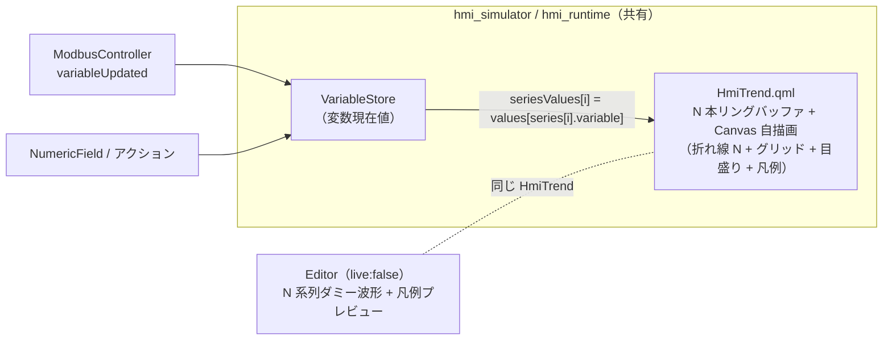

# Phase 8-B 計画 — Trend 拡張（複数系列 + 軸目盛り/凡例）

Phase 8（単系列ライブ折れ線）の Trend Widget を拡張する。**①複数系列**（1 つの Trend に複数変数を
重ね描き・色分け）と **②軸目盛り/凡例**（グリッド線・Y 軸目盛りラベル・系列名の凡例）を足す。
Phase 5/6/8 で確立した**横展開テンプレ**（Schema 4 メソッド + delegate + HmiXxx の入力/resolved を揃える +
インスペクタ型対応 + cross-app E2E）に乗せ、**Phase 8 の最重要制約「新 Qt モジュール依存ゼロ
（QML `Canvas` 自描画のみ・QtCharts 不使用）」を維持**する（グリッド線・目盛りラベル・凡例も
`Canvas` の `strokeText`/`fillText`/線描で描く）。

> **進捗の正本は本ファイル「進捗」表**。承認・着手でステータスが動いたら常駐文書
> （CLAUDE.md / AGENTS.md / README / mvp-task-runner / development-history）を同期する
> （[feedback-phase-status-sync](../.claude/rules/feedback-phase-status-sync.md)）。

## 承認状態

**着手承認（2026-06-17）** — Phase 8 完了後の「次フェーズ候補」のうち、ユーザーが
**複数系列 + 軸目盛り/凡例** を選択（AskUserQuestion 複数選択）。**履歴永続化（historian）は今回非スコープ**
（より重い＝新ストレージ + UI。別承認）。

## 確定スコープ（ユーザー合意）

| 項目 | 決定 |
|---|---|
| 複数系列 | 1 つの Trend に **N 本の折れ線**を重ね描く。各系列は **{変数・線色・凡例ラベル}** を持つ。**Phase 8 の単系列 JSON は無改変で動く**（後方互換）。MVP の N 上限は設けない（実用 4〜6 本想定。性能は実機 VNC で後追い確認） |
| 軸目盛り/凡例 | **グリッド線 + Y 軸目盛りラベル（min..max）+ 凡例（色スウォッチ + 系列名）**。いずれも `Canvas` 自描画。表示 ON/OFF はフラグで切替（既定 OFF ＝後方互換） |
| 描画 | **QML `Canvas` 自描画のまま**。QtCharts 等の新規 Qt モジュール依存は**入れない**（Phase 8 の制約継承＝i.MX8MP rootfs にそのまま載る） |
| サンプル源 | 各系列の変数現在値を `VariableStore` から読む（既存 binding の「読み」経路と同型＝**Schema の binding 機構は使うが書きはしない**。表示専用） |
| 非スコープ | 履歴永続化、X 軸の時刻目盛り（絶対時刻）、ズーム/パン、対数軸、系列ごとの個別 Y 軸（MVP は全系列共通 Y 軸） |

## 各アプリの役割・ソース共有（Phase 8 と同一）

| アプリ | 動作環境 | 振る舞い |
|---|---|---|
| Editor | PC 専用 | 設計面。`live:false` ＝各系列にダミー波形プレビュー（色違いで重ね描き）。系列の追加/削除 UI・軸/凡例トグル |
| Simulator | PC | 各系列の bound 変数変化でサンプル取り込み（`live:true`）。凡例・グリッド実描画 |
| Runtime | 実機 i.MX8MP | **Simulator とソース完全共有で自動継承**（`Runtime/` 無改変） |

## アーキテクチャ



## タスク分割（1 タスク = 1 PR、`cmake --build` + Web `ctest` 緑が完了基準）

| Task | スコープ | 完了基準 |
|---|---|---|
| **8B-A: Schema 拡張** | 子型 `TrendSeriesData {variable, color, label}` を新設（§Schema）。`WidgetData` に `QList<TrendSeriesData> series`（複数系列）+ 軸/凡例フラグ `showGrid`/`showLegend`（bool・既定 false）+ `yTickCount`（int・`0` センチネル）を追加。各型/フィールドの `toJson`/`fromJson`/`toVariantMap`/`fromVariantMap` **4 メソッド**を揃える（C++ ブリッジ無改変）。`isValidJson` 必須集合は不変（全 optional ＝後方互換）。`tst_widget_data.cpp`（+ 新規 `tst_trend_series_data.cpp`）に round-trip（空/非空・presence 両方）。**HmiTrend 描画・インスペクタ UI はまだ無し**。なお Editor の保存保持（delegate/snapshot/EditableWidget メタ素通し + 変数リネーム/削除の series 追従）は、`series` 付き JSON を開いて保存しても失わないため本タスクに含めた（レビュー指摘 PR #132） | build + `ctest` 緑。`series`/フラグ込みで値欠落なく round-trip。**Phase 8 の単系列 JSON が無改変で読める**ことを回帰で固定。`git diff` で C++ ブリッジ無改変を確認 |
| **8B-B: HmiTrend 複数系列描画 + delegate 値供給** | `HmiTrend.qml` を N 系列対応（`_buffer`→`_buffers` 配列、`series` モデル + `seriesValues` 配列入力、系列ごとの色で N 本 strokePath）。**Phase 8 の単系列パス（`value`/`lineColor`）は `series` 空のとき暗黙 1 系列として温存**（後方互換）。Simulator `SimulatorCanvas.qml` の `trendComponent` が `seriesValues` を `VariableStore.values[series[i].variable]` から供給（**依存追跡が効く関数/式で書く**＝[[qml-module-conventions]] の boundValue 同型）。Editor `Canvas.qml` プレビューは系列数ぶんダミー波形を色違いで埋める。テスト公開プロパティ拡張（`seriesCount`/`sampleCountAt(i)`/`lastValueAt(i)`。`sampleCount`/`lastValue` は系列 0 互換維持）。`tst_hmi_trend.qml` に N 系列の取り込み/巻き取りを追加。**軸/凡例描画はまだ無し** | build + `ctest` 緑。`series` 2 本で各バッファが独立に追従（unit）。単系列 JSON が従来どおり描画。実機 Canvas 性能 VNC 確認は PR 本文 TODO（Web で満たせないため完了条件外） |
| **8B-C: 軸目盛り/凡例描画** | `HmiTrend.qml` の `Canvas.onPaint` にグリッド線 + Y 軸目盛りラベル（実効 Y 範囲を `yTickCount` 等分し `fillText`）+ 凡例（系列色スウォッチ + ラベルを `fillText`）を追加。`showGrid`/`showLegend` で描画分岐（既定 OFF）。折れ線描画域と凡例域のレイアウト（凡例ぶんの余白確保）を内部で計算。`tst_hmi_trend.qml` にフラグ ON/OFF の公開状態確認（**ピクセルは見ず**、resolved フラグ/レイアウト派生プロパティを assert） | build + `ctest` 緑。`showGrid`/`showLegend` の ON/OFF で内部状態が切替。単系列/複数系列とも凡例が出る |
| **8B-D: Editor 追加 UI + インスペクタ型対応** | インスペクタ「Trend 詳細」セクションに **系列エディタ**（系列行の追加/削除、各行 = 変数 ComboBox + 線色入力（色スウォッチ）+ 凡例ラベル）と **軸/凡例トグル**（`showGrid`/`showLegend` チェック、`yTickCount` 入力）を追加。`series` の編集は他の配列編集（変数定義パネル / アクション）に倣う。objectName・編集ロジック（2 本立て）・Schema 不変。**`editor.png` 同期** | build + `ctest` 緑。Editor で系列を追加/削除・色/ラベル設定、グリッド/凡例トグルができ round-trip する。`editor.png` 更新 |
| **8B-E: cross-app E2E + スクショ** | `tests/e2e/test_trend_multi.py` 新設（または `test_trend_live.py` 拡張）。Editor で 2 系列 + 凡例 ON の Trend を `--open`→`saveTo`→保存 JSON 直接 assert（`series` 2 件 / 各 variable/color / `showLegend`）→ Simulator で操作用 NumericField を各変数ぶん同居させ複数回更新 → Trend の公開 `sampleCountAt(0)`/`sampleCountAt(1)`/`lastValueAt(i)` 追従を `getStringProperty` で観測。`CMakeLists.txt` に E2E 登録。`editor.png`/`simulator.png` 最終同期（複数系列 + 凡例 + グリッド表示） | build + `ctest` 緑（新 E2E 含む）。E2E が「系列ごとの独立サンプリング」を公開プロパティで観測。スクショ同期 |

> 重ければ分割可：8B-D を D1（系列エディタ）/ D2（軸/凡例トグル）に、8B-B/8B-C を統合（描画を 1 本に）など。**1 タスク = 1 PR は厳守**。

## Schema 拡張（§Task 8B-A）

### 新規子型 `TrendSeriesData`（`ActionData`/`BindingData` と同じ三点セット + QVariant 往復）

```cpp
// Shared/Schema/include/hmi/schema/TrendSeriesData.h
struct TrendSeriesData {
    QString variable;  // サンプル源の変数名（VariableStore のキー）
    QString color;     // 線色 "#RRGGBB"。空 = 未指定（HmiTrend の系列既定パレットへ解決）
    QString label;     // 凡例ラベル。空 = 未指定（凡例では変数名にフォールバック）

    QJsonObject toJson() const;                 // 空フィールドは省略（後方互換）
    static TrendSeriesData fromJson(const QJsonObject &);
    QVariantMap toVariantMap() const;
    static TrendSeriesData fromVariantMap(const QVariantMap &);
    static bool isValidJson(const QJsonObject &); // variable 必須
};
```

- `Shared/Schema/src/TrendSeriesData.cpp` 追加 + `Shared/Schema/CMakeLists.txt` の `qt_add_library` 一覧へ登録（[[schema-conventions]]）。

### `WidgetData` への追加フィールド（Trend 固有・全 optional）

| フィールド | 型 | 未指定表現 | 根拠 |
|---|---|---|---|
| `series` | `QList<TrendSeriesData>` | 空配列＝省略 | 複数系列。空のとき `toJson` 省略。子型の `toJson`/`fromJson`/`toVariantMap`/`fromVariantMap` を内部で回す（`actions`/`bindings` と同型） |
| `showGrid` | `bool` | `false`＝既定（OFF） | bool optional ＝ true のとき書く・欠落時 false（`fontBold` 同型） |
| `showLegend` | `bool` | `false`＝既定（OFF） | 同上 |
| `yTickCount` | `int` | `0`＝未指定（HmiTrend が既定へ解決） | `0` は「目盛り 0 本」の正当値を持たない → `0` センチネル可（`pointCount` 同型） |

`isValidJson` 必須集合（id/type/width/height）は**不変**＝全 optional で後方互換。**Phase 8 の `lineColor`/`yMin`/`yMax`/`bindings` 等は温存**（単系列の後方互換）。

```json
{
  "id": "trend001", "type": "Trend",
  "x": 40, "y": 40, "width": 360, "height": 180,
  "yMin": 0, "yMax": 100, "showGrid": true, "showLegend": true, "yTickCount": 5,
  "series": [
    { "variable": "sensorTemp",     "color": "#4cc9f0", "label": "温度" },
    { "variable": "sensorPressure", "color": "#f72585", "label": "圧力" }
  ]
}
```

> **後方互換の核**：`series` 省略 + 既存 `bindings:[{property:"value",...}]` + `lineColor` の Phase 8 JSON は、
> HmiTrend が「`series` 空 → `value` バインドと `lineColor` を暗黙 1 系列に合成」して従来どおり 1 本描く
> （§HmiTrend）。新 JSON は `series` を使い、`bindings`/`lineColor` を省略してよい。

## HmiTrend.qml（§Task 8B-B / 8B-C）

Phase 8 の `HmiTrend` を N 系列へ一般化する。要点：

| 変更 | 内容 |
|---|---|
| バッファ | `property var _buffer` → `property var _buffers`（系列ごとの配列の配列）。`_push` は系列 index を取る |
| 系列モデル | `property var series: []`（`[{variable, color, label}]`。delegate が流す）。`property var seriesValues: []`（各系列の現在値・delegate が `VariableStore` から供給） |
| 後方互換 | `series` 空のとき：従来の単一 `value`/`resolvedLineColor` を**暗黙の系列 0** として扱う（`effectiveSeries` 派生で吸収し描画ループを 1 本化） |
| 色 | 系列色 = 各 `series[i].color`（空なら既定パレット `_palette[i % n]`。`#4cc9f0`/`#f72585`/… を HmiTrend に集約） |
| 描画 | `onPaint` で effectiveSeries ぶん strokePath（既存の Y スケール/ゼロ除算ガードは流用、自動スケールは**全系列横断の min/max**） |
| 軸/凡例（8B-C） | `showGrid` ON：水平グリッド + 端の縦線、`yTickCount`（既定例 4）等分の Y 値ラベルを `fillText`。`showLegend` ON：右上等に系列色スウォッチ + ラベルを `fillText`。凡例ぶんの内側余白を確保 |
| テスト公開 | `seriesCount`（= effectiveSeries 数）、`sampleCountAt(i)`/`lastValueAt(i)`。`sampleCount`/`lastValue`/`bufferSize` は**系列 0 互換**で残す（既存 unit/E2E を壊さない） |

**サンプル取り込みトリガ**（Phase 8 の方式 A/B を多系列化）：
- 方式 A（既定）：`onSeriesValuesChanged: if (live) push 各系列`（`series` 空時は従来の `onValueChanged` 単系列）。
- 方式 B（`sampleMs>0`）：Timer で全系列の現在値を 1 点ずつ push。
- **A と B の二重取り込み防止**（Phase 8 と同じく `sampleMs>0` で A を抑止）。

**Editor プレビュー**（`live:false`）：`Component.onCompleted` で系列数ぶんダミー波形（位相をずらしたサイン波）を色違いで埋め、凡例/グリッドが ON ならそれも描く。

> 既定値（系列パレット・`yTickCount` 既定・凡例レイアウト）は**実装時に確定し、乖離したら同コミットで本計画更新**（Phase 8 と同じ運用）。

## Editor 統合 / インスペクタ（§Task 8B-D）

- delegate（`Canvas.qml` / `SimulatorCanvas.qml`）の `trendComponent` に新メタ（`widgetSeries`/`widgetShowGrid`/`widgetShowLegend`/`widgetYTickCount`）を流す。`snapshotModel`（保存）にも対応キーを追加（[[qml-module-conventions]] の「4 メソッド + delegate + メタ + HmiXxx」機械適用）。
- インスペクタ「Trend 詳細」セクション（`visible: selectedIsTrend`）に追加：
  - **系列エディタ**：系列行の Repeater（行 = 変数 ComboBox〔`variableNameModel()`〕+ 線色入力〔色スウォッチ + ColorDialog、Task 46 の色入力流用〕+ 凡例ラベル TextField）+「系列を追加 / 削除」。動的 Repeater 由来の入力欄は Delete ショートカット抑止（`variableFieldFocusCount` と同型、[[qml-module-conventions]]）。
  - **軸/凡例**：`showGrid`/`showLegend` チェック + `yTickCount` 数値入力。
- Phase 8 で単系列向けに置いた「線色 / Y 軸 / 周期」項目との関係を整理（単系列の `lineColor` は系列 0 が無いとき用のフォールバックとして残すか、系列エディタへ一本化するかを 8B-D 着手時に確定し本計画へ反映）。

## テスト方針（§Task 8B-E ほか）

1. **Schema round-trip（8B-A）**：`tst_trend_series_data.cpp`（子型単体）+ `tst_widget_data.cpp`（`series`/フラグ込み）で JSON⇄struct⇄QVariantMap 往復。**Phase 8 の単系列 JSON 回帰**（`series` 無しが従来値で読める）を固定。
2. **QML 単体（8B-B/8B-C）**：`tst_hmi_trend.qml` に N 系列の独立取り込み（系列ごと `sampleCountAt`/`lastValueAt`）・巻き取り・後方互換（`series` 空で従来単系列）・`showGrid`/`showLegend` の状態分岐。**ピクセルは見ず公開プロパティのみ**（Canvas は不可視）。
3. **cross-app E2E（8B-E）**：Canvas 不可視 → 公開 `sampleCountAt(i)`/`lastValueAt(i)` を観測。操作用 NumericField を系列数ぶん fixture 同居させ各変数を更新 → 系列ごとの独立追従を確認。Editor 段は保存 JSON 直接 assert（`series`/フラグ round-trip）。

## リスク / 未確定事項

1. **実機 Canvas 性能（N 系列）**：系列数 × 点数ぶんの再描画が i.MX8MP で重い恐れ。Phase 8 と同じく描画間引きの余地を残し、8B-B に VNC 実描画確認 TODO（Web では満たせない＝完了条件外）。
2. **凡例/目盛りラベルのフォント**：実機 image に**日本語フォントが無い**（[dev-environment.md](../.claude/rules/dev-environment.md)）→ 和文ラベルは □。**動作証跡スクショの凡例ラベルは ASCII 推奨**（既存の実機ラベル方針と同じ）。`Canvas` の `fillText` 既定フォントで足りるか実装時確認。
3. **系列の値供給と依存追跡**：`seriesValues` を delegate で `VariableStore.values[...]` から組むとき、**関数/式評価中に `values` を読んで依存追跡させる**（`Qt.binding` 動的生成に頼らない）こと。多系列で配列を作る式が再評価コスト高なら最適化を検討（[[qml-module-conventions]] boundValue 節）。
4. **単系列項目の去就**：Phase 8 の `lineColor`/単一 `value` バインドと新 `series` の二重定義を、インスペクタでどう一本化するか（8B-D 着手時に確定）。Schema は両方温存（後方互換）。
5. **自動 Y スケールの全系列横断**：複数系列で min/max を全系列から取ると軸が暴れうる → 固定 Y 軸（`hasYMin`/`hasYMax`）併用を推奨運用とする（Phase 8 のリスク継承）。

## フォローアップ（別タスク・8B-A スコープ外）

- **変数 rename/削除を undo/redo/clipboard にも同期する**（CodeRabbit PR #132 [Major]）：`Canvas.renameVariableReferences()`/`removeVariableReferences()` は現状 `widgetModel` だけ更新し、`undoStack`/`redoStack`/`_pendingUndo`/`clipboard` 内のスナップショットは旧変数名のまま残る → rename/削除後に undo/redo/paste すると dangling 参照が復活する。**これは Task 40（PR #80）以来の既存仕様で `series` 固有ではなく `actions.target`/`bindings.variable` にも等しく該当**するため、8B-A スコープ外として**別タスクで series + actions + bindings 横断で一括対応**する（2026-06-18 ユーザー判断「別タスクで対応」）。Codex は 97159f6/b52ff75 をクリーン👍。変数操作時に履歴・clipboard へ同じ変換を適用するか、変数操作で履歴・clipboard を明示破棄するかは着手時に設計確定。

## 進捗

| Task | 状態 | PR |
|---|---|---|
| 8B-A Schema 拡張（TrendSeriesData + series + 軸/凡例フラグ round-trip） | 完了（マージ済み） | #132 |
| 8B-B HmiTrend 複数系列描画 + delegate 値供給 | 完了（マージ済み） | #136 |
| 8B-C 軸目盛り/凡例描画 | 完了（コミット 63e1d2d） | — |
| 8B-D Editor 系列エディタ + 軸/凡例トグル | 完了（コミット 7fba17c） | — |
| 8B-E cross-app E2E（系列ごと独立サンプリング）+ スクショ | 完了（コミット 5a149b6） | — |

**Phase 8-B クローズ（全タスク完了）。** 8B-E で `tests/e2e/test_trend_multi.py`（`e2e_trend_multi`）を
新設：Editor 段で 2 系列 + 凡例 ON の Trend を round-trip 保存し保存 JSON を直接 assert（`series` 2 件・
各 variable/color/label・`showGrid`/`showLegend`/`yTickCount`）、Simulator 段で A/B の NumericField を
交互確定して各系列変数を独立操作し `sampleCountAt(i)`/`lastValueAt(i)` の独立追従を観測（系列取り違え
無しを期待表で担保）。**Web `ctest` 25/25 緑**（unit 12 + e2e 13）。スクショは 8B-D で 2 系列 + グリッド +
凡例へ更新済み（8B-E は E2E のみ＝見た目不変で再撮影なし）。

> 罠（8B-E）：`sampleCountAt`/`lastValueAt` は `getStringProperty`（string）でなく `invokeMethod` の
> 返り値で観測する必要があり、AnyRPC が `<value><i4>1</i4></value>` と型タグ付きで返す。既存 E2E の
> string 専用正規表現では float 変換できず FAIL → `<i4>`/`<int>`/`<double>`/`<boolean>`/`<string>` を
> 剥がすよう値抽出を一般化して解消（同型の typed 返り値観測を足す後続 E2E はこの抽出を流用する）。

**次フェーズ＝未確定。** 残る候補（履歴永続化〔historian〕・Gauge / Toggle・NumericField の
step/decimals/unit・OPC-UA）は未承認＝自動着手せず先にユーザーとスコープ確定する。

## 非スコープ（別承認）

履歴永続化（historian・ファイル/DB）・X 軸の絶対時刻目盛り・ズーム/パン・対数軸・系列ごとの個別 Y 軸・
後続入力 Widget（Gauge / Toggle）・NumericField の step/decimals/unit・OPC-UA。
