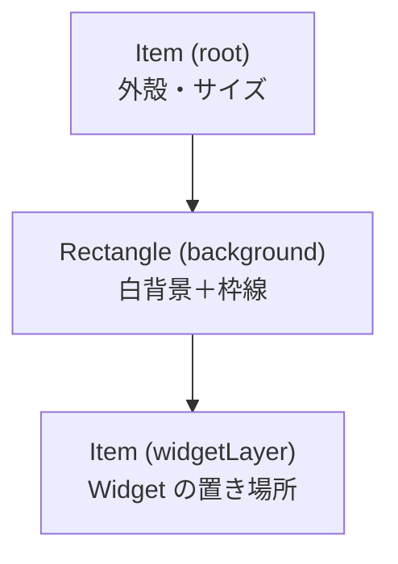
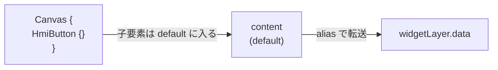

# Canvas.qml の構造

[Editor/qml/Canvas.qml](../Editor/qml/Canvas.qml) は 3 段の入れ子で構成されている。

---

## `default property alias content: widgetLayer.data` の役割

利用側で `Canvas { HmiButton {} }` と書いたとき、`HmiButton` を **内側の `widgetLayer` に転送する** ための配線。

これが無いと `HmiButton` は最外殻の `root` の子になり、枠線の外に置かれてしまう。

---

## 1 行の分解

| キーワード | 役割 |
|---|---|
| `default` | プロパティ名を書かずに子要素を並べられる |
| `property alias` | 別プロパティへの透過参照（値を持たない） |
| `content` | プロパティ名（任意） |
| `widgetLayer.data` | 転送先（QML 標準の子要素リスト） |

`QtQuick.Controls` の `Frame` / `Pane` などにも使われている定番イディオム。
