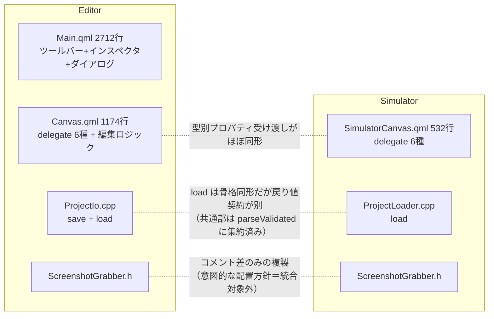

# リファクタリング計画（承認済み・着手中）

> **ステータス：承認済み・RF-A から着手中（2026-07-22 ユーザー指示「リファクタリング進めて」で承認）。** 当初は `[Future]`（Phase 11 クローズ後に再評価）としていたが、ユーザーの明示指示により Phase 11（残タスク W-E）と並行で着手する。1 タスク = 1 PR で進め、常駐文書（README / CLAUDE.md 等）の同期は各タスク PR で行う。

## 背景と目的

Phase 1〜11 で Widget 種別が 6 つ（Button / Label / NumericField / Trend / Meter / SimpleButton）に増え、次の 2 つの負債が育った。**機能追加は一切せず**、これらを解消して「新 Widget 種別を足すコスト」と「ファイル肥大化」を下げるのが目的。

1. **肥大化**：`Editor/qml/Main.qml` が 2,712 行（ツールバー・インスペクタ全節・ダイアログ・約 30 個の関数が 1 ファイルに同居）。`Editor/qml/Canvas.qml` も 1,174 行。
2. **重複と分岐の散在**：新種別を 1 つ足すたびに Editor / Simulator 両側の delegate・型ホワイトリスト・インスペクタ分岐など**約 10 箇所**を同じパターンで触る。（C++ 側の `load` / スクショヘルパーの重複は調査の結果、意図的設計と判明＝対象外。分析表 #4/#5）

## 現状分析（重複・肥大の地図）

| # | 事実 | 根拠（現状） |
|---|---|---|
| 1 | `Editor/qml/Main.qml` = 2,712 行。窓・約 30 関数・ツールバー・インスペクタ（`InspectorSection` 複数節）・ダイアログ 4 つが同居 | `grep` でトップレベル関数 30 個、627〜2632 行が単一 `Rectangle` |
| 2 | delegate の「Schema 値 → Hmi* プロパティ受け渡し」が Editor（`Canvas.qml` 内 6 `Component`）と Simulator（`SimulatorCanvas.qml` 内 6 `Component`）で型ごとに同形反復 | 両ファイルの `sourceComponent` 5 分岐 + 6 `Component` |
| 3 | 新種別追加時に触る箇所が散在：Schema（`WidgetData`）／`normalizeWidgetType` ホワイトリスト／ツールバー追加ボタン／パレット preset／`sourceComponent` 分岐 ×2／delegate `Component` ×2／インスペクタ `selectedIsX` と表示節／テスト／hero-demo | Task W-B（PR #164）で実際に踏んだ経路 |
| 4 | `ProjectIo::load`（Editor）と `ProjectLoader::load`（Simulator）は骨格が同形だが、**戻り値契約はアプリ別**：Editor は接続詳細を各 `variable.source` へ展開して返し `connections` を返さない（UI 再表示用）、Simulator は未展開の変数 + 独立 `connections` を返す（Modbus/OPC-UA 通信用）。検証付き parse は既に `ProjectData::parseValidated` に集約済みで、ファイル I/O はアプリ側に残す契約（`ProjectData.h` のコメント） | `ProjectIo.cpp:168-206` / `ProjectLoader.cpp:70-91` / `ProjectData.h:36-42` |
| 5 | `ScreenshotGrabber.h` は Editor / Simulator に複製されているが、これは「同等の C++ ヘルパーは Shared に移さず両アプリに独立して持つ」という**確立済みの意図的方針**（ヘッダ自身のコメント + [.claude/rules/qml-module-conventions.md](../.claude/rules/qml-module-conventions.md)）＝**リファクタリング対象外** | `Editor/src/ScreenshotGrabber.h:22-25` |
| 6 | 種別ごとの既定サイズ・既定文字が `Canvas.addWidget` にハードコード（パレット preset・Hmi* 側フォールバックと三重管理の芽） | `addWidget` の `isTrend/isMeter` 三項連鎖 |
| 7 | `widgetModel` は QML `var` 配列のまま（`QAbstractListModel` 化は保留中） | [.claude/rules/project-widgetmodel-refactor-deferred.md](../.claude/rules/project-widgetmodel-refactor-deferred.md) |

## タスク分解（1 タスク = 1 PR）

| Task | 内容 | 規模 | リスク | 主な対象 |
|---|---|---|---|---|
| **RF-A** | `Main.qml` 分割①：ツールバーを `EditorToolbar.qml`、ダイアログ群を `EditorDialogs.qml`（または個別ファイル）へ抽出 | 中 | 低 | `Editor/qml/Main.qml` |
| **RF-B** | `Main.qml` 分割②：インスペクタ本体（`ScrollView` 以下の全 `InspectorSection`）を `InspectorPanel.qml` へ抽出。関連関数（`syncGeometryFields` 等）も同居先へ移す | 大 | 中 | 同上 |
| **RF-C**（取り下げ） | ~~C++ 重複解消~~ **計画から除外**。① `load` 同士の統合：共通化できる「検証付き parse」は既に `ProjectData::parseValidated` に集約済みで、残る部分は戻り値契約がアプリ別（Editor = 接続詳細を `variable.source` へ展開・`connections` 非返却／Simulator = 未展開変数 + 独立 `connections`）のうえ、ファイル I/O をアプリ側に残すのが Schema の設計契約。② `ScreenshotGrabber.h` の 1 本化：「同等 C++ ヘルパーは Shared に移さない」既存方針（qml-module-conventions）に反する。**いずれも重複が意図的設計のため、方針変更の明示承認なしには着手しない** | — | — | — |
| **RF-D** | 種別分岐の集約：種別メタ情報（既定サイズ・既定文字・許可リスト）を 1 箇所のテーブル（例 `Canvas` 内 `widgetTypeDefaults` または Shared のシングルトン）にまとめ、`normalizeWidgetType` / `addWidget` / パレット preset がそれを参照する形へ | 中 | 低 | `Editor/qml/Canvas.qml` `Editor/qml/SamplePalette.qml` |
| **RF-E** | delegate 重複の削減：Editor / Simulator の型別 `Component` の「スタイル受け渡し」共通部を削る設計を確定して実施。候補は (a) Shared/Widgets に型別ホスト QML を置き両アプリから使う、(b) Simulator 側の `modelData.x !== undefined ? … : 既定` 反復をヘルパー化に留める。**着手時に (a)/(b) を試作して選ぶ**（Editor=静的値・Simulator=binding 追従で完全同形ではないため、ここでは断定しない） | 大 | 中〜高 | `Canvas.qml` `SimulatorCanvas.qml` `Shared/Widgets/` |
| **RF-F**（保留継続） | `widgetModel` の `QAbstractListModel` 化 | 特大 | 高 | — |

- **実施順は RF-A → RF-D → RF-B → RF-E** を推奨（小さく低リスクな成功を先に積み、delegate 共通化は種別テーブル〔RF-D〕の後が設計しやすい）。
- **RF-F は本計画でも保留のまま**。保留ルールの再評価条件（Phase 3-B スコープ確定）は満たしたが、`var` 配列で実害が出ていない現状は変わらず、規模（数 PR 級）に見合う利益がまだない。RF-E 完了後に実害（性能・バグ）が観測されたら別計画として起こす。

## 全タスク共通の完了基準・制約

| 項目 | 内容 |
|---|---|
| 完了基準 | `cmake --build` 成功 + 既存ユニット / E2E 全緑（機能・見た目の変化ゼロ） |
| E2E 互換 | Spix が参照する `objectName` パス（`hmiEditorWindow/...`、`widget_<id>/hmiButton` 等）を**変えない** |
| フォルダ構成 | 変更禁止（既存の `Editor/ Simulator/ Runtime/ Shared/* ` 内でのファイル追加のみ。CLAUDE.md Must Never） |
| QML 分割時 | 抽出ファイルを各 `CMakeLists.txt` の `QML_FILES` へ追加。URI・`loadFromModule` 引数は不変 |
| Runtime | Simulator ソース共有のため、Simulator 側の変更は Runtime にもそのまま効く（クロスビルド確認は実装 PR 時にローカルで） |
| 削らないもの | 既存コメント内のタスク経緯（Task N 参照）は移動先へ持っていく（削除しない） |

## 進捗

| Task | 状態 | PR | 備考 |
|---|---|---|---|
| RF-A | ✅ 完了 | — | ツールバー→`EditorToolbar.qml`・ダイアログ 4 つ→`EditorDialogs.qml` を抽出（Main.qml 2,712→2,533 行）。着手時に W-D の D&D ゴースト（`Overlay.overlay` 親化）が Editor の全クリックを奪い E2E 4 件が落ちる不具合を発見し同 PR で修正 |
| RF-B | 未着手 | — | 次候補は実施順どおり RF-D |
| RF-C | 取り下げ | — | 重複は意図的設計（parseValidated 集約済み + Shared 非昇格方針）のため除外 |
| RF-D | 未着手 | — | 実施順の次タスク |
| RF-E | 未着手 | — | 着手時に方式 (a)/(b) を試作比較 |
| RF-F | 保留 | — | [widgetmodel-refactor-deferred](../.claude/rules/project-widgetmodel-refactor-deferred.md) を継続 |
