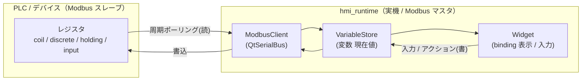

# Atlas 要求仕様 / 機能バックログ

> **位置づけ**：`Docs/phase*-plan.md` が「いま実装する 1 タスク」を扱うのに対し、本書は **中長期に追加したい機能の全体像（バックログ）** と、**当面着手する領域の要求仕様（SRS 抜粋）** を扱う。フェーズ計画はここから切り出して起票する。
>
> **狙い**：単なる作画デモではなく、**実務 HMI として使える**ことを見据える（通信プロトコル連携・数値入出力・状態表示を核に据える）。
>
> 関連：現フェーズ計画 [phase5-widget-expansion-plan.md](phase5-widget-expansion-plan.md)、結線規約 [.claude/rules/qml-module-conventions.md](../.claude/rules/qml-module-conventions.md)、Schema 規約 [.claude/rules/schema-conventions.md](../.claude/rules/schema-conventions.md)。
> **進捗の正本は各 `phase*-plan.md` の「進捗」表**。本書は要求の倉庫であり進捗表ではない。

---

## 当面のロードマップ（合意済みの方向）

- **Widget の横展開は Button(既存)・Label(Phase 5)・Lamp・数値入力・数値表示の 5 種で一旦打ち止め**（Gauge / グラフ / Image / Slider 等は要望が出てから）。
- その後の本命が **Modbus 通信対応**＝実機 HMI が PLC / デバイスと値をやり取りする中核機能。

---

## Part 1. 機能バックログ（全体マップ）

優先度の定義：

| 記号 | 意味 |
|---|---|
| **P0** | 当面のロードマップに含む（Phase 5〜7 で着手）。本書 Part 2 で SRS 化する。 |
| **P1** | 実務 HMI なら早晩必要。順序は P0 完了後に確定。 |
| **P2** | 将来候補。要望が出てから設計（hypothetical future を先に作り込まない＝CLAUDE.md コア原則）。 |

### A. Widget 種別の拡充

| 機能 | 優先 | 概要 | Schema 影響 |
|---|---|---|---|
| Label（文字表示） | — | **実装中**（Phase 5 / Task 47〜49） | 無し |
| **Lamp（状態表示ランプ）** | **P0** | bool / int 変数に追従して点灯色・消灯色を切替える表示専用 Widget | 小（点灯色など） |
| **数値表示（Numeric Display）** | **P0** | 数値変数を桁数・単位付きで表示する読み取り専用 Widget | 小（decimals / unit） |
| **数値入力（Numeric Input）** | **P0** | 数値を入力して変数へ書き込む対話 Widget（min/max/step） | 中（min/max/step + 書込経路） |
| Gauge / メーター（円・バー） | P2 | アナログ値の視覚化 | 中 |
| トレンドグラフ（時系列） | P2 | 変数履歴の折れ線表示 | 中（履歴保持が要る） |
| Image / アイコン | P2 | 画像・アイコン表示 | 小（画像パス） |
| Slider / Switch / ComboBox / ProgressBar | P2 | 標準入力部品の拡充 | 中 |
| 図形プリミティブ（矩形・円・線） | P2 | 装飾・レイアウト用（現状は Button で擬似代替） | 小 |

### B. 画面・ナビゲーション

| 機能 | 優先 | 概要 |
|---|---|---|
| 複数画面 + 画面遷移 | **P1** | `ScreenData` は型として複数対応済みだが UI が単一画面前提。画面リスト + 遷移アクション（`navigate`）を追加 |
| ポップアップ / ダイアログ | P2 | 確認ダイアログ・数値入力テンキー等 |
| 部品のグループ化 / 再利用（コンポーネント） | P2 | 複数 Widget を 1 部品としてテンプレ化 |

### C. データ / ロジック（実 HMI の核心）

| 機能 | 優先 | 概要 |
|---|---|---|
| **Modbus 通信連携** | **P0** | PLC / デバイスのレジスタと変数をマッピングし、実機で周期ポーリング + 書込（Part 2 で詳述） |
| float 変数型 | **P0** | 現状 bool / int / string のみ。アナログ値（温度・圧力）に必須。数値表示/入力の前提 |
| 変数のスケーリング / 単位変換 | P1 | 生レジスタ値 → 物理量（gain / offset） |
| アラーム / イベント管理 | P1 | 条件成立で通知・履歴・確認（ack） |
| ロギング / トレンド記録 | P2 | 変数値の時系列記録（トレンドグラフの土台） |
| バインディングの式評価 | P2 | 単純追従だけでなく演算・条件式（`a > 80` 等） |
| 他プロトコル（OPC-UA / MQTT / CAN / シリアル） | P2 | Modbus で通信抽象の足場を作ってから横展開 |

### D. 編集体験（Editor UX）

| 機能 | 優先 | 概要 |
|---|---|---|
| ウィジェットツリー（アウトライン） | P1 | Widget 一覧から選択・並べ替え。数が増えると必須 |
| 多言語（i18n）リソース管理 | P2 | 表示文字列のロケール切替 |
| レイヤー / z-order 管理 | P2 | 重なり順の明示制御 |
| ズーム / パン | P2 | 大きな画面の編集 |
| スタイルライブラリ（テーマ一括） | P2 | 色・フォントの共通定義と一括適用 |

### E. 品質・運用（非機能）

| 機能 | 優先 | 概要 |
|---|---|---|
| 実機デプロイ自動化 | P1 | クロスビルド → scp → 起動の半自動化（現状は手順書 + ヘルパー） |
| JSON バリデーション強化 / マイグレーション | P1 | スキーマ版数管理と旧 JSON の自動移行 |
| 大量 Widget のパフォーマンス | P2 | `var` 配列モデルの限界が見えたら `QAbstractListModel` 化（[project-widgetmodel-refactor-deferred](../.claude/rules/project-widgetmodel-refactor-deferred.md)） |
| アクセシビリティ | P2 | フォーカス順・スクリーンリーダ対応 |

---

## Part 2. 要求仕様（SRS 抜粋）— 当面着手領域

P0 の 3 領域（Lamp / 数値入力・表示 / Modbus）を機能要求(FR)・非機能要求(NFR)として構造化する。FR は ID と受け入れ基準を持ち、フェーズ計画の完了基準へ落とす。

> **記法**：受け入れ基準は可能な限り「Web `ctest`（unit + e2e）で検証可能」な形にする（プロジェクトのテスト方針に合わせる）。`要調査` は実装着手時にコード / Qt ドキュメントで確認してから確定する（[feedback-plan-docs-consistency](../.claude/rules/feedback-plan-docs-consistency.md) 項目 2）。

### 2.0 横断：データモデル拡張（Lamp / 数値の前提）

| ID | 機能要求 | 受け入れ基準 |
|---|---|---|
| FR-VAR-01 | 変数型に `float`（倍精度）を追加する（現 bool / int / string に追加） | `VariableData` の型に "float" を許容。`VariableStore.coerce` が float を `parseFloat` で解釈。round-trip（保存/読込）で型が保たれる unit テスト緑 |
| FR-VAR-02 | 数値表示・入力のための表示フォーマット属性（小数桁数 `decimals`・単位 `unit`）を Widget が持てる | Widget に `decimals`(int) / `unit`(string) を追加し round-trip。未指定は既定（decimals=0・unit="")へフォールバック |

- **Schema 影響**：`VariableData` の `type` 値域拡張（`isValidJson` の許容集合に "float" 追加）。`WidgetData` に `decimals` / `unit` を追加（[schema-conventions](../.claude/rules/schema-conventions.md) の「4 メソッドを揃える」＝`toJson`/`fromJson`/`toVariantMap`/`fromVariantMap`）。後方互換（旧 JSON は欠落 → 既定）。

### 2.1 Lamp Widget（状態表示ランプ）

**概要**：bool（または int）変数の状態に応じて点灯／消灯を色で表す **表示専用** Widget。Label と同じく action は持たず、binding（読み）のみ。横展開テンプレ（`HmiLamp.qml` + delegate の `type` 分岐）に沿う。

| ID | 機能要求 | 受け入れ基準 |
|---|---|---|
| FR-LMP-01 | `type:"Lamp"` の Widget を `HmiLamp.qml` で描画する（delegate の `type` 分岐に分岐先追加） | Editor / Simulator delegate が `type` で HmiLamp を生成する unit テスト緑（既存 Button / Label 分岐は不変） |
| FR-LMP-02 | bool 変数への binding で点灯／消灯を切替える（点灯色 `litColor` / 消灯色は `backgroundColor`） | Simulator で `lit` を bool 変数にバインド → 変数 true/false で色が変わる（`boundValue` 経路再利用）。E2E round-trip で確認 |
| FR-LMP-03 | 表示専用（クリックで変数を書き換えない） | Lamp の delegate は `onClicked` を action 実行へ結線しない（Editor 選択中継のみ） |
| FR-LMP-04 | Editor のツールバーから Lamp を追加でき、インスペクタは Lamp に無関係なセクション（クリックアクション等）を隠す | `addWidget("Lamp")` で生成。インスペクタ型対応（`visible` 切替のみ・objectName 不変） |

- **設計判断（要調査・実装時確定）**：点灯状態の持ち方は **(a) `lit` 専用 bool プロパティを binding する** か、**(b) Phase 4 で入れた `checked` 状態スタイルを流用する** か。`litColor` を 1 つ足し、消灯時は既存 `backgroundColor`（既定は暗色）にフォールバックする方針を第一候補とする。丸ランプは既存 `radius`（幅の半分）で表現できる（新 Widget でも resolved\* フォールバックを踏襲）。
- **非スコープ**：多状態ランプ（3 色以上）・点滅アニメーションは P2（要望が出てから）。

### 2.2 数値表示 / 数値入力 Widget

**概要**：数値変数（int / float）を **表示**（読み取り専用）／ **入力**（変数へ書込）する Widget。入力は「固定値を set/toggle する Button」と異なり **任意の連続値を変数へ書き込む最初の対話 Widget** で、変数書込経路（ひいては Modbus 書込）の土台になる。

#### 数値表示（Numeric Display）

| ID | 機能要求 | 受け入れ基準 |
|---|---|---|
| FR-NUM-01 | `type:"NumericDisplay"` を `HmiNumericDisplay.qml` で描画（表示専用） | delegate `type` 分岐に追加・unit テスト緑 |
| FR-NUM-02 | 数値変数に binding し、`decimals` 桁・`unit` 付きで整形表示する | 変数 12.3 + decimals=1 + unit="℃" → "12.3 ℃"。Simulator で変数更新に追従（E2E round-trip） |

#### 数値入力（Numeric Input）

| ID | 機能要求 | 受け入れ基準 |
|---|---|---|
| FR-NUM-03 | `type:"NumericInput"` を `HmiNumericInput.qml` で描画（対話） | delegate `type` 分岐に追加・unit テスト緑 |
| FR-NUM-04 | 入力確定で対象変数へ数値を書き込む（`VariableStore.setValue`） | Simulator で入力 → バインド先変数が更新され、別 Widget のバインディングが追従（E2E） |
| FR-NUM-05 | `min` / `max` / `step` で入力範囲・刻みを制約する | 範囲外入力は clamp / 拒否。unit テストで境界確認 |
| FR-NUM-06 | Editor で追加でき、インスペクタに数値固有項目（min/max/step/decimals/unit）を出す | インスペクタ型対応（数値セクション表示・他 Widget では非表示） |

- **Schema 影響**：`WidgetData` に `minValue` / `maxValue` / `step`（数値入力用）を追加（センチネル規約 = `0` が正当値なら `-1` 等。[schema-conventions](../.claude/rules/schema-conventions.md)）。`decimals` / `unit` は 2.0 と共用。
- **設計判断（要調査）**：数値入力の UI は **(a) TextField + IntValidator/DoubleValidator**（[qml-module-conventions](../.claude/rules/qml-module-conventions.md) の「editable SpinBox 不具合」回避）を第一候補。テンキーポップアップは P2。
- **役割分担**：数値入力は **action（書き）を持つ対話 Widget**。Label / Lamp / 数値表示は binding（読み）のみ。Simulator / Runtime は「実行（変数書込）は可・編集 UI は不可」の原則を維持（[phase4-button-slice-plan.md](phase4-button-slice-plan.md) 設計原則）。

### 2.3 Modbus 通信対応（本命）

**概要**：実機 HMI が **Modbus マスタ（クライアント）** として PLC / デバイスのレジスタを周期ポーリングし、レジスタ値を変数ストアへ反映、逆にアクション / 数値入力による変数書込をレジスタへ書き戻す。これにより「動く HMI」が **実デバイスと連動**する。

#### 機能要求

| ID | 機能要求 | 受け入れ基準 |
|---|---|---|
| FR-MB-01 | 変数にデータソース（Modbus マッピング）を定義できる：レジスタ種別 / アドレス / 接続先 / ポーリング周期 | Schema にソース定義を追加し round-trip。Editor の変数定義パネルで編集可 |
| FR-MB-02 | Runtime が Modbus TCP マスタとしてスレーブのレジスタを周期読込し、変数ストアへ反映する | 実デバイス or Modbus シミュレータ相手に、レジスタ変化が Widget 表示に追従することを確認 |
| FR-MB-03 | アクション / 数値入力による変数書込を、書込可能レジスタ（coil / holding）へ反映する | HMI 上の操作でスレーブのレジスタ値が変わることを確認 |
| FR-MB-04 | 接続状態（接続中 / 切断 / エラー）を取得でき、UI へ反映できる | 切断時に再接続を試行し、状態を変数 or 専用 API で観測可能 |
| FR-MB-05 | Editor / Simulator は実通信を必須としない（Editor は定義のみ、Simulator は実機なしでも動く） | Editor はビルドに QtSerialBus を要求しない設計、Simulator はモック or 任意接続（要設計） |

#### 非機能要求

| ID | 非機能要求 | 基準 |
|---|---|---|
| NFR-MB-01 | 通信ライブラリは **Qt 標準の QtSerialBus（QModbusTcpClient 等）** を用い、外部依存を増やさない | CLAUDE.md「設計書未承認のライブラリを独断追加しない」と整合。要調査：Yocto image / SDK に QtSerialBus が含まれるか |
| NFR-MB-02 | ポーリングは UI スレッドをブロックしない（非同期 / イベント駆動） | QtSerialBus の非同期 API（`QModbusReply`）を使用 |
| NFR-MB-03 | 通信は Runtime（実機）に閉じ、Editor のスキーマ / ビルドを汚さない | 通信実装は Simulator/Runtime 共有ソース側に置き、`#ifdef HMI_RUNTIME_BUILD` で実機限定にできる（[qml-module-conventions](../.claude/rules/qml-module-conventions.md) ソース共有則） |

#### 要調査・設計判断（実装着手時に確定）

- **QtSerialBus の可用性**：実機 image（scarthgap / Qt6 6.8.1）と Qt6 クロス SDK に **`QtSerialBus` モジュールが含まれるか**を確認する。無ければ Yocto レシピへ追加が必要（[dev-environment.md](../.claude/rules/dev-environment.md) の SDK 生成手順に追記）。
- **Modbus TCP / RTU の優先**：まず **TCP（Ethernet）** を対象とする（実機は Ethernet 接続実績あり）。RTU（シリアル）は P1〜P2。
- **変数ソースのスキーマ形**：`VariableData` に optional `source` オブジェクト（`{ proto:"modbus", reg:"holding", address:N, poll:ms, ... }`）を足す案。後方互換（ソース無し = 内部変数）を保つ。**要設計**：接続先（host/port/unitId）は変数ごとか、プロジェクト共通の接続定義を参照するか。
- **Simulator の扱い**：実機なしでの試験のため、Modbus を **モック**（疑似値生成）するか、任意で実デバイス / Modbus シミュレータ（pymodbus 等）に TCP 接続するか。**第一候補はモック**（PC 単独で動作確認できる）＋ E2E はモックで検証。
- **値変換**：生レジスタ（16bit int 等）→ 物理量（float / スケーリング）。FR-VAR の float 型と「スケーリング(gain/offset)」（バックログ C）に接続。32bit / float レジスタの byte order は要調査。

#### 想定フェーズ分割（Modbus は複数タスクになる見込み）

| 段階 | 内容 |
|---|---|
| MB-1 | 変数ソース定義のスキーマ追加 + Editor 変数定義 UI（実通信なし・round-trip のみ） |
| MB-2 | Runtime に QtSerialBus 組込み + TCP 読込ポーリング → 変数反映（実機 or シミュレータで確認） |
| MB-3 | 書込（coil / holding）+ 接続状態 + 再接続 |
| MB-4 | Simulator モック + E2E + 実機デモ撮影 |

> タスク粒度・実行環境（PC / 実機）・要調査は **[phase7-modbus-plan.md](phase7-modbus-plan.md)（起票済み）** に展開した。本書はあくまで要求の倉庫。
> 確定済みの前提（2026-06-12）：Modbus **TCP 一本** / **QtSerialBus** / **実 PLC あり** / 初手は **PC の Simulator → 実機 Runtime** の順。

---

## 改訂方針

- 本書は **要求の倉庫**。フェーズ着手時にここから該当領域を `Docs/phaseN-*-plan.md` へ切り出し、タスク分割・完了基準・進捗表を plan 側に書く。
- 新しい要求・優先度変更が出たら Part 1 のバックログ表に追記する（実装が決まった領域だけ Part 2 に SRS 化）。
- 優先度（P0/P1/P2）は実装の合間に見直す。**P2 を前倒しで作り込まない**（CLAUDE.md コア原則：hypothetical future を設計しない）。
