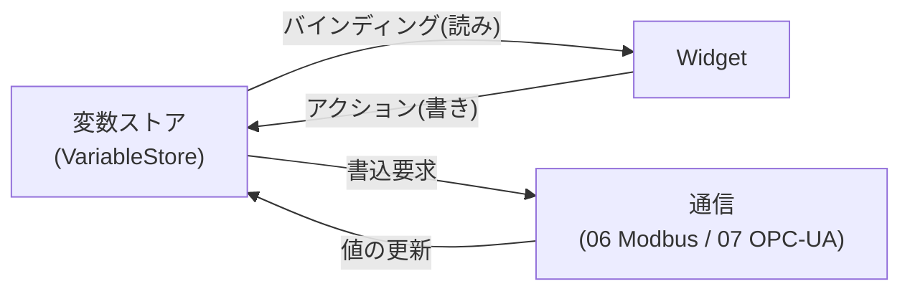
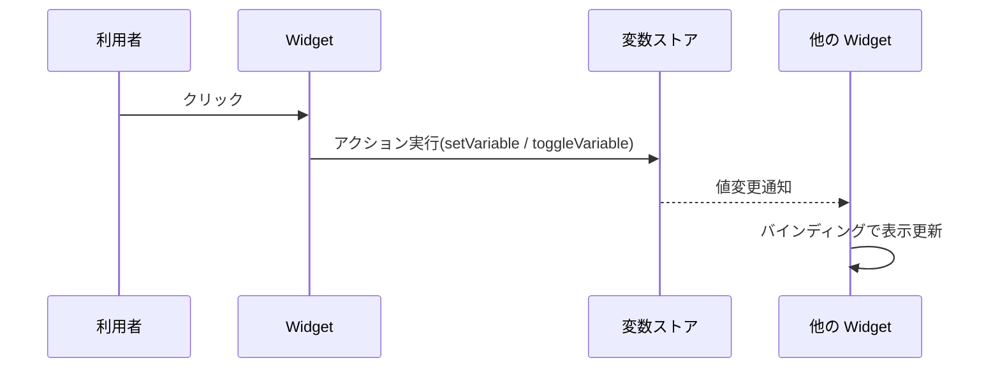

# 要求仕様書 01：変数・バインディング・アクション

| 項目 | 内容 |
|---|---|
| ID 接頭辞 | `REQ-DAT` / `ACC-DAT` |
| 関心 | HMI 内部の「値の持ち方」と「値と画面部品のつなぎ方」 |
| 版 | 1.0（2026-10-31） |

## 1. 概要

画面部品（Widget）が表示・操作する値を **変数** として一元管理し、Widget とは **バインディング（読み）** と **アクション（書き）** でつなぐ仕組みの要求。通信（Modbus / OPC-UA）は、この変数に値を流し込む側として別仕様書で扱う。

## 2. 全体仕様

- 変数はプロジェクト JSON の `variables[]` に定義する。
- Widget は `bindings[]`（表示の追従）と `actions[]`（クリック時の変数操作）を持つ。

## 3. 用語定義

| 用語 | 意味 |
|---|---|
| 変数 | 名前・型・初期値を持つ値の入れ物 |
| 変数ストア | 実行中の変数の現在値を保持する場所（QML シングルトン `VariableStore`） |
| バインディング | Widget のプロパティを変数の値に追従させる定義（読み） |
| アクション | Widget のイベント（現状 `onClick` のみ）で変数を書き換える定義（書き） |
| データソース | 変数の値の取得元（通信先の指定）。無ければ内部変数 |

## 4. 前提条件・制約条件

- 変数型は `bool` / `int` / `real` / `string` の 4 種（`float` ではなく `real`）。
- アクション種別は `setVariable`（固定値を設定）と `toggleVariable`（反転）の 2 種。
- 変数・バインディング・アクションの型と JSON 入出力は `Shared/Schema` にのみ実装する。
- 旧 JSON（変数なし）も読めること（後方互換）。

## 5. 動作仕様

## 6. エラー処理

| 状況 | 動作 |
|---|---|
| 存在しない変数名をバインド / アクション指定 | 実行時に無視し、画面を壊さない |
| 型に合わない値（例：int 変数に "abc"） | 型変換に失敗した値は適用しない |
| 未定義の `op` を持つ JSON | 読込時に不正とみなして拒否する |

## 7. セキュリティ要求

- 外部 JSON は読込時に検証し、不正な構造は拒否する（実行時に未検証データを使わない）。

## 8. 性能要求

- 変数更新から、バインドされた Widget の表示更新までが利用者に遅延を感じさせないこと（目標値は未決事項）。

## 9. 要件

| ID | 要件 | 優先度 | 状態 |
|---|---|---|---|
| REQ-DAT-001 | プロジェクトは `variables[]` に名前・型・初期値を持つ変数を定義できる | P0 | 実装済 |
| REQ-DAT-002 | 変数型として bool / int / real / string を扱える | P0 | 実装済 |
| REQ-DAT-003 | Widget は `bindings[]` で、プロパティを変数値に追従させられる | P0 | 実装済 |
| REQ-DAT-004 | Widget は `actions[]` で、onClick 時に `setVariable` / `toggleVariable` を実行できる | P0 | 実装済 |
| REQ-DAT-005 | 変数・バインディング・アクションは JSON へ保存し、読み込んで元と同じ内容に戻る（round-trip） | P0 | 実装済 |
| REQ-DAT-006 | 変数にデータソース（通信先の指定）を任意で付けられる。無ければ内部変数として動く | P0 | 実装済 |
| REQ-DAT-007 | 未定義の変数・不正な `op` を含む入力を安全に扱う（無視 or 読込拒否） | P0 | 実装済 |
| REQ-DAT-008 | 変数値のスケーリング（gain / offset による単位変換）ができる | P1 | 未実装 |
| REQ-DAT-009 | バインディングで式（演算・条件）を評価できる（例：`a > 80`） | P2 | 未実装 |

## 10. 受入条件

| ID | 対応要件 | 条件 | 確認方法 |
|---|---|---|---|
| ACC-DAT-001 | REQ-DAT-001, 002, 005 | 4 種の型の変数を含む JSON を保存・再読込して同一内容に戻る | Schema unit テスト |
| ACC-DAT-002 | REQ-DAT-003 | 変数値を変えると、バインドした Widget の表示が追従する | Simulator E2E |
| ACC-DAT-003 | REQ-DAT-004 | ボタン押下で bool 変数が反転し、別 Widget の表示が変わる | Simulator E2E |
| ACC-DAT-004 | REQ-DAT-006 | `source` 無しの変数が内部変数として動き、`source` 有り JSON も欠落なく往復する | Schema unit テスト |
| ACC-DAT-005 | REQ-DAT-007 | 存在しない変数名を含むプロジェクトを開いてもクラッシュしない。未定義 `op` の JSON は読込失敗になる | unit テスト |

## 11. 未決事項・課題

| # | 内容 | 状態 |
|---|---|---|
| 1 | REQ-DAT-008（スケーリング）の単位・適用位置（変数側 or Widget 側） | 未決 |
| 2 | REQ-DAT-009（式評価）の文法範囲。要望が出てから設計する | 保留 |
| 3 | 更新遅延の数値目標（性能要求の定量化） | 未決 |
| 4 | アクション trigger を `onClick` 以外に増やすか | 未決 |

## 12. 変更履歴

| 版 | 日付 | 内容 |
|---|---|---|
| 1.0 | 2026-10-31 | `requirements.md` から関心別に分割して新規作成 |
