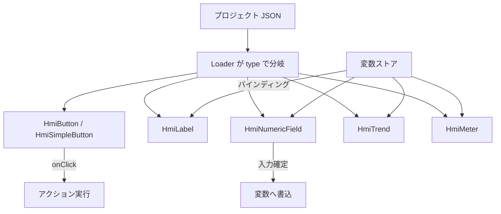

# 要求仕様書 02：Widget（画面部品）

| 項目 | 内容 |
|---|---|
| ID 接頭辞 | `REQ-WGT` / `ACC-WGT` |
| 関心 | 画面に置く部品の種類・見た目・操作の要求 |
| 版 | 1.0（2026-10-31） |

## 1. 概要

HMI 画面を構成する部品（Widget）の種別と、その共通の見た目・振る舞いの要求。部品は Editor / Simulator / Runtime で共有し、同じ JSON から同じ見た目で描画する。

## 2. 全体仕様

| 種別 | 役割 | 変数との関係 | 状態 |
|---|---|---|---|
| Button | 押して変数を操作 | アクション（書き） | 実装済 |
| SimpleButton | 簡易ボタン（見た目プリセット付き） | アクション（書き） | 実装済 |
| Label | 文字表示 | バインディング（読み） | 実装済 |
| NumericField | 数値の表示と入力 | 読み書き両用 | 実装済 |
| Trend | 折れ線グラフ（複数系列） | バインディング（読み） | 実装済 |
| Meter | 円弧と針のメーター | バインディング（読み） | 実装済 |
| Lamp | 状態ランプ（点灯 / 消灯） | バインディング（読み） | 未実装 |
| Image / Slider / Switch など | 汎用部品 | — | 未実装（P2） |

## 3. 用語定義

| 用語 | 意味 |
|---|---|
| Widget | 画面に置く部品 1 個。`type` で種別を表す |
| インスペクタ | 選択した Widget のプロパティを編集するパネル（Editor） |
| 状態別スタイル | pressed / disabled / checked に応じた見た目の切替 |
| presence フラグ | 値が「指定されたか」を別の bool で持つ方式（0 が正当値の項目用） |

## 4. 前提条件・制約条件

- コンポーネント名は `Hmi` 接頭辞を付ける（例：`HmiLabel.qml`）。
- Widget の型と JSON 入出力は `Shared/Schema` にのみ実装する。
- 共有 QML モジュールは STATIC ライブラリとしてアプリに直接リンクする。
- 新しい Widget 種別は、種別テーブルへの登録で追加できる構造を保つ（リファクタリング計画 RF-D）。

## 5. 動作仕様

- 共通プロパティ：位置・サイズ、文字、背景色・文字色、枠、角丸、フォント（太字・斜体・ファミリ）、水平 / 垂直配置、有効 / 無効、状態別スタイル。
- 未指定のプロパティは各 Widget の既定値に戻る（フォールバック）。

## 6. エラー処理

| 状況 | 動作 |
|---|---|
| 未知の `type` | 描画せず、他の Widget は通常どおり表示する |
| 範囲外の数値入力（NumericField） | min / max に丸める（clamp） |
| 不正な色指定 | 既定色にフォールバックする |

## 7. セキュリティ要求

- 特になし（Widget は外部入力を実行しない）。入力値は型と範囲を検証してから変数へ書く。

## 8. 性能要求

- 数十個程度の Widget を同時表示しても操作・更新が滑らかであること（Widget 数・フレーム時間の目標値は未決。11 番の性能計測で定量化する）。

## 9. 要件

| ID | 要件 | 優先度 | 状態 |
|---|---|---|---|
| REQ-WGT-001 | Widget は `type` で種別を指定し、位置・サイズ・文字・色・枠・角丸・フォント・配置の共通プロパティを持てる | P0 | 実装済 |
| REQ-WGT-002 | Button / SimpleButton は onClick でアクションを実行できる | P0 | 実装済 |
| REQ-WGT-003 | 状態別スタイル（pressed / disabled / checked）を持てる | P0 | 実装済 |
| REQ-WGT-004 | Label は変数値に追従して文字を表示できる | P0 | 実装済 |
| REQ-WGT-005 | NumericField は数値の表示と入力ができ、int / real を扱い、min / max で範囲を制限できる | P0 | 実装済 |
| REQ-WGT-006 | Trend は複数系列の折れ線を描画でき、軸目盛り・グリッド・凡例を切り替えられる | P1 | 実装済 |
| REQ-WGT-007 | Meter は最小・最大・単位・目盛り数・色を指定した円弧メーターを描画できる | P1 | 実装済 |
| REQ-WGT-008 | 同じ JSON を Editor / Simulator / Runtime で同じ見た目に描画する | P0 | 実装済 |
| REQ-WGT-009 | Lamp（bool / int に追従して点灯色・消灯色を切替える表示専用部品）を追加できる。Editor のツールバーから追加でき、インスペクタは Lamp に無関係な項目（クリックアクション等）を隠す | P1 | 未実装 |
| REQ-WGT-010 | NumericField / Label で小数桁数（decimals）・単位（unit）を指定して整形表示でき、NumericField は入力の刻み（step）も指定できる | P1 | 未実装 |
| REQ-WGT-011 | Image・Slider・Switch・ComboBox・ProgressBar・図形プリミティブを追加できる | P2 | 未実装 |
| REQ-WGT-012 | Trend の履歴を永続化できる（記録の仕組みは 09 番 REQ-ALM-005・006 と共通） | P2 | 未実装 |

## 10. 受入条件

| ID | 対応要件 | 条件 | 確認方法 |
|---|---|---|---|
| ACC-WGT-001 | REQ-WGT-001, 008 | 全種別を含むデモ JSON を 3 アプリで開くと、同じ配置・見た目で描画される | スクリーンショット比較 / unit テスト |
| ACC-WGT-002 | REQ-WGT-002, 003 | ボタン押下でアクションが実行され、pressed / checked の見た目が切り替わる | Simulator E2E |
| ACC-WGT-003 | REQ-WGT-004 | 変数を更新すると Label の文字が追従する | Simulator E2E |
| ACC-WGT-004 | REQ-WGT-005 | 範囲外の値を入力すると min / max に丸められ、real 型で小数を入力できる | unit テスト |
| ACC-WGT-005 | REQ-WGT-006, 007 | 変数値の変化に Trend の線と Meter の針が追従する | Simulator E2E / スクリーンショット |
| ACC-WGT-006 | REQ-WGT-009 | `lit` 変数の true / false で Lamp の色が切り替わり、クリックしても変数が変わらない | Simulator E2E（Lamp 実装時） |

## 11. 未決事項・課題

| # | 内容 | 状態 |
|---|---|---|
| 1 | Lamp の点灯状態を専用 bool で受けるか、既存プロパティを流用するか（旧案：専用 `lit`） | 未決 |
| 2 | decimals / unit / step の追加先（Widget 共通か、種別別か） | 未決 |
| 3 | Gauge・Image など P2 部品の優先順位。要望が出てから決める | 保留 |
| 4 | Editor / Simulator の delegate 重複削減（RF-E） | 進行中（リファクタリング計画） |

## 12. 変更履歴

| 版 | 日付 | 内容 |
|---|---|---|
| 1.0 | 2026-10-31 | `requirements.md` から関心別に分割して新規作成。実装済み Widget（Phase 5〜11）を反映 |
