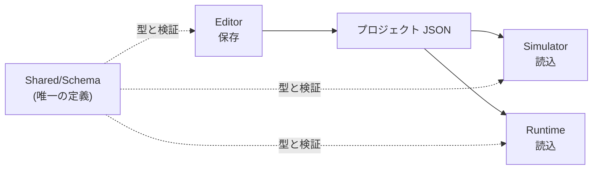
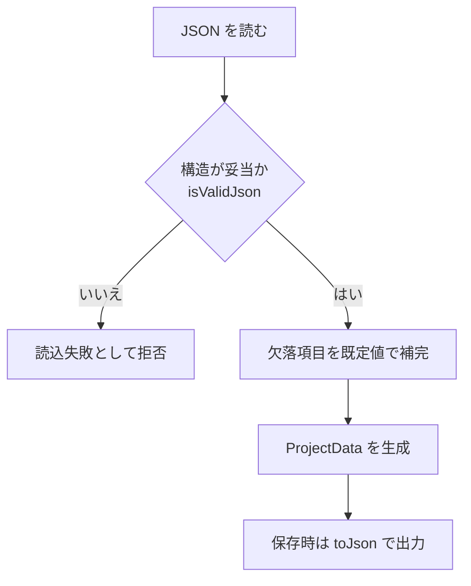

# 要求仕様書 03：プロジェクトファイル（JSON スキーマ）

| 項目 | 内容 |
|---|---|
| ID 接頭辞 | `REQ-PRJ` / `ACC-PRJ` |
| 関心 | プロジェクトの保存形式と、その互換性・検証 |
| 版 | 1.0（2026-10-31） |

## 1. 概要

Editor が作ったプロジェクトを、Simulator / Runtime が同じ内容で読めるようにするための **保存形式（JSON）** の要求。`Shared/Schema` が形式の唯一の定義元になる。

## 2. 全体仕様

トップレベル構成：`project`（名前）、`screens[]`（画面。中に `widgets[]`）、`variables[]`、`connections[]`。

## 3. 用語定義

| 用語 | 意味 |
|---|---|
| round-trip | 保存して読み直したとき、元と同じ内容に戻ること |
| isValidJson | 読込時に JSON の構造を検証する関数 |
| センチネル値 | 「未指定」を表す特別な値（例：`-1`）。0 が正当値の項目で使う |

## 4. 前提条件・制約条件

- 型と JSON 入出力は `Shared/Schema` だけに実装する。他モジュールに重複実装しない。
- 各型は `toJson` / `fromJson` / `toVariantMap` / `fromVariantMap` の 4 メソッドを揃える。
- `hmi_schema` は QML も通信も知らない。
- 追加項目は optional とし、旧 JSON を壊さない（欠落時は既定値）。
- bool の optional は「既定値と異なるときだけ書く」。

## 5. 動作仕様

## 6. エラー処理

| 状況 | 動作 |
|---|---|
| JSON として壊れている | 読込失敗とし、ユーザーに通知する（開いていた内容は保持） |
| 必須項目が欠落 / 型違い | `isValidJson` が偽を返し、読込を拒否する |
| 未知のキー | 無視する（前方互換） |

## 7. セキュリティ要求

- 外部から渡された JSON を未検証のまま実行・評価に使わない。

## 8. 性能要求

- 数百個の Widget を含むプロジェクトの読込が数秒以内に終わること（具体的な目標値は未決。11 番で定量化）。

## 9. 要件

| ID | 要件 | 優先度 | 状態 |
|---|---|---|---|
| REQ-PRJ-001 | プロジェクトは 1 つの JSON ファイルに保存できる | P0 | 実装済 |
| REQ-PRJ-002 | Widget / Screen / Project の型と JSON 入出力は `Shared/Schema` のみで実装する | P0 | 実装済 |
| REQ-PRJ-003 | 保存した内容を読み直すと元と同じ内容に戻る | P0 | 実装済 |
| REQ-PRJ-004 | 読込時に構造を検証し、不正な JSON を拒否する | P0 | 実装済 |
| REQ-PRJ-005 | 追加項目が欠落した旧 JSON を、既定値で補って読める | P0 | 実装済 |
| REQ-PRJ-006 | `screens[]` は複数画面を表現できる | P1 | 実装済（型のみ。UI は 08 番で扱う） |
| REQ-PRJ-007 | 形式に版数を持たせ、旧版 JSON を自動移行できる | P1 | 未実装 |

## 10. 受入条件

| ID | 対応要件 | 条件 | 確認方法 |
|---|---|---|---|
| ACC-PRJ-001 | REQ-PRJ-003 | 全 Widget 種別・変数・接続を含む JSON が round-trip で一致する | Schema unit テスト |
| ACC-PRJ-002 | REQ-PRJ-004 | 必須項目欠落・型違いの JSON が読込拒否される | Schema unit テスト |
| ACC-PRJ-003 | REQ-PRJ-005 | `Docs/samples/` の旧サンプルが現行ビルドで開ける | unit テスト / 手動 |
| ACC-PRJ-004 | REQ-PRJ-007 | 版数 N の JSON を現行版へ移行すると、内容が欠落せず開ける | unit テスト（実装時） |
| ACC-PRJ-005 | REQ-PRJ-001, 002 | プロジェクトを 1 つの JSON ファイルへ保存でき、Widget / Screen / Project の型と JSON 入出力が `Shared/Schema` 以外に実装されていない | Schema unit テスト / ソース構成の確認 |
| ACC-PRJ-006 | REQ-PRJ-006 | `screens[]` に複数画面を持つ JSON が round-trip で一致する（画面切替の UI は 08 番の対象） | Schema unit テスト |

## 11. 未決事項・課題

| # | 内容 | 状態 |
|---|---|---|
| 1 | 版数フィールドの導入時期と、移行処理の置き場所 | 未決 |
| 2 | `ProjectIo`（Editor）と `ProjectLoader`（Simulator）の共通部の扱い（共通部は `parseValidated` に集約済み。残りはアプリ別の戻り値契約） | 現状維持 |

## 12. 変更履歴

| 版 | 日付 | 内容 |
|---|---|---|
| 1.0 | 2026-10-31 | `requirements.md` から関心別に分割して新規作成 |
