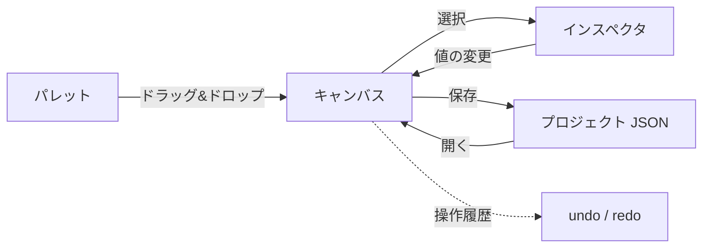

# 要求仕様書 04：Editor（作画ツール）

| 項目 | 内容 |
|---|---|
| ID 接頭辞 | `REQ-EDT` / `ACC-EDT` |
| 関心 | 画面を作る人が使う編集機能 |
| 版 | 1.0（2026-10-31） |

## 1. 概要

PC 上で HMI 画面を作る Editor アプリの要求。Widget を置き、プロパティを編集し、プロジェクト JSON として保存する。実通信は行わない（定義だけ書く）。

## 2. 全体仕様

| 領域 | 内容 |
|---|---|
| キャンバス | Widget の配置・移動・リサイズ・グリッドスナップ |
| パレット | 見た目付きのサンプルを並べ、キャンバスへドラッグ＆ドロップで追加 |
| インスペクタ | 選択 Widget のプロパティをセクション別に編集 |
| 編集操作 | 複数選択・整列・コピー＆ペースト・undo / redo |
| 入出力 | プロジェクトの新規 / 開く / 保存 |
| 変数・接続の定義 | 変数、バインディング、アクション、接続先の編集 |

## 3. 用語定義

| 用語 | 意味 |
|---|---|
| キャンバス | Widget を配置する作画領域 |
| サンプルパレット | Widget の見た目そのままの見本一覧 |
| スナップ | 移動・リサイズ時にグリッドへ吸着させる機能 |

## 4. 前提条件・制約条件

- Editor は `Qt6::SerialBus` / `Qt6::OpcUa` をリンクしない（通信は Simulator / Runtime のみ）。
- Editor は PC 専用。実機には載せない。
- 読み込み直後の undo 履歴は空にする。
- `Main.qml` の肥大化を避け、機能ごとに QML を分割する（リファクタリング計画）。

## 5. 動作仕様

## 6. エラー処理

| 状況 | 動作 |
|---|---|
| 不正な JSON を開く | エラーを表示し、編集中の内容を保持する |
| テキスト入力中の undo | テキストの undo を優先し、キャンバスの undo は動かさない |
| 保存先に書き込めない | エラーを表示し、編集内容は失わない |

## 7. セキュリティ要求

- 開くファイルは読込時に検証する（03 番）。

## 8. 性能要求

- Widget 数十個の編集（移動・プロパティ変更）が操作に追従して滑らかに動くこと。

## 9. 要件

| ID | 要件 | 優先度 | 状態 |
|---|---|---|---|
| REQ-EDT-001 | Widget を追加・選択・移動・リサイズ・削除できる | P0 | 実装済 |
| REQ-EDT-002 | グリッドスナップ、複数選択、整列ができる | P0 | 実装済 |
| REQ-EDT-003 | コピー＆ペーストと undo / redo ができる | P0 | 実装済 |
| REQ-EDT-004 | インスペクタで Widget の共通・種別固有プロパティを編集でき、種別に無関係な項目は隠れる | P0 | 実装済 |
| REQ-EDT-005 | サンプルパレットから Widget をドラッグ＆ドロップで追加できる | P1 | 実装済 |
| REQ-EDT-006 | 変数・バインディング・アクション・接続先を編集できる | P0 | 実装済 |
| REQ-EDT-007 | プロジェクトの新規作成・開く・保存ができる | P0 | 実装済 |
| REQ-EDT-008 | Widget 一覧（アウトライン）から選択・並べ替えができる | P1 | 未実装 |
| REQ-EDT-009 | 複数画面を作成・切替・削除できる | P1 | 未実装（08 番と連動） |
| REQ-EDT-010 | 表示文字列を多言語（ロケール別）で管理できる | P2 | 未実装 |
| REQ-EDT-011 | 重なり順（z-order）、ズーム / パン、テーマ一括適用ができる | P2 | 未実装 |
| REQ-EDT-012 | Editor にビルド依存として通信ライブラリを持ち込まない | P0 | 実装済 |

## 10. 受入条件

| ID | 対応要件 | 条件 | 確認方法 |
|---|---|---|---|
| ACC-EDT-001 | REQ-EDT-001, 002 | 追加・移動・リサイズ・整列の操作結果が座標に反映される | Editor E2E / unit テスト |
| ACC-EDT-002 | REQ-EDT-003 | 操作を undo / redo すると元の状態に戻る / 進む | Editor E2E |
| ACC-EDT-003 | REQ-EDT-005 | パレットから落とした位置に、見本と同じ見た目で Widget が追加される | Editor E2E / スクリーンショット |
| ACC-EDT-004 | REQ-EDT-006, 007 | 変数・アクション付きの画面を保存し、開き直すと同じ内容になる | E2E |
| ACC-EDT-005 | REQ-EDT-012 | `hmi_editor` が SerialBus / OpcUa ライブラリをリンクしていない | ビルド成果物の依存確認 |
| ACC-EDT-006 | REQ-EDT-004 | Widget を選択すると共通・種別固有のプロパティがインスペクタに出て、値を変えるとキャンバスに反映される。種別に無関係な項目は隠れる | Editor E2E / unit テスト |

## 11. 未決事項・課題

| # | 内容 | 状態 |
|---|---|---|
| 1 | アウトライン（REQ-EDT-008）の並べ替えと z-order の関係 | 未決 |
| 2 | 多言語（REQ-EDT-010）のリソース形式 | 保留 |
| 3 | `Main.qml` 分割の残作業（RF-E 以降） | v1.0 公開まで中断 |

## 12. 変更履歴

| 版 | 日付 | 内容 |
|---|---|---|
| 1.0 | 2026-10-31 | `requirements.md` から関心別に分割して新規作成。Phase 4〜11 の実装を反映 |
