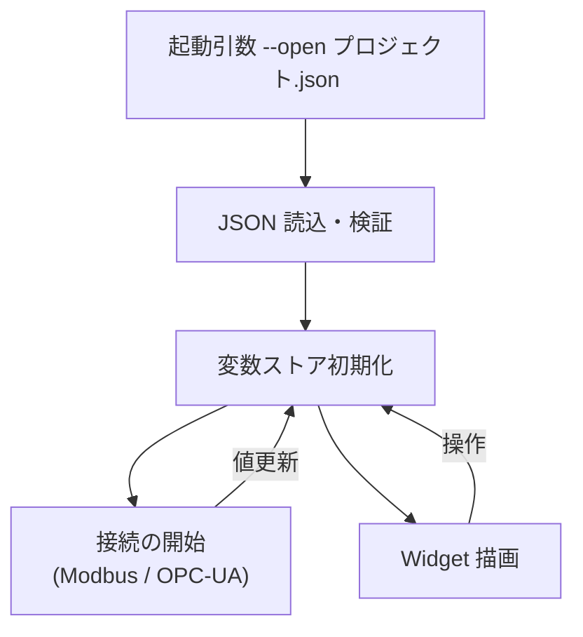

# 要求仕様書 05：Simulator / Runtime（実行環境）

| 項目 | 内容 |
|---|---|
| ID 接頭辞 | `REQ-RUN` / `ACC-RUN` |
| 関心 | 作った画面を動かすアプリ（PC 上の Simulator / 実機の Runtime） |
| 版 | 1.0（2026-10-31） |

## 1. 概要

Editor が作ったプロジェクト JSON を読み込み、実際に動作させるアプリの要求。PC 上で試す **Simulator** と、i.MX8MP 実機で動かす **Runtime** は、ソースを共有する。

## 2. 全体仕様

| アプリ | 動作環境 | 役割 | 編集機能 |
|---|---|---|---|
| hmi_editor | PC のみ | 作画 | あり |
| hmi_simulator | PC | 動作確認（実通信も可） | なし |
| hmi_runtime | 実機（i.MX8MP / Yocto / Wayland） | 製品としての表示・操作 | なし |

- Simulator と Runtime は `Simulator/` のソースを共有する。実機固有の差分は `HMI_RUNTIME_BUILD` で切り替える。
- 「実行（変数の書込・アクション）は可、編集 UI は不可」とする。

## 3. 用語定義

| 用語 | 意味 |
|---|---|
| クロスビルド | PC 上で実機（aarch64）向けバイナリを作ること（Yocto SDK 使用） |
| 変数ソース | 変数の値の取得元。通信先に紐づく |
| VNC モード | `QT_QPA_PLATFORM=vnc` で画面を VNC 配信する起動方法 |

## 4. 前提条件・制約条件

- 実機 image：NXP `imx-6.6.52-2.2.2`（scarthgap）、Qt 6.8.1、weston。
- 実機で最新機能を動かすには、毎回 Runtime を再クロスビルドして配備する必要がある（古いバイナリは新機能を黙って無視する）。
- 実機 image に `libQt6SerialBus` が無いため、Modbus 利用時は別途導入が必要。
- 実機の日本語フォントは未搭載（和文は豆腐になる）。

## 5. 動作仕様

## 6. エラー処理

| 状況 | 動作 |
|---|---|
| プロジェクトが読めない | エラーを出力して起動を中止する |
| 通信先に接続できない | 画面は表示を続け、接続状態を保持して再接続を試みる（06・07 番） |
| 実機のディスプレイ未接続 | VNC モードでの表示確認に切り替えられる |

## 7. セキュリティ要求

- 編集機能を持ち込まない（実機での意図しない改変を防ぐ）。
- 実機の転送・ログインは鍵認証を前提とする。

## 8. 性能要求

- 実機でプロジェクトを開いてから表示されるまで、運用上待たされない時間であること（目標秒数は未決）。
- 実機で通常の Widget 数の更新が滑らかであること。

## 9. 要件

| ID | 要件 | 優先度 | 状態 |
|---|---|---|---|
| REQ-RUN-001 | Simulator はプロジェクト JSON を読み込んで Widget を描画し、バインディング・アクションが動く | P0 | 実装済 |
| REQ-RUN-002 | Runtime は i.MX8MP 実機で JSON を読み込んで描画できる | P0 | 実装済 |
| REQ-RUN-003 | Simulator と Runtime はソースを共有する | P0 | 実装済 |
| REQ-RUN-004 | Simulator / Runtime は編集 UI を持たない | P0 | 実装済 |
| REQ-RUN-005 | 実機向けクロスビルドを手順化し、1 コマンドで実行できる | P0 | 実装済 |
| REQ-RUN-006 | 実機ディスプレイ無しでも VNC 経由で画面を確認できる | P1 | 実装済 |
| REQ-RUN-007 | クロスビルド → 転送 → 起動を半自動化する | P1 | 未実装 |
| REQ-RUN-008 | 実機 Runtime で Modbus を使えるよう、必要ライブラリを image に同梱する | P1 | 未実装（06 番 REQ-MBS-009 と連動。現状は deb を手動導入） |
| REQ-RUN-009 | 起動時のブート画面から Runtime へ黒フレーム無しで切り替える | P2 | 未実装 |

## 10. 受入条件

| ID | 対応要件 | 条件 | 確認方法 |
|---|---|---|---|
| ACC-RUN-001 | REQ-RUN-001, 004 | サンプル JSON を開くとボタン操作で表示が変わり、編集 UI は出ない | Simulator E2E |
| ACC-RUN-002 | REQ-RUN-002, 003 | 同じ JSON が実機 Runtime と Simulator で同じ見た目に描画される | 実機スクリーンショット |
| ACC-RUN-003 | REQ-RUN-005 | `scripts/yocto/cross-build.sh` で aarch64 の `hmi_runtime` が生成される | 手順実行 |
| ACC-RUN-004 | REQ-RUN-006 | VNC クライアントで接続すると実機画面が表示される | 手動確認 |

## 11. 未決事項・課題

| # | 内容 | 状態 |
|---|---|---|
| 1 | 実機デプロイ自動化の範囲（転送先・停止処理を含むか） | 未決 |
| 2 | 実機の日本語フォント導入 | 未決 |
| 3 | ブート画面連携は記事前提（eglfs_kms）が本構成と異なり、再設計が必要 | 保留 |

## 12. 変更履歴

| 版 | 日付 | 内容 |
|---|---|---|
| 1.0 | 2026-10-31 | `requirements.md` から関心別に分割して新規作成 |
