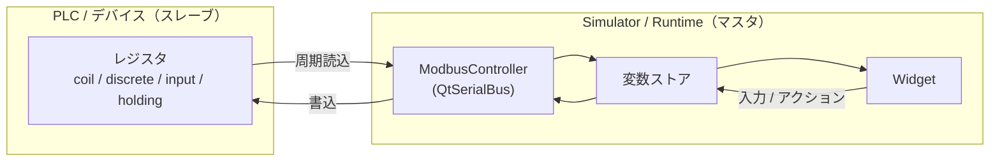
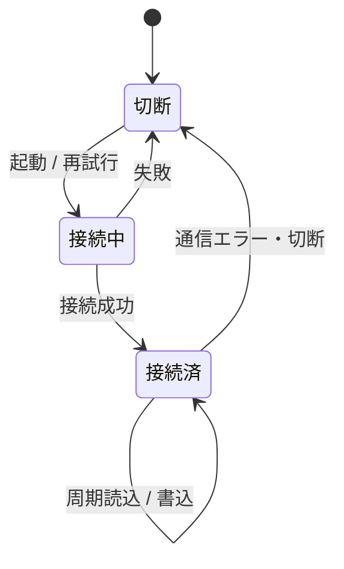

# 要求仕様書 06：Modbus TCP 通信

| 項目 | 内容 |
|---|---|
| ID 接頭辞 | `REQ-MBS` / `ACC-MBS` |
| 関心 | Modbus TCP で PLC・デバイスと値をやり取りする機能 |
| 版 | 1.0（2026-10-31） |
| 関連 | 計画書 [phase7-modbus-plan.md](../phase7-modbus-plan.md)（正本。タスク分割と進捗） |

## 1. 概要

Simulator / Runtime が **Modbus TCP マスタ（クライアント）** として PLC のレジスタを周期的に読み、変数ストアへ反映する。逆に、操作で変わった変数をレジスタへ書き戻す。

## 2. 全体仕様

## 3. 用語定義

| 用語 | 意味 |
|---|---|
| マスタ / スレーブ | 要求を出す側（HMI）/ 応える側（PLC） |
| coil | 1 bit の読み書き可能レジスタ |
| discrete | 1 bit の読み取り専用レジスタ |
| holding | 16 bit の読み書き可能レジスタ |
| input | 16 bit の読み取り専用レジスタ |
| unitId | スレーブの識別番号（既定 1） |
| ポーリング | 一定間隔で値を読みに行くこと（既定 1000 ms） |

## 4. 前提条件・制約条件

- 対象は **Modbus TCP のみ**。RTU（シリアル）は対象外。
- ライブラリは Qt 標準の QtSerialBus（`QModbusTcpClient`）。外部依存を増やさない。
- 接続先はプロジェクト共通の `connections[]` に定義し、変数の `source.connection` が `id` で参照する。
- アドレスは **0 始まり** のプロトコル番地を JSON の正準とする。人間向け表記（1 始まり等）への変換は Editor の表示層が担う。
- 書込できるのは coil / holding のみ。
- Editor は通信せず、定義を JSON に書くだけ（SerialBus 非リンク）。
- 通信コードは Simulator と Runtime の共有ソースに置く。

## 5. 動作仕様

- 接続済みの間、変数ごとの `poll` 周期でレジスタを読み、変数ストアを更新する。
- 利用者の操作で変数が変わると、書込可能レジスタなら該当レジスタへ書く。
- 切断されたら再接続を試みる。

## 6. エラー処理

| 状況 | 動作 |
|---|---|
| 接続失敗 / 切断 | 状態を「切断」にし、再接続を試みる。画面表示は継続する |
| 読込 / 書込の応答エラー | 変数を壊さず、状態に反映する |
| 読み取り専用レジスタへの書込要求 | 書込まず、拒否する |
| `source.connection` が存在しない `id` | 読込時または実行時に無効として扱い、通信しない |

## 7. セキュリティ要求

- Modbus TCP 自体に認証・暗号化が無い。**信頼できる閉じたネットワーク** での利用を前提とする。
- 書込操作は、書込可能レジスタに割り当てた変数に限定する。

## 8. 性能要求

- ポーリングと書込は UI スレッドをブロックしない（非同期・イベント駆動）。
- 既定ポーリング周期 1000 ms で、画面操作に影響しないこと。

## 9. 要件

| ID | 要件 | 優先度 | 状態 |
|---|---|---|---|
| REQ-MBS-001 | 変数に Modbus マッピング（接続先・レジスタ種別・アドレス・ポーリング周期）を定義でき、JSON で往復できる | P0 | 実装済 |
| REQ-MBS-002 | 接続先を `connections[]`（id・proto・host・port・unitId）に定義し、変数が参照できる | P0 | 実装済 |
| REQ-MBS-003 | Simulator / Runtime が周期読込し、値を変数ストアへ反映する | P0 | 実装済 |
| REQ-MBS-004 | 変数の書込を coil / holding へ反映する | P0 | 実装済（ソフトスレーブで確認。実 PLC 書込は未確認） |
| REQ-MBS-005 | 接続状態を取得でき、切断時に再接続を試みる | P0 | 実装済 |
| REQ-MBS-006 | Editor は通信に依存しない（定義のみ） | P0 | 実装済 |
| REQ-MBS-007 | 通信は UI スレッドをブロックしない | P0 | 実装済 |
| REQ-MBS-008 | 実 PLC に対して書込が反映されることを確認する | P0 | 未実施（MB-5） |
| REQ-MBS-009 | 実機 Runtime 上で Modbus 通信が動作する | P1 | 未実施（MB-6） |
| REQ-MBS-010 | 32 bit・浮動小数（変数型 `real`）レジスタ（複数レジスタ値、byte / word order）を扱える | P1 | 未実装 |
| REQ-MBS-011 | Modbus RTU（シリアル）に対応する | P2 | 未実装 |

## 10. 受入条件

| ID | 対応要件 | 条件 | 確認方法 |
|---|---|---|---|
| ACC-MBS-001 | REQ-MBS-001, 002 | 接続・マッピング付き JSON を保存・再読込して一致し、`source.connection` が接続 `id` を指す | Schema unit テスト |
| ACC-MBS-002 | REQ-MBS-003 | pymodbus ソフトスレーブのレジスタ値を変えると、バインドした Widget の表示が追従する | Simulator E2E（ctest） |
| ACC-MBS-003 | REQ-MBS-004 | 画面操作でソフトスレーブの coil / holding の値が変わる | Simulator E2E |
| ACC-MBS-004 | REQ-MBS-005 | スレーブを停止すると「切断」状態になり、再起動後に復帰する | E2E |
| ACC-MBS-005 | REQ-MBS-006 | `hmi_editor` が `Qt6SerialBus` をリンクしていない | 依存確認 |
| ACC-MBS-006 | REQ-MBS-008 | 実 PLC のレジスタが HMI 操作で変わる | 実機・実 PLC の手動確認 |
| ACC-MBS-007 | REQ-MBS-009 | 実機 Runtime でレジスタ値が画面に追従する | 実機の手動確認（スクリーンショット） |
| ACC-MBS-008 | REQ-MBS-007 | ポーリング中も画面操作（ボタン押下・入力）が遅延なく反映される | Simulator E2E（ソフトスレーブ接続中の操作） |

## 11. 未決事項・課題

| # | 内容 | 状態 |
|---|---|---|
| 1 | 32 bit / float レジスタの word / byte order の仕様 | 要調査 |
| 2 | 生値 → 物理量のスケーリング（01 番 REQ-DAT-008 と連動） | 未決 |
| 3 | MB-5 / MB-6 はローカル環境専用（Web 不可）。実施時期 | 未決 |
| 4 | 実機 image への `QtSerialBus` 同梱方法 | 要調査 |

## 12. 変更履歴

| 版 | 日付 | 内容 |
|---|---|---|
| 1.0 | 2026-10-31 | `requirements.md` §2.3 を分離して新規作成（旧 FR-MB-01〜05 / NFR-MB-01〜03 を再編） |
