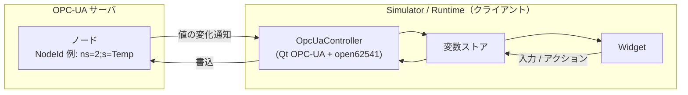
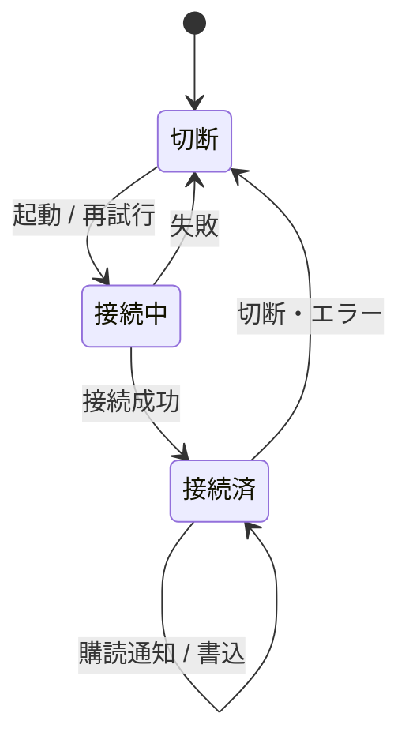

# 要求仕様書 07：OPC-UA 通信

| 項目 | 内容 |
|---|---|
| ID 接頭辞 | `REQ-OPC` / `ACC-OPC` |
| 関心 | OPC-UA クライアントとしてサーバのノードを読み書きする機能 |
| 版 | 1.0（2026-10-31） |
| 関連 | 計画書（完了） [archive/phase9-opcua-plan.md](../archive/phase9-opcua-plan.md) |

## 1. 概要

Simulator / Runtime が **OPC-UA クライアント** として PLC・ゲートウェイ等のサーバに接続し、ノード値を購読して変数ストアへ反映し、操作で変わった変数をノードへ書く。Modbus と同じ「変数のデータソース」の仕組みに、2 つ目のプロトコルとして載る。

## 2. 全体仕様

## 3. 用語定義

| 用語 | 意味 |
|---|---|
| NodeId | サーバ上のノード（値）を指す識別子。例：`ns=2;s=Temp` |
| 購読（MonitoredItem） | サーバから値の変化通知を受ける仕組み |
| endpoint | サーバの接続 URL（例：`opc.tcp://host:4840`） |
| SecurityMode None | 暗号化・認証なしの接続方式 |

## 4. 前提条件・制約条件

- ライブラリは Qt OPC-UA（`QOpcUaClient`）+ open62541 バックエンド。
- 接続先は Modbus と同じ `connections[]` に `proto` と `endpoint` で定義し、変数の `source.nodeId` で指す。
- 対象は **スカラ値ノードの読み・書き・購読**。メソッド呼び出し・履歴アクセス・イベント購読・構造体型は対象外。
- セキュリティは `None`（無暗号・匿名）のみ。
- qtopcua は標準の Web / CI ビルド環境に含まれない。macOS / Windows はソースビルドで導入、実機は SDK に包含済み。
- Editor は OPC-UA ライブラリをリンクしない。

## 5. 動作仕様

- 接続後、`source.nodeId` を持つ変数を購読する。購読できないノードは周期読込で代替する。
- 変化通知を受けるたびに変数ストアを更新する。

## 6. エラー処理

| 状況 | 動作 |
|---|---|
| 接続失敗 / 切断 | 状態を「切断」にし、自動で再接続する。画面表示は継続する |
| 存在しない NodeId | その変数のみ無効として扱い、他の変数は動作を続ける |
| 型の合わない値 | 変数に適用せず、無視する |
| 書込拒否（権限なし） | 変数を壊さず、エラーを状態へ反映する |

## 7. セキュリティ要求

- 現状は `None`（無暗号・匿名）のみ。**信頼できる閉じたネットワーク内に限定する**。
- 証明書・暗号化（Basic256Sha256 等）・ユーザ認証は将来要求（P2）。

## 8. 性能要求

- 購読は変化通知を主とし、UI スレッドをブロックしない。
- 通知から画面反映まで、利用者が遅延を感じないこと（目標値は未決）。

## 9. 要件

| ID | 要件 | 優先度 | 状態 |
|---|---|---|---|
| REQ-OPC-001 | `connections[]` に OPC-UA の接続先（endpoint）を定義でき、変数に `nodeId` を指定でき、JSON で往復できる | P0 | 実装済 |
| REQ-OPC-002 | Editor で OPC-UA の接続先・ノードを編集できる | P0 | 実装済 |
| REQ-OPC-003 | サーバのノード値を購読し、変数ストアへ反映する | P0 | 実装済 |
| REQ-OPC-004 | 変数の書込をノードへ反映する | P0 | 実装済 |
| REQ-OPC-005 | 接続状態を観測でき、切断時に自動再接続する | P0 | 実装済 |
| REQ-OPC-006 | 実機 Runtime で OPC-UA の値が画面に表示される | P0 | 実装済 |
| REQ-OPC-007 | Editor は OPC-UA ライブラリに依存しない | P0 | 実装済 |
| REQ-OPC-008 | 証明書・暗号化・ユーザ認証つきで接続できる | P2 | 未実装 |
| REQ-OPC-009 | 構造体型・配列・メソッド呼び出し・履歴・イベントを扱える | P2 | 未実装 |
| REQ-OPC-010 | 他プロトコル（MQTT + Sparkplug B、CAN）で変数のデータソースを定義し、値を読み書きできる（通信の足場は Modbus / OPC-UA と共通） | P2 | 未実装 |

## 10. 受入条件

| ID | 対応要件 | 条件 | 確認方法 |
|---|---|---|---|
| ACC-OPC-001 | REQ-OPC-001, 002 | OPC-UA 接続・ノード付き JSON が往復で一致する | Schema unit テスト |
| ACC-OPC-002 | REQ-OPC-003 | asyncua ソフトサーバのノード値を変えると、バインドした Widget が追従する | `scripts/opcua/run-local-check.sh`（ローカル）／E2E |
| ACC-OPC-003 | REQ-OPC-004 | 画面の入力でソフトサーバのノード値が変わる | 手動 / E2E |
| ACC-OPC-004 | REQ-OPC-005 | サーバ停止で「切断」になり、再起動後に復帰する | E2E |
| ACC-OPC-005 | REQ-OPC-006 | 実機 Runtime の画面に OPC-UA ライブ値が表示される（証跡：`Docs/screenshots/op6-runtime.png`） | 実機スクリーンショット |
| ACC-OPC-006 | REQ-OPC-007 | `hmi_editor` が OPC-UA ライブラリ（Qt6OpcUa）をリンクしていない | ビルド成果物の依存確認 |

## 11. 未決事項・課題

| # | 内容 | 状態 |
|---|---|---|
| 1 | セキュリティ対応（REQ-OPC-008）を行う判断時期。要望が出てから決める | 保留 |
| 2 | Web / CI で OPC-UA を含めてビルド・テストする手段（現状は qtopcua が無く SKIP） | 未決 |
| 3 | 他プロトコル対応（REQ-OPC-010）。要望が出てから設計する。着手時に専用の仕様書へ分けるか判断する | 保留 |
| 4 | Homebrew Qt 再インストール時の qtopcua 再導入手順の維持 | 運用 |

## 12. 変更履歴

| 版 | 日付 | 内容 |
|---|---|---|
| 1.0 | 2026-10-31 | `requirements.md` から関心別に分割して新規作成 |
