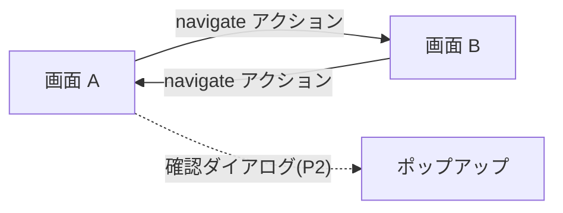

# 要求仕様書 08：画面・ナビゲーション

| 項目 | 内容 |
|---|---|
| ID 接頭辞 | `REQ-NAV` / `ACC-NAV` |
| 関心 | 複数の画面を持ち、画面間を移動する機能 |
| 版 | 1.0（2026-10-31） |
| 状態 | **全体が未実装（要望の整理段階）** |

## 1. 概要

実務の HMI は複数画面（一覧・詳細・設定など）を持つ。現状は `screens[]` の型こそ複数対応だが、Editor / Simulator の UI は単一画面前提。画面の管理と画面遷移の要求をまとめる。

## 2. 全体仕様

| 機能 | 優先度 |
|---|---|
| 複数画面の作成・切替（Editor） | P1 |
| 画面遷移アクション（`navigate`） | P1 |
| ポップアップ / ダイアログ（確認・テンキー） | P2 |
| 部品のグループ化・再利用（コンポーネント） | P2 |

## 3. 用語定義

| 用語 | 意味 |
|---|---|
| 画面 | Widget をまとめた 1 ページ（`screens[]` の要素） |
| 画面遷移 | 操作で別の画面を表示すること |
| ポップアップ | 画面の上に重ねて出す小窓 |
| コンポーネント | 複数 Widget を 1 つの部品にしたテンプレート |

## 4. 前提条件・制約条件

- `ScreenData` は複数画面を保持できる型として既に存在する。
- 画面遷移は既存のアクション機構（01 番）の拡張として定義する。新たな仕組みを別に作らない。
- Simulator / Runtime には編集 UI を持ち込まない。
- Schema 変更は後方互換（単一画面の旧 JSON を読める）にする。

## 5. 動作仕様

## 6. エラー処理

| 状況 | 動作 |
|---|---|
| 存在しない画面名への遷移 | 遷移せず現在の画面を維持する |
| 画面を 1 つだけ残して削除操作 | 最後の 1 画面は削除させない |

## 7. セキュリティ要求

- 特になし。

## 8. 性能要求

- 画面遷移が利用者に待たされる印象を与えないこと（目標値は未決）。

## 9. 要件

| ID | 要件 | 優先度 | 状態 |
|---|---|---|---|
| REQ-NAV-001 | Editor で画面の追加・切替・名前変更・削除ができる | P1 | 未実装 |
| REQ-NAV-002 | アクション種別 `navigate` で、指定した画面へ遷移できる | P1 | 未実装 |
| REQ-NAV-003 | 起動時に表示する画面を指定できる | P1 | 未実装 |
| REQ-NAV-004 | 単一画面の旧 JSON を引き続き開ける | P1 | 未実装（実装時に維持） |
| REQ-NAV-005 | ポップアップ / ダイアログ（確認、数値入力テンキー）を表示できる | P2 | 未実装 |
| REQ-NAV-006 | 複数 Widget をグループ化し、部品として再利用できる | P2 | 未実装 |

## 10. 受入条件

| ID | 対応要件 | 条件 | 確認方法 |
|---|---|---|---|
| ACC-NAV-001 | REQ-NAV-001 | 2 画面を作成して保存・再読込すると、両方の内容が保持される | Editor E2E / Schema unit テスト |
| ACC-NAV-002 | REQ-NAV-002, 003 | ボタン押下で指定画面に切り替わり、起動時は指定画面が表示される | Simulator E2E |
| ACC-NAV-003 | REQ-NAV-004 | 既存サンプル JSON が現行どおり開ける | unit テスト |

## 11. 未決事項・課題

| # | 内容 | 状態 |
|---|---|---|
| 1 | 着手の承認・時期（新機能は承認後に着手する） | 未承認 |
| 2 | 画面ごとの変数スコープ（全画面共通でよいか） | 未決 |
| 3 | `navigate` の `op` 値と引数の持たせ方 | 未決 |

## 12. 変更履歴

| 版 | 日付 | 内容 |
|---|---|---|
| 1.0 | 2026-10-31 | `requirements.md` のバックログ B から関心別に分割して新規作成 |
