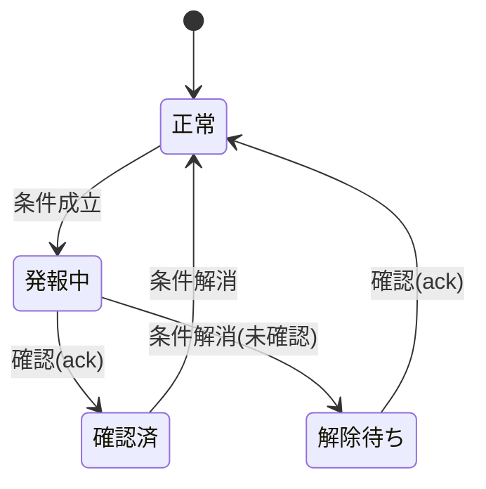

# 要求仕様書 09：アラーム・ロギング

| 項目 | 内容 |
|---|---|
| ID 接頭辞 | `REQ-ALM` / `ACC-ALM` |
| 関心 | 異常の通知・履歴と、値の時系列記録 |
| 版 | 1.0（2026-10-31） |
| 状態 | **全体が未実装（要望の整理段階）** |

## 1. 概要

変数の値が条件を満たしたときの通知（アラーム）と、その履歴・確認操作、および変数値の時系列記録（ロギング）の要求。現状の Trend は画面表示中のライブ描画のみで、履歴は保存しない。

## 2. 全体仕様

| 機能 | 優先度 |
|---|---|
| アラーム条件の定義・発報・解除 | P1 |
| アラーム履歴と確認（ack） | P1 |
| 変数値のロギング（時系列記録） | P2 |
| Trend への履歴表示 | P2 |

## 3. 用語定義

| 用語 | 意味 |
|---|---|
| アラーム | 変数が条件（例：上限超過）を満たしたときの異常通知 |
| 発報 / 解除 | 条件成立で通知を出す / 条件が戻って通知を解く |
| 確認（ack） | 利用者がアラームを認識したと記録する操作 |
| ロギング | 変数値を時刻付きで保存すること |

## 4. 前提条件・制約条件

- アラーム条件は変数値に対する条件として定義する。式評価（01 番 REQ-DAT-009）との関係を整理してから決める。
- 保存先は実機のストレージ容量を考慮する（上限・循環）。
- 新機能のため、着手前にユーザー承認が必要。

## 5. 動作仕様

## 6. エラー処理

| 状況 | 動作 |
|---|---|
| 記録先の容量不足 | 古い記録を上限に従い削除し、動作は継続する |
| 時刻が巻き戻った | 記録の順序を保つ（扱いは未決） |

## 7. セキュリティ要求

- アラームの確認操作や履歴削除は、誰が・いつ行ったかを記録する（認証の有無は未決）。

## 8. 性能要求

- ロギングは UI の描画・操作を妨げないこと。
- 記録間隔と保持期間は設定可能であること（既定値は未決）。

## 9. 要件

| ID | 要件 | 優先度 | 状態 |
|---|---|---|---|
| REQ-ALM-001 | 変数ごとにアラーム条件（上限 / 下限 / 等値など）を定義できる | P1 | 未実装 |
| REQ-ALM-002 | 条件成立時にアラームを発報し、画面で通知できる | P1 | 未実装 |
| REQ-ALM-003 | アラームの発生・解除・確認を履歴として保持し、一覧表示できる | P1 | 未実装 |
| REQ-ALM-004 | 利用者がアラームを確認（ack）できる | P1 | 未実装 |
| REQ-ALM-005 | 変数値を時刻付きで記録し、保持期間・上限を設定できる | P2 | 未実装 |
| REQ-ALM-006 | 記録した履歴を Trend に表示できる | P2 | 未実装 |

## 10. 受入条件

| ID | 対応要件 | 条件 | 確認方法 |
|---|---|---|---|
| ACC-ALM-001 | REQ-ALM-001, 002 | 上限超過の値を設定すると通知が表示され、値が戻ると解除される | Simulator E2E |
| ACC-ALM-002 | REQ-ALM-003, 004 | 発報・確認・解除が履歴一覧に時刻付きで残る | Simulator E2E |
| ACC-ALM-003 | REQ-ALM-005, 006 | 再起動後も記録が残り、Trend で過去の値を表示できる | E2E（実装時） |

## 11. 未決事項・課題

| # | 内容 | 状態 |
|---|---|---|
| 1 | 着手の承認・時期 | 未承認 |
| 2 | 条件の表現方法（Schema 形） | 未決 |
| 3 | 履歴の保存形式と保存先（ファイル / DB） | 未決 |
| 4 | 通知の見た目（バナー / 一覧部品） | 未決 |

## 12. 変更履歴

| 版 | 日付 | 内容 |
|---|---|---|
| 1.0 | 2026-10-31 | `requirements.md` のバックログ C から関心別に分割して新規作成 |
