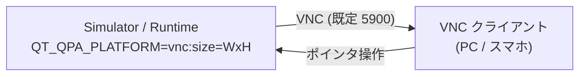
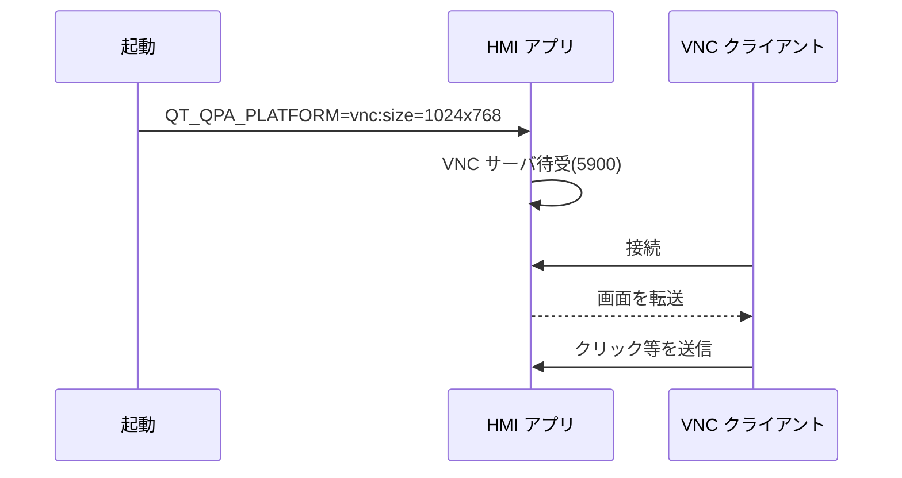

# 要求仕様書 10：リモート監視・操作（VNC）

| 項目 | 内容 |
|---|---|
| ID 接頭辞 | `REQ-RMT` / `ACC-RMT` |
| 関心 | 離れた端末から HMI 画面を見る・操作する機能 |
| 版 | 1.0（2026-10-31） |

## 1. 概要

Qt 内蔵の VNC（`QT_QPA_PLATFORM=vnc`）で HMI 画面を配信し、スマートフォンなどの VNC クライアントから閲覧・操作できるようにする。現状は起動オプションとしての動作確認と、動作証跡撮影での利用までが済んでいる。Editor からの操作性とドキュメント整備が要求として残る。

## 2. 全体仕様

## 3. 用語定義

| 用語 | 意味 |
|---|---|
| VNC | 画面を転送し、遠隔で操作するプロトコル |
| vnc プラットフォーム | Qt 内蔵の VNC 配信用 QPA |
| ポート | 接続先番号（既定 5900） |

## 4. 前提条件・制約条件

- Qt 内蔵 VNC は追加依存なしで使えるが、**認証・暗号化を持たない**。
- 画面サイズ指定は実ウィンドウ（1024×768 等）に合わせる。
- 実機は HDMI 接続の有無にかかわらず、VNC 用の別インスタンスを並行起動して確認できる。
- 新機能（Editor のトグル UI 等）は承認後に着手する。

## 5. 動作仕様

## 6. エラー処理

| 状況 | 動作 |
|---|---|
| ポート使用中 | 起動時にエラーを出す（別ポートを指定して再起動） |
| クライアント切断 | HMI 本体の動作は継続する |
| 変化がないときの差分要求 | 応答が保留される場合があるため、全面取得で確認する |

## 7. セキュリティ要求

- 認証・暗号化が無いため、**信頼できる閉じたネットワークまたは VPN 内でのみ使う**。インターネットに直接公開しない。
- 利用者へ、その旨をドキュメントで明示する。

## 8. 性能要求

- 通常の LAN で、画面更新が操作に追従すること（具体的なフレームレート目標は未決）。

## 9. 要件

| ID | 要件 | 優先度 | 状態 |
|---|---|---|---|
| REQ-RMT-001 | `QT_QPA_PLATFORM=vnc:size=...` で Simulator / Runtime を起動し、VNC クライアントから画面を閲覧できる | P2 | 実装済（起動オプション） |
| REQ-RMT-002 | VNC クライアントからのポインタ操作で、HMI を操作できる | P2 | 実装済 |
| REQ-RMT-003 | Editor に VNC の有効 / 無効を切り替えるボタンを設け、有効時にポートと接続先を表示する | P2 | 未実装 |
| REQ-RMT-004 | Simulator / Runtime 起動時に、VNC モードであることをログに出す | P2 | 未実装 |
| REQ-RMT-005 | README と起動ガイドに「スマホから見るには VNC クライアントを使う」手順と推奨アプリを明記する | P2 | 未実装 |
| REQ-RMT-006 | 認証・暗号化が無い旨と、利用範囲の制限をドキュメントに明記する | P2 | 未実装 |

## 10. 受入条件

| ID | 対応要件 | 条件 | 確認方法 |
|---|---|---|---|
| ACC-RMT-001 | REQ-RMT-001, 002 | VNC クライアントで接続すると画面が見え、クリックが反映される | 手動 / `scripts/yocto/vnc-click-capture.py` |
| ACC-RMT-002 | REQ-RMT-003 | トグルを入れるとポートと接続先が表示される | Editor E2E（実装時） |
| ACC-RMT-003 | REQ-RMT-004 | VNC 起動時にログへモードが出力される | 手動 |
| ACC-RMT-004 | REQ-RMT-005, 006 | README に手順と注意が記載されている | ドキュメントレビュー |

## 11. 未決事項・課題

| # | 内容 | 状態 |
|---|---|---|
| 1 | 認証が必要になった場合の方式（SSH トンネル等） | 保留 |
| 2 | Editor トグルの配置と、有効化の永続性 | 未決 |

## 12. 変更履歴

| 版 | 日付 | 内容 |
|---|---|---|
| 1.0 | 2026-10-31 | `requirements.md` のバックログ E から関心別に分割して新規作成 |
