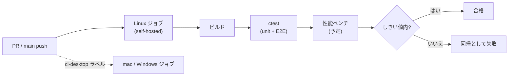

# 要求仕様書 11：品質・運用（非機能）

| 項目 | 内容 |
|---|---|
| ID 接頭辞 | `REQ-QOP` / `ACC-QOP` |
| 関心 | テスト・CI・性能計測・配備など、機能以外の品質と運用 |
| 版 | 1.0（2026-10-31） |

## 1. 概要

機能追加のたびに壊れていないか、遅くなっていないかを自動で確かめる仕組みと、実機へ載せる運用の要求。「載るが実用的な速度で動かない」退行を、実機に載せる前に捕まえることが狙い。

## 2. 全体仕様

| 領域 | 内容 |
|---|---|
| テスト | unit（QtTest）・E2E（Spix）を `ctest` で実行 |
| CI | self-hosted の Linux ランナーを主ゲートとし、mac / Windows は手動 or ラベル時 |
| 性能計測 | JSON 読込・描画構築・変数更新の時間を CI で計測 |
| 配備 | クロスビルドから実機配備までの手順 |

## 3. 用語定義

| 用語 | 意味 |
|---|---|
| ctest | CMake のテスト実行コマンド |
| E2E | アプリ全体を実際に動かして確認するテスト |
| self-hosted runner | 自前環境で動く GitHub Actions 実行機 |
| 回帰（リグレッション） | 以前できたことができなくなる、または遅くなること |

## 4. 前提条件・制約条件

- CI は private リポジトリ前提。public 化や fork PR 許可時は、self-hosted の利用条件を見直す。
- 実機（i.MX8MP）での検証はローカル専用で、CI からは届かない。
- 性能計測は、まず offscreen で測れる指標から始める。
- Web 環境では qtopcua が無く、OPC-UA 込みのテストは SKIP になる。

## 5. 動作仕様

## 6. エラー処理

| 状況 | 動作 |
|---|---|
| テスト失敗 | CI を赤にし、PR の変更起因かをログで切り分ける |
| 環境起因の SKIP（ライブラリ無し） | 終了コード 77 で SKIP とし、失敗とは区別する |
| ランナー停止 | ジョブが待機になるため、ランナー状態の確認手順を整備しておく |

## 7. セキュリティ要求

- self-hosted ランナーは信頼できるリポジトリ・ブランチに限定する。
- ランナーの sudo 権限は必要最小限（`apt-get` のみ）に保つ。

## 8. 性能要求

- 計測対象の指標：JSON 読込、描画構築、N 個の Widget での更新レイテンシ、起動時間。
- しきい値は計測の実績を取ってから決める（現時点では未決）。

## 9. 要件

| ID | 要件 | 優先度 | 状態 |
|---|---|---|---|
| REQ-QOP-001 | unit テスト（QtTest）を `ctest` で実行できる | P0 | 実装済 |
| REQ-QOP-002 | E2E テスト（Spix）を `ctest -L e2e` で実行できる | P0 | 実装済 |
| REQ-QOP-003 | PR と main push で Linux ジョブが自動実行される | P0 | 実装済 |
| REQ-QOP-004 | mac / Windows のビルドは手動実行か `ci-desktop` ラベルで実行できる | P1 | 実装済 |
| REQ-QOP-005 | 環境不足のテストは SKIP（終了コード 77）として失敗と区別する | P1 | 実装済 |
| REQ-QOP-006 | 主要処理の時間（JSON 読込・描画構築・更新レイテンシ・起動時間）を CI で計測し、しきい値超過を検知する | P1 | 未実装 |
| REQ-QOP-007 | 実機へのデプロイ（クロスビルド → 転送 → 起動）を半自動化する | P1 | 未実装（05 番 REQ-RUN-007 と同一） |
| REQ-QOP-008 | プロジェクト JSON の版数管理と旧版の自動移行 | P1 | 未実装（03 番 REQ-PRJ-007 と同一） |
| REQ-QOP-009 | Widget 数が大きい場合の限界を検知し、必要なら内部モデルを見直す | P2 | 未実装 |
| REQ-QOP-010 | アクセシビリティ（フォーカス順、スクリーンリーダ対応） | P2 | 未実装 |

## 10. 受入条件

| ID | 対応要件 | 条件 | 確認方法 |
|---|---|---|---|
| ACC-QOP-001 | REQ-QOP-001, 002 | `ctest` が緑になる（環境起因の SKIP を除く） | CI の Linux ジョブ |
| ACC-QOP-002 | REQ-QOP-003 | PR を作ると Linux ジョブが自動で走る | GitHub Actions の実行履歴 |
| ACC-QOP-003 | REQ-QOP-006 | しきい値を超える変更を入れると、ジョブが失敗する | 意図的な回帰での検証 |
| ACC-QOP-004 | REQ-QOP-004, 005 | mac / Windows ジョブを手動または `ci-desktop` ラベルで起動でき、OPC-UA 等のライブラリが無い環境のテストは終了コード 77 で SKIP になり失敗扱いにならない | CI 実行履歴 / `scripts/opcua/run-local-check.sh` の終了コード |

## 11. 未決事項・課題

| # | 内容 | 状態 |
|---|---|---|
| 1 | 性能しきい値の決め方（実測値の何倍か等） | 未決 |
| 2 | 実機側の FPS 計測方法 | 保留 |
| 3 | Widget 数の限界を判断する基準（REQ-QOP-009 の発動条件） | 未決 |
| 4 | 指標の切り出し先の計画書（`Docs/phase*-plan.md` で起票） | 未起票 |

## 12. 変更履歴

| 版 | 日付 | 内容 |
|---|---|---|
| 1.0 | 2026-10-31 | `requirements.md` のバックログ F から関心別に分割して新規作成 |
