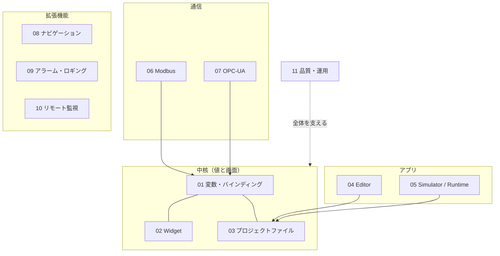

# 要求仕様書 索引

Atlas の要求仕様を、**関心（機能・目的）ごと** に分けた文書群。各仕様書は同じ 12 セクション構成で、要件は `REQ-xxx-nnn`、受入条件は `ACC-xxx-nnn` の表で管理する。

> 進捗の正本は [phase-status.md](../phase-status.md) と各計画書の「進捗」表。ここは「何を満たすべきか」を書く場所で、進捗表ではない。
> フェーズ計画は、ここから必要な要件を切り出して `Docs/phase*-plan.md` に起票する。

## 仕様書一覧

| # | 仕様書 | 関心 | ID 接頭辞 | 要件数 | 実装済 / 未実装 |
|---|---|---|---|---|---|
| 01 | [変数・バインディング・アクション](01-data-model.md) | 値の持ち方とつなぎ方 | REQ-DAT | 9 | 7 / 2 |
| 02 | [Widget](02-widgets.md) | 画面部品の種類・見た目・操作 | REQ-WGT | 12 | 8 / 4 |
| 03 | [プロジェクトファイル](03-project-format.md) | 保存形式・互換性・検証 | REQ-PRJ | 7 | 6 / 1 |
| 04 | [Editor](04-editor.md) | 作画ツールの編集機能 | REQ-EDT | 12 | 8 / 4 |
| 05 | [Simulator / Runtime](05-runtime-simulator.md) | 実行環境（PC・実機） | REQ-RUN | 9 | 6 / 3 |
| 06 | [Modbus TCP](06-modbus.md) | Modbus 通信 | REQ-MBS | 11 | 7 / 4 |
| 07 | [OPC-UA](07-opcua.md) | OPC-UA 通信（他プロトコルの P2 要件を含む） | REQ-OPC | 10 | 7 / 3 |
| 08 | [画面・ナビゲーション](08-navigation.md) | 複数画面・遷移 | REQ-NAV | 6 | 0 / 6 |
| 09 | [アラーム・ロギング](09-alarm-logging.md) | 異常通知・履歴・記録 | REQ-ALM | 6 | 0 / 6 |
| 10 | [リモート監視（VNC）](10-remote-monitoring.md) | 遠隔閲覧・操作 | REQ-RMT | 6 | 2 / 4 |
| 11 | [品質・運用](11-quality-ops.md) | テスト・CI・性能・配備 | REQ-QOP | 10 | 5 / 5 |

## 関心の分け方

## 運用ルール

- **件数表の凡例**：「実装済」は状態列が「実装済」で始まる要件（一部だけ実装済のものを含む）。「未実装」はそれ以外（実機での未実施 `未実施` を含む）。
- **受入条件（ACC）は、実装済の要件と、着手が決まった要件に付ける**。未着手の要件（P2 など）は、着手時に ACC を足す。
- **ID は欠番を詰めない・再利用しない**。要件をやめるときは状態を「廃止」にして行を残す。
- 新しい要件は該当仕様書の「要件」表に追記し、対応する受入条件（ACC）を同じ版で足す。
- 版が変わるたびに各仕様書末尾の「変更履歴」へ追記し、上の一覧の件数を更新する。
- どの仕様書にも当てはまらない関心が出たら、番号を続けて新しい仕様書を足す。
- 文書を足したら [DOCS-MAP.md](../../DOCS-MAP.md) も更新する。

## 旧 `requirements.md` との対応

| 旧セクション | 移行先 |
|---|---|
| Part 1-A Widget 種別 | 02 |
| Part 1-B 画面・ナビゲーション | 08 |
| Part 1-C データ / ロジック | 01・06・07・09 |
| Part 1-D 編集体験 | 04 |
| Part 1-E リモート監視 | 10 |
| Part 1-F 品質・運用 | 05・11 |
| Part 2 §2.0 / 2.1 / 2.2（float・Lamp・数値。変数型 `float` は実装で `real` になった） | 01・02 |
| Part 2 §2.3 Modbus（FR-MB / NFR-MB） | 06 |
