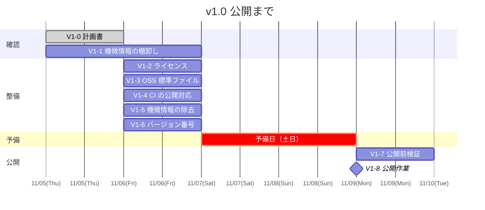
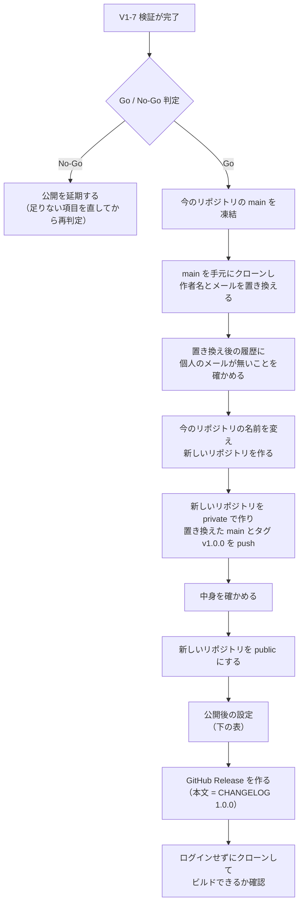

# v1.0 公開計画（OSS 化）

| 項目 | 内容 |
|---|---|
| 公開日 | **2026-11-09（月）** |
| 公開形態 | 作者メールを置き換えた履歴を**新しい public リポジトリ**（D9）に push し、タグ `v1.0.0` と GitHub Release を作る。今のリポジトリは private のまま残す |
| ライセンス | **MIT**（本リポジトリのコード。Qt など依存ライブラリはそれぞれのライセンスのまま） |
| 承認 | 2026-11-05 ユーザー指示（公開日・MIT を決定） |
| 状態 | 着手中 |

## 1. 目的と方針

v1.0 は「**今あるものを、安全に・使える形で公開する**」リリースにする。新しい機能は足さない。

- **機能凍結（2026-11-05 の下記マージの後〜11-09）**：新機能・リファクタリングの PR は出さない。マージしてよいのは本計画のタスクと、公開の妨げになる不具合の修正だけ。例外として、凍結前から開いていた #178（RF-E）・#179・#180（RF-G）・#181（DT-1）は 11/5 にユーザー指示で最新 main に合わせ、テストを通してからマージした（D3）。
- **リファクタリングは RF-E（Button / Label / SimpleButton）と RF-G まで v1.0 に含める**（11/5 にユーザー指示でマージ済み）。残り（RF-E の残り種別・RF-F）は v1.0 の後に必要なら再評価する（[refactoring-plan.md](refactoring-plan.md)）。
- **公開してから消すことはできない**：新しいリポジトリに載るのは git の全履歴だけだが、公開した瞬間に誰でも読めるようになる。後でファイルを消しても過去のコミットには残る。Issue・PR・Actions のログは今のリポジトリに private のまま残る。だから「機微情報の確認」と「CI の安全対策」は、公開前に必ず終わらせる（公開を止める条件にする）。

## 2. スケジュール

実働は **11/5（木）・11/6（金）・11/9（月）午前** の 3 日。土日（11/7・11/8）は予備日として計算に入れない。

| 日 | やること | 終わりの状態 |
|---|---|---|
| 11/5（木） | V1-0 計画書、V1-1 開始（全履歴スキャン） | 計画書がマージされ、スキャン結果が出ている |
| 11/6（金） | V1-1 の判断 → V1-2〜V1-6 | 公開に必要なファイルと CI 変更がすべて main に入っている |
| 11/7〜8（土日） | 予備日。遅れたタスクの回収のみ | — |
| 11/9（月）午前 | V1-7 検証 → Go / No-Go 判定 | 判定結果をユーザーが決める |
| 11/9（月）午後 | V1-8 公開作業 | public 化・タグ・Release が完了 |

## 3. タスク一覧

| Task | 内容 | 完了基準 | 環境 |
|---|---|---|---|
| **V1-0** | 本計画書の作成と進捗文書の同期 | 計画書が main に入る | Web 可 |
| **V1-1** | **機微情報の棚卸し**。現在のファイルと**全 git 履歴**を対象に、①秘密情報（トークン・鍵・パスワード）を `gitleaks` などで機械スキャン、②個人や自宅環境が分かる情報を grep（自宅 LAN の IP、Proxmox の接続先、Windows のユーザー名・ディスク構成、メールアドレスなど）、③コミットの作者名とメール（`git log --format='%an %ae' \| sort -u`）、④画像の目視（`Docs/screenshots/`。ファイル名に IP を含むものや、デスクトップに個人名が写ったものがないか）と `insights/` の利用レポート、⑤GitHub 上の Issue・PR の本文とコメント、Actions のログと artifact（不要なら削除）。結果を表にまとめ、**D4（履歴の扱い）** を決める | スキャン結果の一覧と、D4 の判断がこの計画書に書かれている | Web 可（全履歴の取得が必要。Web のクローンは shallow なので `git fetch --unshallow` してから） |
| **V1-2** | **ライセンス整備**。ルートに `LICENSE`（MIT・著作権者名と年）を置く。依存ライブラリのライセンスを `THIRD_PARTY_NOTICES.md` に一覧化（Qt 6 の各モジュール〔`find_package` と QML の `import` から洗い出す。Core / Gui / Qml / Quick / Network / SerialBus / OpcUa / Test / QuickTest、QtQuick.Controls / Dialogs など〕、Spix、AnyRPC、間接依存として open62541〔Qt OpcUa のバックエンド〕。テスト用 Python パッケージ〔asyncua など〕は「テスト時のみ」と分けて書く。**各ライセンス名は配布元で確認してから書く**）。著作権者名は D8 に従う。README の「ライセンス」節を「準備中」から書き換える | 3 ファイルが main に入る | Web 可 |
| **V1-3** | **OSS として最低限そろえるファイル**。`CONTRIBUTING.md`（ビルド・テスト・PR の出し方）、`SECURITY.md`（脆弱性は GitHub の非公開報告機能で受け付ける）、`CODE_OF_CONDUCT.md`（Contributor Covenant。連絡先欄には個人メールを書かず、GitHub の機能か公開用の窓口にする）、`CHANGELOG.md`（1.0.0 の内容 = Phase 1〜11 で実装した機能の要約）、`.github/` の Issue / PR テンプレート（短いもの）。CONTRIBUTING には「`.claude/settings.json` のフックは Claude Code 利用時に自動で動く」ことも一言書く。**CHANGELOG とテンプレートは最小限でよく、遅れたら公開後に足してよい** | ファイルが main に入る | Web 可 |
| **V1-4** | **CI の公開対応（公開を止める条件）**。いまの linux ジョブは自宅 Proxmox の self-hosted runner で動いており、public にすると**外部の人の PR が自宅のマシンでコードを実行できてしまう**。public リポジトリは GitHub 標準の runner が無料で使えるので、public のときは linux ジョブを `ubuntu-24.04` で動かす。private の今のリポジトリでは、公開までは自前の runner を使い続ける。desktop（macOS / Windows）ジョブを自動で回すかは D7 で決める。あわせて、実際の条件と食い違っている `ci.yml` のコメント（「main への push で走る」）も直す。**注意**：private のうちは Actions の無料枠が切れている可能性がある（2026-06 に実際に切れた）ので、標準 runner での緑は public 化の直後に確かめる。**`ci.yml` を直すだけでは足りない**：`pull_request` は PR 側で書き換えたワークフローで動く。runner が登録されていると、fork PR から `self-hosted` に書き戻せてしまう。だから新しいリポジトリには runner を登録しない。今のリポジトリの runner も撤去する（5 節） | linux ジョブが public では `ubuntu-24.04` を選ぶ。新しいリポジトリの runner 登録が 0 件。public 化の直後に linux ジョブが緑 | Web 可（runner の登録解除は V1-8 でユーザーが行う） |
| **V1-5** | **機微情報の除去と文書の整理**。V1-1 で見つかったものを現在のファイルから消す・一般化する（例：[dev-environment.md](../.claude/rules/dev-environment.md) の自宅環境の詳細〔ディスク構成・Proxmox・LAN〕、計画書中の LAN IP）。AI 向けの設定（`.claude/`・`AGENTS.md`・`CLAUDE.md`）と `branding/`（アイコンが自作か）を公開してよいか決める。`insights/` は削除する（11/5 決定）。ここで消すものは整理のためで、履歴に残っても問題ないものに限る。文書中の `github.com/hang-up33/hmi-platform/pull/N` へのリンクは、新しいリポジトリでは別の PR を指すので外す。README を外部の人向けに見直す。冒頭に英語の短い概要を足す。対象は「Qt6 が動く組込み Linux 向け」と書き、i.MX8M Plus EVK は「動作確認済みの実機」として書く。Claude Code で開発し、Codex でレビューしたことも一言書く | V1-1 の一覧の「対応要」がすべて対応済み | Web 可 |
| **V1-6** | **バージョン番号の付与**。ルート `CMakeLists.txt` の `project()` に `VERSION 1.0.0` を付け、`target_compile_definitions` で Editor / Simulator の `main.cpp` に渡して `QCoreApplication::setApplicationVersion` を呼ぶ（Runtime は Simulator のソースを共有するので Simulator 側の変更で足りる。`--version` で確認できるようにする） | ビルド成功・`ctest` 全緑・`--version` が `1.0.0` を返す | Web 可 |
| **V1-7** | **公開前検証**。新しいクローンから README の手順どおりにビルドし、`ctest` を全部通す（Linux は Web / CI、macOS と Windows はユーザーのローカル）。README のスクリーンショットとリンク切れを確認する。最後に V1-1 のスキャンを main に対してもう一度かける | 下の「Go / No-Go 判定」がすべて ✅ | Web + ローカル |
| **V1-8** | **公開作業**（ユーザーが行う。リポジトリ設定はユーザーの権限のため）。手順は 5 節 | public 化・タグ・Release が完了し、ログインしていない状態でクローンとビルドができる | ユーザー |

## 4. 決めること

| # | 内容 | 状態 |
|---|---|---|
| D1 | 公開日 | ✅ **11/9（月）**（11/5 決定） |
| D2 | ライセンス | ✅ **MIT**（11/5 決定） |
| D3 | リファクタリング RF-E | ✅ **v1.0 に含める**（11/5 に「v1.0 の後」から変更。#178・#180 をマージ済み。残り種別と RF-F は v1.0 の後） |
| D4 | **git 履歴の扱い** | ✅ **作者メールを置き換えた履歴を、新しい public リポジトリに push する**（11/5 決定）。V1-1 で、個人のメールアドレスが多数のコミットの作者情報に入っていると分かった。同じリポジトリで履歴を書き換えても、GitHub の PR が古いコミットを参照し続けて消せないため、リポジトリを分ける。今のリポジトリは private のまま残し、PR とレビューの記録はそちらに置いておく |
| D5 | **GitHub Issues を有効にするか** | ✅ **有効にする**（11/5 決定）（外部の人が不具合を報告する窓口として）。内部のタスク管理は今まで通り `Docs/` の計画書で行う。決めたら [Docs/agents/issue-tracker.md](agents/issue-tracker.md) と CLAUDE.md の「Issues を使わない」記述を合わせて直す。過去の Issue は今のリポジトリに残り、新しいリポジトリには引き継がれない |
| D6 | **ビルド済みバイナリを配るか** | 推奨：**v1.0 ではソースだけ**にする。バイナリを配ると Qt（LGPL）の再配布の条件を満たす作業が増えるため、v1.1 以降の候補にする |
| D7 | macOS / Windows の CI を自動にするか | ✅ **public リポジトリでは PR と main への push のたびに自動で回す**（11/5、推奨どおり）。private の今のリポジトリでは、これまでどおり手動とラベルのときだけ回す |
| D8 | `LICENSE` の著作権者名 | ✅ **ハンドル名 `hang-up33`**（11/5 決定） |
| D9 | 新旧リポジトリの名前 | ✅ **公開する新しいリポジトリは `hang-up33/hmi-platform`**（11/5 決定）。今のリポジトリは公開の直前に `hmi-platform-archive` へ名前を変え、公開後に Archive（読み取り専用）にする。公開後の開発は新しいリポジトリだけで行う |
| D10 | コミットメッセージの `Claude-Session:` 行 | ✅ **置き換えのときに消す**（11/5 決定）。PR 本文から入った「セッション URL だけの行」も消す |

## 5. 公開当日の手順（V1-8）

**履歴の置き換え**は `git filter-repo` で行う。対応表には個人のメールが入るので、リポジトリには置かない。

| 手順 | 内容 |
|---|---|
| 1 | 今のリポジトリの main だけを、新しい作業用ディレクトリにクローンする（`--single-branch`） |
| 2 | `--mailmap` で、作者とコミッターの名前とメールを置き換える |
| 3 | `--replace-message` で、コミットメッセージの `Co-authored-by:` 行のメールを置き換える。件名の `(#N)` も `(PR N)` に変える。そのままだと新しいリポジトリの別の PR に自動でリンクされるため。`Claude-Session:` 行と、セッション URL だけの行も消す（D10） |
| 4 | `git log --all --format='%an %ae %cn %ce %B'` と `git grep <メール> $(git rev-list --all)` で、個人のメールが残っていないことを確かめる |
| 5 | 置き換え後の main にタグ `v1.0.0` を打つ。新しいリポジトリを remote に足し、`git push <新> main v1.0.0` だけを送る。`--mirror` や `--all` は使わない |

**手元のクローンの付け替え**：今のリポジトリの名前を変えると、各マシン（Mac・Windows・WSL・Web セッション）のクローンの `origin` は、同じ名前の新しいリポジトリを指すようになる。そのまま古いブランチを push すると、置き換え前のコミットが公開側に入ってしまう。

- 古いクローンは `git remote set-url origin` で改名後のリポジトリに向け直す。
- 新しいリポジトリでの作業は、新しくクローンして始める。
- 各マシンで `git config user.email` を noreply アドレスにする。

**public にする前**に必ず行う：

| 設定 | 内容 |
|---|---|
| self-hosted runner | 新しいリポジトリには登録しない。今のリポジトリの runner は、**名前を変える前に** Settings → Actions → Runners から削除し、Proxmox の `gh-runner` CT を停止する。削除した後、今のリポジトリの linux ジョブは runner 待ちで止まるが、Archive にするので問題ない |
| Actions | 新しいリポジトリで「外部の人の fork PR はワークフロー実行に承認を要する」にする |
| レビュー用の GitHub App | 新しいリポジトリに Codex と CodeRabbit を入れ直す。ChatGPT Codex の Settings で連携先のリポジトリも変える |
| Claude Code on the Web | 環境が使うリポジトリを新しいリポジトリに変える |

**public にした後**に行う：

| 設定 | 内容 |
|---|---|
| CI | linux ジョブが標準 runner で緑になることを確かめる（V1-4 の完了基準） |
| ブランチ保護 | `main` への直接 push を禁止し、linux CI 緑を必須にする |
| セキュリティ | 非公開の脆弱性報告（Private vulnerability reporting）を有効にする |
| Issues | D5 の結果に合わせる |
| メール | アカウント設定で「個人メールを含む push を拒否する」を有効にする |
| 今のリポジトリ | Archive にする（読み取り専用になる。いつでも戻せる） |
| About | 説明文・トピック（`hmi` `qt6` `qml` `modbus` `opcua` `embedded` `yocto` `imx8mp`）を設定する |

### Go / No-Go 判定（11/9 午前）

**1 つでも ❌ なら公開しない。** 日付を守るより、機微情報や危険な CI を公開しないほうが大事。

| # | 条件 |
|---|---|
| 1 | V1-1 で見つかった項目がすべて「公開してよい」か「公開できない」に分けられ、「公開できない」ものが履歴にも現在のファイルにも残っていない（秘密情報は無効化済み）。D4・D8・D9・D10 が決まっている |
| 2 | `ci.yml` の linux ジョブが、public リポジトリでは `ubuntu-24.04` を選ぶ（V1-4）。ただしこの式は防御にならない。fork の PR はワークフローを書き換えられるため。防御は 2b |
| 2b | 新しいリポジトリの runner の登録が 0 件（5 節）。Settings → Actions → Runners で確かめる |
| 2c | 置き換え後の履歴に、個人のメールアドレスが 1 件も無い（5 節） |
| 3 | `LICENSE` と `THIRD_PARTY_NOTICES.md` が main にある（V1-2） |
| 4 | 新しいクローンから Linux / macOS / Windows でビルドでき、`ctest` が全部緑（V1-7） |
| 5 | README のライセンス節が書き換わっていて、手順どおりに動く |

## 6. v1.0 に含めないもの

| 項目 | 理由・扱い |
|---|---|
| 新機能（未承認の候補すべて） | 機能凍結のため。v1.0 の後に範囲を決めてから着手する |
| リファクタリング RF-E の残り種別（NumericField / Trend / Meter）/ RF-F | D3。v1.0 の後に必要なら再評価 |
| Modbus の MB-5（実 PLC 書込確認）/ MB-6（実機展開） | 実機作業でローカル専用。v1.0 では「既知の未確認事項」として CHANGELOG に書く |
| ビルド済みバイナリの配布 | D6。v1.1 以降の候補 |
| 契約→テスト→実装の導入 DT-2〜DT-6（[dbc-tdd-plan.md](dbc-tdd-plan.md)） | 機能凍結のため v1.0 の後。DT-1（計画とルール）だけマージ済み |
| ドキュメントの英訳 | README 冒頭の英語概要だけにする。全訳は v1.0 の後 |
| ソースファイルごとのライセンス表記（SPDX ヘッダ） | ルートの `LICENSE` で足りる。必要になったら後で足す |

## 7. 進捗

| Task | 状態 | PR | 備考 |
|---|---|---|---|
| V1-0 | ✅ 完了 | #184 | 本計画書 |
| V1-1 | ✅ 完了 | — | 秘密情報は 0 件。個人のメールがコミットの作者情報に入っていたため D4 を決めた。自宅 LAN の IP などは履歴に残っても問題ないと判断した。現在のファイルからは整理のため V1-5 で消す。11/5 に作業用のクローンで履歴の置き換えを試し、個人のメールが 0 件になることを確認した。具体的な値は公開リポジトリに書かない |
| V1-2 | ✅ 完了 | — | `LICENSE`（MIT・hang-up33）と `THIRD_PARTY_NOTICES.md` を追加。各ライセンスは配布元のページで確認した |
| V1-3 | ✅ 完了 | — | CONTRIBUTING・SECURITY・CODE_OF_CONDUCT（連絡先は GitHub の非公開の報告機能）・CHANGELOG・Issue と PR のテンプレートを追加。Issue での受付は D5 が前提 |
| V1-4 | ✅ 完了 | — | linux ジョブは public では `ubuntu-24.04`、private では自前の runner を選ぶ。desktop ジョブは public では毎回走る。標準 runner での緑は公開直後に確認する |
| V1-5 | ✅ 完了 | — | dev-environment の自宅環境の詳細（ディスク・runner の接続先・LAN の IP・MAC）を一般化。文書の PR リンクを外し、`insights/` を削除。README に英語の概要・対象環境・AI で開発したことを追記。AI 向け設定とアイコンは残す |
| V1-6 | ✅ 完了 | — | ルート CMake を `VERSION 1.0.0` にし、Editor / Simulator / Runtime が `--version` で版数を出す。契約 → テスト → 実装の順で進め、テスト 3 本を追加（Web の `ctest` 30/30 緑） |
| V1-7 | 未着手 | — | 11/9 午前 |
| V1-8 | 未着手 | — | 11/9 午後・ユーザー作業 |
