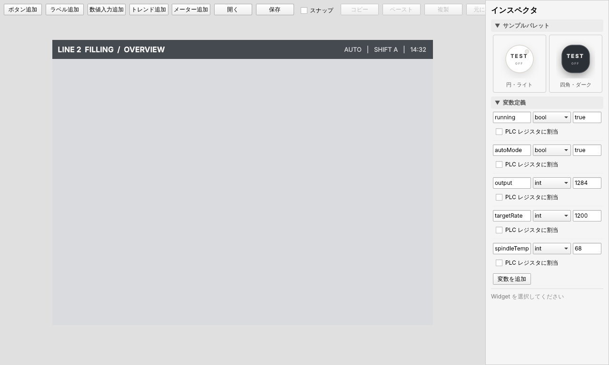
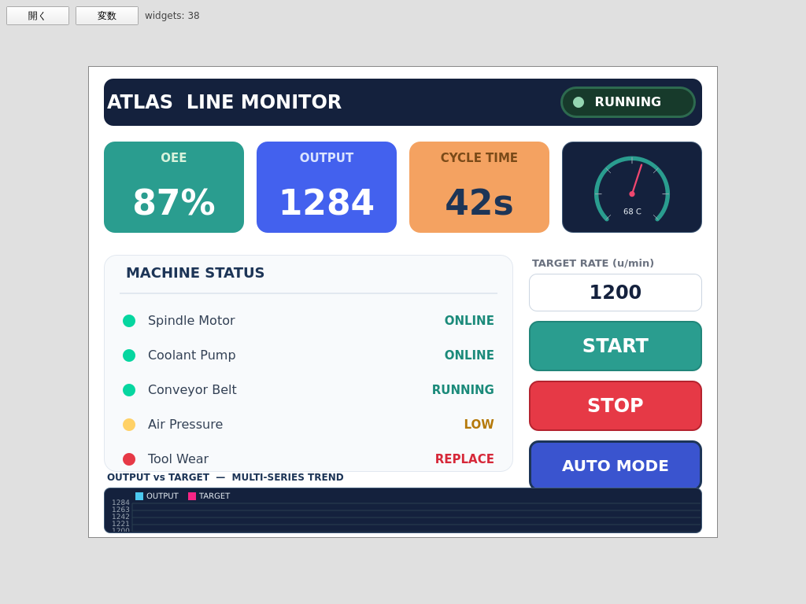
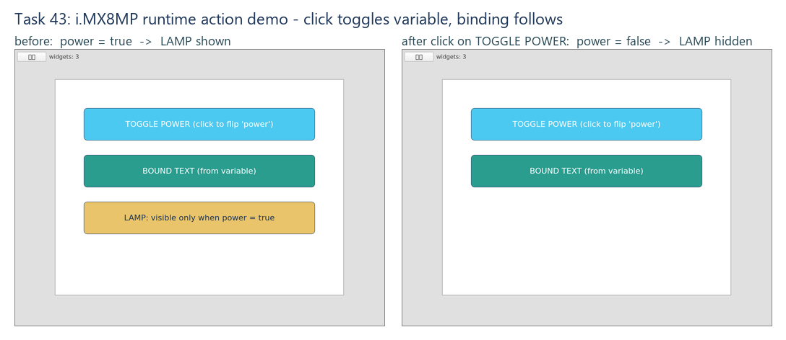

# hmi-platform（Atlas）

GUI で HMI 画面を作図 → JSON で保存 → PC でも組込み実機でも同じ画面を描画する、Qt6 ベースの HMI 開発プラットフォーム。

- **Editor** … マウスで Widget を並べて画面を作る作画ツール
- **Simulator** … 同じ JSON を PC で描画して動作確認する試験環境
- **Runtime** … その JSON を i.MX8M Plus などの実機（Yocto / Qt6）で描画するランタイム

> コードネーム **Atlas**（天空を支える巨神 ＝ Editor / Simulator / Runtime / Shared を束ねる基盤の意）。正式なリポジトリ名は `hmi-platform`。



Editor でライン監視ダッシュボードのショーケースを 1 画面に組み上げていく様子（ヘッダ → 状態ピル → KPI タイル → 機械ステータス盤 → 設定値入力 + 操作ボタン → ライブトレンド）。ツールバーで Widget 追加（ボタン / ラベル / 数値入力 / トレンド）・JSON 開く / 保存・編集補助（スナップ・コピペ・undo / redo）、右のインスペクタでスタイル・配置・アクション・バインディングを編集できる。**Phase 8（トレンドグラフ）でトレンド Widget（ライブ折れ線）を追加**：選択するとインスペクタに「Trend 詳細」セクションが現れ、表示点数（N）・Y 軸範囲（最小値 / 最大値・空欄で自動スケール）・線色・サンプル周期（ms）を編集できる（描画は QML Canvas 自描画で新 Qt モジュール依存なし。Editor では濃紺背景＋ダミー波形のプレビュー、実行時〔Simulator / Runtime〕は bind した変数の値をサンプルして折れ線描画。図はライン監視ダッシュボードのショーケース〔KPI タイル・機械ステータス・操作ボタン・設定値入力 + 下部に targetRate のライブトレンド〕で全 Widget 種別を 1 画面に同居させた例）。数値入力（NumericField）は変数の型（int / real）を引き継ぎ、インスペクタ「詳細」の範囲（最小値 / 最大値）で入力 clamp の境界を指定できる。**Phase 7（Modbus TCP）の変数パネル（ツールバー「変数」トグル）では各変数に「PLC レジスタに割当」を追加**：チェックすると接続先（ホスト / ポート / Unit ID）とレジスタ写像（レジスタ種別 coil/discrete/input/holding・アドレス・ポーリング間隔 ms）を編集でき、JSON に保存される。



Simulator（読み取り専用）。同じ JSON を描画し、変数・クリックアクション・バインディングも動く（ボタン操作や数値入力で変数が変わると、それを参照する Widget が追従）。図はライン監視ダッシュボードのショーケースで、下部の **トレンド Widget（ライブ折れ線）** が bind した変数 `targetRate` の値変化をライブサンプリングして折れ線描画している様子（NumericField〔TARGET RATE〕で値を変えると Trend が即追従する）。ツールバーの「変数」トグルで、実行時のタグ（変数）現在値をライブ表示するデバッグパネルを開ける。

## できること

- ドラッグ＆ドロップで Widget を配置・リサイズ・整列（複数選択・スナップ・コピペ・undo / redo）
- Widget 種別: **Button / Label / NumericField / Trend**（型分岐で順次拡張中）
- スタイル: 背景色 / 文字色 / フォント（名・サイズ・太字・斜体）/ テキスト配置 / ボーダー / 角丸 / 不透明度
- 状態とロジック: 変数ストア・クリックアクション・読み書きバインディング（入力で変数を書き、他 Widget が追従）
- 1 つの JSON を Editor / Simulator / 実機 Runtime で共有（`Shared/Schema` が唯一の真実）

## 必要要件

- Qt **6.8 以上**（macOS 14+ では Qt 6.7 以前は `AGL.framework` 不在でリンク不可）
- CMake **3.21 以上**、C++17 対応コンパイラ

## ビルドと起動

### macOS

```sh
brew install qt
cmake -S . -B build -DCMAKE_PREFIX_PATH=/opt/homebrew/opt/qt
cmake --build build
./build/Editor/hmi_editor.app/Contents/MacOS/hmi_editor
./build/Simulator/hmi_simulator.app/Contents/MacOS/hmi_simulator
```

### Windows（PowerShell）

Qt Online Installer で **Qt 6.11.0 MinGW 64-bit** kit（付属 MinGW / Ninja / CMake）を入れて:

```powershell
.\scripts\windows\build.ps1     # configure + build → build-mingw\ に出力
.\build-mingw\hmi_editor.exe
.\build-mingw\hmi_simulator.exe
```

新しいシェルからは `. .\scripts\windows\setup-env.ps1` で PATH を通す。Explorer から起動したい場合は `.\scripts\windows\deploy.ps1`（windeployqt で DLL 同梱）。ビルドの詳細・既知の罠は開発ノート [.claude/skills/qt6-build/SKILL.md](.claude/skills/qt6-build/SKILL.md) を参照。

### Simulator / Runtime に JSON を渡す

```sh
hmi_simulator --open path/to/project.json
hmi_runtime   --open path/to/project.json
```

## プロジェクトファイル形式

`Shared/Schema` を唯一の真実とし、project / screen / widget を JSON で表す:

```json
{
  "project": "Sample",
  "screens": [
    {
      "name": "Main",
      "widgets": [
        { "id": "btn001", "type": "Button", "x": 100, "y": 50,
          "width": 120, "height": 40, "text": "Start",
          "backgroundColor": "#e63946", "textColor": "#ffffff", "fontSize": 22 }
      ]
    }
  ]
}
```

- 必須: `id` / `type` / `width` / `height`
- `x` / `y` は省略可（欠落時は `0` として扱う）
- 色・フォント等のスタイル属性は省略可（省略時は Widget の既定外観にフォールバック＝旧 JSON も後方互換で描画）

## フォルダ構成

```text
hmi-platform/
├─ Editor/        作画アプリ（Qt6 + QML）
├─ Simulator/     試験アプリ（読み取り専用）
├─ Runtime/       実機向け。Simulator/ のソースを共有して hmi_runtime を生成
├─ Shared/
│   ├─ Schema/    JSON スキーマ・C++ データモデル（唯一の真実）
│   └─ Widgets/   共通 QML Widget（Button / Label / NumericField / Trend …）
├─ Docs/          設計・開発ドキュメント
└─ CMakeLists.txt ルート CMake
```

## 実機（i.MX8M Plus / Yocto）

`hmi_runtime` だけを aarch64 にクロスビルドして実機へ転送・起動する（PC ビルドには影響しない）:

```sh
./scripts/yocto/cross-build.sh          # WSL2 内。meta-toolchain-qt6 の Qt6 クロス SDK を使用
scp -O ~/build-yocto/Runtime/hmi_runtime root@<board-ip>:/tmp/hmi_runtime
```

SDK 生成・実機 scp・起動（weston）・キャプチャの全手順と罠は [scripts/yocto/README.md](scripts/yocto/README.md) を参照。下は i.MX8MP 実機（scarthgap / Qt6 / weston）で Editor 由来の JSON を描画した様子:



## ステータスとドキュメント

- **現在地**: **Phase 9 / OPC-UA クライアント着手中**（2026-06-20 選択）。Modbus（Phase 7）と同じ「変数ソース」抽象に proto 2 本目（OPC-UA）を足し、`hmi_simulator`/`hmi_runtime` が **OPC-UA クライアント**としてサーバのノードを MonitoredItem 購読・読み書きし、既存の変数ストア + binding 経路へ流す（通信は Simulator 共有ソース＝Runtime 継承・Editor は `Qt6::OpcUa` 非リンク）。**OP-1〔変数ソース Schema 拡張〔proto 2 本目〕+ Editor 編集 UI〕完了（PR #140）／OP-2〔PC 読込/購読〕／OP-3〔実サーバ読込確認：test_server.py による Counter/Temperature/Running/Setpoint 追従証跡〕／OP-4〔書込 + 接続状態 + 自動再接続〕完了**（macOS ローカル：unit 13/13 + asyncua E2E 緑）。**🔴 Qt OpcUa は aqtinstall 非同梱＝Web/CI 不可だが、macOS は qtopcua を Homebrew Qt にソースビルドでマージして解消済み**（手順は [.claude/rules/dev-environment.md](.claude/rules/dev-environment.md)。Windows 母艦 / 実機 rootfs は別途未導入）。**次＝OP-5〔実サーバ書込確認〕/ OP-6〔実機 Yocto〕＝ローカル（実サーバ / 実機要）。** 進捗の正本は [Docs/phase9-opcua-plan.md](Docs/phase9-opcua-plan.md)。直近完了は Phase 8-B（Trend 拡張・複数系列 + 軸/凡例・PR #138 クローズ）。履歴永続化・Gauge / Toggle・NumericField の step/decimals/unit は引き続き未承認。
  - **Phase 8 / トレンドグラフ（単系列ライブ折れ線）完了**（2026-06-16 承認・PR #127〜#131）。新 Widget 種別「Trend」を横展開テンプレに乗せ、`Canvas` 自描画で実機にそのまま載る。進捗の正本は [Docs/phase8-trend-plan.md](Docs/phase8-trend-plan.md)。
  - **Phase 7 / Modbus TCP** は MB-1〜MB-4（書込 + 接続状態 + 自動再接続・PR #119/#121/#122）完了。残る MB-5〔実 PLC 書込確認〕/ MB-6〔実機 Yocto〕はローカル専用で Web 不可。進捗の正本は [Docs/phase7-modbus-plan.md](Docs/phase7-modbus-plan.md)。
- 開発の時系列（各タスクの目的 / PR / 学び）: [Docs/development-history.md](Docs/development-history.md)
- 各フェーズの計画と進捗表（正本）: [Docs/](Docs/) の `phase*-plan.md`
- 開発ガイド・ビルドの罠・ルール: [CLAUDE.md](CLAUDE.md)

## ライセンス

（未定）
