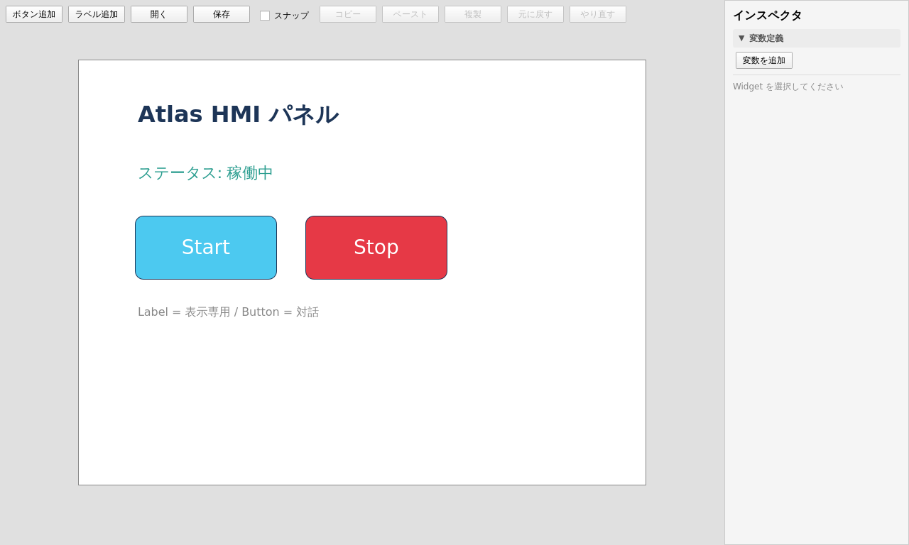
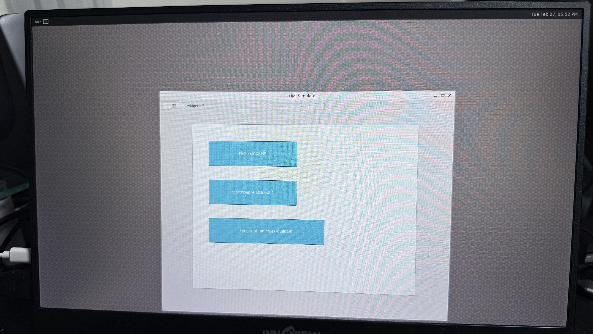
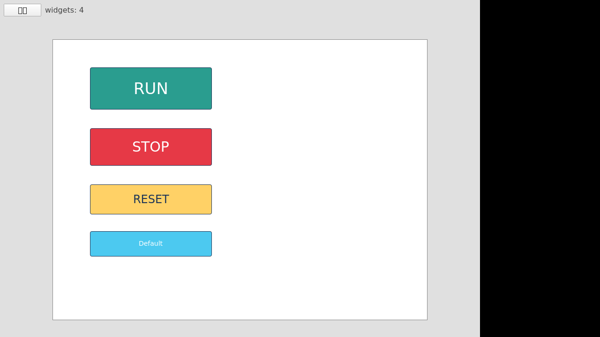

# hmi-platform

> **コードネーム: Atlas（アトラス）** — 開発時の通称（プロジェクト全体のブランド別名）。Editor / Simulator / Runtime / Shared を束ねて支える基盤、という意味でギリシャ神話の天空を支える巨神アトラスにちなむ。正式なリポジトリ名は `hmi-platform` のまま（リネームはしない）。

Yocto / i.MX8M Plus 向け Qt6 HMI ランタイムを対象に、HMI 作画ツール（Editor）・PC 試験環境（Simulator）・実機ランタイム（Runtime）・JSON スキーマ（Shared/Schema）・共有 Widget（Shared/Widgets）を統合した開発基盤。

## スクリーンショット



Editor の現状画面（Phase 4 拡張 + インスペクタ UX 改善 + Phase 5 横展開 / Task 25〜48）。上部ツールバーは Widget 追加・JSON 入出力（**`ボタン追加` / `ラベル追加`**〔Task 48 で種別を選んで追加〕 / `開く` / `保存`）に加え、**グリッドスナップ（`スナップ`）・コピー / ペースト / 複製・元に戻す / やり直す（undo-redo）** を備える。キャンバスは **Phase 5 / Task 47〜48 で追加した Label（表示専用・背景透明・枠なし）** と従来の Button を型分岐で描き分ける（図の `Atlas HMI パネル`・`ステータス: 稼働中`・下部ヒントが Label、`Start` / `Stop` が色・角丸の効いた Button）。右側インスペクタは **Task 44〜45 で折りたたみ可能なセクション**（**変数定義** / 基本 / 文字 / 背景・枠 / 状態 / 動作 / 詳細）に整理し、分かりづらいラベルを言い換え（`チェック可能`→`トグルボタンにする`・`チェック状態`→`初期状態をオン`・`Tag`→`外部タグ`）＋主要項目に hover ツールチップを付けた。**Task 46 で色入力（背景色 / 文字色 / ボーダー色）の隣に現在色スウォッチを追加**し、クリックでカラーダイアログから色を選べる（hex 手入力も併用可。Widget 選択時に表示され、スウォッチの単独証跡は `Docs/screenshots/task-46-color-swatch.png`）。Widget 選択時に **text・座標・サイズ（基本）/ フォント〔名・サイズ・太字・斜体〕・文字色・テキスト配置（文字）/ 背景色・ボーダー色 / 幅・角丸・不透明度（背景・枠）/ 有効・トグル設定（状態）/ クリックアクション・バインディング（動作）/ ID・外部タグ（詳細・既定で折りたたみ）** を編集・削除できる（複数選択時は整列・分布・一括削除）。**Task 48 で選択 Widget の種別に応じてインスペクタの無関係セクションを隠す**（Label は状態 / クリックアクション / ボーダー・角丸を非表示、binding 編集は残す）。


Simulator（読み取り専用）で同じ JSON を描画した様子。Editor で付けた **背景色 / 文字色 / フォント / テキスト配置 / 不透明度 / ボーダー / 角丸** がそのまま反映される。さらに Task 41 で **変数・クリックアクション・バインディングを実行**できるようになり、ボタンクリックで変数を更新 → `visible` / `text` / 色などのバインディングが追従する（読み取り専用アプリが初めて「動く」）。Runtime はこの Simulator のソースを共有する。



`hmi_runtime`（Simulator のソース共有・aarch64 クロスビルド）を **i.MX8MP 実機（scarthgap / Qt6 6.8.1 / weston）** で起動し、Editor 由来の JSON を描画した様子（Phase 3-B / Task 24）。



Phase 4 の styled JSON（背景色 / 文字色 / 文字サイズ）を **i.MX8MP 実機**の `hmi_runtime` で描画した様子（Task 30）。HDMI 未接続のため Qt 内蔵 VNC platform に描画し digital capture した（右の黒帯は VNC framebuffer とウィンドウサイズ差、日本語ラベルが □ なのは実機 image にフォント無しのため）。スタイル属性が実機まで貫通していることの証跡。


Phase 4 拡張の **変数・クリックアクション・バインディング**を **i.MX8MP 実機**で動かした様子（Task 43）。`TOGGLE POWER` ボタンに VNC ポインタクリックを送ると `toggleVariable("power")` が実行され、バインディング（`visible` ← `power`）に追従して `LAMP` が消える（左=クリック前 / 右=クリック後）。静的描画だけでなく **実機上で「動く HMI」** になっていることの証跡（撮影は新ヘルパー `scripts/yocto/vnc-click-capture.py`）。

## 成果物

| モジュール | 役割 |
|---|---|
| **Editor** | HMI 作画ツール（Qt6 + QML） |
| **Simulator** | PC 上での HMI 試験環境（Qt6 + QML） |
| **Runtime** | i.MX8MP / Yocto 実機向けランタイム。**Simulator のソースを共有**して `hmi_runtime` バイナリを生成（Phase 3-B / Task 22 以降、計画は [Docs/phase3b-runtime-plan.md](Docs/phase3b-runtime-plan.md)） |
| **Shared/Schema** | プロジェクト JSON スキーマ / C++ データモデル（唯一の真実） |
| **Shared/Widgets** | 共通 QML Widget（Button / Label 等） |

## 技術スタック

- **言語 / フレームワーク**: Qt 6 (Qt Quick / QML), C++17
- **ビルド**: CMake (≥ 3.21)
- **ホスト OS（開発）**: macOS / Windows（共に動作確認済み）
  - **Claude Code on the web は条件付きで対応**（PC ビルド・ユニット + E2E は可。環境ネットワークを `Full` にして Qt を `aqtinstall` で導入する前提。Yocto SDK クロスビルド / i.MX8MP 実機描画は不可。詳細は [CLAUDE.md](CLAUDE.md) の「Claude Code on the web（条件付きで PC ビルド・テスト可。実機は不可）」節 / [Docs/claude-web-dev.md](Docs/claude-web-dev.md)）。
- **ターゲット OS（最終）**: Yocto on i.MX8MP

## フォルダ構成

```
hmi-platform/
├─ Editor/              HMI Editor アプリ
│   ├─ CMakeLists.txt
│   ├─ src/
│   └─ qml/
├─ Simulator/           HMI Simulator アプリ
│   ├─ CMakeLists.txt
│   ├─ src/
│   └─ qml/
├─ Runtime/             i.MX8MP / Yocto 実機向け。CMake glue のみ（ソースは Simulator/ を共有、Phase 3-B / Task 22 以降）
├─ Shared/
│   ├─ Schema/          JSON スキーマ・C++ データモデル
│   │   ├─ CMakeLists.txt
│   │   ├─ include/
│   │   └─ src/
│   └─ Widgets/         共通 QML Widget モジュール
│       ├─ CMakeLists.txt
│       └─ qml/
├─ Docs/
└─ CMakeLists.txt       ルート CMake
```

## 前提

- Qt 6.8 以上（macOS 14+ では Qt 6.7 以前は `AGL.framework` 不在によりリンクエラーになるため）
- CMake 3.21 以上
- C++17 対応コンパイラ

macOS で Homebrew Qt を使う場合：

```sh
brew install qt
```

Windows は Qt Online Installer から **Qt 6.11.0 MinGW 64-bit** kit と付属 MinGW 13.1 / Ninja / CMake をインストール（既定パス `C:\Qt`）。

## ビルド

### macOS

```sh
cmake -S . -B build -DCMAKE_PREFIX_PATH=/opt/homebrew/opt/qt
cmake --build build
```

`CMAKE_PREFIX_PATH` は環境に合わせて変更してください（例: `~/Qt/6.8.0/macos`）。

### Windows（PowerShell）

リポジトリ同梱の補助スクリプトを使うのが最も簡単：

```powershell
# configure + build を一発実行（build-mingw/ に出力）
.\scripts\windows\build.ps1

# 個別ターゲットや再 configure
.\scripts\windows\build.ps1 -Target hmi_editor
.\scripts\windows\build.ps1 -Reconfigure
```

手動で実行する場合は、まず PATH を整える（dot-source）：

```powershell
. .\scripts\windows\setup-env.ps1
cmake -S . -B build-mingw -G Ninja `
  -DCMAKE_PREFIX_PATH=C:\Qt\6.11.0\mingw_64 `
  -DCMAKE_CXX_COMPILER=C:/Qt/Tools/mingw1310_64/bin/g++.exe
cmake --build build-mingw
```

詳細・罠は [.claude/skills/qt6-build/SKILL.md](.claude/skills/qt6-build/SKILL.md) を参照。

### Yocto クロスビルド（i.MX8MP 実機向け / Phase 3-B）

`hmi_runtime` だけを aarch64（Yocto scarthgap / Qt6）にクロスビルドする。**WSL2 内で実行**し、上記ホストビルドには影響しない。

```sh
# meta-toolchain-qt6 で生成した Qt6 クロス SDK を ~/qt6-sdk に install 済みとして
./scripts/yocto/cross-build.sh
# → ~/build-yocto/Runtime/hmi_runtime（ARM aarch64 ELF）
```

SDK 生成（新 BSP の image+SDK ビルド）から実機 scp 起動までの手順は [scripts/yocto/README.md](scripts/yocto/README.md) を参照。

## 起動

### macOS

```sh
./build/Editor/hmi_editor.app/Contents/MacOS/hmi_editor
./build/Simulator/hmi_simulator.app/Contents/MacOS/hmi_simulator
# Runtime PC ビルド（Simulator のソース共有、Phase 3-B Task 22〜）
./build/Runtime/hmi_runtime.app/Contents/MacOS/hmi_runtime --open <path/to/project.json>
```

### Windows

`build.ps1` で通すと PATH に Qt の bin が乗るため、そのまま実行できる：

```powershell
.\build-mingw\hmi_editor.exe
.\build-mingw\hmi_simulator.exe
# Runtime PC ビルド（Simulator のソース共有、Phase 3-B Task 22〜）
.\build-mingw\hmi_runtime.exe --open <path\to\project.json>
```

新しいシェルから起動する場合は `. .\scripts\windows\setup-env.ps1` で PATH を通してから実行。

Explorer からダブルクリックで起動したい（「Qt の DLL が見つからない」を解消したい）場合は、`windeployqt` で DLL / プラグイン / QML を exe の隣へ同梱する：

```powershell
.\scripts\windows\deploy.ps1            # hmi_editor + hmi_simulator 両方
.\scripts\windows\build.ps1 -Deploy     # build と同時に実行する場合
```

`build-mingw` をクリーンビルドで作り直した後は DLL も消えるため再実行が必要。

3 つの exe（hmi_editor / hmi_simulator / hmi_runtime）には **Atlas ブランドアイコン**（`branding/atlas.ico`）が埋め込まれ、Explorer・タスクバー・ウィンドウタイトルバーに表示される（windeployqt とは独立に exe 自身へ焼き込まれる）。アイコンを変えたいときは `scripts\windows\generate-icon.ps1` を編集・再実行して `.ico` を再生成する（外部ツール不要）。

### 実機（i.MX8MP）で描画

Editor で作った画面（JSON）を実機の `hmi_runtime` で描画するまでの流れ（Phase 3-B / Task 24 で確立）。クロス SDK の生成は上記「ビルド > Yocto クロスビルド」節を、IP の引き方・キャプチャ・転送の罠の詳細は [scripts/yocto/README.md](scripts/yocto/README.md) と [.claude/rules/dev-environment.md](.claude/rules/dev-environment.md) を参照。

1. **Editor で画面を作って保存** — `hmi_editor` で Widget を配置・スタイル編集し、ツールバーの `保存` で `project.json` を書き出す。
2. **`hmi_runtime` を aarch64 にクロスビルド**（WSL2 内）— `./scripts/yocto/cross-build.sh` → `~/build-yocto/Runtime/hmi_runtime`（ARM aarch64 ELF）。
3. **実機へ転送** — 実機 sshd は socket-activated のため scp は **`-O`** 必須（新しい OpenSSH の SFTP 既定を回避）。実機側で事前に `passwd` 設定が要る。Windows 母艦から link-local 直結で送る（実機 IP は mDNS `imx8mp-lpddr4-evk.local` でも引ける）：

   ```sh
   scp -O ~/build-yocto/Runtime/hmi_runtime root@<board-ip>:/tmp/hmi_runtime
   scp -O project.json                      root@<board-ip>:/tmp/project.json
   ```

4. **実機 weston 上で起動** — boot は microSD（SW4=0011、0010=eMMC）。weston は root（uid 0）で動作するので Wayland 環境変数を通してから起動する：

   ```sh
   export XDG_RUNTIME_DIR=/run/user/0
   export WAYLAND_DISPLAY=wayland-1
   export QT_QPA_PLATFORM=wayland
   chmod +x /tmp/hmi_runtime
   /tmp/hmi_runtime --open /tmp/project.json
   ```

成功すると weston 上に「HMI Simulator」ウィンドウが出て、Editor で付けた色・フォント・ボーダー・角丸・変数バインディングがそのまま描画される（証跡: [Docs/screenshots/task-24-runtime-imx.jpg](Docs/screenshots/task-24-runtime-imx.jpg)）。HDMI 未接続で物理モニタ無しに撮りたい場合は Qt 内蔵 VNC platform（`QT_QPA_PLATFORM='vnc:size=1280x720'`）で起動 → 母艦から `scripts/yocto/vnc-capture.py` で digital capture する（手順・罠は [scripts/yocto/README.md](scripts/yocto/README.md)）。実機 image には日本語フォントが無いため日本語ラベルは □ になる（描画自体は正常）。

## フェーズ進捗

Phase 1 / MVP、Phase 2 / テスト基盤導入、Phase 3-A / E2E テスト導入、**Phase 3-B / Runtime（Task 22〜24）まで全タスク完了**。新 BSP（scarthgap）で Qt6 入り実機 image と Qt6 クロス SDK を生成し、`hmi_runtime` を aarch64 にクロスビルド → **i.MX8MP 実機（weston / Wayland）で Editor 由来の JSON を描画**することを実機で確認済み。**Phase 4 / Button 縦スライス（Task 25〜32）も完了** — Widget 種別を横に増やす前に Button 1 つを全レイヤで深く作り込み「Widget 追加テンプレ」を確立した（選択・インスペクタ・リサイズ・削除・スタイル属性〔色・フォント・ボーダー・角丸〕の Schema 拡張）。`0` が正当値の数値プロパティを `-1` センチネルで optional 化、E2E に style / border / radius round-trip を追加し、macOS `ctest`（unit 8 + e2e 5 = 13/13）緑を確認した（旧 Phase 4〔Task 25〜30〕＋旧 Phase 5〔Task 31〜32〕を 1 本の Button 縦スライスに統合）。続く **Phase 4 拡張（Task 33〜43）も完了** — ①静的スタイルの続き（フォント詳細 / 配置 / opacity）→②編集体験の強化（グリッドスナップ / 複数選択・整列 / コピペ / undo-redo）→③状態 / アクション（変数ストア + クリックアクション + 状態別スタイル）で Button をさらに深く作り込み、**Task 43 の実機（i.MX8MP）アクション動作撮影も完了**するところまで到達した（**Task 33〜43 の一覧は下記「フェーズ進捗」表を参照**）。続いて **インスペクタ UX 改善（Task 44〜45）完了** — 横展開で同じ散らかりが各 Widget へ波及する前に、テンプレ＝右側インスペクタを折りたたみセクションに整理し分かりづらいラベルを言い換えた（PR #94）。**ここから Phase 5 / 横展開（新 Widget 種別）に着手** — 最初の Widget を **Label（文字表示）** と定めて計画を起票し（[Docs/phase5-widget-expansion-plan.md](Docs/phase5-widget-expansion-plan.md)、Task 47〜49）、Button の縦スライス資産を再利用しつつ **delegate の「型分岐の足場」** を導入する（Label は既存スキーマで足りるため **Schema / C++ ブリッジは無改変**、表示専用で binding のみ・action は持たない）。**Task 47（型分岐の足場 + HmiLabel 描画）完了** — `HmiLabel.qml`（表示専用・resolved\* フォールバック・選択用 clicked relay）を新設し、Editor / Simulator の delegate に `type` 分岐（Loader + inline Component の 2 分岐）を入れて `type:"Label"` を HmiLabel で描けるようにした。**続く Task 48（Editor で Label 作成 + インスペクタの型対応）も完了** — ツールバーに「ラベル追加」を足し（`addWidget(type)` へ一般化）、選択 Widget の種別に応じてインスペクタの無関係セクション（Label は状態 / クリックアクション / ボーダー・角丸）を隠す（binding 編集は残す。objectName・Schema 不変で `visible` 切替のみ）。Web `ctest` unit 10 + e2e 6 = 16/16 緑。次は Task 49（Label round-trip + binding + E2E + simulator.png）。

> 各タスクで何をしたか・どの PR で入ったか・何を学んだかの **時系列まとめ** は [Docs/development-history.md](Docs/development-history.md) を参照。第三者への説明用。
>
> 開発環境の現状（ホスト構成・ディスク事情・WSL/Yocto ビルド環境・実機 i.MX8MP の状態）は [.claude/rules/dev-environment.md](.claude/rules/dev-environment.md) に集約。複数マシン（macOS / Windows 母艦 + WSL2）を跨いで参照するためのメモ（`.claude/rules/` は git 共有＋Claude Code が自動読込）。

### Phase 1: MVP（Editor / Simulator の作画 → 保存 → 読込）

詳細は [Docs/phase1-mvp-plan.md](Docs/phase1-mvp-plan.md)（Phase 2 以降の体裁に合わせた事後整理）。

| # | タスク | 状態 |
|---|---|---|
| 1 | Qt6 プロジェクト作成 | ✅ 完了 |
| 2 | キャンバス表示 | ✅ 完了 |
| 3 | Widget データ構造定義 | ✅ 完了 |
| 4 | Button 配置 | ✅ 完了 |
| 5 | ドラッグ | ✅ 完了 |
| 6 | JSON 保存 | ✅ 完了 |
| 7 | JSON 読込 | ✅ 完了 |
| 8 | Simulator 表示 | ✅ 完了 |

### Phase 2: テスト基盤導入

詳細は [Docs/phase2-testing-plan.md](Docs/phase2-testing-plan.md)。

| # | タスク | 状態 |
|---|---|---|
| 9 | Qt Test 基盤構築 | ✅ 完了 |
| 10 | Schema JSON I/O テスト | ✅ 完了 |
| 11 | ファイル I/O テスト（ProjectIo / ProjectLoader） | ✅ 完了 |
| 12 | Qt Quick Test 基盤構築 | ✅ 完了 |
| 13 | 共有 Widget テスト | ✅ 完了 |
| 14 | Editor QML テスト | ✅ 完了 |
| 15 | CI 整備（GitHub Actions） | ✅ 完了 |

### Phase 3-A: E2E テスト導入

詳細は [Docs/phase3-e2e-plan.md](Docs/phase3-e2e-plan.md)。E2E フレームワークに **Spix（OSS / MIT）** を採用。

| # | タスク | 状態 |
|---|---|---|
| 16 | Spix 取り込み + Editor / Simulator 統合 | ✅ 完了 |
| 17 | E2E ハーネス雛形 + smoke 1 件 | ✅ 完了 |
| 18 | Editor 配置 + 座標反映 E2E | ✅ 完了 |
| 19 | JSON 保存 → 読込ループ E2E | ✅ 完了 |
| 20 | Simulator 表示 E2E | ✅ 完了 |
| 21 | E2E ジョブを GitHub Actions に追加 | ✅ 完了 |

### Phase 3-B: Runtime / i.MX8MP 対応

詳細は [Docs/phase3b-runtime-plan.md](Docs/phase3b-runtime-plan.md)。**Simulator と同じ JSON 描画機能を i.MX8MP 実機で動かす Runtime** を導入。Simulator/ のソースを共有して `hmi_runtime` バイナリを Yocto SDK でクロスビルド → 実機 scp。3 バイナリ構成（hmi_editor / hmi_simulator / hmi_runtime）を維持。

| # | タスク | 状態 |
|---|---|---|
| 22 | Runtime/ で Simulator のソースを再利用して hmi_runtime バイナリを追加 | ✅ 完了 |
| 23 | Yocto SDK で hmi_runtime をクロスビルド | ✅ 完了 |
| 24 | i.MX8MP 実機で hmi_runtime を起動し JSON 描画 | ✅ 完了 |

### Phase 4: Button 縦スライス（Widget 追加テンプレの確立 / スタイル + ボーダー・角丸）

詳細は [Docs/phase4-button-slice-plan.md](Docs/phase4-button-slice-plan.md)。Widget 種別を横に増やす前に、Button 1 つを全レイヤ（Schema→Widgets→Editor→Simulator→Runtime→実機）で深く作り込み、後続の全 Widget 追加に流用できる **選択 + インスペクタ** と **Schema スタイル拡張の手順** を確立する。前半（Task 25〜30）で選択・編集 UI とスタイル属性（色・フォント）を、後半（Task 31〜32）で同じテンプレを再実行してボーダー＋角丸（`0` が正当値の数値は `-1` センチネル）を足した。

> 旧 Phase 4（Task 25〜30）と旧 Phase 5（Task 31〜32）は、どちらも「Button を全レイヤで深く仕上げる縦スライス」で連続するため **1 本の Phase 4 に統合**した（2026-06-07）。

| # | タスク | 状態 |
|---|---|---|
| 25 | 選択モデル + 選択枠（Editor） | ✅ 完了 |
| 26 | インスペクタ + text/tag 編集（Editor） | ✅ 完了 |
| 27 | 座標/サイズ数値編集 + ハンドルリサイズ（Editor） | ✅ 完了 |
| 28 | スタイル属性追加（背景色/文字色/文字サイズ：Schema + HmiButton + Simulator/Runtime）★ | ✅ 完了 |
| 29 | インスペクタにスタイル編集 + 削除（Editor） | ✅ 完了 |
| 30 | テスト/E2E 拡充 + 実機 styled 描画（全環境） | ✅ 完了（QML テスト + E2E コード + スクショ + 実機 styled 描画 + **macOS `ctest -L e2e` 緑（`e2e_style_roundtrip` 含む 5/5）**） |
| 31 | ボーダー＋角丸を全レイヤ貫通（Schema + HmiButton + Simulator/Runtime + インスペクタ）★ | ✅ 完了（PR #64。`0`=ボーダーなし／`-1`=未指定／キー欠落時省略の境界 unit テスト + インスペクタ ScrollView 化 + Editor/Simulator スクショ） |
| 32 | E2E 拡充（border/radius）+ 実機 styled 描画更新（全環境） | ✅ 完了（PR #66。`e2e_style_roundtrip` を border/radius まで拡張〔数値は `int(float())`、border 色は既定 `#1d3557` と別値〕。**macOS `ctest` で unit 8 + e2e 5 = 13/13 緑**。README スクショを border 入りに更新。実機 border 再撮影は任意のため省略） |

**Phase 4 拡張（Task 33〜43・2026-06-07 承認 / 完了）** — Button をさらに深く作り込む 3 トラック。詳細は [Docs/phase4-button-slice-plan.md](Docs/phase4-button-slice-plan.md)「Phase 4 拡張」。

| # | タスク | 状態 |
|---|---|---|
| 33 | フォント詳細（bold/italic/family）全レイヤ貫通 + インスペクタ（A） | ✅ 完了（bool は既定値差分で省略書き出し・新インスペクタ UI〔CheckBox / ComboBox〕・空 family は `Qt.application.font.family` にフォールバック〔空文字直結は文字化けするため〕） |
| 34 | テキスト配置（hAlign/vAlign）+ 不透明度（opacity）全レイヤ貫通（A） | ✅ 完了（配置は **enum 文字列**を `Text` の alignment enum へマップ〔Text を `anchors.fill` 化〕・opacity は **real センチネル `-1.0`** で公開入力を `widgetOpacity` に統一〔`Item.opacity` 組込み衝突回避〕・新インスペクタ UI〔ComboBox ×2 + SpinBox〕） |
| 35 | グリッドスナップ + スナップ ON/OFF トグル（Editor）（C） | ✅ 完了（Canvas に 8px グリッド線描画 + 移動/リサイズ確定座標の格子吸着・ツールバーの「スナップ」CheckBox で ON/OFF。**JSON 非保存**＝編集補助のみ） |
| 36 | 複数選択 + 一括移動・整列・削除（Editor）（C） | ✅ 完了（Shift/Ctrl クリックで複数選択・一括ドラッグ移動・整列〔左/中央/右・上/中央/下〕・等間隔分布・一括削除。インスペクタに「N 個選択中」+ 整列/分布/削除。プロパティ編集は単一選択時のみ） |
| 37 | コピー / ペースト / 複製（Editor）（C） | ✅ 完了（内部クリップボードでコピー/ペースト/複製。新 id 採番 + オフセット配置 + ペースト後選択。ショートカット〔コピー/ペースト = StandardKey、複製 = Ctrl+Shift+D〕とツールバーボタン） |
| 38 | undo / redo（コマンドスタック）（Editor）（C） | ✅ 完了（状態スナップショット方式・QML 完結。構造変更は操作前に積み、連続操作は確定時に 1 件。Undo/Redo ショートカット〔StandardKey + Ctrl+Shift+Z〕とツールバーボタン） |
| 39 | 変数 / タグストア + Schema アクション型 + バインディング型（B） | ✅ 完了（Schema に変数定義/アクション/バインディング型を追加し JSON round-trip + C++ ブリッジ往復。ランタイム変数ストア（QML singleton）を新設。**型と保存のみ**で描画/実行は未接続＝T41） |
| 40 | インスペクタでアクション編集（Editor）（B） | ✅ 完了（インスペクタに変数定義パネル + クリック時アクション編集〔操作/対象変数/値〕+ バインディング編集〔property/追従変数〕を追加。設定は保存 JSON に反映） |
| 41 | Simulator / Runtime でアクション実行 + 状態反映（B） | ✅ 完了（Simulator/Runtime に「実行」を追加：読込時に変数ストアを初期化、Button クリックでアクション〔setVariable / toggleVariable〕実行 → 変数更新 → binding〔visible / text / 背景色 / 文字色〕が追従。読み取り専用アプリが初めて「動く」。Simulator QML テスト追加・unit 10/10 緑） |
| 42 | 状態別スタイル（pressed / disabled / checked）（B） | ✅ 完了（Schema に enabled / checkable / checked を追加し全レイヤ貫通。disabled は淡色＋クリック実行無効、checked は背景暗転＋太枠のトグル外観。checked は変数バインド連動可。enabled は既定 true で false のときだけ保存。unit + Simulator QML テスト追加・10/10 緑） |
| 43 | アクション round-trip E2E + 実機動作確認（全環境）（B） | ✅ 完了。新規 cross-app E2E `e2e_action_roundtrip`：Editor で変数/アクション/バインディング付き JSON を round-trip 保存 → Simulator で `HmiButton` を Spix `mouseClick` → `setVariable` 実行 → `text` バインディング追従（"OFF"→"ON"）を観測（**実クリックで状態遷移を見る初の E2E**）。Linux/Web で unit 10 + e2e 6 = 16/16 緑。**実機（i.MX8MP）でも `vnc-click-capture.py` で VNC クリックを送り `toggleVariable`→binding の状態遷移を撮影**（`Docs/screenshots/task-43-runtime-action.png`）。Phase 4 全クローズ |

### インスペクタ UX 改善（Task 44〜46・完了）

詳細は [Docs/inspector-ux-plan.md](Docs/inspector-ux-plan.md)。横展開（新 Widget 種別）で同じ散らかりが各 Widget へ波及する前に、**テンプレ＝右側インスペクタを綺麗にしてから増やす**。スキーマ・round-trip・objectName は不変（表示・配置・ラベルのみ変更）。

| # | タスク | 状態 |
|---|---|---|
| 44 | インスペクタをセクション化 + 論理的に再配置（Editor） | ✅ 完了（PR #94。`InspectorSection`〔折りたたみヘッダ + Column〕を導入し平坦な約 20 項目を 6 セクション〔基本 / 文字 / 背景・枠 / 状態 / 動作 / 詳細〕＋変数定義へ再編。詳細〔ID / 外部タグ〕は既定で折りたたみ。objectName / Schema 不変で unit 10 + e2e 6 = 16/16 緑） |
| 45 | 分かりづらいプロパティのリネーム + ツールチップ（Editor） | ✅ 完了（PR #94。`チェック可能`→`トグルボタンにする`・`チェック状態`→`初期状態をオン`・`Tag`→`外部タグ（PLC 等）`へ言い換え + 主要項目に hover ToolTip。objectName / Schema 不変で 16/16 緑） |
| 46 | 色入力の改善＝色スウォッチ + ColorDialog（Editor・任意） | ✅ 完了（背景色 / 文字色 / ボーダー色の hex 入力欄の隣に現在色スウォッチを表示〔未指定は既定色をプレビュー〕、クリックで ColorDialog → `#RRGGBB` を書き戻し。手入力欄・objectName は不変。併せて undo / redo が色等の復元を取りこぼす Repeater delegate 再利用の潜在バグを修正） |

### Phase 5: 横展開（新 Widget 種別・最初は Label）

詳細は [Docs/phase5-widget-expansion-plan.md](Docs/phase5-widget-expansion-plan.md)。Phase 4 で固めたテンプレを使い Widget 種別を横に増やす。**最初の Widget = Label（文字表示）**。Label は既存スキーマで足りるため **Schema / C++ ブリッジは無改変**で、横展開で唯一新しい **delegate の「型分岐の足場」**（`type` で HmiButton / HmiLabel を描き分ける）を最小コストで導入する。binding（変数追従＝読み）は全 Widget・action（クリック実行＝書き）は対話 Widget のみで、**Label は表示専用＝binding のみ**。後続 Widget（Lamp / Gauge / Image 等）は Label 完了後に別途承認。

| # | タスク | 状態 |
|---|---|---|
| 47 | 型分岐の足場 + HmiLabel 描画（Shared/Widgets + Editor/Simulator delegate） | ✅ 完了 |
| 48 | Editor で Label 作成 + インスペクタの型対応（Editor） | ✅ 完了 |
| 49 | Label round-trip + binding + E2E + スクショ（全環境） | ⬜ 未着手 |

## 共通データ仕様（Project Format）

`Shared/Schema` を唯一の真実とし、以下の JSON 形状で project / screen / widget を表現する。

```json
{
  "project": "Sample",
  "screens": [
    {
      "name": "Main",
      "widgets": [
        {
          "id": "btn001",
          "type": "Button",
          "x": 100,
          "y": 50,
          "width": 120,
          "height": 40,
          "text": "Start",
          "tag": "PLC.START",
          "backgroundColor": "#e63946",
          "textColor": "#ffffff",
          "fontSize": 22
        }
      ]
    }
  ]
}
```

`backgroundColor` / `textColor`（`#RRGGBB`）と `fontSize`（int px）は Task 28 で追加した **省略可能なスタイル属性**。省略時は HmiButton の既定外観（`#4cc9f0` / `white` / 14px）にフォールバックするため、旧 JSON はそのまま描画できる（後方互換）。必須項目は従来どおり `id` / `type` / `width` / `height`。

## 開発ルール

- 1 タスクごとに実装し、ビルド成功を完了基準とする
- `Shared/Schema` を唯一の真実とする
- フォルダ構成の変更禁止
- 既存コードの削除禁止
- Qt6 + CMake 前提
