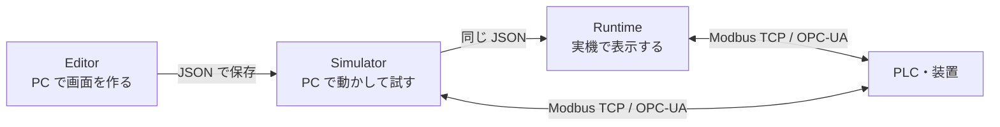
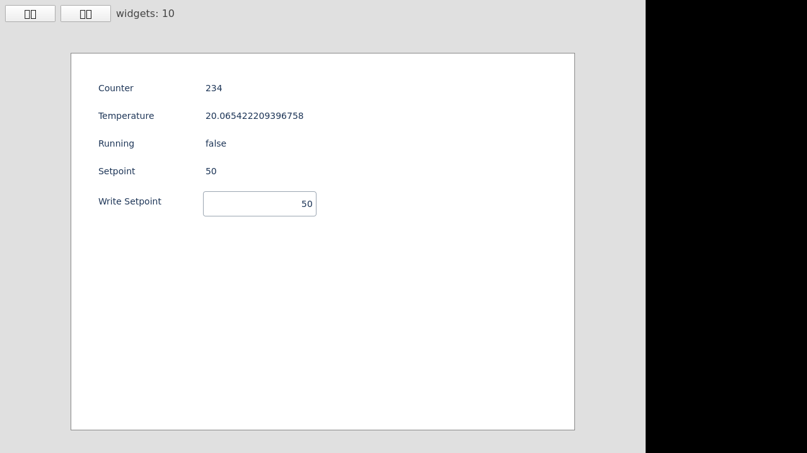

# hmi-platform（Atlas）

**PLC や装置の操作画面（HMI）を、PC で作って試し、そのまま組込み Linux の実機に載せる。** そのための作画ツールと実行環境です。

専用の HMI 作画ソフトや操作パネルが無くても、Modbus TCP や OPC-UA でつながる機器の画面を作れます。画面は 1 つの JSON ファイルで、PC でも実機でも同じものが動きます。

本体は [MIT License](LICENSE) で、無料で使えます。土台の Qt は LGPL などのライセンスなので、製品に組み込んで配るときの条件は [THIRD_PARTY_NOTICES.md](THIRD_PARTY_NOTICES.md) を見てください。


> **English**: Atlas (hmi-platform) is an HMI screen editor and runtime for embedded Linux with Qt 6. Design operator screens on your PC, test them with the Simulator, and run the same JSON on a device. Talks to PLCs and equipment over Modbus TCP and OPC-UA. Tested on NXP i.MX8M Plus EVK. MIT licensed (Qt itself is LGPL). Documentation is mainly in Japanese.

## こんなときに

- **試作機や検査装置に操作画面を付けたい**：Qt6 が動く Linux ボード（動作確認済みは i.MX8M Plus）に、ボタン・数値入力・グラフのある画面を載せる。
- **PLC の値を手元で見たい・動かしたい**：Modbus TCP や OPC-UA の機器につないで、値の表示と書き込みを PC 上で試す。
- **実機が届く前に画面を詰めたい**：同じ JSON を Simulator で動かし、ボタンや変数の動きを先に確かめる。

向かないこと：大規模な SCADA（多数の画面・履歴の保存・ユーザー管理）や、安全にかかわる制御の画面には、まだ使えません。

## 作ってから実機で動かすまで



| アプリ | 動く場所 | 役割 |
|---|---|---|
| **Editor** | PC（macOS / Windows / Linux） | Widget をドラッグ＆ドロップで置き、色や文字、変数とのつながりを設定する |
| **Simulator** | PC | 作った画面を動かし、ボタン・数値入力・通信の動きを確かめる |
| **Runtime** | Qt6 が動く組込み Linux（Yocto など） | 同じ画面を実機で表示する。動作確認済みの実機は NXP i.MX8M Plus EVK（Yocto scarthgap / Qt 6.8） |

## 5 分で試す

macOS の例です。Windows は下の「クイックスタート」を見てください。Qt 6.8 以上と CMake 3.21 以上が要ります。

```sh
brew install qt cmake
git clone https://github.com/hang-up33/hmi-platform.git && cd hmi-platform
# テストを省いてアプリだけビルドする（早く終わる）
cmake -S . -B build -DCMAKE_PREFIX_PATH=/opt/homebrew/opt/qt -DBUILD_TESTING=OFF -DHMI_ENABLE_E2E=OFF
cmake --build build
# 上の画面（装置の監視画面のサンプル）を Simulator で開く
./build/Simulator/hmi_simulator.app/Contents/MacOS/hmi_simulator --open Docs/samples/atlas-dashboard-demo.json
```

開けたら、次を試してみてください。

1. **Editor で開いて動かす**：`./build/Editor/hmi_editor.app/Contents/MacOS/hmi_editor --open Docs/samples/atlas-dashboard-demo.json` で開き、Widget をドラッグしたり色を変えたりする。
2. **変数の動きを見る**：Simulator で START / STOP / AUTO を押したり TARGET RATE を書き換えたりして、ツールバーの「変数」で値が変わるのを見る。
3. **ほかのサンプルを開く**：[Docs/samples/](Docs/samples/) に、Widget ごとの小さなサンプルがあります。

**通信を試すとき**

- **OPC-UA**：テスト用サーバ `scripts/opcua/test_server.py` を使えば、PC だけで試せます。`pip install asyncua` のあとサーバを起動し、`Docs/samples/opcua-demo.json` を開くと値が動きます。
  - ただし Qt の OPC-UA モジュール（qtopcua）が別に要ります。Homebrew の Qt には入っていないので、導入手順は [.claude/rules/dev-environment.md](.claude/rules/dev-environment.md) を見てください。
- **Modbus TCP**：実際の PLC が要ります。`Docs/samples/mb-3-click-plc-demo.json` の接続先（`192.168.0.10`）を、手元の PLC のアドレスに書き換えて開いてください。

> **開発コードネーム: Atlas**（天空を支える巨神 ＝ 各モジュールを束ねる基盤の意）。正式なリポジトリ名は `hmi-platform` です。

---

## 画面イメージ

### Editor（作画ツール）

上の GIF は、Editor で装置の監視画面を組み上げていく様子です。

- **キャンバス操作**：Widget の追加、ドラッグ＆ドロップでの配置、リサイズ、グリッドスナップ、コピー・貼り付け、元に戻す・やり直しに対応します。
- **インスペクタ**：背景色・文字色・フォント・角丸・枠・透明度、クリックしたときの動作、変数とのつながりを編集します。
- **サンプルパレット**：見た目そのままのサンプルを、キャンバスへドラッグして追加します。

### Simulator（試験環境）


- **動きの確認**：Editor で作った JSON をそのまま読み込み、ボタン操作・数値入力・変数に連動する表示・トレンドグラフを PC 上で確かめます。
- **変数の確認**：ツールバーの「変数」で、動いている間の変数の値を一覧できます。

### Runtime（実機）



---

## 主な機能と対応 Widget

### 対応 Widget 種別
- **Button / SimpleButton**: タッチ / クリック操作、状態別スタイル、変数操作アクション
- **Label**: テキスト表示、変数バインディングによる動的表示
- **NumericField**: 数値入力（int / real 対応、min/max 範囲クランプ）
- **Trend**: ライブ折れ線グラフ（単系列 / 複数系列、軸目盛り・凡例表示、QML Canvas 自描画）
- **Meter**: 車のスピードメーター風アーク＋針表示（範囲・色・目盛りカスタマイズ）

### 産業プロトコル・通信連携
- **Modbus TCP**: PLC レジスタ（Coil / Discrete / Input / Holding）の周期ポーリング & 書込
- **OPC-UA**: 産業用標準プロトコルによるタグ読込・書込・自動再接続

---

## 必要動作環境

- **Qt**: 6.8 以上（macOS / Windows / Linux / Yocto）
  - 必須モジュール：Qt Quick、Qt Serial Bus / Serial Port（Modbus 用）
  - 任意：Qt OPC UA（OPC-UA 用。無ければ OPC-UA 抜きでビルドされる）
  - Linux で必要なパッケージは、Web 開発用のセットアップ [scripts/web/setup.sh](scripts/web/setup.sh) が参考になります
- **CMake**: 3.21 以上
- **コンパイラ**: C++17 対応コンパイラ（Clang / GCC / MSVC / MinGW）

---

## クイックスタート（ビルドと実行）

### macOS

```sh
brew install qt
cmake -S . -B build -DCMAKE_PREFIX_PATH=/opt/homebrew/opt/qt
cmake --build build

# アプリ起動
./build/Editor/hmi_editor.app/Contents/MacOS/hmi_editor
./build/Simulator/hmi_simulator.app/Contents/MacOS/hmi_simulator
```

### Windows (PowerShell)

Qt Online Installer で **Qt 6.11.0 MinGW 64-bit** kit をインストール後:

```powershell
.\scripts\windows\build.ps1     # ビルド実行 → build-mingw\ に出力
.\build-mingw\hmi_editor.exe
.\build-mingw\hmi_simulator.exe
```

> **Note**: 新しい PowerShell シェルからは `. .\scripts\windows\setup-env.ps1` で環境変数を設定できます。詳細は [qt6-build スキル](.claude/skills/qt6-build/SKILL.md) を参照してください。

---

## プロジェクト構造 & データ形式

データモデルは `Shared/Schema` を唯一の真実とし、プロジェクト全体をシンプルフラットな JSON で表現します。

```json
{
  "project": "SampleProject",
  "screens": [
    {
      "name": "MainScreen",
      "widgets": [
        {
          "id": "btn001",
          "type": "Button",
          "x": 100,
          "y": 50,
          "width": 120,
          "height": 40,
          "text": "Start",
          "backgroundColor": "#e63946",
          "textColor": "#ffffff",
          "fontSize": 18
        }
      ]
    }
  ]
}
```

```text
hmi-platform/
├─ Editor/        作画アプリ（Qt6 + QML）
├─ Simulator/     試験アプリ（PC 用エミュレーション）
├─ Runtime/       実機用ランタイム（Simulator ソース共有・軽量化）
├─ Shared/
│   ├─ Schema/    JSON スキーマ・C++ データモデル（唯一の真実）
│   └─ Widgets/   共有 QML Widget ライブラリ
├─ Docs/          設計・開発ドキュメント
└─ CMakeLists.txt ルート CMake
```

---

## 組込み実機への展開（i.MX8M Plus / Yocto）

`hmi_runtime` を aarch64 向けにクロスビルドし、実機ボードへ転送して起動します。

```sh
# クロスビルド (WSL2 / Linux 環境)
./scripts/yocto/cross-build.sh
scp -O ~/build-yocto/Runtime/hmi_runtime root@<board-ip>:/tmp/hmi_runtime
```

実機環境での詳細な展開手順・Wayland/Weston 設定は [scripts/yocto/README.md](scripts/yocto/README.md) を参照してください。

---

## 開発の進め方

本プロジェクトは、Claude Code（Anthropic）でほぼすべてのコードを書き、ChatGPT Codex と CodeRabbit でレビューしながら開発しています。仕様・計画・ルールは `Docs/` と `.claude/` にあります。

---

## 開発ドキュメント

> 🗺️ **どの文書が人間向けで、どれが AI エージェント向けかは [DOCS-MAP.md](DOCS-MAP.md) にまとめています。**
> このリポジトリには Claude Code / Codex への指示ファイルが多数含まれるため、まず地図を見ると迷いません。

詳細な開発仕様、進捗状況、各種ガイドラインは `Docs/` 配下を参照してください。

- 🚀 **[フェーズ進捗・ステータス](Docs/phase-status.md)**: 現在の開発フェーズおよび完了機能の一覧
- 📐 **[アーキテクチャ概要](Docs/architecture.md)**: モジュール構成、CMake、データモデル設計
- 🔄 **[開発ワークフローとルール](Docs/workflow.md)**: PR 運用、コード規約、開発ルール
- 🔍 **[コードレビューガイドライン](Docs/agents/review-guidelines.md)**: PR レビュー観点・重要度定義
- 📜 **[開発経緯・PR 履歴](Docs/development-history.md)**: 過去のタスク達成履歴と技術的知見
- 📦 **[完了フェーズの計画書](Docs/archive/)**: 過去の実装指示書（現在の仕様書ではありません）

---

## 現在地

- **現在地**: **v1.0 を 2026-11-09 に MIT ライセンスの OSS として公開した**（[Release v1.0.0](https://github.com/hang-up33/hmi-platform/releases/tag/v1.0.0)）。次に何をやるかは、未承認の候補から決める。公開までの記録は [Docs/archive/v1-release-plan.md](Docs/archive/v1-release-plan.md)。
  - **契約→テスト→実装（DbC + テスト先行）の導入**：DT-1（計画とルール）完了。DT-2〜DT-6 は未着手で、始める時期はこれから決める。正本は [Docs/dbc-tdd-plan.md](Docs/dbc-tdd-plan.md)。
  - **リファクタリング計画（2026-07-22 承認）一区切り — RF-A / RF-B / RF-D / RF-E / RF-G 完了**。機能追加はせず、`Editor/qml/Main.qml` の肥大化（2,712→346 行）と型分岐の散在を解消した。RF-E〔Button / Label / SimpleButton の delegate を `Shared/Widgets` の型別ホスト QML へ集約〕と RF-G〔`InspectorPanel.qml` をセクション単位へ分割〕も v1.0 に含める。RF-E の残り種別と RF-F は保留。進捗の正本は [Docs/refactoring-plan.md](Docs/refactoring-plan.md)。
  - **Phase 11 / Widget サンプルパレット（ドラッグ&ドロップ追加）＋ 初号「シンプルボタン」完了（W-A〜W-E クローズ）**。issue #155「シンプル・イズ・ベスト版 HMI ボタン（ベゼル無し）」を新 Widget 種別 `SimpleButton`（`HmiSimpleButton.qml`）として QML で忠実再現し、**見た目そのままの Widget サンプルをインスペクタに並べてキャンバスへ D&D で追加**する汎用パレット UX を新設した（将来他 Widget もパレット化）。Canvas 自描画で新 Qt 依存ゼロ（Meter/Trend 同方針）。W-A〔Schema 拡張〕/ W-B〔HmiSimpleButton 描画 + delegate 6 分岐目〕/ W-C〔サンプルパレット〕/ W-D〔パレット→キャンバス D&D 追加〕/ W-E〔インスペクタ型対応（シンプルボタン詳細＝形状 / テーマ / 差し色 / 長押し時間）+ cross-app E2E `e2e_simple_button_live` + スクショ同期〕すべて完了（Web `ctest` 27/27 緑）。次フェーズは未承認候補から選定（自動着手しない）。進捗の正本は [Docs/archive/phase11-widget-palette-plan.md](Docs/archive/phase11-widget-palette-plan.md)。
  - **Phase 10 / メーター（Meter・車のスピードメーター風）完了**（M-A〜M-D クローズ）。新 Widget 種別「Meter」を横展開テンプレに乗せた（円弧＋針の QML `Canvas` 自描画で新 Qt モジュール依存ゼロ）。進捗の正本は [Docs/archive/phase10-meter-plan.md](Docs/archive/phase10-meter-plan.md)。
  - **Phase 9 / OPC-UA クライアント完了**（2026-06-27 OP-6 クローズ）。**OP-1〜OP-6 すべて完了**：OP-1〔Schema + Editor UI〕／OP-2〔PC 読込/購読〕／OP-3〔実サーバ読込確認〕／OP-4〔書込 + 接続状態 + 自動再接続〕／OP-5〔実サーバ書込確認〕／OP-6〔実機 Runtime 展開（i.MX8MP で OPC-UA ライブ値を VNC キャプチャで確認）〕。**🔴 Qt OpcUa は aqtinstall 非同梱＝Web/CI 不可。macOS / Windows / 実機（SDK 包含）ともに導入済み**（手順は [.claude/rules/dev-environment.md](.claude/rules/dev-environment.md)）。進捗の正本は [Docs/archive/phase9-opcua-plan.md](Docs/archive/phase9-opcua-plan.md)。
  - **Phase 8 / トレンドグラフ（単系列ライブ折れ線）完了**（2026-06-16 承認・PR #127〜#131）。新 Widget 種別「Trend」を横展開テンプレに乗せ、`Canvas` 自描画で実機にそのまま載る。進捗の正本は [Docs/archive/phase8-trend-plan.md](Docs/archive/phase8-trend-plan.md)。
  - **Phase 7 / Modbus TCP** は MB-1〜MB-4（書込 + 接続状態 + 自動再接続・PR #119/#121/#122）完了。残る MB-5〔実 PLC 書込確認〕/ MB-6〔実機 Yocto〕はローカル専用で Web 不可。進捗の正本は [Docs/phase7-modbus-plan.md](Docs/phase7-modbus-plan.md)。
- 開発の時系列（各タスクの目的 / PR / 学び）: [Docs/development-history.md](Docs/development-history.md)
- 各フェーズの計画と進捗表（正本）: 進行中は [Docs/](Docs/) の `phase*-plan.md`、完了済みは [Docs/archive/](Docs/archive/)
- 開発ガイド・ビルドの罠・ルール: [CLAUDE.md](CLAUDE.md)

## ライセンス

本プロジェクトは [MIT License](LICENSE) で公開しています。

Qt などの依存ライブラリは、それぞれのライセンスに従います。一覧と、Qt を使ったアプリを配布するときの注意は [THIRD_PARTY_NOTICES.md](THIRD_PARTY_NOTICES.md) にまとめています。
