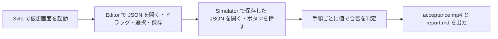

# 録画付き受け入れ試験

Editor と Simulator の主な流れを、仮想画面の上で実際に操作して確かめる。
操作中の画面を録画し、字幕入りの動画と、PR に貼る報告（report.md）を作る。



## 実行のしかた

```sh
cmake -S . -B build -DCMAKE_PREFIX_PATH=<Qt のインストール先>   # HMI_ENABLE_E2E は既定で ON
cmake --build build
python3 scripts/acceptance/run_acceptance.py \
    --editor-binary build/Editor/hmi_editor \
    --simulator-binary build/Simulator/hmi_simulator \
    --out build/acceptance
```

すべての手順が OK なら終了コード 0、1 つでも NG なら 1 を返す。
必要なツールが無いときや、出力先が不正なときは 2 を返す。

`--out` には専用のディレクトリを指定する。前回の出力は消してから作り直す。
リポジトリ直下やホームなど、ほかのファイルがある場所は拒否する。

## 必要なもの

| もの | 用途 |
|---|---|
| Linux と Xvfb | 仮想画面。Qt は xcb で動かすので、`libxcb-cursor0` などの xcb 系ライブラリも要る |
| xdotool | 本物のマウスでクリック・ドラッグする |
| ffmpeg（libass 付き） | 録画と、字幕・カーソルの印の焼き込み |
| 日本語フォント（Noto Sans CJK JP） | 字幕 |
| `HMI_ENABLE_E2E=ON` でビルドしたアプリ | 部品の位置を調べる・値を読む・保存する（Spix） |

## 出力

| ファイル | 中身 |
|---|---|
| `acceptance.mp4` | 録画。カーソルの位置に赤い輪が出る。ボタンを押している間は塗りつぶしの丸になる。字幕は上が期待値、下が結果 |
| `report.md` | 手順・期待結果・合否・動画の時刻・スクショの表 |
| `shots/*.png` | 手順ごとのスクショ |

## 判定のしかた

判定は 2 段で行う。

1. スクリプトが、プロパティや保存した JSON の値を機械的に確かめる。
2. 試験した人（Claude を含む）が、スクショと動画で表示の崩れや文字化けがないかを見て、report.md の「所見」欄を書く。

保存の手順だけは、ファイル選択画面を避けるため、Spix から `saveTo` を直接呼ぶ。
