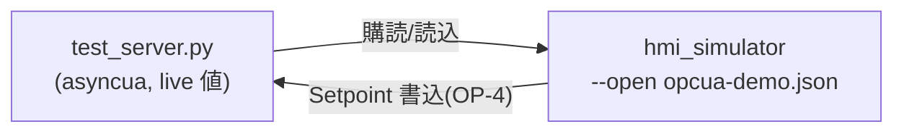

# 手動テスト用ソフト OPC-UA サーバ

実 PLC / 実 OPC-UA サーバが無くても、`hmi_simulator` / `hmi_runtime` の OPC-UA 読み書きを
ローカルで手動確認するための **asyncua ソフトサーバ**。OP-3（実サーバ読込確認）/ OP-4（書込）の
リハーサルに使う。E2E 用の `tests/e2e/opcua_server.py`（固定値 1 ノードの最小・自動テスト用）とは別。



## 公開ノード（既定 `ns=2` / セキュリティ None・匿名）

| NodeId | 型 | 動き |
|---|---|---|
| `ns=2;s=Demo.Counter` | Int32 | 周期ごとに +1 |
| `ns=2;s=Demo.Temperature` | Double | 25±5 の正弦波 |
| `ns=2;s=Demo.Running` | Boolean | 周期ごとに反転 |
| `ns=2;s=Demo.Setpoint` | Double | **書込可**（OP-4 用・書いた値を保持） |

## 使い方

```sh
# asyncua（Homebrew python3.14 は pyexpat 破損のため /usr/bin/python3 の venv 推奨）
/usr/bin/python3 -m venv /tmp/opcua-venv && /tmp/opcua-venv/bin/pip install asyncua

# サーバ起動（別マシン/実機から繋ぐ時は --host <実IP>）
/tmp/opcua-venv/bin/python scripts/opcua/test_server.py

# 別シェルで Simulator を起動（OPC-UA 込みでビルドされた hmi_simulator が要る＝OP-2）
./build/Simulator/hmi_simulator.app/Contents/MacOS/hmi_simulator --open Docs/samples/opcua-demo.json
```

Counter / Temperature / Running の Label がライブで動けば読込追従 OK。

**別マシン / 実機から繋ぐとき**は 2 箇所を実 IP に合わせる（両方必要）：
1. サーバ側：`python3 scripts/opcua/test_server.py --host <サーバ実IP>`（discovery で返す endpoint を実 IP に）。
2. クライアント側：`Docs/samples/opcua-demo.json` の `endpoint` を `opc.tcp://<サーバ実IP>:4840` に書き換える。

実機 i.MX8MP から繋ぐ場合は rootfs に qtopcua + open62541 backend が要る（＝OP-6）。

> Qt OPC-UA（qtopcua）は aqtinstall 非同梱。ローカル kit で OPC-UA 込みの `hmi_simulator` を
> ビルドする手順は [.claude/rules/dev-environment.md](../../.claude/rules/dev-environment.md)
> 「Qt OPC-UA を Homebrew Qt にマージ」。計画は [Docs/archive/phase9-opcua-plan.md](../../Docs/archive/phase9-opcua-plan.md)。
